# Backtest report: credit_losses

## Findings: Fed charge-off and delinquency rates, 7 loan types, 8-quarter one-shot, 36 quarterly origins 2015Q3..2024Q2 (+ live)

Relative MASE vs AutoARIMA (<1 = better; geometric mean over 14 series = 7 loan types x {charge-off, delinquency}):

| Model | h=1 | h=2 | h=4 | h=8 | Overall | 80% coverage |
|---|---|---|---|---|---|---|
| **Timestral joint (charge-off + delinquency together)** | 0.87 | 0.86 | 0.83 | 0.79 | **0.81** | 0.82 |
| Timestral + past macro | 0.90 | 0.89 | 0.85 | 0.79 | 0.82 | 0.85 |
| Timestral (univariate) | 0.92 | 0.91 | 0.87 | 0.83 | 0.85 | 0.81 |
| Random walk | 1.08 | 1.05 | 0.94 | 0.76 | 0.86 | 0.90 |
| Timestral + known unemployment & Baa spread | 1.12 | 1.16 | 1.24 | 1.11 | 1.14 | 0.83 |
| Timestral + known macro (6 vars) | 1.17 | 1.50 | 1.35 | 1.08 | 1.19 | 0.87 |
| ARIMAX + known unemployment & Baa spread | 2.07 | 1.93 | 1.60 | 1.30 | 1.49 | 0.87 |

- **Without covariates Timestral beats AutoARIMA by ~15%**, and forecasting each loan type's charge-off and delinquency
  jointly is best (0.81; significantly better than ARIMA on 21-29% of series per horizon, never worse). Biggest wins:
  all loans 0.50, CRE 0.73, credit cards 0.75, resi mortgages 0.83. AutoARIMA is a weak baseline here: even the random
  walk beats it at 8 quarters (0.76).
- **Surprise: a known macro path hurts** (1.19), the opposite of the bank-provisions result. The cause is COVID: unemployment
  hit 13% in 2020 but charge-offs *fell* (stimulus, forbearance), so any model that maps unemployment to losses badly
  overshoots (COVID-slice MASE 5.8 vs 2.8). ARIMAX is hurt most (6.3).
- **Excluding the 2019Q2-2020Q2 origins**, known macro is better than ARIMA (0.94) but still ~10% worse than plain Timestral;
  past macro is best overall (0.77).
- **Where macro does help: the 2022-23 normalisation.** With losses rising from record lows while unemployment stayed low,
  known macro gives the lowest error of any model in that window (MASE 1.12 vs 1.60 plain Timestral, 1.91 ARIMA).
- **Intervals:** Timestral 80% bands cover 81-87%, close to nominal; ARIMA's are wide (94%).

Caveats: known paths are realised values (a perfect-foresight scenario test). Aggregate all-bank rates, not a single
portfolio; 14 series and overlapping 8-quarter windows limit DM power. COVID is a structural break for macro-to-loss links.

---

# Full tables

- Series: 7 ids x 2 targets = 14
- Data: 1991-03-31 to 2026-06-30 (142 periods)
- Rolling origins: 36 (2015-09-30 .. 2024-06-30), one-shot direct horizon h=1..8
- Challenger `timestral_macro_known` vs baseline `arima`. MASE scale = in-sample naive (lag 1).

## Overall
| model | MAE | RMSE | MAPE | sMAPE | MASE | coverage80 | dir_acc | n |
|---|---|---|---|---|---|---|---|---|
| timestral_macro_past | 0.220 | 0.387 | 11.028 | 30.811 | 1.434 | 0.854 | 0.669 | 4032 |
| timestral_joint | 0.219 | 0.372 | 11.890 | 31.364 | 1.439 | 0.820 | 0.638 | 4032 |
| timestral | 0.230 | 0.389 | 12.227 | 31.798 | 1.482 | 0.808 | 0.633 | 4032 |
| naive | 0.245 | 0.417 | 14.344 | 32.774 | 1.548 | 0.903 |  | 4032 |
| arima | 0.274 | 0.455 | 15.769 | 35.358 | 1.709 | 0.935 | 0.612 | 4032 |
| timestral_unemp_known | 0.301 | 0.583 | 13.656 | 34.644 | 1.979 | 0.828 | 0.658 | 4032 |
| timestral_macro_known | 0.308 | 0.644 | 13.091 | 33.907 | 1.998 | 0.866 | 0.695 | 4032 |
| arimax_macro_known | 0.376 | 0.803 | 16.425 | 42.771 | 2.424 | 0.866 | 0.585 | 4032 |

## MASE by horizon (all series)
| h | naive | arima | timestral | timestral_joint | timestral_macro_past | timestral_macro_known | timestral_unemp_known | arimax_macro_known |
|---|---|---|---|---|---|---|---|---|
| 1 | 0.510 | 0.466 | 0.436 | 0.414 | 0.432 | 0.542 | 0.521 | 0.923 |
| 2 | 0.857 | 0.795 | 0.731 | 0.696 | 0.729 | 1.142 | 0.938 | 1.458 |
| 3 | 1.198 | 1.128 | 1.031 | 0.989 | 1.021 | 1.601 | 1.422 | 1.905 |
| 4 | 1.512 | 1.535 | 1.372 | 1.318 | 1.347 | 2.010 | 1.920 | 2.356 |
| 5 | 1.775 | 1.907 | 1.669 | 1.616 | 1.630 | 2.287 | 2.258 | 2.740 |
| 6 | 1.994 | 2.282 | 1.958 | 1.905 | 1.894 | 2.515 | 2.579 | 3.072 |
| 7 | 2.180 | 2.629 | 2.216 | 2.168 | 2.117 | 2.796 | 2.958 | 3.361 |
| 8 | 2.356 | 2.930 | 2.439 | 2.404 | 2.306 | 3.094 | 3.240 | 3.577 |

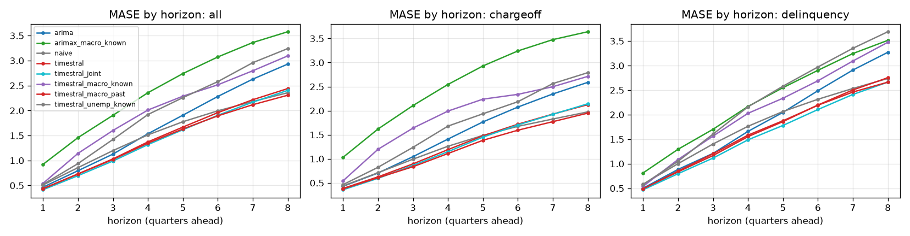

## Skill vs horizon
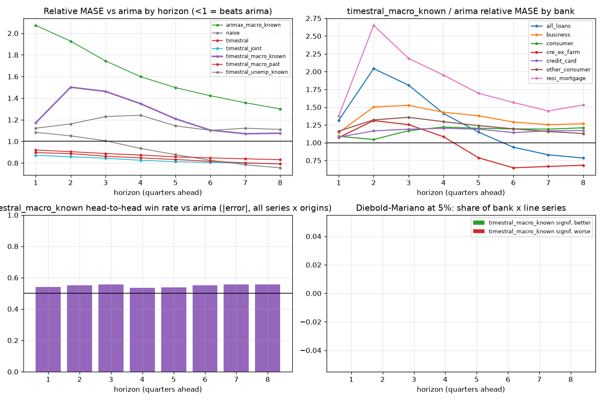

| h | arima | arimax_macro_known | naive | timestral | timestral_joint | timestral_macro_known | timestral_macro_past | timestral_unemp_known |
|---|---|---|---|---|---|---|---|---|
| 1 | 1.000 | 2.074 | 1.084 | 0.920 | 0.871 | 1.172 | 0.896 | 1.122 |
| 2 | 1.000 | 1.927 | 1.051 | 0.905 | 0.858 | 1.501 | 0.887 | 1.161 |
| 3 | 1.000 | 1.744 | 1.006 | 0.888 | 0.844 | 1.462 | 0.862 | 1.230 |
| 4 | 1.000 | 1.599 | 0.935 | 0.874 | 0.825 | 1.349 | 0.847 | 1.242 |
| 5 | 1.000 | 1.497 | 0.877 | 0.857 | 0.813 | 1.209 | 0.832 | 1.144 |
| 6 | 1.000 | 1.422 | 0.826 | 0.847 | 0.805 | 1.104 | 0.816 | 1.102 |
| 7 | 1.000 | 1.358 | 0.784 | 0.839 | 0.798 | 1.071 | 0.802 | 1.121 |
| 8 | 1.000 | 1.301 | 0.756 | 0.830 | 0.793 | 1.076 | 0.791 | 1.111 |

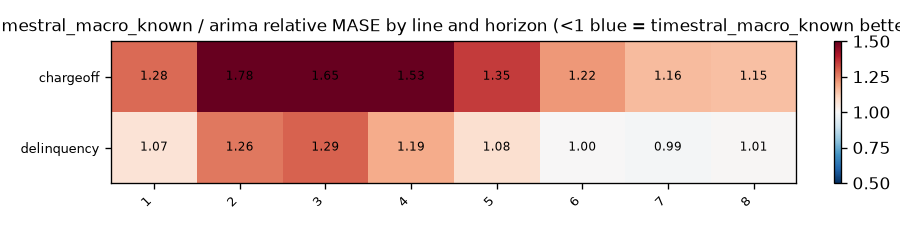

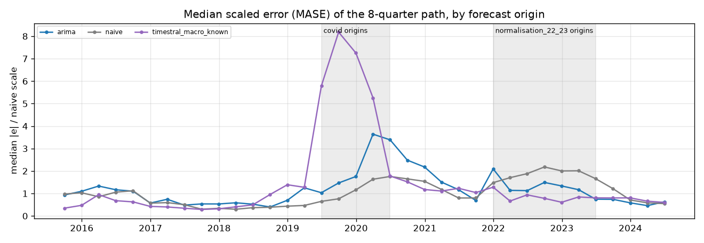

## Relative MASE vs baseline (geometric mean; <1 = better than baseline)
| model | rel_mase |
|---|---|
| timestral_joint | 0.810 |
| timestral_macro_past | 0.820 |
| timestral | 0.853 |
| naive | 0.855 |
| arima | 1.000 |
| timestral_unemp_known | 1.139 |
| timestral_macro_known | 1.190 |
| arimax_macro_known | 1.486 |

### By bank
| id | arima | arimax_macro_known | naive | timestral | timestral_joint | timestral_macro_known | timestral_macro_past | timestral_unemp_known |
|---|---|---|---|---|---|---|---|---|
| all_loans | 1.000 | 0.996 | 0.563 | 0.540 | 0.501 | 1.064 | 0.504 | 0.910 |
| business | 1.000 | 1.358 | 0.699 | 0.883 | 0.873 | 1.334 | 0.893 | 1.130 |
| consumer | 1.000 | 1.477 | 1.207 | 1.040 | 1.057 | 1.185 | 1.022 | 1.346 |
| cre_ex_farm | 1.000 | 1.596 | 0.620 | 0.872 | 0.728 | 0.816 | 0.716 | 0.787 |
| credit_card | 1.000 | 1.456 | 0.896 | 0.861 | 0.753 | 1.174 | 0.842 | 1.244 |
| other_consumer | 1.000 | 1.395 | 1.012 | 0.999 | 1.090 | 1.214 | 0.956 | 1.249 |
| resi_mortgage | 1.000 | 2.473 | 1.249 | 0.882 | 0.828 | 1.727 | 0.944 | 1.467 |

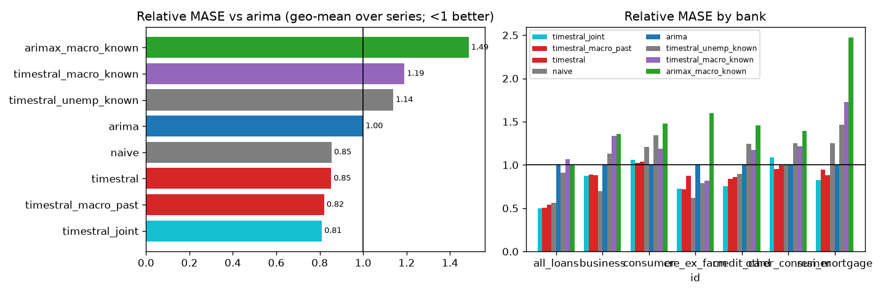

## Win rates (share of series where challenger beats baseline)
| id | MAE | MASE | RMSE | dir_acc | sMAPE |
|---|---|---|---|---|---|
| all_loans | 0% | 0% | 0% | 100% | 100% |
| business | 0% | 0% | 0% | 100% | 50% |
| consumer | 0% | 0% | 0% | 50% | 0% |
| cre_ex_farm | 100% | 100% | 0% | 100% | 100% |
| credit_card | 0% | 0% | 0% | 50% | 50% |
| other_consumer | 0% | 0% | 0% | 50% | 50% |
| resi_mortgage | 50% | 50% | 50% | 100% | 50% |

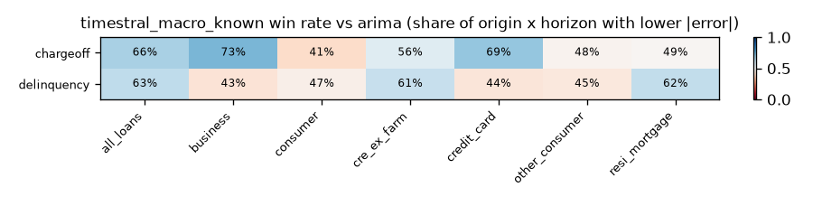

## Diebold-Mariano (squared error, HLN-corrected, per series and horizon)
Share of bank x target series where the challenger is significantly better / worse at 5%:

| h | better | worse |
|---|---|---|
| 1 | 0% | 0% |
| 2 | 0% | 0% |
| 3 | 0% | 0% |
| 4 | 0% | 0% |
| 5 | 0% | 0% |
| 6 | 0% | 0% |
| 7 | 0% | 0% |
| 8 | 0% | 0% |

## Stress slices (MASE)
| model | covid | normal | normalisation_22_23 |
|---|---|---|---|
| arima | 3.001 | 1.383 | 1.906 |
| arimax_macro_known | 6.342 | 1.751 | 1.932 |
| naive | 2.236 | 1.119 | 2.528 |
| timestral | 2.763 | 1.179 | 1.603 |
| timestral_joint | 2.824 | 1.139 | 1.477 |
| timestral_macro_known | 5.797 | 1.462 | 1.124 |
| timestral_macro_past | 3.132 | 1.097 | 1.379 |
| timestral_unemp_known | 4.827 | 1.582 | 1.309 |

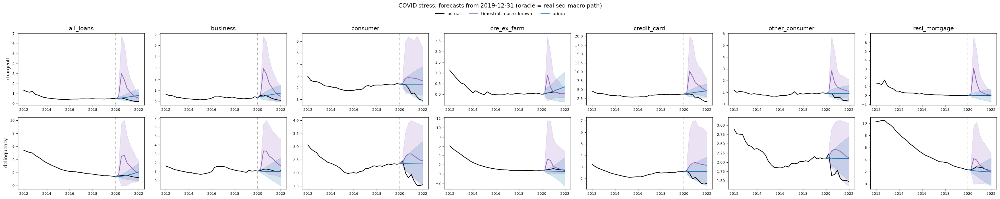

## Interval coverage (80%)
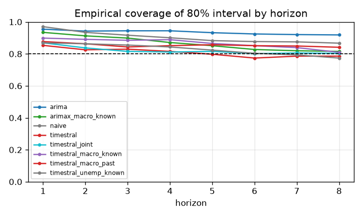

## Balance-sheet identity consistency
(none configured)

## Forecast fans

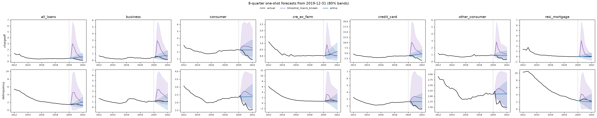
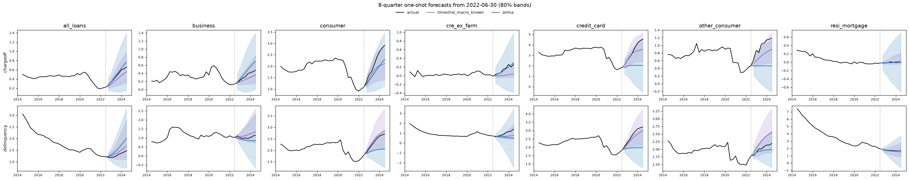
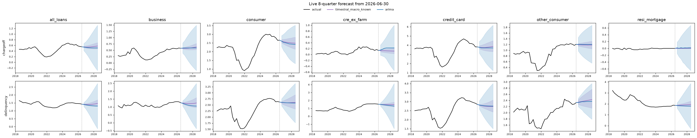

## Diebold-Mariano vs baseline, all models
Share of series significantly **better** than `arima` at 5% (squared error):

| h | arimax_macro_known | naive | timestral | timestral_joint | timestral_macro_known | timestral_macro_past | timestral_unemp_known |
|---|---|---|---|---|---|---|---|
| 1 | 0% | 0% | 7% | 21% | 0% | 14% | 0% |
| 2 | 0% | 0% | 7% | 14% | 0% | 21% | 0% |
| 3 | 0% | 0% | 14% | 14% | 0% | 21% | 0% |
| 4 | 0% | 7% | 21% | 29% | 0% | 29% | 0% |
| 5 | 0% | 7% | 21% | 21% | 0% | 29% | 0% |
| 6 | 0% | 7% | 21% | 21% | 0% | 29% | 0% |
| 7 | 0% | 14% | 21% | 21% | 0% | 29% | 0% |
| 8 | 7% | 7% | 14% | 21% | 0% | 29% | 0% |

Share significantly **worse**:

| h | arimax_macro_known | naive | timestral | timestral_joint | timestral_macro_known | timestral_macro_past | timestral_unemp_known |
|---|---|---|---|---|---|---|---|
| 1 | 0% | 14% | 0% | 0% | 0% | 0% | 0% |
| 2 | 0% | 0% | 0% | 0% | 0% | 0% | 0% |
| 3 | 0% | 0% | 0% | 0% | 0% | 0% | 0% |
| 4 | 0% | 0% | 0% | 0% | 0% | 0% | 0% |
| 5 | 0% | 0% | 0% | 0% | 0% | 0% | 0% |
| 6 | 0% | 0% | 0% | 7% | 0% | 0% | 7% |
| 7 | 0% | 0% | 0% | 7% | 0% | 0% | 0% |
| 8 | 0% | 0% | 0% | 0% | 0% | 0% | 7% |

## 80% interval coverage by line
| model | chargeoff | delinquency |
|---|---|---|
| arima | 0.947 | 0.923 |
| arimax_macro_known | 0.863 | 0.870 |
| naive | 0.935 | 0.871 |
| timestral | 0.777 | 0.840 |
| timestral_joint | 0.804 | 0.836 |
| timestral_macro_known | 0.839 | 0.893 |
| timestral_macro_past | 0.843 | 0.865 |
| timestral_unemp_known | 0.793 | 0.864 |

## Relative MASE vs `arima` by line
| target | arima | arimax_macro_known | naive | timestral | timestral_joint | timestral_macro_known | timestral_macro_past | timestral_unemp_known |
|---|---|---|---|---|---|---|---|---|
| chargeoff | 1.000 | 1.891 | 0.803 | 0.846 | 0.806 | 1.321 | 0.803 | 1.188 |
| delinquency | 1.000 | 1.168 | 0.910 | 0.860 | 0.814 | 1.072 | 0.838 | 1.092 |

### chargeoff: relative MASE by horizon
| h | arima | arimax_macro_known | naive | timestral | timestral_joint | timestral_macro_known | timestral_macro_past | timestral_unemp_known |
|---|---|---|---|---|---|---|---|---|
| 1 | 1.000 | 2.531 | 0.985 | 0.888 | 0.823 | 1.283 | 0.858 | 1.093 |
| 2 | 1.000 | 2.533 | 0.980 | 0.890 | 0.842 | 1.785 | 0.866 | 1.185 |
| 3 | 1.000 | 2.234 | 0.902 | 0.841 | 0.805 | 1.652 | 0.796 | 1.237 |
| 4 | 1.000 | 2.044 | 0.862 | 0.843 | 0.797 | 1.533 | 0.800 | 1.301 |
| 5 | 1.000 | 1.886 | 0.806 | 0.838 | 0.798 | 1.351 | 0.801 | 1.156 |
| 6 | 1.000 | 1.814 | 0.778 | 0.844 | 0.806 | 1.216 | 0.801 | 1.141 |
| 7 | 1.000 | 1.727 | 0.752 | 0.851 | 0.810 | 1.156 | 0.803 | 1.210 |
| 8 | 1.000 | 1.636 | 0.731 | 0.853 | 0.812 | 1.149 | 0.807 | 1.196 |

### delinquency: relative MASE by horizon
| h | arima | arimax_macro_known | naive | timestral | timestral_joint | timestral_macro_known | timestral_macro_past | timestral_unemp_known |
|---|---|---|---|---|---|---|---|---|
| 1 | 1.000 | 1.699 | 1.192 | 0.953 | 0.923 | 1.070 | 0.936 | 1.151 |
| 2 | 1.000 | 1.466 | 1.127 | 0.920 | 0.874 | 1.263 | 0.909 | 1.139 |
| 3 | 1.000 | 1.362 | 1.121 | 0.937 | 0.885 | 1.295 | 0.934 | 1.222 |
| 4 | 1.000 | 1.251 | 1.014 | 0.905 | 0.855 | 1.187 | 0.897 | 1.186 |
| 5 | 1.000 | 1.189 | 0.954 | 0.877 | 0.827 | 1.082 | 0.865 | 1.131 |
| 6 | 1.000 | 1.115 | 0.876 | 0.851 | 0.803 | 1.003 | 0.832 | 1.065 |
| 7 | 1.000 | 1.067 | 0.817 | 0.827 | 0.787 | 0.992 | 0.801 | 1.039 |
| 8 | 1.000 | 1.034 | 0.781 | 0.809 | 0.774 | 1.007 | 0.776 | 1.032 |

## How much does `timestral_macro_known` help vs `timestral`? (relative MASE, <1 = helps)
| target | rel_mase |
|---|---|
| chargeoff | 1.561 |
| delinquency | 1.247 |

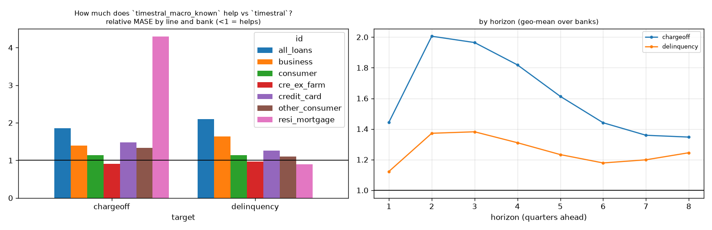

## How much does `timestral_unemp_known` help vs `timestral`? (relative MASE, <1 = helps)
| target | rel_mase |
|---|---|
| chargeoff | 1.405 |
| delinquency | 1.270 |

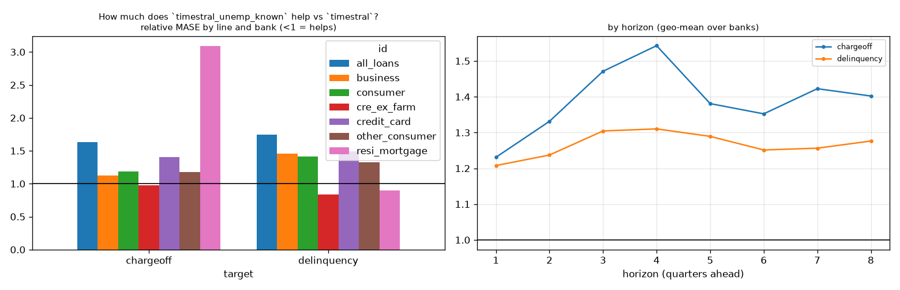

## How much does `timestral_macro_past` help vs `timestral`? (relative MASE, <1 = helps)
| target | rel_mase |
|---|---|
| chargeoff | 0.949 |
| delinquency | 0.975 |

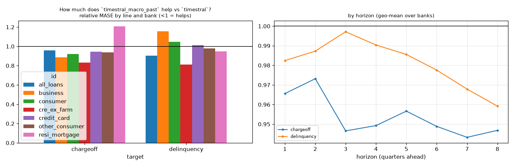

## How much does `timestral_joint` help vs `timestral`? (relative MASE, <1 = helps)
| target | rel_mase |
|---|---|
| chargeoff | 0.952 |
| delinquency | 0.947 |

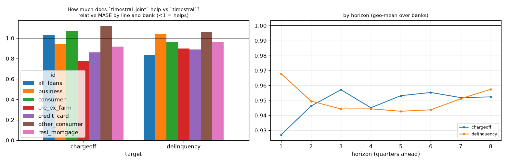

## How much does `timestral` help vs `arima`? (relative MASE, <1 = helps)
| target | rel_mase |
|---|---|
| chargeoff | 0.846 |
| delinquency | 0.860 |

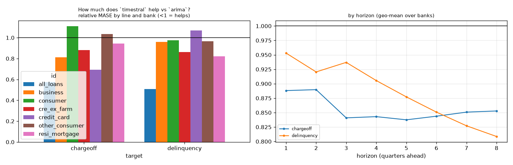

## How much does `arimax_macro_known` help vs `arima`? (relative MASE, <1 = helps)
| target | rel_mase |
|---|---|
| chargeoff | 1.891 |
| delinquency | 1.168 |

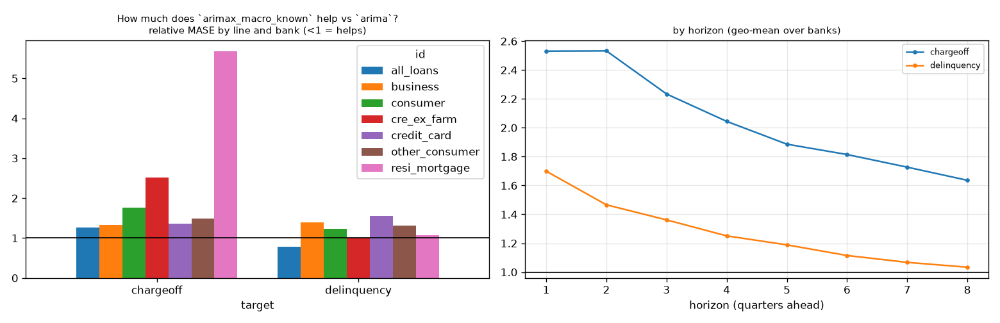

## Line x variant: relative MASE vs baseline
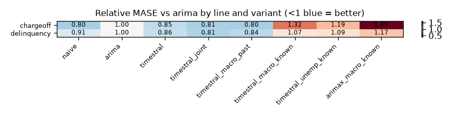

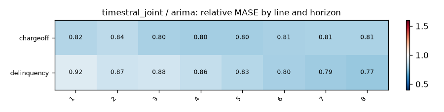
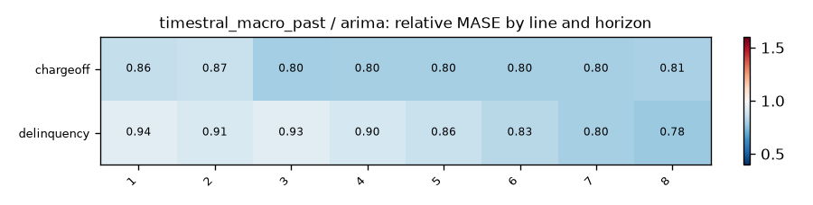
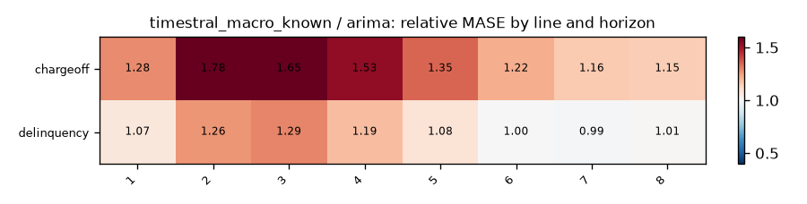
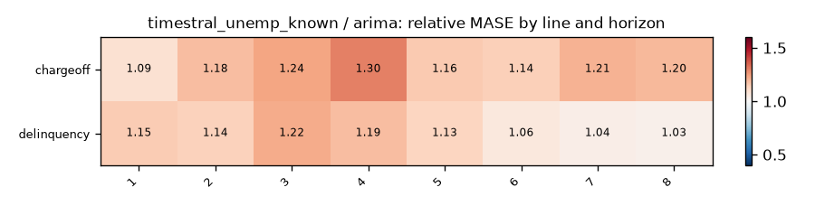

## Does macro help? (relative MASE of covariate variant vs its no-covariate twin; <1 = helps)
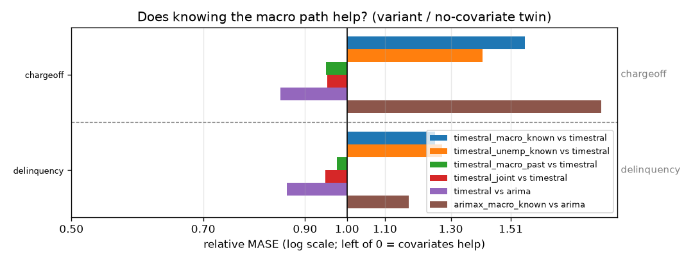

| target | timestral_macro_known vs timestral | timestral_unemp_known vs timestral | timestral_macro_past vs timestral | timestral_joint vs timestral | timestral vs arima | arimax_macro_known vs arima |
|---|---|---|---|---|---|---|
| chargeoff | 1.561 | 1.405 | 0.949 | 0.952 | 0.846 | 1.891 |
| delinquency | 1.247 | 1.270 | 0.975 | 0.947 | 0.860 | 1.168 |

## Spaghetti pages by group

- [chargeoff](figures/chargeoff/index.md) (1 lines)
- [delinquency](figures/delinquency/index.md) (1 lines)

## Relative MASE vs `arima` by series
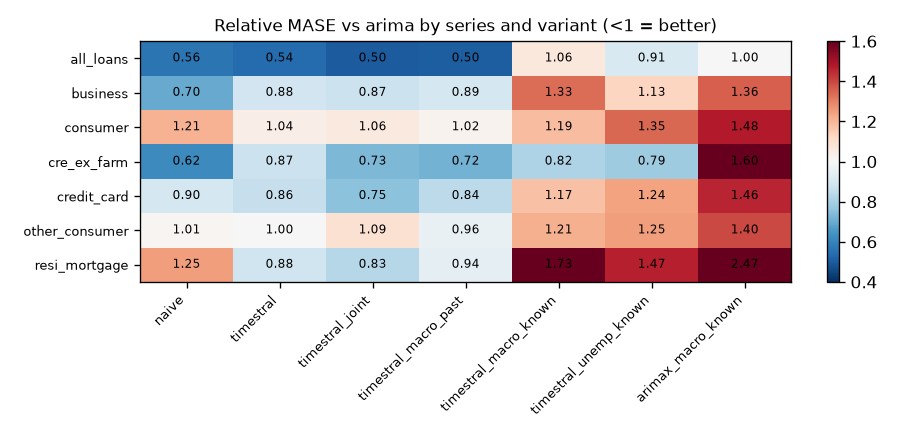

| id | naive | timestral | timestral_joint | timestral_macro_past | timestral_macro_known | timestral_unemp_known | arimax_macro_known |
|---|---|---|---|---|---|---|---|
| all_loans | 0.563 | 0.540 | 0.501 | 0.504 | 1.064 | 0.910 | 0.996 |
| business | 0.699 | 0.883 | 0.873 | 0.893 | 1.334 | 1.130 | 1.358 |
| consumer | 1.207 | 1.040 | 1.057 | 1.022 | 1.185 | 1.346 | 1.477 |
| cre_ex_farm | 0.620 | 0.872 | 0.728 | 0.716 | 0.816 | 0.787 | 1.596 |
| credit_card | 0.896 | 0.861 | 0.753 | 0.842 | 1.174 | 1.244 | 1.456 |
| other_consumer | 1.012 | 0.999 | 1.090 | 0.956 | 1.214 | 1.249 | 1.395 |
| resi_mortgage | 1.249 | 0.882 | 0.828 | 0.944 | 1.727 | 1.467 | 2.473 |

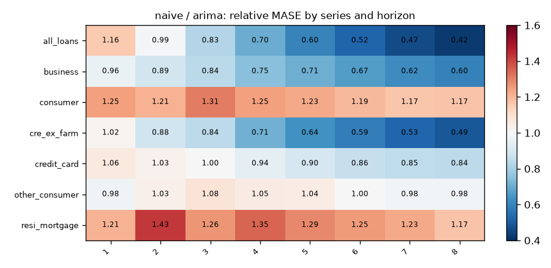
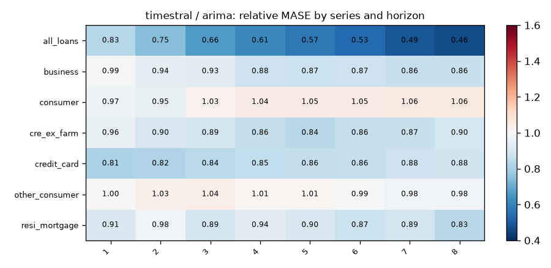
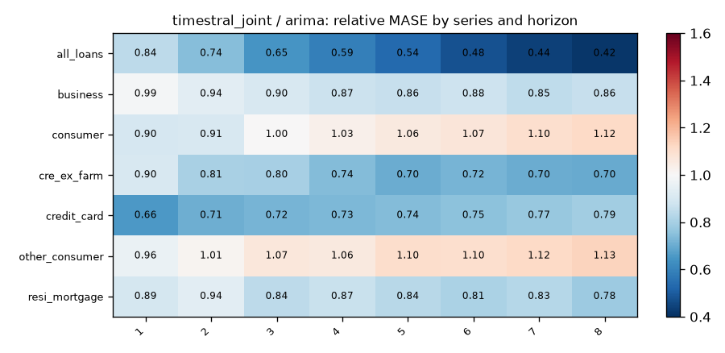
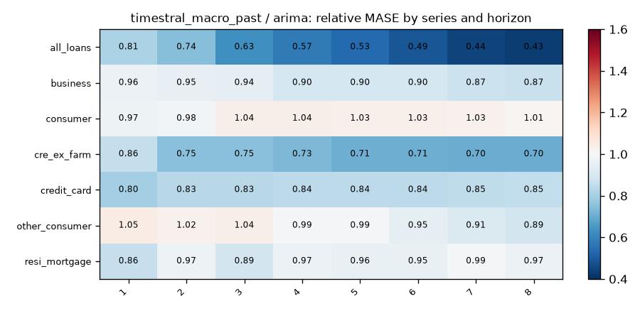
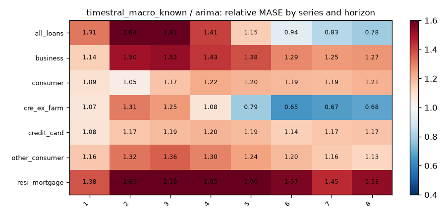
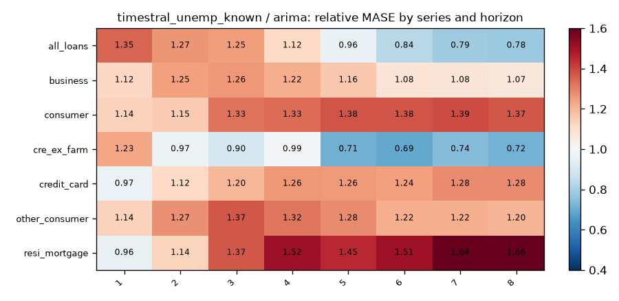
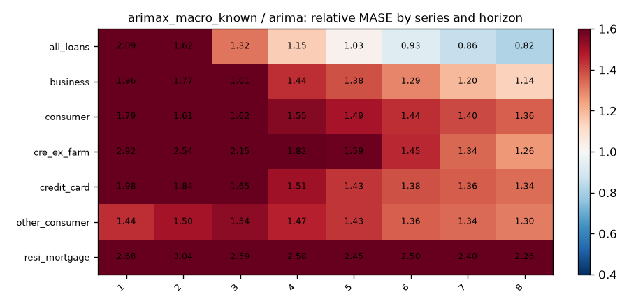
