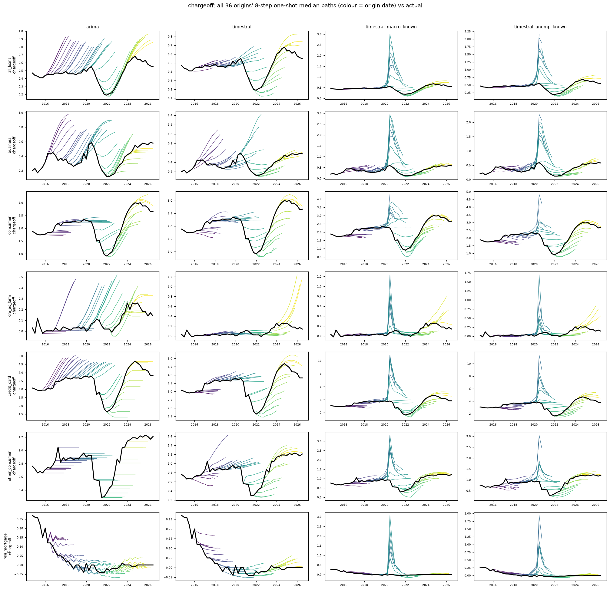

# chargeoff: all origins' 8-quarter median paths vs actual

Columns: arima | timestral | timestral_macro_known | timestral_unemp_known. Rows: banks. Colour = origin date; black = actual.

| target | naive | arima | timestral | timestral_joint | timestral_macro_past | timestral_macro_known | timestral_unemp_known | arimax_macro_known |
|---|---|---|---|---|---|---|---|---|
| chargeoff | 0.803 | 1.000 | 0.846 | 0.806 | 0.803 | 1.321 | 1.188 | 1.891 |

## chargeoff

