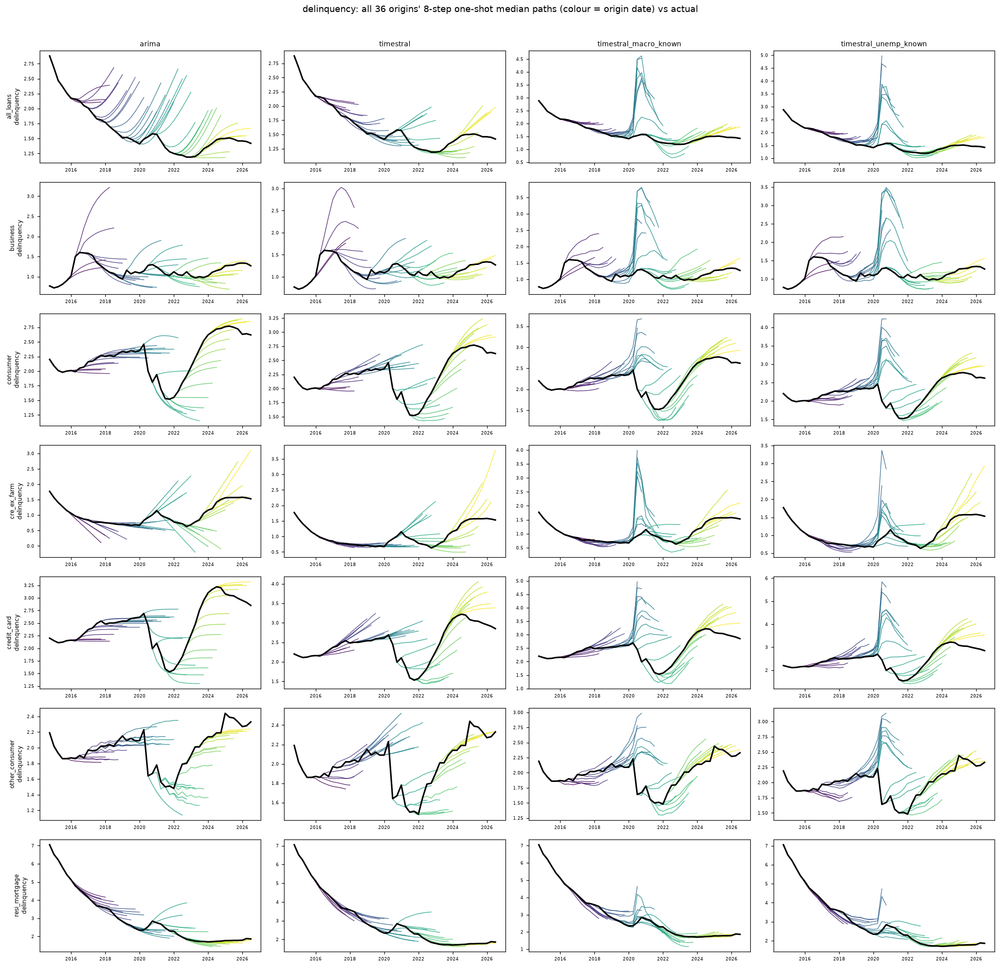

# delinquency: all origins' 8-quarter median paths vs actual

Columns: arima | timestral | timestral_macro_known | timestral_unemp_known. Rows: banks. Colour = origin date; black = actual.

| target | naive | arima | timestral | timestral_joint | timestral_macro_past | timestral_macro_known | timestral_unemp_known | arimax_macro_known |
|---|---|---|---|---|---|---|---|---|
| delinquency | 0.910 | 1.000 | 0.860 | 0.814 | 0.838 | 1.072 | 1.092 | 1.168 |

## delinquency

