# Backtest report: earnings

# Company earnings (SEC XBRL, 23 large S&P 500 non-financials): headline findings

Setup: quarterly revenue, operating margin, net income and diluted EPS, 2009Q2-2026Q2, 30 rolling origins (2017Q1-2024Q2),
each a one-shot 8-quarter forecast. Relative MASE = model MASE / AutoARIMA MASE (geometric mean over series; <1 = better).
MASE is scaled by the seasonal (lag-4) naive error.

| Model | h=1 | h=4 | h=8 | Overall | 80% coverage |
|---|---|---|---|---|---|
| **Timestral, no covariates** | **0.87** | **0.90** | **0.89** | **0.886** | 0.74 |
| Timestral + past macro | 0.88 | 0.91 | 0.90 | 0.899 | 0.78 |
| Timestral + known-future macro | 0.90 | 0.97 | 1.00 | 0.969 | 0.82 |
| AutoETS | 0.98 | 0.99 | 0.97 | 0.972 | 0.71 |
| AutoARIMA (baseline) | 1 | 1 | 1 | 1 | 0.69 |
| Seasonal naive | 1.37 | 1.03 | 1.01 | 1.096 | 0.69 |

- Plain Timestral beats AutoARIMA by ~11% at every horizon; Diebold-Mariano: significantly better on 13% of series at h=1
  and h=8, significantly worse on 0-5%.
- Best by line: net income 0.84, EPS 0.85, operating margin 0.87; revenue only 0.98 (revenue is smooth, ARIMA does fine).
- Best companies: VZ 0.67, PG 0.71, CAT 0.77, NEE 0.77, MCD 0.78, CSCO 0.79. No edge on NVDA/AAPL/AMZN/INTC (~1.0), worse on UNH 1.05.
- **Known-future macro (GDP, nominal GDP, CPI, 10y, fed funds, unemployment) hurts**: 0.969 vs 0.886, worse at long horizons.
  Firm earnings are driven by company-specific factors; tying them to macro adds noise. It does help cyclicals: CAT 0.67 vs 0.77.
  Macro does make the bands better calibrated (82% vs 74% for 80% intervals).
- Known-future macro = realised macro path, i.e. a scenario-conditional test, not a real-time forecast.
- **Analyst consensus: not included** - no free historical consensus series was found/used; no comparison is invented.
- Data notes: Q4 = FY minus Q1-Q3 (approximate for EPS); fiscal quarters mapped to calendar quarters by period midpoint.
  Dropped: NKE, PFE, MRK (no OperatingIncomeLoss tag), JNJ, HON (sparse), LIN, GOOGL, DIS (new CIK, <50 quarters),
  COST (12/12/12/16-week quarters collide in calendar mapping).

Best plots: `figures/fundamentals/spaghetti_net_income.png`, `figures/relmase_line_x_variant.png`, `figures/macro_helps_by_line.png`.

---

# Full tables

- Series: 23 ids x 4 targets = 92
- Data: 2009-06-30 to 2026-06-30 (69 periods)
- Rolling origins: 30 (2017-03-31 .. 2024-06-30), one-shot direct horizon h=1..8
- Challenger `timestral` vs baseline `arima`. MASE scale = in-sample naive (lag 4).

## Overall
| model | MAE | RMSE | MAPE | sMAPE | MASE | coverage80 | dir_acc | n |
|---|---|---|---|---|---|---|---|---|
| timestral | 1.325 | 3.421 | 12.915 | 29.457 | 1.684 | 0.738 | 0.669 | 22064 |
| timestral_macro_past | 1.299 | 3.308 | 12.926 | 29.913 | 1.697 | 0.777 | 0.656 | 22064 |
| ets | 1.387 | 3.462 | 15.519 | 33.476 | 1.788 | 0.714 | 0.659 | 22064 |
| arima | 1.396 | 3.507 | 16.462 | 33.980 | 1.834 | 0.688 | 0.644 | 22064 |
| timestral_macro_known | 1.485 | 3.958 | 14.300 | 32.746 | 1.859 | 0.822 | 0.639 | 22064 |
| seasonal_naive | 1.893 | 4.930 | 15.441 | 36.007 | 2.051 | 0.694 | 0.645 | 22064 |

## MASE by horizon (all series)
| h | seasonal_naive | arima | ets | timestral | timestral_macro_past | timestral_macro_known |
|---|---|---|---|---|---|---|
| 1 | 1.697 | 1.274 | 1.232 | 1.092 | 1.110 | 1.143 |
| 2 | 1.754 | 1.480 | 1.448 | 1.329 | 1.345 | 1.426 |
| 3 | 1.797 | 1.648 | 1.601 | 1.504 | 1.511 | 1.610 |
| 4 | 1.753 | 1.705 | 1.673 | 1.568 | 1.584 | 1.716 |
| 5 | 2.244 | 1.931 | 1.859 | 1.757 | 1.772 | 1.948 |
| 6 | 2.311 | 2.085 | 2.019 | 1.926 | 1.933 | 2.150 |
| 7 | 2.383 | 2.210 | 2.157 | 2.067 | 2.078 | 2.343 |
| 8 | 2.472 | 2.342 | 2.315 | 2.236 | 2.242 | 2.543 |

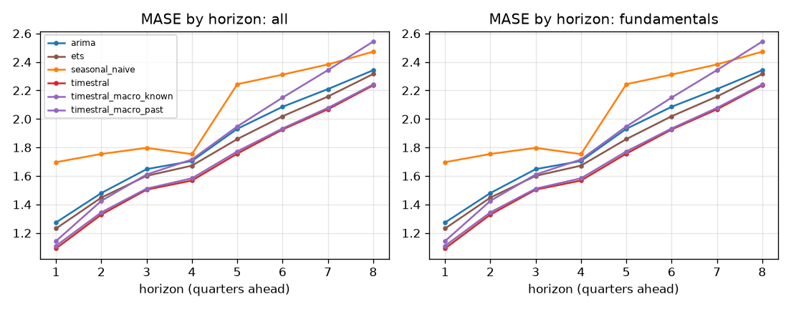

## Skill vs horizon
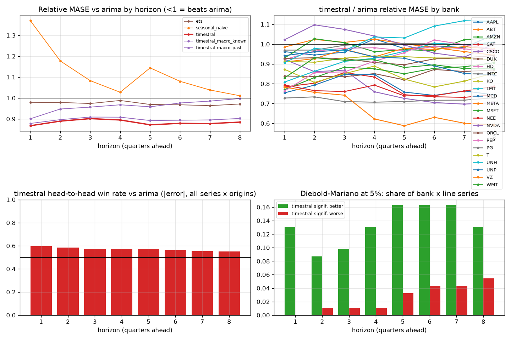

| h | arima | ets | seasonal_naive | timestral | timestral_macro_known | timestral_macro_past |
|---|---|---|---|---|---|---|
| 1 | 1.000 | 0.979 | 1.370 | 0.867 | 0.901 | 0.878 |
| 2 | 1.000 | 0.979 | 1.177 | 0.889 | 0.947 | 0.897 |
| 3 | 1.000 | 0.974 | 1.083 | 0.901 | 0.956 | 0.909 |
| 4 | 1.000 | 0.988 | 1.028 | 0.895 | 0.968 | 0.908 |
| 5 | 1.000 | 0.969 | 1.144 | 0.872 | 0.958 | 0.892 |
| 6 | 1.000 | 0.968 | 1.080 | 0.879 | 0.976 | 0.894 |
| 7 | 1.000 | 0.963 | 1.038 | 0.878 | 0.985 | 0.895 |
| 8 | 1.000 | 0.971 | 1.011 | 0.885 | 0.998 | 0.902 |

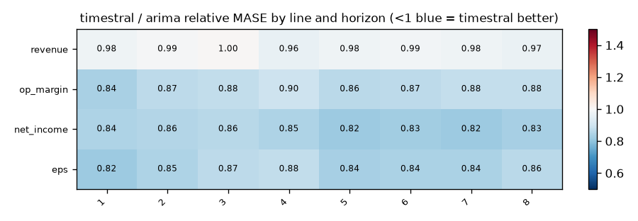

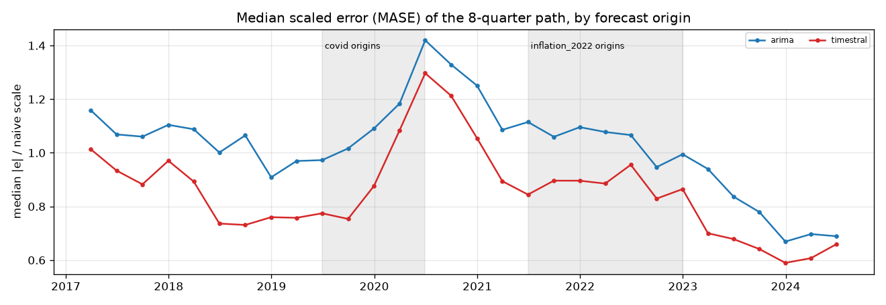

## Relative MASE vs baseline (geometric mean; <1 = better than baseline)
| model | rel_mase |
|---|---|
| timestral | 0.886 |
| timestral_macro_past | 0.899 |
| timestral_macro_known | 0.969 |
| ets | 0.972 |
| arima | 1.000 |
| seasonal_naive | 1.096 |

### By bank
| id | arima | ets | seasonal_naive | timestral | timestral_macro_known | timestral_macro_past |
|---|---|---|---|---|---|---|
| AAPL | 1.000 | 0.946 | 1.038 | 0.987 | 1.066 | 1.037 |
| ABT | 1.000 | 1.058 | 1.174 | 0.990 | 0.946 | 0.962 |
| AMZN | 1.000 | 1.005 | 1.282 | 0.994 | 1.132 | 0.915 |
| CAT | 1.000 | 0.817 | 0.927 | 0.768 | 0.667 | 0.764 |
| CSCO | 1.000 | 0.927 | 1.036 | 0.791 | 0.890 | 0.824 |
| DUK | 1.000 | 0.928 | 1.041 | 0.848 | 0.906 | 0.920 |
| HD | 1.000 | 1.085 | 1.048 | 0.970 | 1.074 | 0.911 |
| INTC | 1.000 | 0.962 | 1.030 | 0.995 | 1.132 | 0.967 |
| KO | 1.000 | 0.958 | 0.916 | 0.833 | 0.862 | 0.834 |
| LMT | 1.000 | 1.028 | 1.130 | 0.943 | 1.071 | 0.928 |
| MCD | 1.000 | 0.834 | 0.921 | 0.779 | 0.880 | 0.870 |
| META | 1.000 | 0.939 | 1.256 | 0.950 | 1.164 | 0.958 |
| MSFT | 1.000 | 0.998 | 1.070 | 0.869 | 1.082 | 0.840 |
| NEE | 1.000 | 0.876 | 0.991 | 0.774 | 0.862 | 0.840 |
| NVDA | 1.000 | 0.999 | 1.146 | 1.012 | 1.102 | 1.026 |
| ORCL | 1.000 | 1.033 | 1.248 | 0.926 | 0.975 | 0.953 |
| PEP | 1.000 | 0.970 | 1.184 | 0.924 | 0.952 | 0.934 |
| PG | 1.000 | 0.997 | 1.012 | 0.712 | 0.835 | 0.758 |
| T | 1.000 | 0.970 | 1.286 | 0.926 | 0.955 | 0.932 |
| UNH | 1.000 | 1.045 | 1.639 | 1.045 | 1.295 | 1.089 |
| UNP | 1.000 | 1.085 | 0.978 | 0.921 | 0.946 | 0.908 |
| VZ | 1.000 | 1.016 | 0.937 | 0.666 | 0.746 | 0.684 |
| WMT | 1.000 | 0.944 | 1.150 | 0.900 | 0.979 | 0.942 |

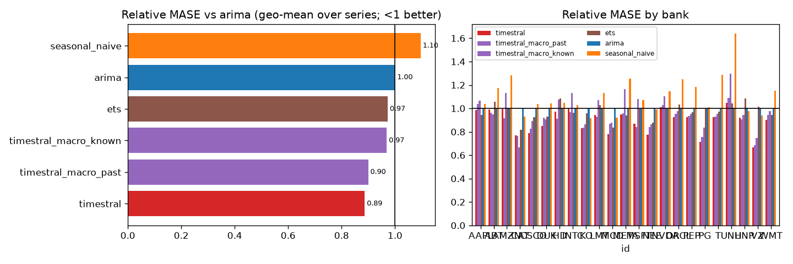

## Win rates (share of series where challenger beats baseline)
| id | MAE | MASE | RMSE | dir_acc | sMAPE |
|---|---|---|---|---|---|
| AAPL | 75% | 75% | 75% | 25% | 75% |
| ABT | 75% | 75% | 75% | 50% | 75% |
| AMZN | 75% | 50% | 100% | 25% | 50% |
| CAT | 100% | 100% | 100% | 100% | 100% |
| CSCO | 100% | 100% | 100% | 100% | 100% |
| DUK | 100% | 100% | 75% | 75% | 100% |
| HD | 75% | 75% | 100% | 75% | 50% |
| INTC | 25% | 50% | 50% | 50% | 75% |
| KO | 100% | 100% | 100% | 75% | 100% |
| LMT | 75% | 75% | 75% | 50% | 75% |
| MCD | 100% | 100% | 100% | 100% | 100% |
| META | 75% | 75% | 75% | 75% | 75% |
| MSFT | 75% | 75% | 75% | 75% | 75% |
| NEE | 75% | 75% | 75% | 75% | 75% |
| NVDA | 25% | 25% | 25% | 50% | 25% |
| ORCL | 50% | 75% | 75% | 50% | 75% |
| PEP | 75% | 75% | 75% | 75% | 75% |
| PG | 100% | 100% | 100% | 100% | 100% |
| T | 75% | 75% | 50% | 50% | 100% |
| UNH | 0% | 0% | 0% | 25% | 0% |
| UNP | 75% | 75% | 75% | 0% | 75% |
| VZ | 100% | 100% | 100% | 100% | 100% |
| WMT | 75% | 75% | 75% | 75% | 75% |

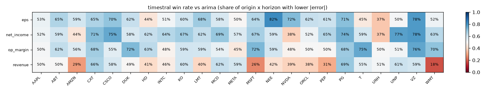

## Diebold-Mariano (squared error, HLN-corrected, per series and horizon)
Share of bank x target series where the challenger is significantly better / worse at 5%:

| h | better | worse |
|---|---|---|
| 1 | 13% | 0% |
| 2 | 9% | 1% |
| 3 | 10% | 1% |
| 4 | 13% | 1% |
| 5 | 16% | 3% |
| 6 | 16% | 4% |
| 7 | 16% | 4% |
| 8 | 13% | 5% |

## Stress slices (MASE)
| model | covid | inflation_2022 | normal |
|---|---|---|---|
| arima | 1.910 | 1.898 | 1.788 |
| ets | 1.900 | 1.851 | 1.732 |
| seasonal_naive | 2.009 | 2.025 | 2.073 |
| timestral | 1.772 | 1.726 | 1.644 |
| timestral_macro_known | 2.211 | 1.824 | 1.775 |
| timestral_macro_past | 1.851 | 1.729 | 1.641 |

## Interval coverage (80%)
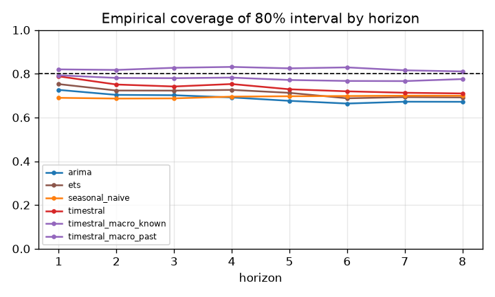

## Balance-sheet identity consistency
(none configured)

## Forecast fans

## Diebold-Mariano vs baseline, all models
Share of series significantly **better** than `arima` at 5% (squared error):

| h | ets | seasonal_naive | timestral | timestral_macro_known | timestral_macro_past |
|---|---|---|---|---|---|
| 1 | 2% | 0% | 13% | 7% | 9% |
| 2 | 3% | 1% | 9% | 4% | 5% |
| 3 | 3% | 1% | 10% | 7% | 11% |
| 4 | 3% | 4% | 13% | 15% | 14% |
| 5 | 9% | 2% | 16% | 10% | 11% |
| 6 | 8% | 5% | 16% | 10% | 16% |
| 7 | 5% | 5% | 16% | 7% | 15% |
| 8 | 7% | 7% | 13% | 12% | 22% |

Share significantly **worse**:

| h | ets | seasonal_naive | timestral | timestral_macro_known | timestral_macro_past |
|---|---|---|---|---|---|
| 1 | 2% | 25% | 0% | 0% | 0% |
| 2 | 2% | 9% | 1% | 0% | 1% |
| 3 | 1% | 8% | 1% | 1% | 0% |
| 4 | 2% | 8% | 1% | 3% | 0% |
| 5 | 1% | 13% | 3% | 4% | 2% |
| 6 | 5% | 14% | 4% | 12% | 3% |
| 7 | 4% | 11% | 4% | 10% | 3% |
| 8 | 4% | 11% | 5% | 4% | 4% |

## 80% interval coverage by line
| model | eps | net_income | op_margin | revenue |
|---|---|---|---|---|
| arima | 0.680 | 0.631 | 0.781 | 0.662 |
| ets | 0.693 | 0.656 | 0.779 | 0.726 |
| seasonal_naive | 0.716 | 0.677 | 0.820 | 0.564 |
| timestral | 0.722 | 0.704 | 0.776 | 0.751 |
| timestral_macro_known | 0.806 | 0.788 | 0.846 | 0.847 |
| timestral_macro_past | 0.759 | 0.747 | 0.810 | 0.792 |

## Relative MASE vs `arima` by line
| target | arima | ets | seasonal_naive | timestral | timestral_macro_known | timestral_macro_past |
|---|---|---|---|---|---|---|
| eps | 1.000 | 0.982 | 1.049 | 0.853 | 0.953 | 0.883 |
| net_income | 1.000 | 0.967 | 1.054 | 0.845 | 0.931 | 0.867 |
| op_margin | 1.000 | 0.959 | 1.014 | 0.873 | 0.955 | 0.881 |
| revenue | 1.000 | 0.981 | 1.284 | 0.981 | 1.039 | 0.969 |

### eps: relative MASE by horizon
| h | arima | ets | seasonal_naive | timestral | timestral_macro_known | timestral_macro_past |
|---|---|---|---|---|---|---|
| 1 | 1.000 | 0.955 | 1.192 | 0.817 | 0.869 | 0.843 |
| 2 | 1.000 | 0.964 | 1.089 | 0.847 | 0.934 | 0.876 |
| 3 | 1.000 | 0.963 | 1.036 | 0.868 | 0.942 | 0.892 |
| 4 | 1.000 | 1.013 | 1.018 | 0.877 | 0.964 | 0.910 |
| 5 | 1.000 | 0.984 | 1.075 | 0.835 | 0.945 | 0.873 |
| 6 | 1.000 | 0.988 | 1.031 | 0.841 | 0.956 | 0.873 |
| 7 | 1.000 | 0.984 | 1.013 | 0.841 | 0.983 | 0.879 |
| 8 | 1.000 | 1.002 | 1.000 | 0.863 | 0.992 | 0.899 |

### net_income: relative MASE by horizon
| h | arima | ets | seasonal_naive | timestral | timestral_macro_known | timestral_macro_past |
|---|---|---|---|---|---|---|
| 1 | 1.000 | 0.973 | 1.227 | 0.844 | 0.882 | 0.860 |
| 2 | 1.000 | 0.977 | 1.120 | 0.855 | 0.920 | 0.870 |
| 3 | 1.000 | 0.963 | 1.051 | 0.861 | 0.920 | 0.877 |
| 4 | 1.000 | 0.965 | 1.009 | 0.845 | 0.912 | 0.868 |
| 5 | 1.000 | 0.962 | 1.078 | 0.819 | 0.911 | 0.850 |
| 6 | 1.000 | 0.961 | 1.040 | 0.827 | 0.943 | 0.854 |
| 7 | 1.000 | 0.965 | 1.009 | 0.820 | 0.937 | 0.846 |
| 8 | 1.000 | 0.968 | 0.993 | 0.833 | 0.954 | 0.864 |

### op_margin: relative MASE by horizon
| h | arima | ets | seasonal_naive | timestral | timestral_macro_known | timestral_macro_past |
|---|---|---|---|---|---|---|
| 1 | 1.000 | 0.982 | 1.174 | 0.839 | 0.873 | 0.851 |
| 2 | 1.000 | 0.968 | 1.067 | 0.869 | 0.939 | 0.875 |
| 3 | 1.000 | 0.964 | 1.025 | 0.879 | 0.942 | 0.887 |
| 4 | 1.000 | 0.990 | 0.992 | 0.897 | 0.989 | 0.905 |
| 5 | 1.000 | 0.961 | 1.031 | 0.865 | 0.954 | 0.881 |
| 6 | 1.000 | 0.946 | 0.980 | 0.870 | 0.960 | 0.879 |
| 7 | 1.000 | 0.937 | 0.963 | 0.880 | 0.969 | 0.885 |
| 8 | 1.000 | 0.952 | 0.950 | 0.882 | 0.985 | 0.883 |

### revenue: relative MASE by horizon
| h | arima | ets | seasonal_naive | timestral | timestral_macro_known | timestral_macro_past |
|---|---|---|---|---|---|---|
| 1 | 1.000 | 1.008 | 2.052 | 0.978 | 0.983 | 0.965 |
| 2 | 1.000 | 1.006 | 1.477 | 0.995 | 0.999 | 0.969 |
| 3 | 1.000 | 1.005 | 1.233 | 1.005 | 1.026 | 0.984 |
| 4 | 1.000 | 0.985 | 1.094 | 0.964 | 1.008 | 0.952 |
| 5 | 1.000 | 0.969 | 1.434 | 0.977 | 1.025 | 0.968 |
| 6 | 1.000 | 0.976 | 1.293 | 0.987 | 1.050 | 0.974 |
| 7 | 1.000 | 0.968 | 1.181 | 0.978 | 1.057 | 0.976 |
| 8 | 1.000 | 0.965 | 1.107 | 0.965 | 1.062 | 0.966 |

## How much does `timestral_macro_known` help vs `timestral`? (relative MASE, <1 = helps)
| target | rel_mase |
|---|---|
| eps | 1.117 |
| net_income | 1.102 |
| op_margin | 1.094 |
| revenue | 1.059 |

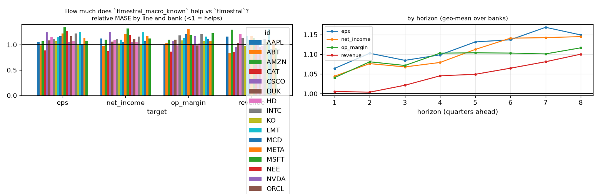

## How much does `timestral_macro_past` help vs `timestral`? (relative MASE, <1 = helps)
| target | rel_mase |
|---|---|
| eps | 1.035 |
| net_income | 1.027 |
| op_margin | 1.010 |
| revenue | 0.988 |

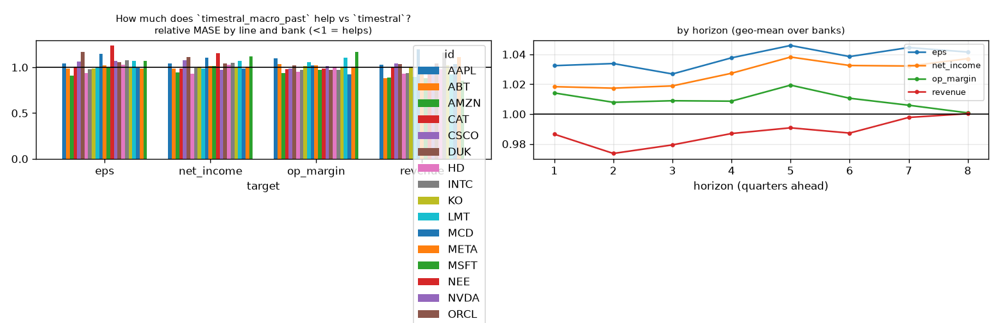

## How much does `timestral` help vs `arima`? (relative MASE, <1 = helps)
| target | rel_mase |
|---|---|
| eps | 0.853 |
| net_income | 0.845 |
| op_margin | 0.873 |
| revenue | 0.981 |

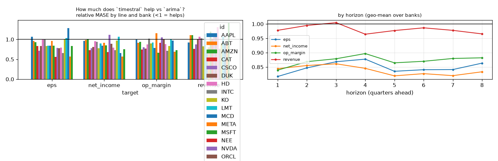

## Line x variant: relative MASE vs baseline
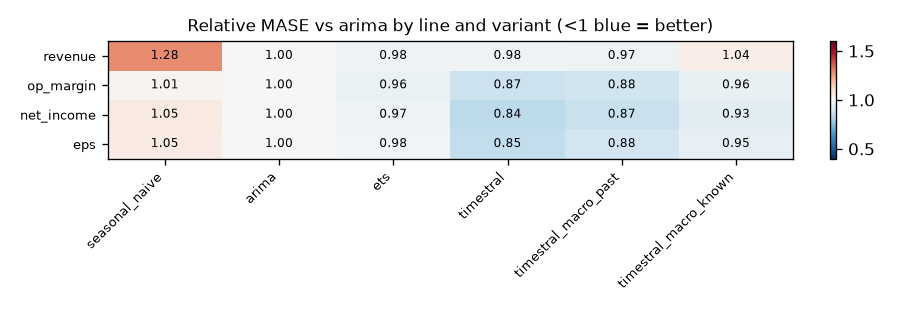

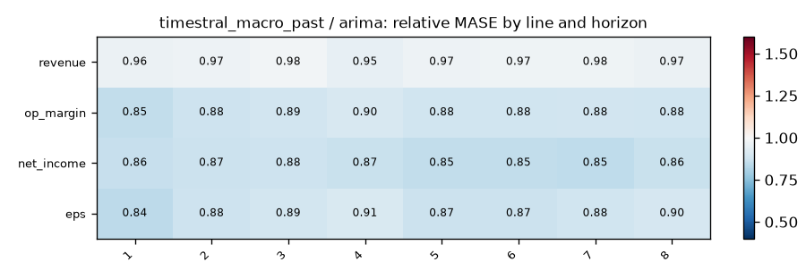
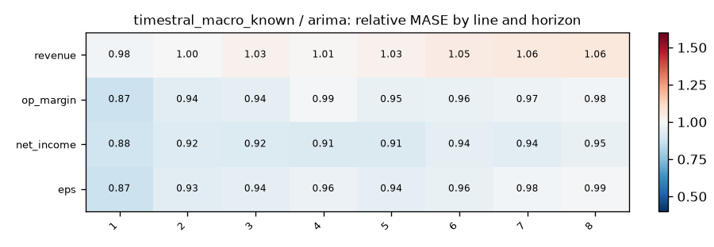

## Does macro help? (relative MASE of covariate variant vs its no-covariate twin; <1 = helps)
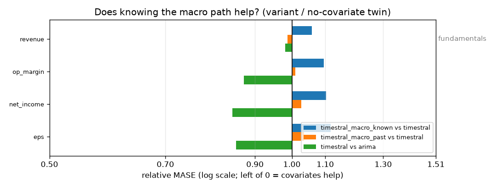

| target | timestral_macro_known vs timestral | timestral_macro_past vs timestral | timestral vs arima |
|---|---|---|---|
| revenue | 1.059 | 0.988 | 0.981 |
| op_margin | 1.094 | 1.010 | 0.873 |
| net_income | 1.102 | 1.027 | 0.845 |
| eps | 1.117 | 1.035 | 0.853 |

## Spaghetti pages by group

- [fundamentals](figures/fundamentals/index.md) (4 lines)
