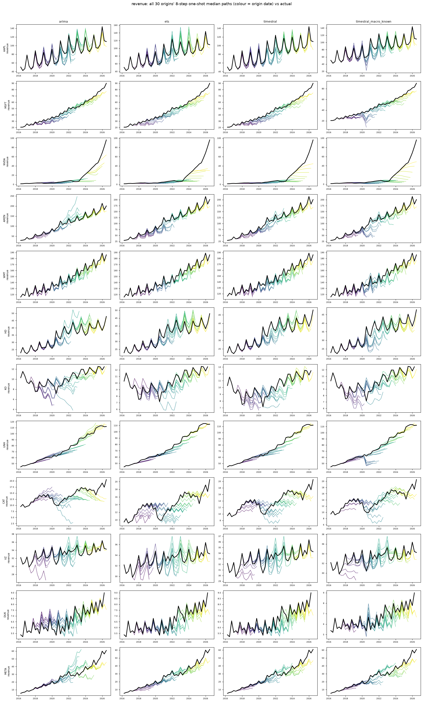
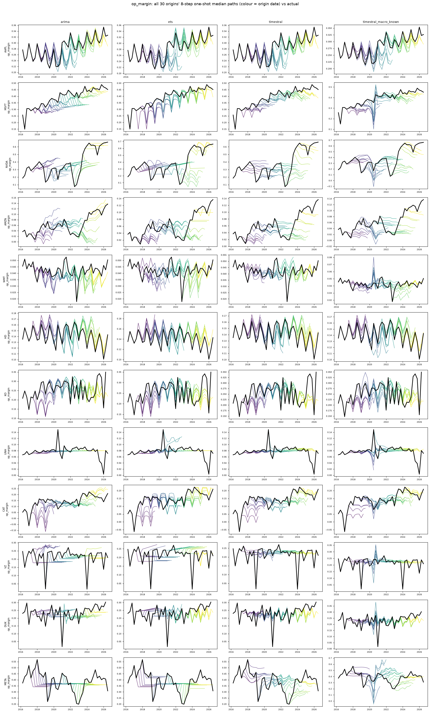
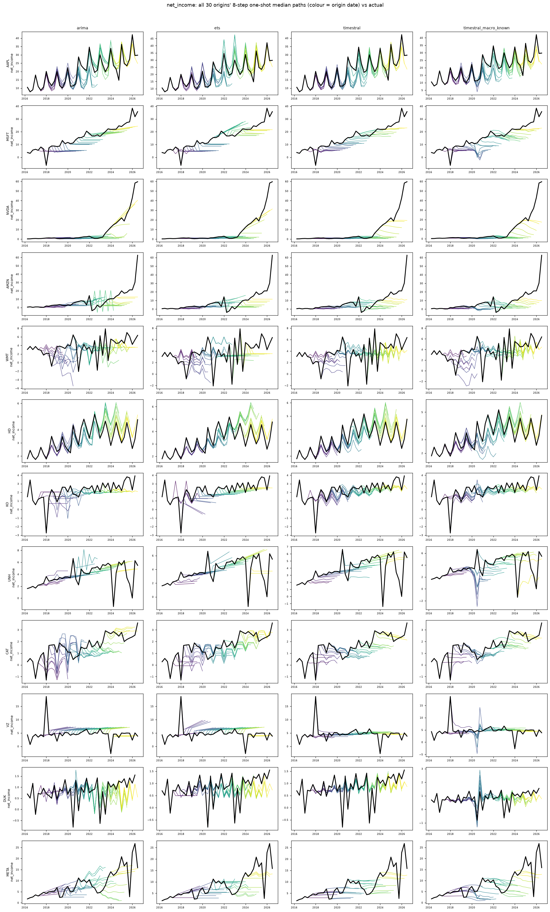
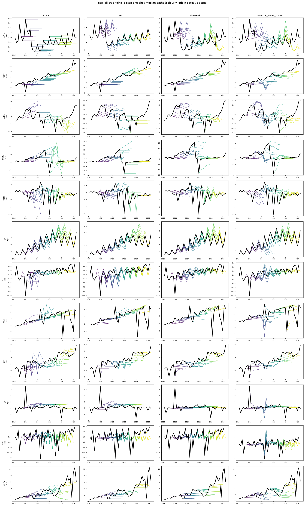

# fundamentals: all origins' 8-quarter median paths vs actual

Columns: arima | ets | timestral | timestral_macro_known. Rows: banks. Colour = origin date; black = actual.

| target | seasonal_naive | arima | ets | timestral | timestral_macro_past | timestral_macro_known |
|---|---|---|---|---|---|---|
| revenue | 1.284 | 1.000 | 0.981 | 0.981 | 0.969 | 1.039 |
| op_margin | 1.014 | 1.000 | 0.959 | 0.873 | 0.881 | 0.955 |
| net_income | 1.054 | 1.000 | 0.967 | 0.845 | 0.867 | 0.931 |
| eps | 1.049 | 1.000 | 0.982 | 0.853 | 0.883 | 0.953 |

## revenue

## op_margin

## net_income

## eps

