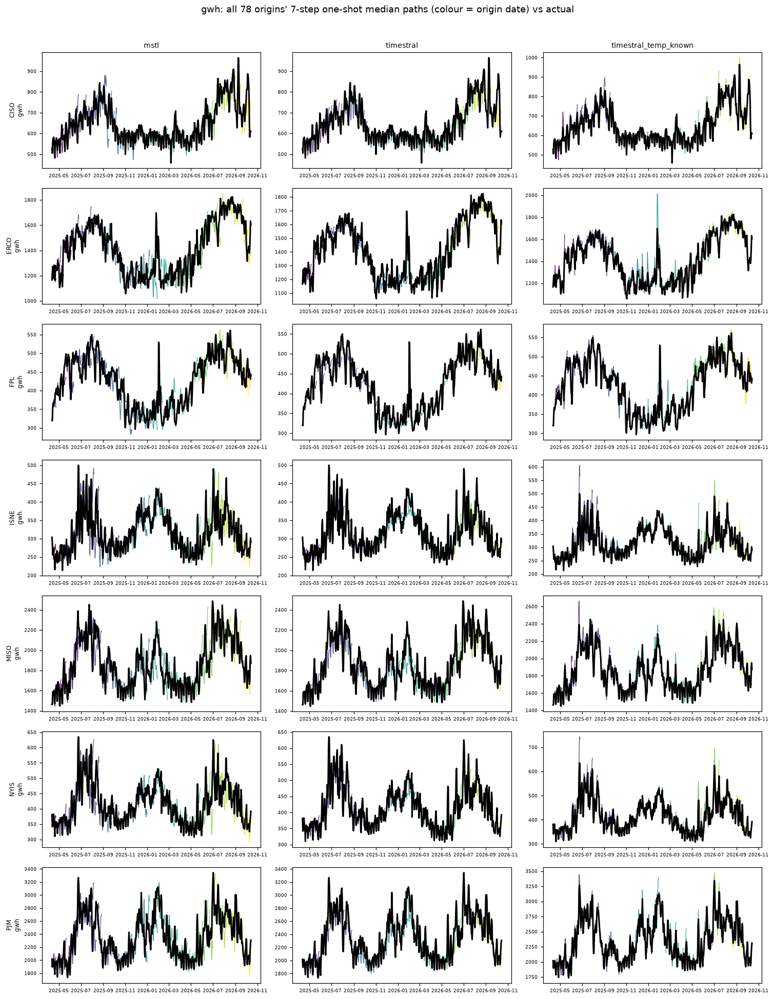

# load: all origins' 8-quarter median paths vs actual

Columns: mstl | timestral | timestral_temp_known. Rows: banks. Colour = origin date; black = actual.

| target | seasonal_naive | mstl | timestral | timestral_temp_past | timestral_temp_known |
|---|---|---|---|---|---|
| gwh | 1.157 | 1.000 | 0.772 | 0.765 | 0.407 |

## gwh

