# Backtest report: housing_fhfa

# Housing, FHFA metro HPI (quarterly, 22 metros incl. Tampa): headline findings

Setup: FHFA all-transactions HPI, 1991Q1-2026Q2, 37 rolling origins (2015Q2-2024Q2) + a live origin (2026Q2),
one-shot 8-quarter forecasts. Relative MASE vs AutoARIMA (<1 = better).

| Model | h=1 | h=2 | h=4 | h=8 | Overall | 80% coverage |
|---|---|---|---|---|---|---|
| **Timestral + known-future macro** | 1.03 | 0.95 | **0.84** | 0.79 | **0.825** | **0.80** |
| Timestral, no covariates | 1.01 | 0.96 | 0.87 | 0.79 | 0.833 | 0.79 |
| Timestral + past macro | 1.03 | 0.98 | 0.89 | 0.80 | 0.844 | 0.78 |
| AutoETS | 1.17 | 1.08 | 0.91 | **0.77** | 0.845 | 0.63 |
| AutoARIMA (baseline) | 1 | 1 | 1 | 1 | 1 | 0.58 |
| Seasonal naive | 6.20 | 3.21 | 1.59 | 1.32 | 1.868 | 0.38 |

- Timestral ties ARIMA one quarter ahead and wins by ~20% at 8 quarters; it is the only family with calibrated 80% bands
  (79-80% vs ARIMA 58%, ETS 63%).
- Known-future mortgage rate, unemployment and income help only slightly overall (0.825 vs 0.833); the edge is at h=4
  (DM significantly better on 18% of metros at h=4). House prices are dominated by their own momentum.
- Rate shock 2022 origins: ARIMA collapses (MASE 12.3), Timestral 7.6, ETS 6.9 - ARIMA extrapolated the 2021 boom.
- Tampa: Timestral 0.73 vs ARIMA (ETS 1.12). Biggest Timestral wins: Austin 0.61, Denver 0.67, Phoenix 0.70, Nashville 0.73.
- Known-future = realised macro path (scenario test). Covariates are national, not metro-level.
- Live Tampa forecast from 2026Q2 (FHFA HPI 516.6): Timestral median +2.6% by 2028Q2 (80% band 487-564); with flat macro +2.8%; ARIMA -2.2%; ETS +9.1%. Plot: `outputs/housing/figures/live_tampa.png` (Zillow panels pending).

Best plots: `figures/house_prices/spaghetti_hpi.png`, `figures/error_by_horizon_mase.png`, `figures/coverage_by_horizon.png`.

---

# Full tables

- Series: 22 ids x 1 targets = 22
- Data: 1991-03-31 to 2026-06-30 (142 periods)
- Rolling origins: 36 (2015-09-30 .. 2024-06-30), one-shot direct horizon h=1..8
- Challenger `timestral` vs baseline `arima`. MASE scale = in-sample naive (lag 1).

## Overall
| model | MAE | RMSE | MAPE | sMAPE | MASE | coverage80 | dir_acc | n |
|---|---|---|---|---|---|---|---|---|
| timestral_macro_known | 16.655 | 28.801 | 2.217 | 4.471 | 5.082 | 0.804 | 0.922 | 6336 |
| timestral | 16.782 | 29.143 | 2.251 | 4.497 | 5.150 | 0.786 | 0.928 | 6336 |
| timestral_macro_past | 16.928 | 29.370 | 2.242 | 4.542 | 5.176 | 0.780 | 0.924 | 6336 |
| ets | 17.314 | 28.286 | 2.798 | 4.810 | 5.249 | 0.627 | 0.952 | 6336 |
| arima | 21.854 | 42.716 | 2.620 | 5.539 | 6.418 | 0.584 | 0.921 | 6336 |
| seasonal_naive | 35.787 | 46.758 | 8.455 | 10.970 | 11.485 | 0.379 | 0.089 | 6336 |

## MASE by horizon (all series)
| h | seasonal_naive | arima | ets | timestral | timestral_macro_past | timestral_macro_known |
|---|---|---|---|---|---|---|
| 1 | 7.527 | 1.218 | 1.413 | 1.232 | 1.253 | 1.250 |
| 2 | 7.652 | 2.412 | 2.575 | 2.296 | 2.331 | 2.253 |
| 3 | 7.748 | 3.594 | 3.530 | 3.230 | 3.272 | 3.072 |
| 4 | 7.810 | 5.086 | 4.543 | 4.306 | 4.356 | 4.163 |
| 5 | 15.143 | 7.065 | 5.807 | 5.694 | 5.736 | 5.630 |
| 6 | 15.272 | 8.979 | 6.965 | 7.011 | 7.027 | 7.012 |
| 7 | 15.361 | 10.655 | 8.032 | 8.147 | 8.144 | 8.083 |
| 8 | 15.367 | 12.334 | 9.126 | 9.287 | 9.289 | 9.193 |

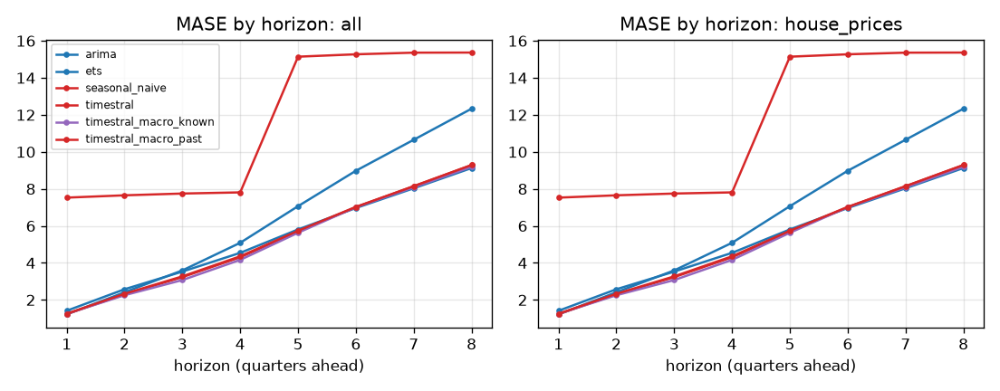

## Skill vs horizon
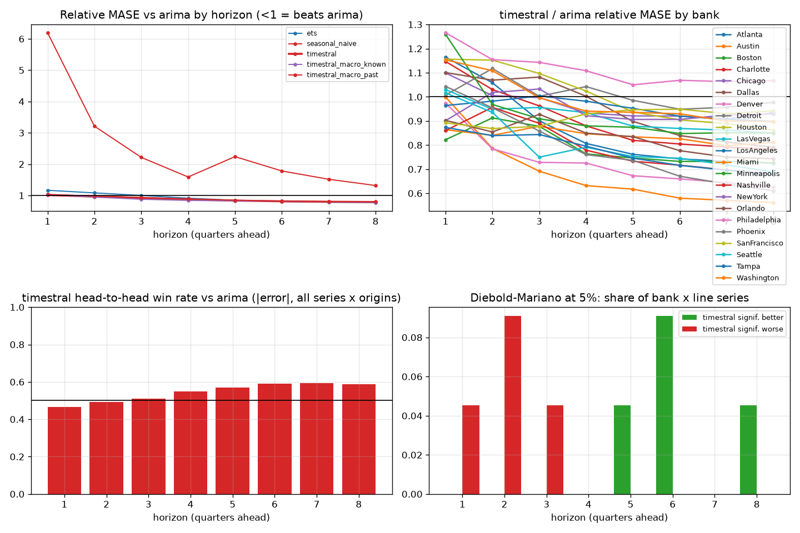

| h | arima | ets | seasonal_naive | timestral | timestral_macro_known | timestral_macro_past |
|---|---|---|---|---|---|---|
| 1 | 1.000 | 1.165 | 6.196 | 1.014 | 1.025 | 1.032 |
| 2 | 1.000 | 1.082 | 3.213 | 0.964 | 0.948 | 0.982 |
| 3 | 1.000 | 1.001 | 2.216 | 0.920 | 0.878 | 0.936 |
| 4 | 1.000 | 0.913 | 1.591 | 0.871 | 0.842 | 0.887 |
| 5 | 1.000 | 0.847 | 2.240 | 0.836 | 0.828 | 0.848 |
| 6 | 1.000 | 0.803 | 1.782 | 0.813 | 0.816 | 0.821 |
| 7 | 1.000 | 0.783 | 1.517 | 0.799 | 0.797 | 0.806 |
| 8 | 1.000 | 0.772 | 1.318 | 0.791 | 0.787 | 0.800 |

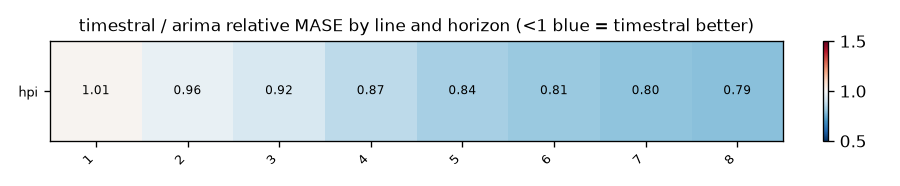

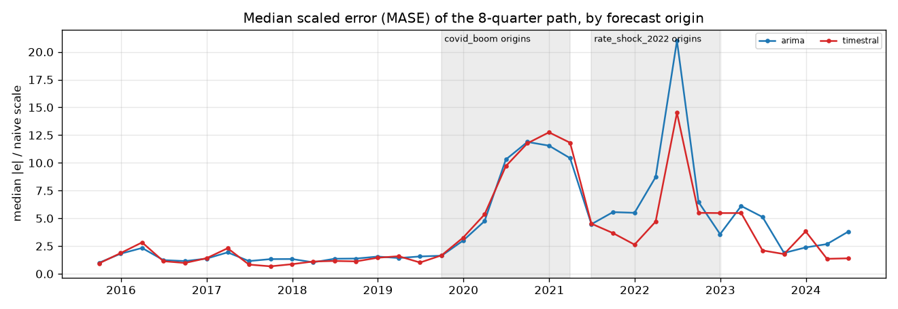

## Relative MASE vs baseline (geometric mean; <1 = better than baseline)
| model | rel_mase |
|---|---|
| timestral_macro_known | 0.825 |
| timestral | 0.833 |
| timestral_macro_past | 0.844 |
| ets | 0.845 |
| arima | 1.000 |
| seasonal_naive | 1.868 |

### By bank
| id | arima | ets | seasonal_naive | timestral | timestral_macro_known | timestral_macro_past |
|---|---|---|---|---|---|---|
| Atlanta | 1.000 | 0.673 | 1.972 | 0.777 | 0.795 | 0.782 |
| Austin | 1.000 | 0.692 | 1.093 | 0.608 | 0.579 | 0.582 |
| Boston | 1.000 | 0.625 | 2.129 | 0.759 | 0.784 | 0.809 |
| Charlotte | 1.000 | 0.832 | 2.072 | 0.832 | 0.775 | 0.802 |
| Chicago | 1.000 | 1.005 | 2.390 | 0.939 | 0.985 | 1.049 |
| Dallas | 1.000 | 0.872 | 1.812 | 0.876 | 0.881 | 0.885 |
| Denver | 1.000 | 0.612 | 1.399 | 0.675 | 0.659 | 0.658 |
| Detroit | 1.000 | 0.925 | 2.682 | 0.987 | 0.953 | 1.022 |
| Houston | 1.000 | 0.853 | 2.216 | 0.937 | 0.916 | 0.930 |
| LasVegas | 1.000 | 0.928 | 1.588 | 0.886 | 1.013 | 0.901 |
| LosAngeles | 1.000 | 0.868 | 1.888 | 0.933 | 0.921 | 0.928 |
| Miami | 1.000 | 1.113 | 2.434 | 0.825 | 0.852 | 0.890 |
| Minneapolis | 1.000 | 0.998 | 2.140 | 0.878 | 0.877 | 0.884 |
| Nashville | 1.000 | 0.678 | 1.700 | 0.733 | 0.701 | 0.710 |
| NewYork | 1.000 | 0.862 | 2.547 | 0.932 | 0.955 | 0.994 |
| Orlando | 1.000 | 1.046 | 1.992 | 0.795 | 0.774 | 0.832 |
| Philadelphia | 1.000 | 0.955 | 2.669 | 1.084 | 0.991 | 1.033 |
| Phoenix | 1.000 | 0.871 | 1.498 | 0.697 | 0.670 | 0.687 |
| SanFrancisco | 1.000 | 0.836 | 1.143 | 0.927 | 0.923 | 0.939 |
| Seattle | 1.000 | 0.645 | 1.274 | 0.746 | 0.723 | 0.746 |
| Tampa | 1.000 | 1.124 | 1.903 | 0.730 | 0.727 | 0.767 |
| Washington | 1.000 | 0.869 | 1.825 | 0.939 | 0.887 | 0.936 |

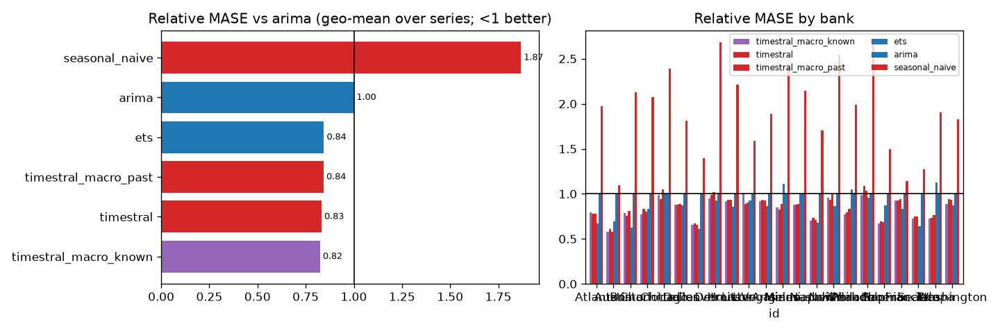

## Win rates (share of series where challenger beats baseline)
| id | MAE | MASE | RMSE | dir_acc | sMAPE |
|---|---|---|---|---|---|
| Atlanta | 100% | 100% | 100% | 100% | 100% |
| Austin | 100% | 100% | 100% | 100% | 100% |
| Boston | 100% | 100% | 100% | 100% | 100% |
| Charlotte | 100% | 100% | 100% | 100% | 100% |
| Chicago | 100% | 100% | 100% | 100% | 100% |
| Dallas | 100% | 100% | 100% | 0% | 100% |
| Denver | 100% | 100% | 100% | 100% | 100% |
| Detroit | 100% | 100% | 100% | 100% | 0% |
| Houston | 100% | 100% | 100% | 100% | 100% |
| LasVegas | 100% | 100% | 100% | 100% | 100% |
| LosAngeles | 100% | 100% | 100% | 0% | 100% |
| Miami | 100% | 100% | 100% | 0% | 100% |
| Minneapolis | 100% | 100% | 100% | 100% | 100% |
| Nashville | 100% | 100% | 100% | 100% | 100% |
| NewYork | 100% | 100% | 100% | 100% | 100% |
| Orlando | 100% | 100% | 100% | 0% | 100% |
| Philadelphia | 0% | 0% | 0% | 100% | 0% |
| Phoenix | 100% | 100% | 100% | 100% | 100% |
| SanFrancisco | 100% | 100% | 100% | 0% | 100% |
| Seattle | 100% | 100% | 100% | 100% | 100% |
| Tampa | 100% | 100% | 100% | 0% | 100% |
| Washington | 100% | 100% | 100% | 100% | 100% |

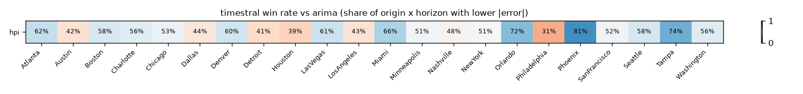

## Diebold-Mariano (squared error, HLN-corrected, per series and horizon)
Share of bank x target series where the challenger is significantly better / worse at 5%:

| h | better | worse |
|---|---|---|
| 1 | 0% | 5% |
| 2 | 0% | 9% |
| 3 | 0% | 5% |
| 4 | 0% | 0% |
| 5 | 5% | 0% |
| 6 | 9% | 0% |
| 7 | 0% | 0% |
| 8 | 5% | 0% |

## Stress slices (MASE)
| model | covid_boom | normal | rate_shock_2022 |
|---|---|---|---|
| arima | 10.686 | 3.196 | 12.275 |
| ets | 11.277 | 2.818 | 6.859 |
| seasonal_naive | 18.085 | 8.100 | 15.524 |
| timestral | 11.199 | 2.455 | 7.572 |
| timestral_macro_known | 10.863 | 2.438 | 7.612 |
| timestral_macro_past | 11.303 | 2.443 | 7.639 |

## Interval coverage (80%)
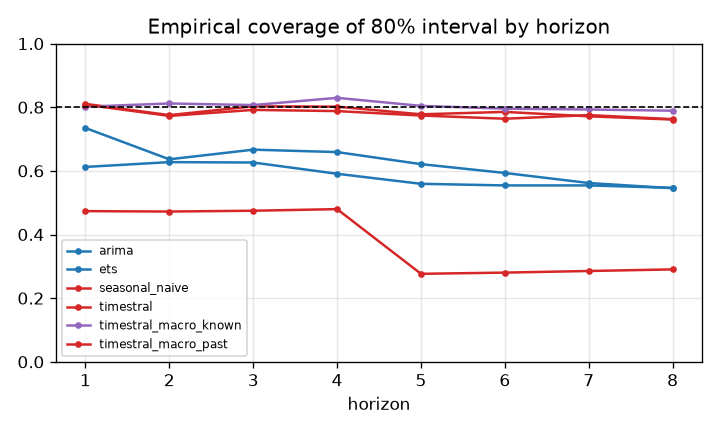

## Balance-sheet identity consistency
(none configured)

## Forecast fans

## Diebold-Mariano vs baseline, all models
Share of series significantly **better** than `arima` at 5% (squared error):

| h | ets | seasonal_naive | timestral | timestral_macro_known | timestral_macro_past |
|---|---|---|---|---|---|
| 1 | 0% | 0% | 0% | 0% | 0% |
| 2 | 0% | 0% | 0% | 0% | 0% |
| 3 | 0% | 0% | 0% | 5% | 0% |
| 4 | 0% | 0% | 0% | 18% | 0% |
| 5 | 0% | 0% | 5% | 5% | 5% |
| 6 | 0% | 0% | 9% | 5% | 9% |
| 7 | 5% | 5% | 0% | 0% | 5% |
| 8 | 0% | 0% | 5% | 0% | 0% |

Share significantly **worse**:

| h | ets | seasonal_naive | timestral | timestral_macro_known | timestral_macro_past |
|---|---|---|---|---|---|
| 1 | 0% | 100% | 5% | 0% | 5% |
| 2 | 0% | 41% | 9% | 0% | 0% |
| 3 | 0% | 14% | 5% | 0% | 0% |
| 4 | 0% | 9% | 0% | 0% | 0% |
| 5 | 0% | 23% | 0% | 0% | 0% |
| 6 | 0% | 23% | 0% | 0% | 0% |
| 7 | 0% | 23% | 0% | 0% | 0% |
| 8 | 0% | 18% | 0% | 0% | 0% |

## 80% interval coverage by line
| model | hpi |
|---|---|
| arima | 0.584 |
| ets | 0.627 |
| seasonal_naive | 0.379 |
| timestral | 0.786 |
| timestral_macro_known | 0.804 |
| timestral_macro_past | 0.780 |

## Relative MASE vs `arima` by line
| target | arima | ets | seasonal_naive | timestral | timestral_macro_known | timestral_macro_past |
|---|---|---|---|---|---|---|
| hpi | 1.000 | 0.845 | 1.868 | 0.833 | 0.825 | 0.844 |

### hpi: relative MASE by horizon
| h | arima | ets | seasonal_naive | timestral | timestral_macro_known | timestral_macro_past |
|---|---|---|---|---|---|---|
| 1 | 1.000 | 1.165 | 6.196 | 1.014 | 1.025 | 1.032 |
| 2 | 1.000 | 1.082 | 3.213 | 0.964 | 0.948 | 0.982 |
| 3 | 1.000 | 1.001 | 2.216 | 0.920 | 0.878 | 0.936 |
| 4 | 1.000 | 0.913 | 1.591 | 0.871 | 0.842 | 0.887 |
| 5 | 1.000 | 0.847 | 2.240 | 0.836 | 0.828 | 0.848 |
| 6 | 1.000 | 0.803 | 1.782 | 0.813 | 0.816 | 0.821 |
| 7 | 1.000 | 0.783 | 1.517 | 0.799 | 0.797 | 0.806 |
| 8 | 1.000 | 0.772 | 1.318 | 0.791 | 0.787 | 0.800 |

## How much does `timestral_macro_known` help vs `timestral`? (relative MASE, <1 = helps)
| target | rel_mase |
|---|---|
| hpi | 0.990 |

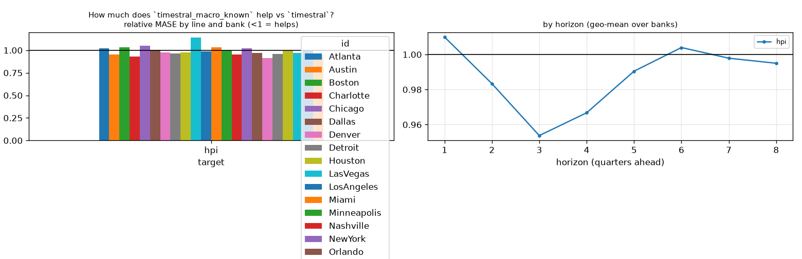

## How much does `timestral_macro_past` help vs `timestral`? (relative MASE, <1 = helps)
| target | rel_mase |
|---|---|
| hpi | 1.013 |

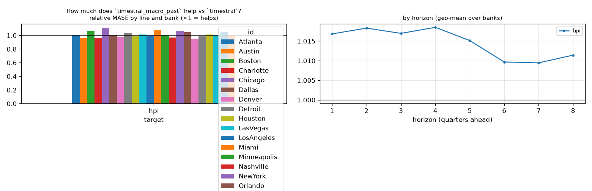

## How much does `timestral` help vs `arima`? (relative MASE, <1 = helps)
| target | rel_mase |
|---|---|
| hpi | 0.833 |

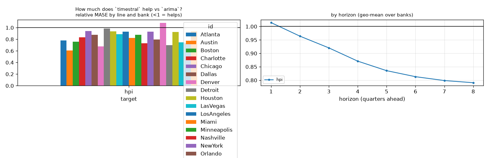

## Line x variant: relative MASE vs baseline
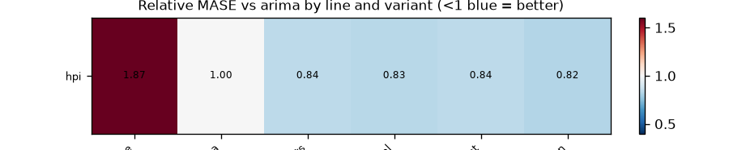

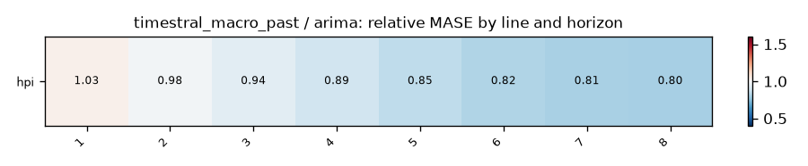
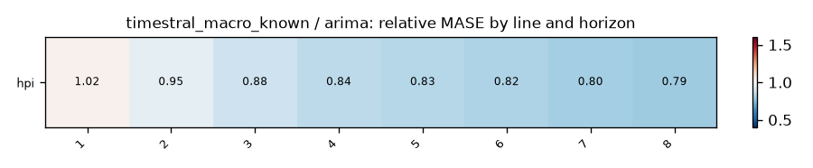

## Does macro help? (relative MASE of covariate variant vs its no-covariate twin; <1 = helps)
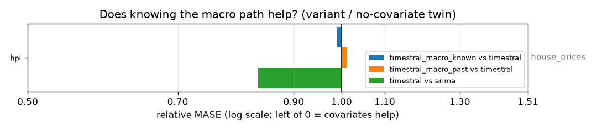

| target | timestral_macro_known vs timestral | timestral_macro_past vs timestral | timestral vs arima |
|---|---|---|---|
| hpi | 0.990 | 1.013 | 0.833 |

## Spaghetti pages by group

- [house_prices](figures/house_prices/index.md) (1 lines)
