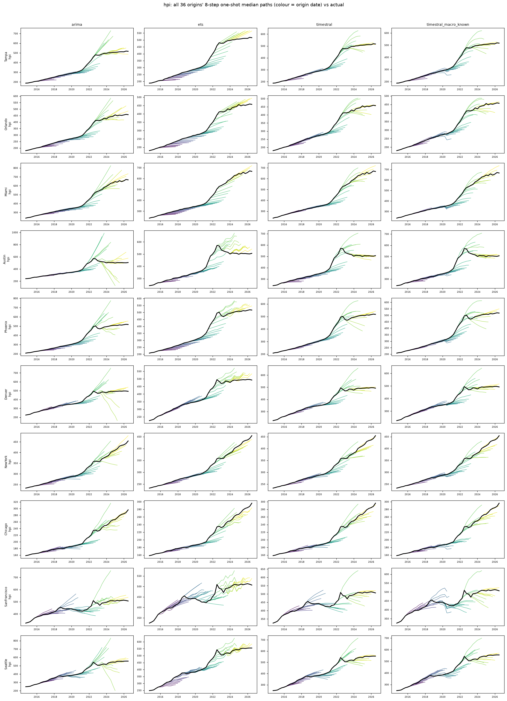

# house_prices: all origins' 8-quarter median paths vs actual

Columns: arima | ets | timestral | timestral_macro_known. Rows: banks. Colour = origin date; black = actual.

| target | seasonal_naive | arima | ets | timestral | timestral_macro_past | timestral_macro_known |
|---|---|---|---|---|---|---|
| hpi | 1.868 | 1.000 | 0.845 | 0.833 | 0.844 | 0.825 |

## hpi

