# Backtest report: housing_zillow

# Housing, Zillow ZHVI home values + ZORI rents (monthly, 22 metros incl. Tampa): headline findings

Setup: 2000-01..2026-09 (ZORI from 2015), 31 origins every 2 months (2019-2024) + a live origin (2026-09),
one-shot 24-month forecasts. **AutoARIMA was dropped** (seasonal m=12, h=24 too slow on the shared box); the reference
baseline is AutoETS, with seasonal naive also shown. Relative MASE vs AutoETS (<1 = better). Run on Gus, report built on the box.

| Model | h=1 | h=6 | h=12 | h=24 | Overall | 80% coverage |
|---|---|---|---|---|---|---|
| **Timestral + past macro** | **0.60** | **0.83** | **0.91** | **0.86** | **0.869** | 0.73 |
| Timestral, no covariates | 0.60 | 0.85 | 0.95 | 0.87 | 0.887 | 0.72 |
| Timestral + known-future macro | 0.63 | 0.84 | 0.93 | 0.89 | 0.892 | 0.73 |
| AutoETS (baseline) | 1 | 1 | 1 | 1 | 1 | 0.38 |
| Seasonal naive | 13.5 | 2.18 | 1.25 | 1.08 | 1.576 | 0.42 |

- Timestral beats ETS by 11-13% overall and by 40% one month ahead; ETS bands are far too narrow (38% coverage).
- Rents gain more than values: ZORI 0.83-0.85 vs ZHVI 0.91-0.94 for the macro variants.
- Known-future mortgage rate / unemployment / income does not beat past-only macro: house values and rents follow
  their own momentum; the realised macro path (scenario test) adds little.
- Tampa (vs ETS): ZHVI 0.85-0.88, ZORI 0.80-0.82 for the macro variants.
- Live Tampa from 2026-09: ZHVI $356.8k -> Timestral median $356.0k by 2028-09 (-0.2%, 80% band 323-381k); ETS -2.1%.
  ZORI $1,991 -> $2,018 (+1.4%). Plot: `outputs/housing/figures/live_tampa.png`.

Best plots: `figures/values_and_rents/spaghetti_zori.png`, `figures/values_and_rents/spaghetti_zhvi.png`, `figures/error_by_horizon_mase.png`.

---

# Full tables

- Series: 22 ids x 2 targets = 44
- Data: 2000-01-31 to 2026-09-30 (321 periods)
- Rolling origins: 30 (2019-11-30 .. 2024-09-30), one-shot direct horizon h=1..24
- Challenger `timestral` vs baseline `ets`. MASE scale = in-sample naive (lag 1).

## Overall
| model | MAE | RMSE | MAPE | sMAPE | MASE | coverage80 | dir_acc | n |
|---|---|---|---|---|---|---|---|---|
| timestral_macro_past | 52.857 | 94.869 | 2.692 | 5.080 | 13.578 | 0.729 | 0.795 | 31680 |
| timestral_macro_known | 54.230 | 97.165 | 2.775 | 5.217 | 13.904 | 0.728 | 0.789 | 31680 |
| timestral | 53.825 | 96.500 | 2.772 | 5.217 | 13.906 | 0.715 | 0.786 | 31680 |
| ets | 66.352 | 116.432 | 3.341 | 5.926 | 15.919 | 0.378 | 0.783 | 31680 |
| seasonal_naive | 96.710 | 146.478 | 6.822 | 9.610 | 24.465 | 0.424 | 0.266 | 31680 |

## MASE by horizon (all series)
| h | seasonal_naive | ets | timestral | timestral_macro_past | timestral_macro_known |
|---|---|---|---|---|---|
| 1 | 16.165 | 1.154 | 0.712 | 0.719 | 0.746 |
| 2 | 16.297 | 2.461 | 1.605 | 1.549 | 1.564 |
| 3 | 16.445 | 3.768 | 2.756 | 2.648 | 2.688 |
| 4 | 16.592 | 5.079 | 3.995 | 3.867 | 3.947 |
| 5 | 16.742 | 6.339 | 5.292 | 5.113 | 5.227 |
| 6 | 16.888 | 7.569 | 6.534 | 6.311 | 6.421 |
| 7 | 17.057 | 8.706 | 7.678 | 7.407 | 7.530 |
| 8 | 17.229 | 9.802 | 8.835 | 8.513 | 8.617 |
| 9 | 17.419 | 10.928 | 10.016 | 9.638 | 9.782 |
| 10 | 17.580 | 12.040 | 11.249 | 10.760 | 10.908 |
| 11 | 17.734 | 13.253 | 12.467 | 11.914 | 12.073 |
| 12 | 17.836 | 14.595 | 13.632 | 13.034 | 13.218 |
| 13 | 31.943 | 16.063 | 14.857 | 14.259 | 14.498 |
| 14 | 32.079 | 17.602 | 16.055 | 15.497 | 15.801 |
| 15 | 32.220 | 19.212 | 17.327 | 16.786 | 17.137 |
| 16 | 32.293 | 20.793 | 18.513 | 18.014 | 18.412 |
| 17 | 32.358 | 22.317 | 19.667 | 19.245 | 19.680 |
| 18 | 32.343 | 23.717 | 20.717 | 20.352 | 20.841 |
| 19 | 32.297 | 25.028 | 21.726 | 21.384 | 21.947 |
| 20 | 32.143 | 26.226 | 22.622 | 22.297 | 22.926 |
| 21 | 31.925 | 27.357 | 23.411 | 23.130 | 23.821 |
| 22 | 31.596 | 28.376 | 24.094 | 23.849 | 24.616 |
| 23 | 31.218 | 29.353 | 24.722 | 24.523 | 25.365 |
| 24 | 30.761 | 30.323 | 25.257 | 25.060 | 25.932 |

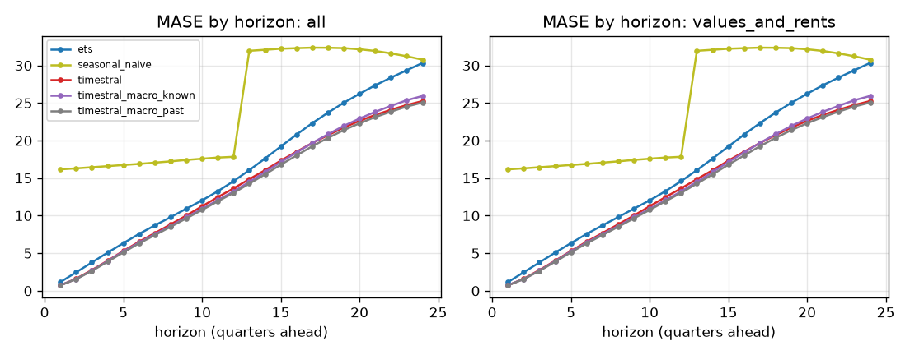

## Skill vs horizon
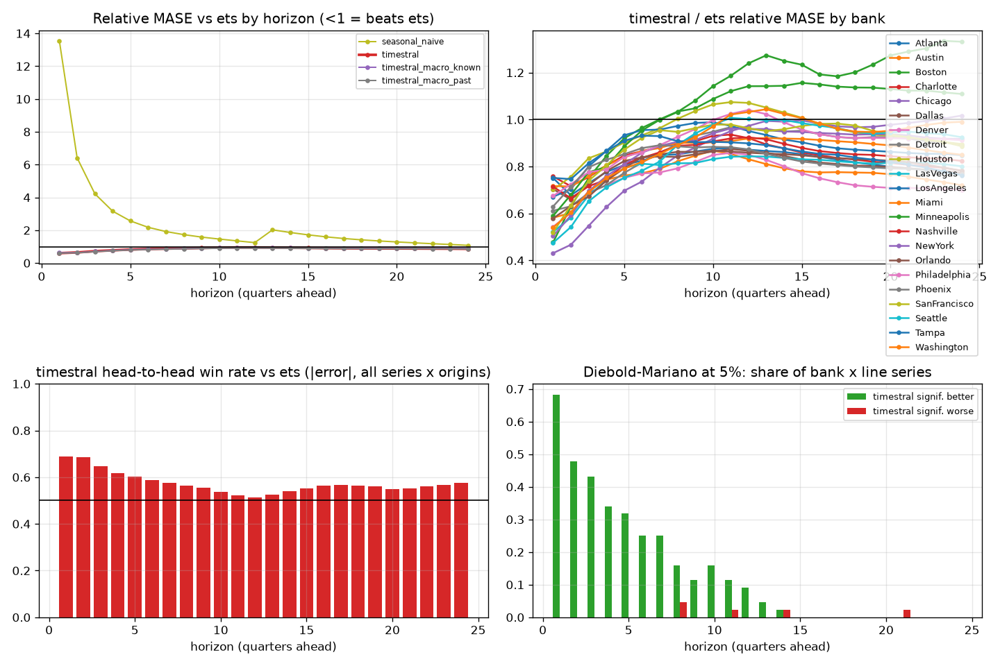

| h | ets | seasonal_naive | timestral | timestral_macro_known | timestral_macro_past |
|---|---|---|---|---|---|
| 1 | 1.000 | 13.545 | 0.603 | 0.625 | 0.603 |
| 2 | 1.000 | 6.410 | 0.645 | 0.629 | 0.622 |
| 3 | 1.000 | 4.222 | 0.723 | 0.705 | 0.695 |
| 4 | 1.000 | 3.162 | 0.774 | 0.765 | 0.750 |
| 5 | 1.000 | 2.566 | 0.823 | 0.813 | 0.796 |
| 6 | 1.000 | 2.177 | 0.854 | 0.840 | 0.826 |
| 7 | 1.000 | 1.919 | 0.877 | 0.862 | 0.848 |
| 8 | 1.000 | 1.733 | 0.898 | 0.880 | 0.869 |
| 9 | 1.000 | 1.582 | 0.916 | 0.900 | 0.886 |
| 10 | 1.000 | 1.462 | 0.938 | 0.916 | 0.901 |
| 11 | 1.000 | 1.352 | 0.950 | 0.926 | 0.912 |
| 12 | 1.000 | 1.245 | 0.949 | 0.927 | 0.911 |
| 13 | 1.000 | 2.023 | 0.943 | 0.926 | 0.907 |
| 14 | 1.000 | 1.862 | 0.930 | 0.921 | 0.900 |
| 15 | 1.000 | 1.719 | 0.920 | 0.915 | 0.894 |
| 16 | 1.000 | 1.597 | 0.908 | 0.909 | 0.886 |
| 17 | 1.000 | 1.497 | 0.899 | 0.906 | 0.882 |
| 18 | 1.000 | 1.415 | 0.892 | 0.903 | 0.879 |
| 19 | 1.000 | 1.346 | 0.889 | 0.903 | 0.877 |
| 20 | 1.000 | 1.286 | 0.886 | 0.903 | 0.877 |
| 21 | 1.000 | 1.230 | 0.883 | 0.903 | 0.875 |
| 22 | 1.000 | 1.179 | 0.878 | 0.902 | 0.872 |
| 23 | 1.000 | 1.130 | 0.874 | 0.902 | 0.869 |
| 24 | 1.000 | 1.080 | 0.865 | 0.894 | 0.861 |

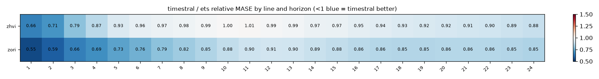

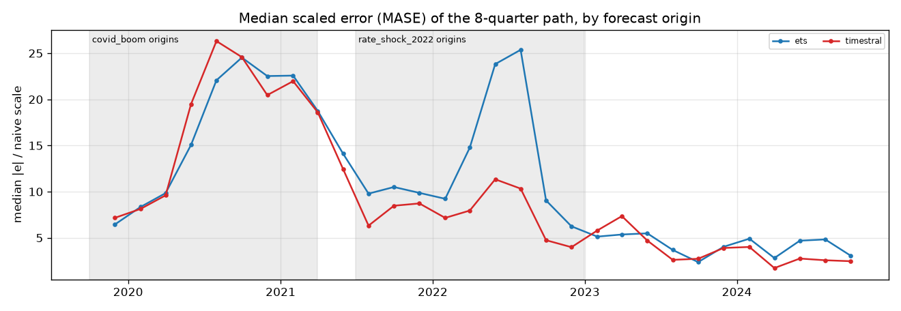

## Relative MASE vs baseline (geometric mean; <1 = better than baseline)
| model | rel_mase |
|---|---|
| timestral_macro_past | 0.869 |
| timestral | 0.887 |
| timestral_macro_known | 0.892 |
| ets | 1.000 |
| seasonal_naive | 1.576 |

### By bank
| id | ets | seasonal_naive | timestral | timestral_macro_known | timestral_macro_past |
|---|---|---|---|---|---|
| Atlanta | 1.000 | 1.544 | 0.818 | 0.848 | 0.847 |
| Austin | 1.000 | 1.231 | 0.774 | 0.771 | 0.753 |
| Boston | 1.000 | 1.862 | 1.088 | 0.935 | 0.901 |
| Charlotte | 1.000 | 1.747 | 0.839 | 0.855 | 0.831 |
| Chicago | 1.000 | 1.929 | 0.939 | 0.913 | 0.903 |
| Dallas | 1.000 | 1.407 | 0.811 | 0.855 | 0.811 |
| Denver | 1.000 | 1.224 | 0.744 | 0.799 | 0.743 |
| Detroit | 1.000 | 2.056 | 0.910 | 0.905 | 0.879 |
| Houston | 1.000 | 1.594 | 0.957 | 0.892 | 0.927 |
| LasVegas | 1.000 | 1.157 | 0.817 | 0.839 | 0.810 |
| LosAngeles | 1.000 | 1.613 | 0.892 | 0.913 | 0.902 |
| Miami | 1.000 | 1.640 | 0.888 | 0.863 | 0.849 |
| Minneapolis | 1.000 | 2.468 | 1.146 | 1.277 | 1.187 |
| Nashville | 1.000 | 1.419 | 0.857 | 0.847 | 0.813 |
| NewYork | 1.000 | 1.665 | 0.919 | 0.892 | 0.909 |
| Orlando | 1.000 | 1.473 | 0.826 | 0.843 | 0.812 |
| Philadelphia | 1.000 | 2.549 | 0.931 | 0.896 | 0.898 |
| Phoenix | 1.000 | 1.316 | 0.815 | 0.791 | 0.792 |
| SanFrancisco | 1.000 | 0.999 | 0.933 | 0.982 | 0.943 |
| Seattle | 1.000 | 1.365 | 0.921 | 0.952 | 0.900 |
| Tampa | 1.000 | 1.566 | 0.841 | 0.847 | 0.826 |
| Washington | 1.000 | 1.755 | 0.949 | 1.011 | 0.967 |

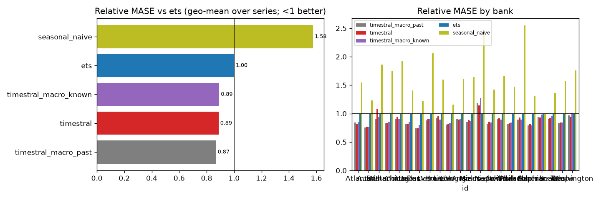

## Win rates (share of series where challenger beats baseline)
| id | MAE | MASE | RMSE | dir_acc | sMAPE |
|---|---|---|---|---|---|
| Atlanta | 100% | 100% | 100% | 50% | 100% |
| Austin | 100% | 100% | 100% | 100% | 100% |
| Boston | 50% | 50% | 50% | 0% | 50% |
| Charlotte | 100% | 100% | 100% | 50% | 100% |
| Chicago | 50% | 50% | 50% | 0% | 50% |
| Dallas | 100% | 100% | 100% | 100% | 100% |
| Denver | 100% | 100% | 100% | 100% | 100% |
| Detroit | 50% | 50% | 100% | 0% | 50% |
| Houston | 50% | 50% | 50% | 50% | 50% |
| LasVegas | 100% | 100% | 100% | 50% | 100% |
| LosAngeles | 100% | 50% | 50% | 50% | 50% |
| Miami | 100% | 100% | 100% | 0% | 100% |
| Minneapolis | 50% | 50% | 50% | 0% | 50% |
| Nashville | 100% | 100% | 100% | 50% | 50% |
| NewYork | 50% | 50% | 50% | 50% | 50% |
| Orlando | 100% | 100% | 100% | 50% | 100% |
| Philadelphia | 50% | 50% | 50% | 0% | 50% |
| Phoenix | 100% | 100% | 100% | 100% | 100% |
| SanFrancisco | 100% | 100% | 100% | 50% | 100% |
| Seattle | 100% | 100% | 100% | 50% | 50% |
| Tampa | 100% | 100% | 100% | 100% | 100% |
| Washington | 50% | 50% | 100% | 50% | 50% |

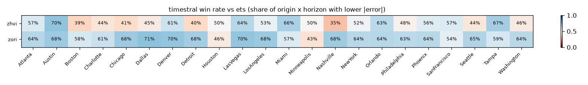

## Diebold-Mariano (squared error, HLN-corrected, per series and horizon)
Share of bank x target series where the challenger is significantly better / worse at 5%:

| h | better | worse |
|---|---|---|
| 1 | 68% | 0% |
| 2 | 48% | 0% |
| 3 | 43% | 0% |
| 4 | 34% | 0% |
| 5 | 32% | 0% |
| 6 | 25% | 0% |
| 7 | 25% | 0% |
| 8 | 16% | 5% |
| 9 | 11% | 0% |
| 10 | 16% | 0% |
| 11 | 11% | 2% |
| 12 | 9% | 0% |
| 13 | 5% | 0% |
| 14 | 2% | 2% |
| 15 | 0% | 0% |
| 16 | 0% | 0% |
| 17 | 0% | 0% |
| 18 | 0% | 0% |
| 19 | 0% | 0% |
| 20 | 0% | 0% |
| 21 | 0% | 2% |
| 22 | 0% | 0% |
| 23 | 0% | 0% |
| 24 | 0% | 0% |

## Stress slices (MASE)
| model | covid_boom | normal | rate_shock_2022 |
|---|---|---|---|
| ets | 23.338 | 7.243 | 20.068 |
| seasonal_naive | 39.348 | 12.242 | 25.880 |
| timestral | 24.646 | 6.933 | 12.463 |
| timestral_macro_known | 23.926 | 6.526 | 13.719 |
| timestral_macro_past | 24.494 | 6.228 | 12.461 |

## Interval coverage (80%)
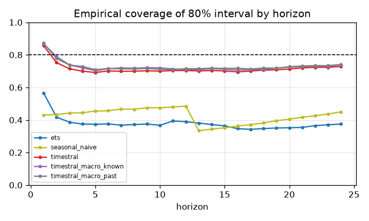

## Balance-sheet identity consistency
(none configured)

## Forecast fans

## Diebold-Mariano vs baseline, all models
Share of series significantly **better** than `ets` at 5% (squared error):

| h | seasonal_naive | timestral | timestral_macro_known | timestral_macro_past |
|---|---|---|---|---|
| 1 | 0% | 68% | 57% | 70% |
| 2 | 0% | 48% | 50% | 55% |
| 3 | 0% | 43% | 34% | 41% |
| 4 | 0% | 34% | 41% | 39% |
| 5 | 0% | 32% | 32% | 30% |
| 6 | 0% | 25% | 30% | 30% |
| 7 | 0% | 25% | 32% | 30% |
| 8 | 0% | 16% | 25% | 30% |
| 9 | 0% | 11% | 18% | 25% |
| 10 | 2% | 16% | 11% | 9% |
| 11 | 0% | 11% | 9% | 11% |
| 12 | 0% | 9% | 14% | 20% |
| 13 | 0% | 5% | 5% | 5% |
| 14 | 0% | 2% | 0% | 2% |
| 15 | 0% | 0% | 0% | 0% |
| 16 | 0% | 0% | 0% | 0% |
| 17 | 0% | 0% | 0% | 0% |
| 18 | 0% | 0% | 0% | 0% |
| 19 | 0% | 0% | 0% | 2% |
| 20 | 0% | 0% | 0% | 0% |
| 21 | 0% | 0% | 0% | 0% |
| 22 | 0% | 0% | 0% | 0% |
| 23 | 0% | 0% | 0% | 0% |
| 24 | 0% | 0% | 0% | 0% |

Share significantly **worse**:

| h | seasonal_naive | timestral | timestral_macro_known | timestral_macro_past |
|---|---|---|---|---|
| 1 | 100% | 0% | 0% | 0% |
| 2 | 80% | 0% | 0% | 0% |
| 3 | 34% | 0% | 0% | 0% |
| 4 | 18% | 0% | 0% | 0% |
| 5 | 9% | 0% | 0% | 0% |
| 6 | 9% | 0% | 0% | 0% |
| 7 | 9% | 0% | 0% | 0% |
| 8 | 11% | 5% | 2% | 0% |
| 9 | 14% | 0% | 0% | 0% |
| 10 | 14% | 0% | 0% | 0% |
| 11 | 14% | 2% | 2% | 0% |
| 12 | 11% | 0% | 0% | 0% |
| 13 | 45% | 0% | 0% | 2% |
| 14 | 36% | 2% | 0% | 0% |
| 15 | 39% | 0% | 0% | 0% |
| 16 | 34% | 0% | 2% | 0% |
| 17 | 27% | 0% | 0% | 0% |
| 18 | 20% | 0% | 0% | 0% |
| 19 | 18% | 0% | 0% | 0% |
| 20 | 14% | 0% | 0% | 2% |
| 21 | 9% | 2% | 0% | 0% |
| 22 | 5% | 0% | 0% | 0% |
| 23 | 5% | 0% | 0% | 0% |
| 24 | 5% | 0% | 0% | 0% |

## 80% interval coverage by line
| model | zhvi | zori |
|---|---|---|
| ets | 0.289 | 0.468 |
| seasonal_naive | 0.465 | 0.384 |
| timestral | 0.703 | 0.727 |
| timestral_macro_known | 0.714 | 0.742 |
| timestral_macro_past | 0.710 | 0.749 |

## Relative MASE vs `ets` by line
| target | ets | seasonal_naive | timestral | timestral_macro_known | timestral_macro_past |
|---|---|---|---|---|---|
| zhvi | 1.000 | 1.602 | 0.934 | 0.937 | 0.907 |
| zori | 1.000 | 1.551 | 0.843 | 0.849 | 0.832 |

### zhvi: relative MASE by horizon
| h | ets | seasonal_naive | timestral | timestral_macro_known | timestral_macro_past |
|---|---|---|---|---|---|
| 1 | 1.000 | 16.959 | 0.663 | 0.711 | 0.702 |
| 2 | 1.000 | 7.836 | 0.706 | 0.690 | 0.688 |
| 3 | 1.000 | 5.045 | 0.794 | 0.769 | 0.758 |
| 4 | 1.000 | 3.749 | 0.867 | 0.848 | 0.830 |
| 5 | 1.000 | 3.008 | 0.928 | 0.910 | 0.887 |
| 6 | 1.000 | 2.506 | 0.960 | 0.934 | 0.914 |
| 7 | 1.000 | 2.164 | 0.969 | 0.943 | 0.923 |
| 8 | 1.000 | 1.906 | 0.979 | 0.950 | 0.932 |
| 9 | 1.000 | 1.704 | 0.988 | 0.965 | 0.944 |
| 10 | 1.000 | 1.541 | 1.002 | 0.974 | 0.954 |
| 11 | 1.000 | 1.404 | 1.006 | 0.978 | 0.959 |
| 12 | 1.000 | 1.276 | 0.995 | 0.972 | 0.951 |
| 13 | 1.000 | 2.097 | 0.986 | 0.970 | 0.946 |
| 14 | 1.000 | 1.920 | 0.972 | 0.964 | 0.937 |
| 15 | 1.000 | 1.764 | 0.966 | 0.960 | 0.932 |
| 16 | 1.000 | 1.625 | 0.953 | 0.952 | 0.923 |
| 17 | 1.000 | 1.507 | 0.942 | 0.948 | 0.917 |
| 18 | 1.000 | 1.403 | 0.932 | 0.944 | 0.911 |
| 19 | 1.000 | 1.314 | 0.925 | 0.940 | 0.906 |
| 20 | 1.000 | 1.234 | 0.917 | 0.936 | 0.899 |
| 21 | 1.000 | 1.164 | 0.908 | 0.929 | 0.892 |
| 22 | 1.000 | 1.102 | 0.901 | 0.923 | 0.886 |
| 23 | 1.000 | 1.046 | 0.894 | 0.918 | 0.879 |
| 24 | 1.000 | 0.994 | 0.884 | 0.908 | 0.869 |

### zori: relative MASE by horizon
| h | ets | seasonal_naive | timestral | timestral_macro_known | timestral_macro_past |
|---|---|---|---|---|---|
| 1 | 1.000 | 10.818 | 0.549 | 0.550 | 0.517 |
| 2 | 1.000 | 5.244 | 0.589 | 0.574 | 0.562 |
| 3 | 1.000 | 3.533 | 0.659 | 0.646 | 0.636 |
| 4 | 1.000 | 2.666 | 0.692 | 0.689 | 0.679 |
| 5 | 1.000 | 2.188 | 0.731 | 0.726 | 0.715 |
| 6 | 1.000 | 1.891 | 0.760 | 0.756 | 0.747 |
| 7 | 1.000 | 1.703 | 0.793 | 0.788 | 0.778 |
| 8 | 1.000 | 1.575 | 0.823 | 0.814 | 0.810 |
| 9 | 1.000 | 1.469 | 0.849 | 0.839 | 0.831 |
| 10 | 1.000 | 1.387 | 0.877 | 0.861 | 0.851 |
| 11 | 1.000 | 1.301 | 0.897 | 0.877 | 0.866 |
| 12 | 1.000 | 1.214 | 0.906 | 0.884 | 0.872 |
| 13 | 1.000 | 1.953 | 0.901 | 0.884 | 0.870 |
| 14 | 1.000 | 1.806 | 0.890 | 0.879 | 0.864 |
| 15 | 1.000 | 1.674 | 0.876 | 0.873 | 0.857 |
| 16 | 1.000 | 1.570 | 0.864 | 0.868 | 0.851 |
| 17 | 1.000 | 1.486 | 0.857 | 0.865 | 0.848 |
| 18 | 1.000 | 1.426 | 0.853 | 0.864 | 0.848 |
| 19 | 1.000 | 1.378 | 0.854 | 0.867 | 0.850 |
| 20 | 1.000 | 1.341 | 0.857 | 0.872 | 0.854 |
| 21 | 1.000 | 1.300 | 0.858 | 0.877 | 0.858 |
| 22 | 1.000 | 1.261 | 0.856 | 0.882 | 0.858 |
| 23 | 1.000 | 1.222 | 0.854 | 0.886 | 0.859 |
| 24 | 1.000 | 1.174 | 0.847 | 0.880 | 0.853 |

## How much does `timestral_macro_known` help vs `timestral`? (relative MASE, <1 = helps)
| target | rel_mase |
|---|---|
| zhvi | 1.003 |
| zori | 1.007 |

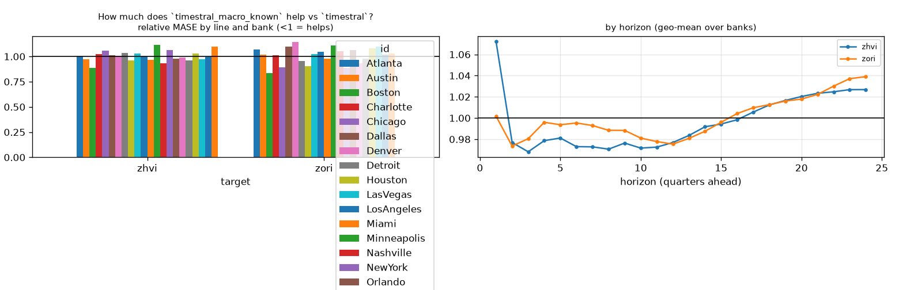

## How much does `timestral_macro_past` help vs `timestral`? (relative MASE, <1 = helps)
| target | rel_mase |
|---|---|
| zhvi | 0.971 |
| zori | 0.987 |

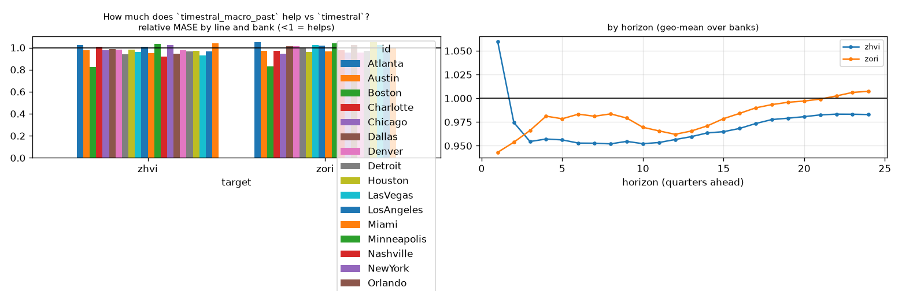

## How much does `timestral` help vs `ets`? (relative MASE, <1 = helps)
| target | rel_mase |
|---|---|
| zhvi | 0.934 |
| zori | 0.843 |

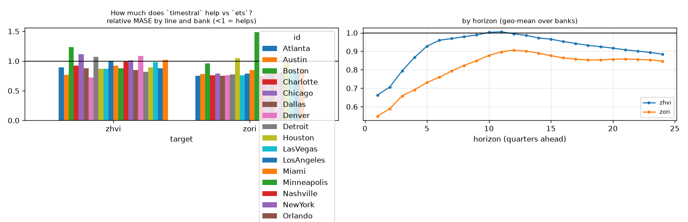

## Line x variant: relative MASE vs baseline
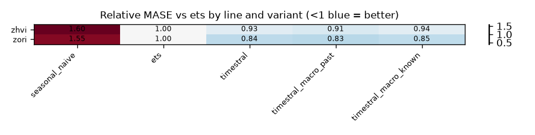

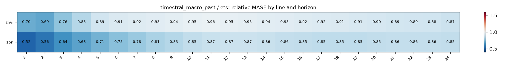
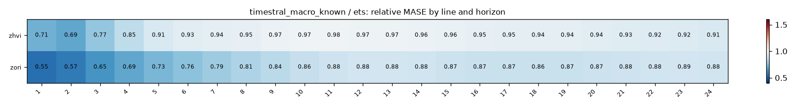

## Does macro help? (relative MASE of covariate variant vs its no-covariate twin; <1 = helps)
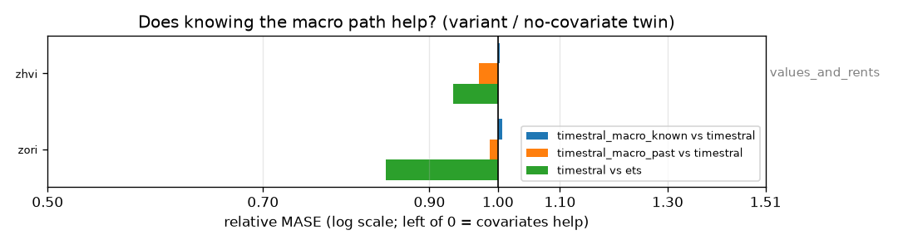

| target | timestral_macro_known vs timestral | timestral_macro_past vs timestral | timestral vs ets |
|---|---|---|---|
| zhvi | 1.003 | 0.971 | 0.934 |
| zori | 1.007 | 0.987 | 0.843 |

## Spaghetti pages by group

- [values_and_rents](figures/values_and_rents/index.md) (2 lines)
