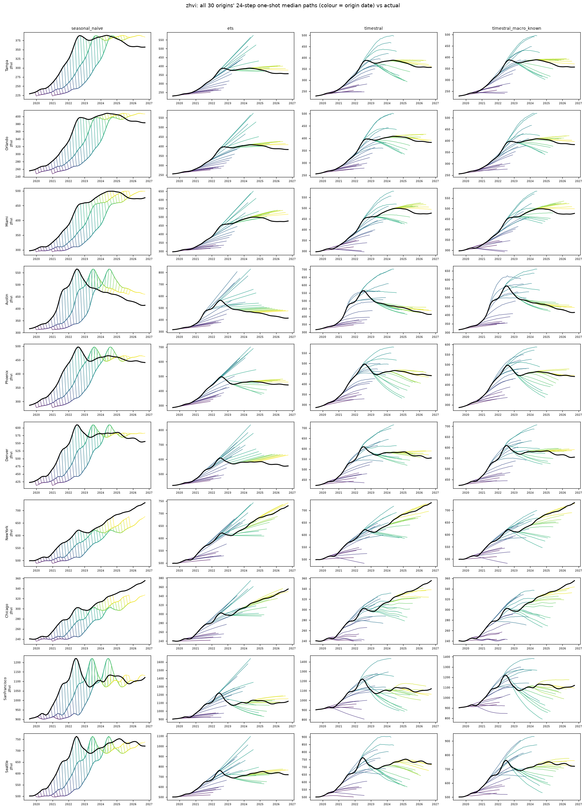
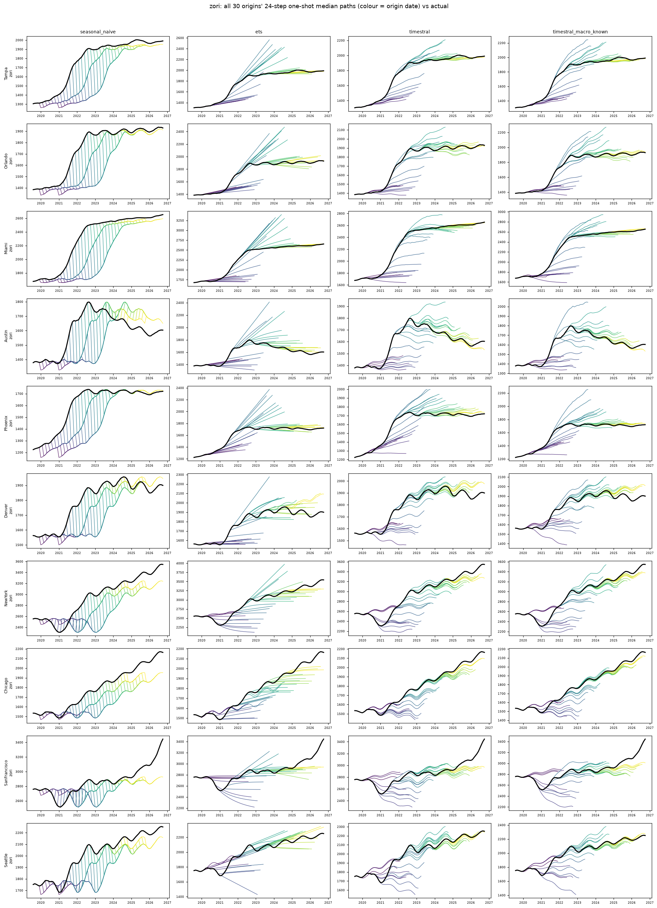

# values_and_rents: all origins' 8-quarter median paths vs actual

Columns: seasonal_naive | ets | timestral | timestral_macro_known. Rows: banks. Colour = origin date; black = actual.

| target | seasonal_naive | ets | timestral | timestral_macro_past | timestral_macro_known |
|---|---|---|---|---|---|
| zhvi | 1.602 | 1.000 | 0.934 | 0.907 | 0.937 |
| zori | 1.551 | 1.000 | 0.843 | 0.832 | 0.849 |

## zhvi

## zori

