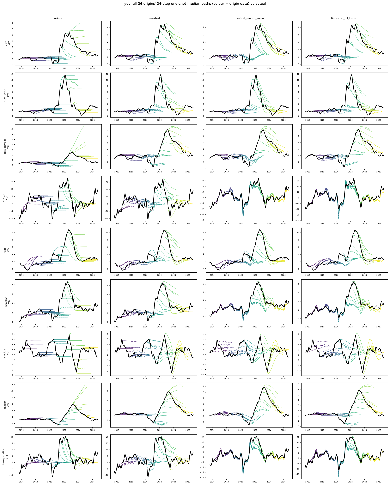

# cpi: all origins' 8-quarter median paths vs actual

Columns: arima | timestral | timestral_macro_known | timestral_oil_known. Rows: banks. Colour = origin date; black = actual.

| target | naive | arima | timestral | timestral_macro_past | timestral_macro_known | timestral_oil_known | arimax_macro_known |
|---|---|---|---|---|---|---|---|
| yoy | 1.071 | 1.000 | 0.892 | 0.881 | 0.659 | 0.676 | 0.845 |

## yoy

