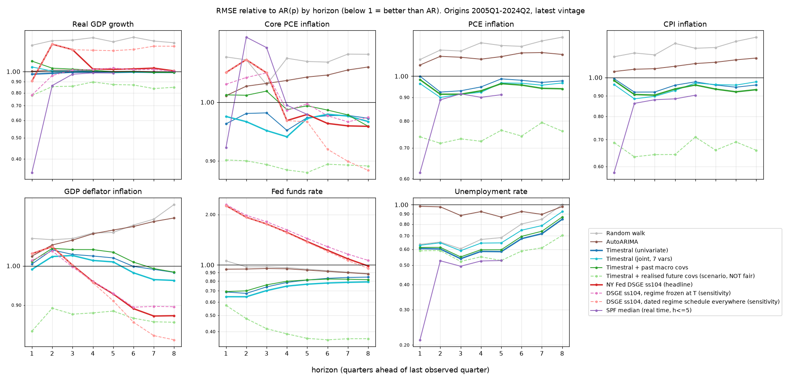
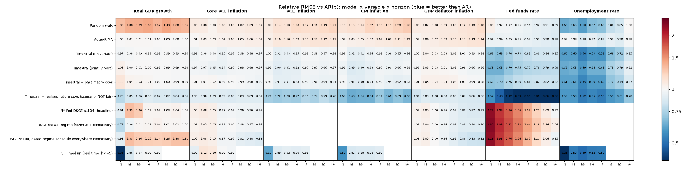
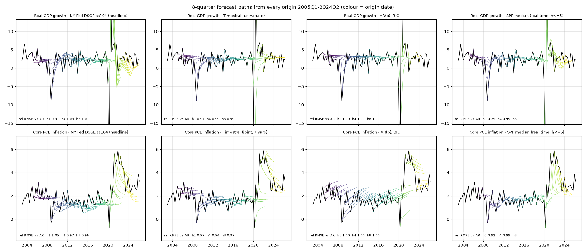
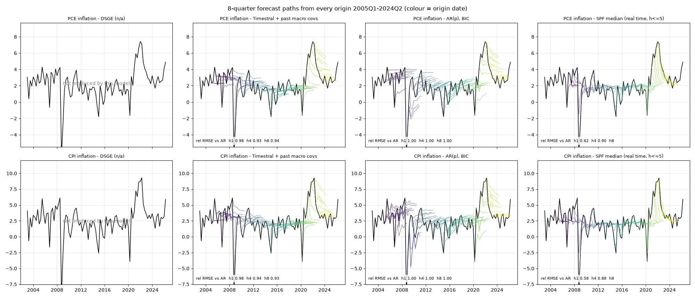
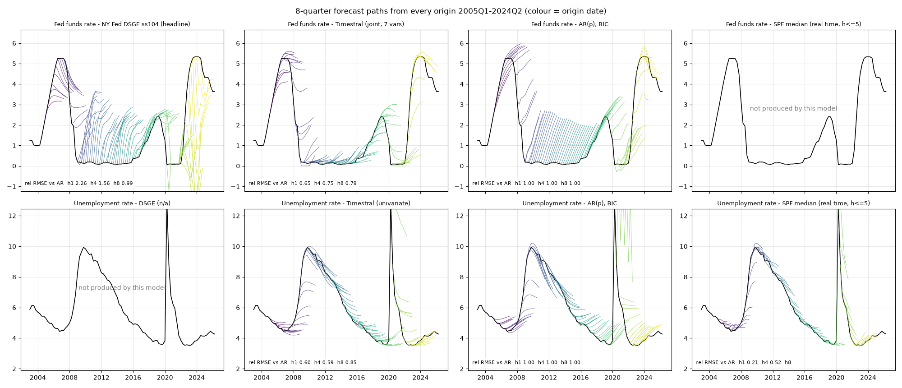
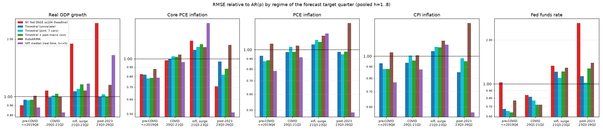
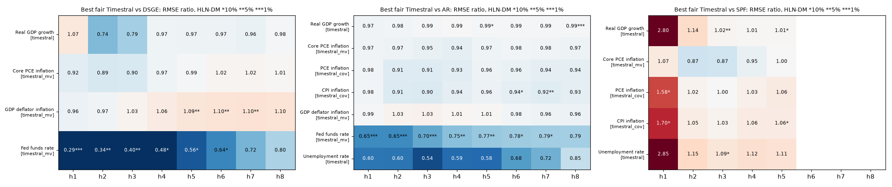
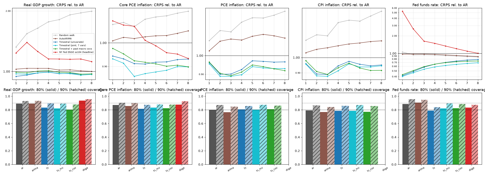

# Macro horse race: Timestral-209M vs the NY Fed DSGE (Model1002 ss104)

**Question.** Does the zero-shot time-series foundation model Timestral-209M forecast core US macro variables better
than the NY Fed DSGE (Model1002, subspec ss104, as ported in `gustavorubim/nydsge-python`) over 1 to 8 quarters?

## Bottom line (plain language)

* **GDP growth and core PCE inflation: Timestral is a bit more consistent, but it isn't a clear win.** Over 78
  quarterly starting points from 2005 to 2024, Timestral's error is 0 to 6% below a simple autoregression's (AR) at
  every horizon. The DSGE ranges from 9% better to 33% worse than AR. Excluding the COVID quarters, the DSGE trails AR
  by 4–19% on GDP; on core PCE it trails AR by 7–15% at 1–4 quarters and beats it by 7–8% at 6–8 quarters. Pitting
  Timestral against the DSGE directly, none of the Diebold-Mariano tests on GDP or core PCE is significant.
* **The DSGE did better before 2020 and much worse after.** Before COVID (target quarters up to 2019Q4), the DSGE
  beats the AR on GDP (0.90) and core PCE (0.82). That's better than Timestral on GDP (0.96) and close to it on
  core PCE (0.78). During the
  2021–23 inflation surge and after 2023, its GDP error is 1.9 to 2.4 times the AR's, and its fed funds error 1.3 to
  2.6 times. Timestral degrades much less. The post-2020 ss104 setup has COVID regimes, a flexible
  average-inflation-targeting credibility path, and no survey or expectations data after 2021, and that's where the
  fixed-parameter DSGE suffers.
* **Fed funds rate: Timestral wins clearly.** The joint Timestral (all seven series together) has 0.65–0.79 times the
  AR's error, and 0.29–0.80 times the DSGE's. The gain over the DSGE is significant at the 5% level 1 to 3 quarters
  ahead, and at the 10% level out to 6 quarters. Without
  expectations data, the unconditional DSGE pulls the policy rate quickly back toward its steady state, including
  during 2009–15, when the rate stayed at zero.
* **GDP deflator inflation: the DSGE's one long-horizon edge.** The DSGE is better 5 to 8 quarters out (0.87 vs 0.96 at 8 quarters;
  the DM test favours the DSGE at the 5% level 5 to 7 quarters ahead).
* **What the DSGE doesn't forecast.** It has no observables for headline PCE, CPI or unemployment. On those,
  Timestral beats AR and AutoARIMA (PCE and CPI 0.93–0.98, unemployment 0.6–0.85).
* **The professional forecasters (SPF) beat everyone in the first 1–2 quarters.** That's mostly an information
  advantage: the survey is taken mid-quarter with that month's data in hand. At 2 to 5 quarters ahead, Timestral is
  within about 0–6% of the SPF on GDP, PCE and CPI, but well behind it on unemployment.
* **Uncertainty bands.** Timestral's distributions score better on CRPS, a measure of probabilistic accuracy, but
  are slightly too narrow (80% bands catch 72–83% of outcomes on average, depending on the variable). The DSGE's bands are too wide on GDP and core PCE
  (80% bands catch 88–94%), and its post-2020 densities are unstable.
* **Worth adding to Econer's notes? Yes, as a benchmark row, not a replacement.** A Timestral line next to the DSGE
  path is a cheap check, taking seconds per run on a CPU. It is most informative for the policy-rate path and for the
  variables the DSGE lacks (headline PCE, CPI, unemployment). It shouldn't be presented as more accurate than the
  DSGE on GDP or core PCE, because this backtest doesn't support that.

## Design

| Item | Choice |
|---|---|
| Targets | Real GDP growth, core PCE, headline PCE, CPI and GDP deflator inflation (annualised quarterly log rates, %); fed funds rate and unemployment (quarterly averages, levels) |
| Origins | 78 quarterly expanding-window origins; last observed quarter T from 2005Q1 to 2024Q2; forecasts for T+1..T+8 |
| Data vintage | **Latest vintage, pseudo-out-of-sample, the same for every model.** There's no `FRED_API_KEY`, so no ALFRED real-time vintages. GDP, GDP deflator, core PCE, fed funds and the 10-year yield come from the same FRED snapshot (2026-10-06) that the nydsge port uses. Headline PCE, CPI, unemployment, WTI oil and the 3-month bill were fetched from FRED on 2026-10-18. |
| Information set | At each origin every model sees only data dated ≤ T. The DSGE's transformed observables are rebuilt from the levels truncated at T, so the HP-filtered population trend uses data only up to T. The DSGE uses its own 13+ observables (wages, hours, spreads, TFP and so on), while the statistical models use the target histories (plus the covariates listed below). |
| DSGE | Model1002 ss104, **fixed DSGE.jl published-code default parameters**, the same ones nydsge's `forecast_ss104_nyfed_params.py` uses. No estimation at any origin. Kalman filter on 1959Q3..T, then an unconditional mean forecast and a closed-form Gaussian density (filtered state covariance propagated with the shock covariance; no parameter uncertainty). GDP adds back population growth at T. Run in a fresh nydsge clone (`main` e2ff029) via `experiments/macro_horse/dsge_runner.py`; Econer's tree and routines were not touched. |
| DSGE regimes | **Headline:** origins before 2020Q1 freeze the regime in force at T, so there's no foreknowledge of COVID. From 2020Q1 on, origins follow ss104's dated regime schedule (ZLB, then a flexible-AIT credibility path), which is the model's own forward assumption. Sensitivity runs: `dsge_frozen` (always frozen; freezing the one-quarter COVID shock-variance regimes gives absurd densities) and `dsge_sched` (always scheduled, so pre-2020 origins "know" about the COVID regimes). Filtering 2020–21 data uses the COVID regime parameters, which were designed after the fact; this mildly flatters the DSGE at origins from 2020 to 2021. |
| Survey and expectations data | ss104's expected-FFR (OIS/survey) observables are missing for much of the sample and entirely after 2021 in the public snapshot, so the DSGE filters without them. This probably accounts for much of its weak policy-rate forecasting. |
| Models | Random walk; **AR(p)**, p≤8 chosen by BIC on each window (the reference, with analytic Gaussian bands); AutoARIMA; Timestral zero-shot univariate; Timestral joint (all 7 targets as one multivariate series); Timestral with past-only covariates (unemployment, 10y–3m term spread, oil growth, fed funds; a target is never its own covariate); a **labelled scenario variant** given the realised future covariate path (not a fair forecast); SPF median. |
| Not run | Timestral fine-tuning, because the installed `timestral` package has no fine-tuning API. DSGE unemployment, because there's no observable (nydsge has an hours-to-unemployment bridge, but it's an add-on, not the model). DSGE headline PCE and CPI, because there are no observables. Fed SEP, because it's annual. |
| SPF | Philadelphia Fed median forecasts (RGDP, CPI, core PCE, PCE, UNEMP). The survey in quarter Q corresponds to origin T = Q−1, so SPF's current-quarter nowcast is our h=1, giving h=1..5. Compounded rates are converted to log rates. Core PCE and PCE start in 2007. |
| Metrics | RMSE and MAE relative to AR by variable and horizon, on each model's common sample with AR. HLN-corrected Diebold-Mariano tests on squared errors. CRPS (19-quantile grid, the same grid for Gaussian and quantile models) and 80%/90% coverage. Regimes by **target quarter**: pre-COVID ≤2019Q4, COVID 2020Q1–2021Q2, inflation surge 2021Q3–2023Q2, post-2023 from 2023Q3. |

Reproduce:

```bash
uv run python -m bsforecast macro-horse data          # panel + SPF (needs data/raw/spf, see NOTES.md)
(cd /path/to/nydsge-python && uv run python <repo>/experiments/macro_horse/dsge_runner.py \
     --out <repo>/data/processed/macro_horse/dsge_forecasts.csv)   # ~80 s
BSF_THREADS=6 uv run python -m bsforecast macro-horse run          # ~5 min on 8 cores
uv run python -m bsforecast macro-horse report
```

**Caveats.** All scores use the latest data vintage (pseudo-out-of-sample), so the SPF's real-time forecasts are
scored against revised data that the other models also train on. The DSGE uses public default parameters, not the
FRBNY production posterior, and isn't re-estimated. 78 overlapping origins give few independent observations at
long horizons, so treat differences under about 5% as noise.


## Headline: relative RMSE vs AR(p) at h = 1, 4, 8

| Variable | h | DSGE ss104 | best fair Timestral | AR = 1 (AR RMSE, pp) | SPF | AutoARIMA |
|---|---|---|---|---|---|---|
| Real GDP growth | 1 | 0.91 | 0.97 (timestral) | 1 (6.61) | 0.35 | 1.00 |
| Real GDP growth | 4 | 1.03 | 0.99 (timestral) | 1 (5.75) | 0.99 | 1.01 |
| Real GDP growth | 8 | 1.01 | 0.99 (timestral) | 1 (5.74) |  | 1.00 |
| Core PCE inflation | 1 | 1.05 | 0.97 (timestral_mv) | 1 (0.86) | 0.92 | 1.01 |
| Core PCE inflation | 4 | 0.97 | 0.94 (timestral_mv) | 1 (1.23) | 0.99 | 1.04 |
| Core PCE inflation | 8 | 0.96 | 0.97 (timestral_mv) | 1 (1.45) |  | 1.07 |
| PCE inflation | 1 |  | 0.98 (timestral_cov) | 1 (1.82) | 0.62 | 1.06 |
| PCE inflation | 4 |  | 0.93 (timestral_cov) | 1 (2.27) | 0.90 | 1.09 |
| PCE inflation | 8 |  | 0.94 (timestral_cov) | 1 (2.36) |  | 1.11 |
| CPI inflation | 1 |  | 0.98 (timestral_cov) | 1 (2.57) | 0.58 | 1.03 |
| CPI inflation | 4 |  | 0.94 (timestral_cov) | 1 (2.99) | 0.88 | 1.07 |
| CPI inflation | 8 |  | 0.93 (timestral_cov) | 1 (3.01) |  | 1.12 |
| GDP deflator inflation | 1 | 1.03 | 0.99 (timestral_mv) | 1 (1.26) |  | 1.03 |
| GDP deflator inflation | 4 | 0.96 | 1.01 (timestral_mv) | 1 (1.79) |  | 1.09 |
| GDP deflator inflation | 8 | 0.87 | 0.96 (timestral_mv) | 1 (2.20) |  | 1.14 |
| Fed funds rate | 1 | 2.26 | 0.65 (timestral_mv) | 1 (0.41) |  | 0.94 |
| Fed funds rate | 4 | 1.56 | 0.75 (timestral_mv) | 1 (1.49) |  | 0.95 |
| Fed funds rate | 8 | 0.99 | 0.79 (timestral_mv) | 1 (2.55) |  | 0.88 |
| Unemployment rate | 1 |  | 0.60 (timestral) | 1 (1.91) | 0.21 | 0.98 |
| Unemployment rate | 4 |  | 0.59 (timestral) | 1 (2.90) | 0.52 | 0.92 |
| Unemployment rate | 8 |  | 0.85 (timestral) | 1 (2.53) |  | 0.98 |

SPF and each model are scored on their common sample with AR (SPF: h<=5; core/headline PCE from 2007). Best fair Timestral = the no-future-information variant with the lowest geometric-mean relative RMSE over h=1..8 for that variable.

### Same table excluding COVID target quarters (2020Q1-2021Q2)

| Variable | h | DSGE ss104 | best fair Timestral | SPF | AutoARIMA |
|---|---|---|---|---|---|
| Real GDP growth | 1 | 1.07 | 1.01 (timestral) | 0.80 | 1.05 |
| Real GDP growth | 4 | 1.06 | 0.97 (timestral) | 0.96 | 1.03 |
| Real GDP growth | 8 | 1.07 | 0.95 (timestral) |  | 0.99 |
| Core PCE inflation | 1 | 1.09 | 0.92 (timestral_mv) | 0.98 | 1.00 |
| Core PCE inflation | 4 | 1.07 | 0.94 (timestral_mv) | 1.06 | 1.03 |
| Core PCE inflation | 8 | 0.93 | 0.96 (timestral_mv) |  | 1.07 |
| PCE inflation | 1 |  | 0.99 (timestral_cov) | 0.61 | 1.06 |
| PCE inflation | 4 |  | 0.93 (timestral_cov) | 0.91 | 1.10 |
| PCE inflation | 8 |  | 0.93 (timestral_cov) |  | 1.12 |
| CPI inflation | 1 |  | 0.99 (timestral_cov) | 0.58 | 1.05 |
| CPI inflation | 4 |  | 0.95 (timestral_cov) | 0.89 | 1.08 |
| CPI inflation | 8 |  | 0.93 (timestral_cov) |  | 1.13 |
| GDP deflator inflation | 1 | 1.06 | 0.95 (timestral_mv) |  | 1.04 |
| GDP deflator inflation | 4 | 1.02 | 1.02 (timestral_mv) |  | 1.09 |
| GDP deflator inflation | 8 | 0.84 | 0.96 (timestral_mv) |  | 1.14 |
| Fed funds rate | 1 | 2.28 | 0.66 (timestral_mv) |  | 0.94 |
| Fed funds rate | 4 | 1.65 | 0.75 (timestral_mv) |  | 0.97 |
| Fed funds rate | 8 | 1.00 | 0.79 (timestral_mv) |  | 0.91 |
| Unemployment rate | 1 |  | 0.78 (timestral) | 0.54 | 1.01 |
| Unemployment rate | 4 |  | 0.76 (timestral) | 0.64 | 1.06 |
| Unemployment rate | 8 |  | 0.75 (timestral) |  | 0.98 |

















## Relative RMSE vs AR, all horizons

| target | h | rw | ar | arima | timestral | timestral_mv | timestral_cov | timestral_scenario | dsge | dsge_frozen | dsge_sched | spf |
|---|---|---|---|---|---|---|---|---|---|---|---|---|
| corepce | 1 | 1.08 | 1.00 | 1.01 | 0.96 | 0.97 | 1.01 | 0.90 | 1.05 | 1.03 | 1.05 | 0.92 |
| corepce | 2 | 1.08 | 1.00 | 1.03 | 0.98 | 0.97 | 1.01 | 0.90 | 1.08 | 1.05 | 1.08 | 1.12 |
| corepce | 3 | 1.03 | 1.00 | 1.03 | 0.98 | 0.95 | 1.02 | 0.89 | 1.05 | 1.05 | 1.05 | 1.10 |
| corepce | 4 | 1.08 | 1.00 | 1.04 | 0.95 | 0.94 | 0.99 | 0.89 | 0.97 | 0.99 | 0.97 | 0.99 |
| corepce | 5 | 1.08 | 1.00 | 1.05 | 0.97 | 0.97 | 0.99 | 0.88 | 0.98 | 1.00 | 0.97 | 0.98 |
| corepce | 6 | 1.07 | 1.00 | 1.05 | 0.98 | 0.98 | 0.99 | 0.89 | 0.96 | 0.98 | 0.92 |  |
| corepce | 7 | 1.09 | 1.00 | 1.06 | 0.98 | 0.98 | 0.98 | 0.89 | 0.96 | 0.97 | 0.90 |  |
| corepce | 8 | 1.09 | 1.00 | 1.07 | 0.97 | 0.97 | 0.96 | 0.89 | 0.96 | 0.97 | 0.88 |  |
| cpi | 1 | 1.13 | 1.00 | 1.03 | 0.99 | 0.96 | 0.98 | 0.69 |  |  |  | 0.58 |
| cpi | 2 | 1.15 | 1.00 | 1.05 | 0.92 | 0.89 | 0.91 | 0.63 |  |  |  | 0.86 |
| cpi | 3 | 1.14 | 1.00 | 1.05 | 0.92 | 0.90 | 0.90 | 0.64 |  |  |  | 0.88 |
| cpi | 4 | 1.22 | 1.00 | 1.07 | 0.96 | 0.93 | 0.94 | 0.64 |  |  |  | 0.88 |
| cpi | 5 | 1.18 | 1.00 | 1.08 | 0.98 | 0.97 | 0.96 | 0.71 |  |  |  | 0.90 |
| cpi | 6 | 1.19 | 1.00 | 1.09 | 0.96 | 0.96 | 0.94 | 0.66 |  |  |  |  |
| cpi | 7 | 1.23 | 1.00 | 1.11 | 0.95 | 0.96 | 0.92 | 0.69 |  |  |  |  |
| cpi | 8 | 1.26 | 1.00 | 1.12 | 0.96 | 0.98 | 0.93 | 0.66 |  |  |  |  |
| ffr | 1 | 1.06 | 1.00 | 0.94 | 0.69 | 0.65 | 0.69 | 0.57 | 2.26 | 2.30 | 2.26 |  |
| ffr | 2 | 0.97 | 1.00 | 0.94 | 0.68 | 0.65 | 0.70 | 0.48 | 1.93 | 1.98 | 1.93 |  |
| ffr | 3 | 0.97 | 1.00 | 0.95 | 0.74 | 0.70 | 0.76 | 0.42 | 1.76 | 1.81 | 1.76 |  |
| ffr | 4 | 0.96 | 1.00 | 0.95 | 0.79 | 0.75 | 0.80 | 0.39 | 1.56 | 1.62 | 1.56 |  |
| ffr | 5 | 0.94 | 1.00 | 0.93 | 0.81 | 0.77 | 0.81 | 0.36 | 1.38 | 1.44 | 1.37 |  |
| ffr | 6 | 0.92 | 1.00 | 0.92 | 0.83 | 0.78 | 0.82 | 0.36 | 1.22 | 1.28 | 1.20 |  |
| ffr | 7 | 0.91 | 1.00 | 0.90 | 0.84 | 0.79 | 0.82 | 0.36 | 1.09 | 1.16 | 1.06 |  |
| ffr | 8 | 0.89 | 1.00 | 0.88 | 0.85 | 0.79 | 0.82 | 0.36 | 0.99 | 1.06 | 0.95 |  |
| gdp | 1 | 1.32 | 1.00 | 1.00 | 0.97 | 1.05 | 1.12 | 0.78 | 0.91 | 0.78 | 0.91 | 0.35 |
| gdp | 2 | 1.38 | 1.00 | 1.01 | 0.98 | 1.00 | 1.04 | 0.85 | 1.33 | 0.96 | 1.33 | 0.86 |
| gdp | 3 | 1.39 | 1.00 | 1.01 | 0.99 | 1.01 | 1.03 | 0.86 | 1.26 | 1.02 | 1.26 | 0.97 |
| gdp | 4 | 1.43 | 1.00 | 1.01 | 0.99 | 1.00 | 1.01 | 0.90 | 1.03 | 1.02 | 1.25 | 0.99 |
| gdp | 5 | 1.37 | 1.00 | 1.00 | 0.99 | 0.99 | 1.00 | 0.87 | 1.02 | 1.04 | 1.24 | 0.98 |
| gdp | 6 | 1.43 | 1.00 | 1.00 | 0.99 | 0.99 | 1.00 | 0.87 | 1.03 | 1.02 | 1.26 |  |
| gdp | 7 | 1.38 | 1.00 | 1.00 | 0.99 | 0.99 | 0.99 | 0.84 | 1.04 | 1.02 | 1.30 |  |
| gdp | 8 | 1.35 | 1.00 | 1.00 | 0.99 | 0.99 | 0.99 | 0.85 | 1.01 | 1.00 | 1.30 |  |
| gdpdef | 1 | 1.08 | 1.00 | 1.03 | 1.00 | 0.99 | 1.01 | 0.84 | 1.03 | 1.02 | 1.03 |  |
| gdpdef | 2 | 1.07 | 1.00 | 1.06 | 1.04 | 1.03 | 1.05 | 0.89 | 1.05 | 1.04 | 1.05 |  |
| gdpdef | 3 | 1.08 | 1.00 | 1.07 | 1.03 | 1.03 | 1.04 | 0.88 | 1.00 | 1.00 | 1.00 |  |
| gdpdef | 4 | 1.09 | 1.00 | 1.09 | 1.03 | 1.01 | 1.04 | 0.88 | 0.96 | 0.96 | 0.96 |  |
| gdpdef | 5 | 1.09 | 1.00 | 1.10 | 1.02 | 1.01 | 1.04 | 0.89 | 0.93 | 0.93 | 0.91 |  |
| gdpdef | 6 | 1.12 | 1.00 | 1.11 | 1.00 | 0.98 | 1.01 | 0.87 | 0.89 | 0.89 | 0.86 |  |
| gdpdef | 7 | 1.13 | 1.00 | 1.13 | 0.99 | 0.96 | 0.99 | 0.86 | 0.87 | 0.90 | 0.83 |  |
| gdpdef | 8 | 1.18 | 1.00 | 1.14 | 0.98 | 0.96 | 0.98 | 0.86 | 0.87 | 0.90 | 0.82 |  |
| pce | 1 | 1.09 | 1.00 | 1.06 | 1.00 | 0.96 | 0.98 | 0.74 |  |  |  | 0.62 |
| pce | 2 | 1.14 | 1.00 | 1.10 | 0.92 | 0.90 | 0.91 | 0.72 |  |  |  | 0.89 |
| pce | 3 | 1.13 | 1.00 | 1.10 | 0.93 | 0.91 | 0.91 | 0.73 |  |  |  | 0.92 |
| pce | 4 | 1.18 | 1.00 | 1.09 | 0.95 | 0.92 | 0.93 | 0.72 |  |  |  | 0.90 |
| pce | 5 | 1.17 | 1.00 | 1.10 | 0.99 | 0.97 | 0.96 | 0.76 |  |  |  | 0.91 |
| pce | 6 | 1.16 | 1.00 | 1.12 | 0.98 | 0.97 | 0.96 | 0.74 |  |  |  |  |
| pce | 7 | 1.19 | 1.00 | 1.12 | 0.97 | 0.96 | 0.94 | 0.79 |  |  |  |  |
| pce | 8 | 1.21 | 1.00 | 1.11 | 0.98 | 0.97 | 0.94 | 0.76 |  |  |  |  |
| unrate | 1 | 0.63 | 1.00 | 0.98 | 0.60 | 0.63 | 0.61 | 0.59 |  |  |  | 0.21 |
| unrate | 2 | 0.65 | 1.00 | 0.98 | 0.60 | 0.65 | 0.61 | 0.59 |  |  |  | 0.53 |
| unrate | 3 | 0.60 | 1.00 | 0.88 | 0.54 | 0.59 | 0.55 | 0.52 |  |  |  | 0.49 |
| unrate | 4 | 0.67 | 1.00 | 0.92 | 0.59 | 0.64 | 0.60 | 0.55 |  |  |  | 0.52 |
| unrate | 5 | 0.69 | 1.00 | 0.87 | 0.58 | 0.65 | 0.60 | 0.53 |  |  |  | 0.53 |
| unrate | 6 | 0.80 | 1.00 | 0.93 | 0.68 | 0.75 | 0.70 | 0.59 |  |  |  |  |
| unrate | 7 | 0.85 | 1.00 | 0.90 | 0.72 | 0.79 | 0.74 | 0.61 |  |  |  |  |
| unrate | 8 | 1.00 | 1.00 | 0.98 | 0.85 | 0.92 | 0.87 | 0.70 |  |  |  |  |

## Relative MAE vs AR

| target | h | rw | ar | arima | timestral | timestral_mv | timestral_cov | timestral_scenario | dsge | dsge_frozen | dsge_sched | spf |
|---|---|---|---|---|---|---|---|---|---|---|---|---|
| corepce | 1 | 1.10 | 1.00 | 1.00 | 0.92 | 0.90 | 0.96 | 0.86 | 1.00 | 0.98 | 1.00 | 0.84 |
| corepce | 2 | 1.09 | 1.00 | 1.03 | 0.92 | 0.91 | 0.95 | 0.86 | 1.03 | 1.03 | 1.03 | 1.04 |
| corepce | 3 | 0.99 | 1.00 | 0.96 | 0.91 | 0.85 | 0.93 | 0.82 | 1.04 | 1.06 | 1.04 | 1.01 |
| corepce | 4 | 1.06 | 1.00 | 1.01 | 0.91 | 0.89 | 0.93 | 0.84 | 1.00 | 1.02 | 1.00 | 0.95 |
| corepce | 5 | 1.05 | 1.00 | 1.00 | 0.90 | 0.85 | 0.90 | 0.82 | 0.97 | 0.98 | 0.95 | 0.89 |
| corepce | 6 | 1.02 | 1.00 | 0.96 | 0.88 | 0.85 | 0.86 | 0.79 | 0.89 | 0.90 | 0.86 |  |
| corepce | 7 | 1.00 | 1.00 | 0.97 | 0.89 | 0.87 | 0.88 | 0.78 | 0.88 | 0.88 | 0.84 |  |
| corepce | 8 | 1.01 | 1.00 | 0.97 | 0.86 | 0.83 | 0.83 | 0.77 | 0.84 | 0.84 | 0.80 |  |
| cpi | 1 | 1.09 | 1.00 | 1.02 | 0.93 | 0.94 | 0.95 | 0.65 |  |  |  | 0.61 |
| cpi | 2 | 1.13 | 1.00 | 1.06 | 0.88 | 0.87 | 0.88 | 0.62 |  |  |  | 0.83 |
| cpi | 3 | 1.16 | 1.00 | 1.07 | 0.89 | 0.90 | 0.89 | 0.63 |  |  |  | 0.84 |
| cpi | 4 | 1.25 | 1.00 | 1.11 | 0.98 | 0.95 | 0.96 | 0.66 |  |  |  | 0.89 |
| cpi | 5 | 1.22 | 1.00 | 1.09 | 0.97 | 0.94 | 0.95 | 0.70 |  |  |  | 0.89 |
| cpi | 6 | 1.17 | 1.00 | 1.10 | 0.93 | 0.91 | 0.91 | 0.66 |  |  |  |  |
| cpi | 7 | 1.22 | 1.00 | 1.11 | 0.91 | 0.91 | 0.89 | 0.68 |  |  |  |  |
| cpi | 8 | 1.26 | 1.00 | 1.10 | 0.90 | 0.90 | 0.87 | 0.65 |  |  |  |  |
| ffr | 1 | 0.82 | 1.00 | 0.78 | 0.50 | 0.48 | 0.52 | 0.50 | 2.39 | 2.43 | 2.39 |  |
| ffr | 2 | 0.77 | 1.00 | 0.76 | 0.51 | 0.49 | 0.55 | 0.40 | 1.94 | 2.02 | 1.94 |  |
| ffr | 3 | 0.79 | 1.00 | 0.78 | 0.57 | 0.53 | 0.61 | 0.33 | 1.74 | 1.85 | 1.74 |  |
| ffr | 4 | 0.81 | 1.00 | 0.80 | 0.63 | 0.58 | 0.65 | 0.32 | 1.58 | 1.68 | 1.55 |  |
| ffr | 5 | 0.79 | 1.00 | 0.79 | 0.66 | 0.61 | 0.67 | 0.30 | 1.38 | 1.48 | 1.34 |  |
| ffr | 6 | 0.78 | 1.00 | 0.77 | 0.69 | 0.64 | 0.68 | 0.30 | 1.23 | 1.31 | 1.18 |  |
| ffr | 7 | 0.76 | 1.00 | 0.75 | 0.71 | 0.65 | 0.68 | 0.30 | 1.11 | 1.18 | 1.04 |  |
| ffr | 8 | 0.75 | 1.00 | 0.74 | 0.72 | 0.67 | 0.69 | 0.31 | 1.02 | 1.09 | 0.94 |  |
| gdp | 1 | 1.35 | 1.00 | 1.05 | 0.99 | 1.04 | 1.06 | 0.94 | 1.04 | 0.97 | 1.04 | 0.62 |
| gdp | 2 | 1.45 | 1.00 | 1.05 | 0.98 | 1.02 | 1.04 | 0.89 | 1.30 | 1.06 | 1.30 | 0.92 |
| gdp | 3 | 1.50 | 1.00 | 1.05 | 1.00 | 1.01 | 1.03 | 0.89 | 1.27 | 1.08 | 1.27 | 0.97 |
| gdp | 4 | 1.60 | 1.00 | 1.05 | 1.00 | 1.01 | 1.03 | 0.95 | 1.11 | 1.13 | 1.28 | 0.96 |
| gdp | 5 | 1.57 | 1.00 | 1.03 | 0.99 | 0.99 | 1.01 | 0.87 | 1.11 | 1.17 | 1.30 | 0.98 |
| gdp | 6 | 1.57 | 1.00 | 1.03 | 0.99 | 0.99 | 1.01 | 0.91 | 1.14 | 1.15 | 1.32 |  |
| gdp | 7 | 1.52 | 1.00 | 1.01 | 0.98 | 0.96 | 0.97 | 0.88 | 1.17 | 1.16 | 1.37 |  |
| gdp | 8 | 1.59 | 1.00 | 1.00 | 0.97 | 0.97 | 0.98 | 0.92 | 1.11 | 1.10 | 1.35 |  |
| gdpdef | 1 | 1.03 | 1.00 | 1.04 | 1.01 | 0.97 | 1.02 | 0.88 | 1.01 | 1.00 | 1.01 |  |
| gdpdef | 2 | 1.08 | 1.00 | 1.09 | 1.03 | 1.00 | 1.04 | 0.89 | 1.04 | 1.04 | 1.04 |  |
| gdpdef | 3 | 1.07 | 1.00 | 1.08 | 1.01 | 1.00 | 1.03 | 0.87 | 1.00 | 1.01 | 1.00 |  |
| gdpdef | 4 | 1.06 | 1.00 | 1.06 | 0.98 | 0.95 | 0.98 | 0.85 | 0.91 | 0.92 | 0.90 |  |
| gdpdef | 5 | 1.10 | 1.00 | 1.09 | 0.96 | 0.93 | 0.98 | 0.85 | 0.88 | 0.88 | 0.86 |  |
| gdpdef | 6 | 1.11 | 1.00 | 1.09 | 0.95 | 0.92 | 0.96 | 0.85 | 0.87 | 0.86 | 0.84 |  |
| gdpdef | 7 | 1.10 | 1.00 | 1.09 | 0.95 | 0.92 | 0.94 | 0.84 | 0.81 | 0.81 | 0.78 |  |
| gdpdef | 8 | 1.15 | 1.00 | 1.11 | 0.95 | 0.92 | 0.95 | 0.86 | 0.82 | 0.82 | 0.78 |  |
| pce | 1 | 1.06 | 1.00 | 1.00 | 0.94 | 0.94 | 0.95 | 0.68 |  |  |  | 0.64 |
| pce | 2 | 1.16 | 1.00 | 1.08 | 0.90 | 0.89 | 0.91 | 0.68 |  |  |  | 0.86 |
| pce | 3 | 1.13 | 1.00 | 1.09 | 0.91 | 0.92 | 0.90 | 0.69 |  |  |  | 0.87 |
| pce | 4 | 1.16 | 1.00 | 1.09 | 0.92 | 0.90 | 0.91 | 0.71 |  |  |  | 0.86 |
| pce | 5 | 1.17 | 1.00 | 1.11 | 0.96 | 0.91 | 0.94 | 0.74 |  |  |  | 0.87 |
| pce | 6 | 1.13 | 1.00 | 1.12 | 0.94 | 0.90 | 0.92 | 0.72 |  |  |  |  |
| pce | 7 | 1.17 | 1.00 | 1.10 | 0.92 | 0.90 | 0.90 | 0.72 |  |  |  |  |
| pce | 8 | 1.19 | 1.00 | 1.08 | 0.93 | 0.89 | 0.88 | 0.70 |  |  |  |  |
| unrate | 1 | 0.76 | 1.00 | 1.00 | 0.58 | 0.60 | 0.58 | 0.58 |  |  |  | 0.30 |
| unrate | 2 | 0.91 | 1.00 | 1.04 | 0.66 | 0.71 | 0.66 | 0.69 |  |  |  | 0.55 |
| unrate | 3 | 0.87 | 1.00 | 0.96 | 0.62 | 0.67 | 0.62 | 0.63 |  |  |  | 0.55 |
| unrate | 4 | 0.96 | 1.00 | 1.02 | 0.69 | 0.74 | 0.68 | 0.66 |  |  |  | 0.60 |
| unrate | 5 | 0.95 | 1.00 | 0.98 | 0.69 | 0.73 | 0.68 | 0.62 |  |  |  | 0.59 |
| unrate | 6 | 1.07 | 1.00 | 1.04 | 0.77 | 0.82 | 0.76 | 0.65 |  |  |  |  |
| unrate | 7 | 1.06 | 1.00 | 1.01 | 0.77 | 0.83 | 0.76 | 0.63 |  |  |  |  |
| unrate | 8 | 1.15 | 1.00 | 1.06 | 0.85 | 0.89 | 0.84 | 0.67 |  |  |  |  |

## Relative CRPS vs AR (quantile-grid CRPS; Gaussian models evaluated on the same grid)

| target | h | ar | arima | dsge | dsge_frozen | dsge_sched | rw | timestral | timestral_cov | timestral_mv | timestral_scenario |
|---|---|---|---|---|---|---|---|---|---|---|---|
| corepce | 1 | 1.00 | 1.01 | 1.10 | 1.08 | 1.11 | 1.09 | 0.94 | 0.98 | 0.93 | 0.88 |
| corepce | 2 | 1.00 | 1.02 | 1.08 | 1.07 | 1.08 | 1.10 | 0.93 | 0.95 | 0.91 | 0.85 |
| corepce | 3 | 1.00 | 1.02 | 1.08 | 1.09 | 1.08 | 1.07 | 0.91 | 0.92 | 0.86 | 0.82 |
| corepce | 4 | 1.00 | 1.03 | 1.01 | 1.03 | 1.02 | 1.11 | 0.91 | 0.92 | 0.87 | 0.83 |
| corepce | 5 | 1.00 | 1.03 | 0.99 | 0.98 | 0.98 | 1.12 | 0.92 | 0.91 | 0.88 | 0.81 |
| corepce | 6 | 1.00 | 1.03 | 0.96 | 0.95 | 0.93 | 1.13 | 0.92 | 0.90 | 0.88 | 0.81 |
| corepce | 7 | 1.00 | 1.04 | 0.95 | 0.94 | 0.91 | 1.14 | 0.93 | 0.91 | 0.90 | 0.82 |
| corepce | 8 | 1.00 | 1.05 | 0.93 | 0.92 | 0.88 | 1.15 | 0.93 | 0.90 | 0.90 | 0.81 |
| cpi | 1 | 1.00 | 1.03 |  |  |  | 1.13 | 0.96 | 0.98 | 0.96 | 0.68 |
| cpi | 2 | 1.00 | 1.06 |  |  |  | 1.17 | 0.89 | 0.91 | 0.88 | 0.62 |
| cpi | 3 | 1.00 | 1.07 |  |  |  | 1.16 | 0.89 | 0.89 | 0.88 | 0.62 |
| cpi | 4 | 1.00 | 1.08 |  |  |  | 1.27 | 0.94 | 0.93 | 0.91 | 0.65 |
| cpi | 5 | 1.00 | 1.10 |  |  |  | 1.29 | 0.97 | 0.96 | 0.96 | 0.70 |
| cpi | 6 | 1.00 | 1.11 |  |  |  | 1.28 | 0.95 | 0.93 | 0.94 | 0.67 |
| cpi | 7 | 1.00 | 1.12 |  |  |  | 1.33 | 0.94 | 0.91 | 0.94 | 0.69 |
| cpi | 8 | 1.00 | 1.12 |  |  |  | 1.37 | 0.95 | 0.92 | 0.94 | 0.65 |
| ffr | 1 | 1.00 | 0.97 | 5.28 | 6.94 | 6.93 | 1.06 | 0.41 | 0.43 | 0.40 | 0.38 |
| ffr | 2 | 1.00 | 0.97 | 2.63 | 5.64 | 5.59 | 0.94 | 0.49 | 0.51 | 0.47 | 0.35 |
| ffr | 3 | 1.00 | 0.97 | 1.62 | 4.56 | 4.46 | 0.95 | 0.58 | 0.59 | 0.53 | 0.32 |
| ffr | 4 | 1.00 | 0.96 | 1.49 | 3.86 | 3.73 | 0.94 | 0.65 | 0.65 | 0.58 | 0.31 |
| ffr | 5 | 1.00 | 0.94 | 1.33 | 3.34 | 3.19 | 0.92 | 0.70 | 0.69 | 0.62 | 0.30 |
| ffr | 6 | 1.00 | 0.92 | 1.20 | 2.95 | 2.79 | 0.90 | 0.74 | 0.72 | 0.65 | 0.30 |
| ffr | 7 | 1.00 | 0.90 | 1.09 | 2.67 | 2.48 | 0.88 | 0.77 | 0.73 | 0.67 | 0.31 |
| ffr | 8 | 1.00 | 0.88 | 1.00 | 2.45 | 2.25 | 0.86 | 0.79 | 0.74 | 0.69 | 0.31 |
| gdp | 1 | 1.00 | 1.03 | 1.24 | 1.43 | 1.50 | 1.32 | 0.95 | 0.99 | 0.97 | 0.85 |
| gdp | 2 | 1.00 | 1.04 | 1.39 | 1.84 | 1.80 | 1.54 | 0.96 | 0.98 | 0.97 | 0.80 |
| gdp | 3 | 1.00 | 1.04 | 1.26 | 2.19 | 2.02 | 1.64 | 0.98 | 1.00 | 0.98 | 0.81 |
| gdp | 4 | 1.00 | 1.04 | 1.15 | 2.27 | 2.05 | 1.77 | 0.99 | 1.01 | 0.99 | 0.85 |
| gdp | 5 | 1.00 | 1.02 | 1.15 | 2.30 | 2.09 | 1.81 | 0.97 | 0.99 | 0.98 | 0.81 |
| gdp | 6 | 1.00 | 1.02 | 1.15 | 2.29 | 2.10 | 1.91 | 0.98 | 0.99 | 0.97 | 0.82 |
| gdp | 7 | 1.00 | 1.01 | 1.15 | 2.30 | 2.13 | 1.96 | 0.97 | 0.97 | 0.96 | 0.77 |
| gdp | 8 | 1.00 | 1.00 | 1.12 | 2.28 | 2.13 | 1.99 | 0.97 | 0.97 | 0.97 | 0.83 |
| gdpdef | 1 | 1.00 | 1.03 | 1.02 | 1.02 | 1.04 | 1.04 | 1.00 | 1.01 | 0.96 | 0.85 |
| gdpdef | 2 | 1.00 | 1.07 | 1.03 | 1.04 | 1.05 | 1.07 | 1.01 | 1.01 | 0.98 | 0.85 |
| gdpdef | 3 | 1.00 | 1.07 | 0.97 | 0.97 | 1.00 | 1.07 | 0.98 | 0.99 | 0.96 | 0.84 |
| gdpdef | 4 | 1.00 | 1.08 | 0.92 | 0.90 | 0.94 | 1.09 | 0.99 | 1.00 | 0.96 | 0.84 |
| gdpdef | 5 | 1.00 | 1.09 | 0.87 | 0.85 | 0.89 | 1.10 | 0.99 | 1.00 | 0.96 | 0.86 |
| gdpdef | 6 | 1.00 | 1.10 | 0.85 | 0.81 | 0.85 | 1.13 | 0.98 | 0.98 | 0.94 | 0.85 |
| gdpdef | 7 | 1.00 | 1.12 | 0.83 | 0.79 | 0.82 | 1.15 | 0.98 | 0.97 | 0.94 | 0.85 |
| gdpdef | 8 | 1.00 | 1.13 | 0.84 | 0.81 | 0.81 | 1.19 | 0.97 | 0.97 | 0.94 | 0.86 |
| pce | 1 | 1.00 | 1.03 |  |  |  | 1.09 | 0.96 | 0.96 | 0.95 | 0.70 |
| pce | 2 | 1.00 | 1.08 |  |  |  | 1.15 | 0.90 | 0.90 | 0.89 | 0.66 |
| pce | 3 | 1.00 | 1.10 |  |  |  | 1.14 | 0.90 | 0.89 | 0.89 | 0.67 |
| pce | 4 | 1.00 | 1.09 |  |  |  | 1.21 | 0.92 | 0.91 | 0.90 | 0.69 |
| pce | 5 | 1.00 | 1.11 |  |  |  | 1.24 | 0.97 | 0.95 | 0.94 | 0.72 |
| pce | 6 | 1.00 | 1.13 |  |  |  | 1.24 | 0.97 | 0.94 | 0.93 | 0.71 |
| pce | 7 | 1.00 | 1.12 |  |  |  | 1.26 | 0.96 | 0.93 | 0.93 | 0.73 |
| pce | 8 | 1.00 | 1.10 |  |  |  | 1.28 | 0.97 | 0.92 | 0.93 | 0.71 |
| unrate | 1 | 1.00 | 0.99 |  |  |  | 0.74 | 0.52 | 0.53 | 0.56 | 0.53 |
| unrate | 2 | 1.00 | 1.03 |  |  |  | 0.87 | 0.62 | 0.63 | 0.67 | 0.63 |
| unrate | 3 | 1.00 | 0.93 |  |  |  | 0.84 | 0.60 | 0.60 | 0.64 | 0.59 |
| unrate | 4 | 1.00 | 1.01 |  |  |  | 0.94 | 0.68 | 0.68 | 0.74 | 0.63 |
| unrate | 5 | 1.00 | 0.95 |  |  |  | 0.95 | 0.69 | 0.68 | 0.74 | 0.60 |
| unrate | 6 | 1.00 | 1.02 |  |  |  | 1.07 | 0.78 | 0.78 | 0.85 | 0.64 |
| unrate | 7 | 1.00 | 0.98 |  |  |  | 1.08 | 0.79 | 0.79 | 0.86 | 0.62 |
| unrate | 8 | 1.00 | 1.05 |  |  |  | 1.20 | 0.88 | 0.89 | 0.95 | 0.68 |

## Interval coverage (mean over h=1..8; nominal 0.80 / 0.90)

| model | target | cov80 | cov90 |
|---|---|---|---|
| ar | corepce | 0.87 | 0.90 |
| ar | cpi | 0.79 | 0.87 |
| ar | ffr | 0.89 | 0.96 |
| ar | gdp | 0.89 | 0.93 |
| ar | gdpdef | 0.78 | 0.85 |
| ar | pce | 0.80 | 0.87 |
| ar | unrate | 0.81 | 0.84 |
| arima | corepce | 0.86 | 0.90 |
| arima | cpi | 0.77 | 0.84 |
| arima | ffr | 0.91 | 0.95 |
| arima | gdp | 0.89 | 0.93 |
| arima | gdpdef | 0.77 | 0.84 |
| arima | pce | 0.76 | 0.85 |
| arima | unrate | 0.80 | 0.84 |
| dsge | corepce | 0.88 | 0.93 |
| dsge | ffr | 0.83 | 0.88 |
| dsge | gdp | 0.94 | 0.96 |
| dsge | gdpdef | 0.85 | 0.90 |
| dsge_frozen | corepce | 0.89 | 0.94 |
| dsge_frozen | ffr | 0.83 | 0.87 |
| dsge_frozen | gdp | 0.95 | 0.97 |
| dsge_frozen | gdpdef | 0.89 | 0.93 |
| dsge_sched | corepce | 0.89 | 0.94 |
| dsge_sched | ffr | 0.81 | 0.85 |
| dsge_sched | gdp | 0.97 | 0.98 |
| dsge_sched | gdpdef | 0.88 | 0.93 |
| rw | corepce | 0.91 | 0.96 |
| rw | cpi | 0.89 | 0.93 |
| rw | ffr | 0.89 | 0.92 |
| rw | gdp | 0.93 | 0.95 |
| rw | gdpdef | 0.87 | 0.92 |
| rw | pce | 0.88 | 0.93 |
| rw | unrate | 0.66 | 0.77 |
| timestral | corepce | 0.81 | 0.87 |
| timestral | cpi | 0.79 | 0.86 |
| timestral | ffr | 0.79 | 0.84 |
| timestral | gdp | 0.83 | 0.90 |
| timestral | gdpdef | 0.72 | 0.82 |
| timestral | pce | 0.81 | 0.86 |
| timestral | unrate | 0.76 | 0.86 |
| timestral_cov | corepce | 0.83 | 0.88 |
| timestral_cov | cpi | 0.77 | 0.86 |
| timestral_cov | ffr | 0.83 | 0.88 |
| timestral_cov | gdp | 0.80 | 0.88 |
| timestral_cov | gdpdef | 0.74 | 0.83 |
| timestral_cov | pce | 0.81 | 0.86 |
| timestral_cov | unrate | 0.77 | 0.87 |
| timestral_mv | corepce | 0.83 | 0.88 |
| timestral_mv | cpi | 0.79 | 0.87 |
| timestral_mv | ffr | 0.82 | 0.90 |
| timestral_mv | gdp | 0.82 | 0.89 |
| timestral_mv | gdpdef | 0.73 | 0.82 |
| timestral_mv | pce | 0.80 | 0.87 |
| timestral_mv | unrate | 0.74 | 0.85 |
| timestral_scenario | corepce | 0.86 | 0.91 |
| timestral_scenario | cpi | 0.83 | 0.89 |
| timestral_scenario | ffr | 0.90 | 0.97 |
| timestral_scenario | gdp | 0.79 | 0.89 |
| timestral_scenario | gdpdef | 0.77 | 0.85 |
| timestral_scenario | pce | 0.81 | 0.90 |
| timestral_scenario | unrate | 0.77 | 0.84 |

## Regimes (target quarter), RMSE relative to AR, pooled h=1..8

| target | regime | rw | arima | timestral | timestral_mv | timestral_cov | timestral_scenario | dsge | dsge_frozen | dsge_sched | spf |
|---|---|---|---|---|---|---|---|---|---|---|---|
| corepce | covid | 1.09 | 1.05 | 1.00 | 1.03 | 1.03 | 0.83 | 0.98 | 1.04 | 0.89 | 0.96 |
| corepce | inflation_surge | 1.16 | 1.16 | 1.12 | 1.16 | 1.20 | 1.08 | 1.25 | 1.23 | 1.23 | 1.56 |
| corepce | post_2023 | 1.18 | 1.19 | 0.97 | 0.82 | 0.88 | 0.88 | 0.71 | 0.72 | 0.71 | 0.51 |
| corepce | pre_covid | 0.96 | 0.88 | 0.82 | 0.78 | 0.79 | 0.75 | 0.82 | 0.82 | 0.82 | 0.79 |
| cpi | covid | 1.12 | 1.01 | 0.93 | 1.01 | 0.96 | 0.73 |  |  |  | 0.87 |
| cpi | inflation_surge | 1.22 | 1.17 | 1.05 | 1.10 | 1.09 | 0.91 |  |  |  | 1.12 |
| cpi | post_2023 | 1.36 | 1.39 | 0.85 | 0.98 | 0.95 | 0.77 |  |  |  | 0.57 |
| cpi | pre_covid | 1.18 | 1.04 | 0.93 | 0.88 | 0.88 | 0.56 |  |  |  | 0.77 |
| ffr | covid | 0.72 | 0.72 | 0.82 | 0.77 | 0.72 | 0.45 | 0.84 | 0.94 | 0.64 |  |
| ffr | inflation_surge | 1.31 | 1.29 | 1.21 | 1.10 | 1.22 | 0.53 | 1.33 | 1.57 | 1.30 |  |
| ffr | post_2023 | 1.43 | 1.40 | 1.13 | 1.02 | 1.27 | 0.60 | 2.61 | 2.74 | 2.61 |  |
| ffr | pre_covid | 0.77 | 0.77 | 0.68 | 0.65 | 0.64 | 0.27 | 1.03 | 1.03 | 1.03 |  |
| gdp | covid | 1.21 | 1.00 | 0.99 | 1.01 | 1.03 | 0.84 | 1.08 | 0.95 | 1.25 | 0.83 |
| gdp | inflation_surge | 5.78 | 1.08 | 1.07 | 1.10 | 1.16 | 1.29 | 1.89 | 1.73 | 2.00 | 1.17 |
| gdp | post_2023 | 1.47 | 1.15 | 1.00 | 1.03 | 1.00 | 1.08 | 2.43 | 2.57 | 2.43 | 1.65 |
| gdp | pre_covid | 1.22 | 1.01 | 0.96 | 0.96 | 0.96 | 0.83 | 0.90 | 0.90 | 0.90 | 0.88 |
| gdpdef | covid | 1.09 | 1.06 | 1.00 | 1.03 | 1.01 | 0.73 | 0.96 | 1.02 | 0.87 |  |
| gdpdef | inflation_surge | 1.11 | 1.12 | 1.07 | 1.07 | 1.09 | 0.94 | 1.05 | 1.04 | 1.03 |  |
| gdpdef | post_2023 | 1.31 | 1.36 | 1.06 | 0.91 | 1.07 | 0.88 | 0.65 | 0.62 | 0.65 |  |
| gdpdef | pre_covid | 1.06 | 0.99 | 0.90 | 0.88 | 0.90 | 0.85 | 0.82 | 0.82 | 0.82 |  |
| pce | covid | 1.11 | 1.05 | 0.97 | 1.03 | 0.98 | 1.10 |  |  |  | 0.92 |
| pce | inflation_surge | 1.17 | 1.17 | 1.06 | 1.12 | 1.09 | 0.94 |  |  |  | 1.20 |
| pce | post_2023 | 1.29 | 1.36 | 0.98 | 0.95 | 0.98 | 0.79 |  |  |  | 0.49 |
| pce | pre_covid | 1.16 | 1.07 | 0.93 | 0.88 | 0.89 | 0.60 |  |  |  | 0.78 |
| unrate | covid | 0.71 | 0.93 | 0.69 | 0.73 | 0.70 | 0.64 |  |  |  | 0.52 |
| unrate | inflation_surge | 0.57 | 0.84 | 0.42 | 0.56 | 0.43 | 0.35 |  |  |  | 0.18 |
| unrate | post_2023 | 0.74 | 1.04 | 0.47 | 0.60 | 0.38 | 0.75 |  |  |  | 0.63 |
| unrate | pre_covid | 1.25 | 1.10 | 0.98 | 1.00 | 1.02 | 0.83 |  |  |  | 0.85 |

## Diebold-Mariano tests (squared error, HLN small-sample correction; negative stat = challenger better)

| challenger | baseline | target | h | rel_rmse | dm_stat | p_value | n | sig |
|---|---|---|---|---|---|---|---|---|
| timestral_mv | ar | corepce | 1 | 0.97 | -0.76 | 0.45 | 78 |  |
| timestral_mv | ar | corepce | 2 | 0.97 | -0.59 | 0.56 | 78 |  |
| timestral_mv | ar | corepce | 3 | 0.95 | -0.69 | 0.49 | 78 |  |
| timestral_mv | ar | corepce | 4 | 0.94 | -0.94 | 0.35 | 78 |  |
| timestral_mv | ar | corepce | 5 | 0.97 | -0.37 | 0.71 | 78 |  |
| timestral_mv | ar | corepce | 6 | 0.98 | -0.27 | 0.79 | 78 |  |
| timestral_mv | ar | corepce | 7 | 0.98 | -0.30 | 0.77 | 78 |  |
| timestral_mv | ar | corepce | 8 | 0.97 | -0.37 | 0.71 | 78 |  |
| timestral_mv | dsge | corepce | 1 | 0.92 | -1.38 | 0.17 | 78 |  |
| timestral_mv | dsge | corepce | 2 | 0.89 | -1.34 | 0.18 | 78 |  |
| timestral_mv | dsge | corepce | 3 | 0.90 | -0.95 | 0.34 | 78 |  |
| timestral_mv | dsge | corepce | 4 | 0.97 | -0.33 | 0.75 | 78 |  |
| timestral_mv | dsge | corepce | 5 | 0.99 | -0.14 | 0.89 | 78 |  |
| timestral_mv | dsge | corepce | 6 | 1.02 | 0.26 | 0.80 | 78 |  |
| timestral_mv | dsge | corepce | 7 | 1.02 | 0.30 | 0.76 | 78 |  |
| timestral_mv | dsge | corepce | 8 | 1.01 | 0.24 | 0.81 | 78 |  |
| dsge | ar | corepce | 1 | 1.05 | 0.83 | 0.41 | 78 |  |
| dsge | ar | corepce | 2 | 1.08 | 0.63 | 0.53 | 78 |  |
| dsge | ar | corepce | 3 | 1.05 | 0.36 | 0.72 | 78 |  |
| dsge | ar | corepce | 4 | 0.97 | -0.28 | 0.78 | 78 |  |
| dsge | ar | corepce | 5 | 0.98 | -0.22 | 0.82 | 78 |  |
| dsge | ar | corepce | 6 | 0.96 | -0.67 | 0.51 | 78 |  |
| dsge | ar | corepce | 7 | 0.96 | -0.57 | 0.57 | 78 |  |
| dsge | ar | corepce | 8 | 0.96 | -0.41 | 0.69 | 78 |  |
| timestral_mv | spf | corepce | 1 | 1.07 | 0.75 | 0.45 | 71 |  |
| timestral_mv | spf | corepce | 2 | 0.87 | -1.10 | 0.27 | 71 |  |
| timestral_mv | spf | corepce | 3 | 0.87 | -0.91 | 0.37 | 71 |  |
| timestral_mv | spf | corepce | 4 | 0.95 | -0.49 | 0.63 | 71 |  |
| timestral_mv | spf | corepce | 5 | 1.00 | -0.07 | 0.94 | 71 |  |
| timestral_cov | ar | cpi | 1 | 0.98 | -0.36 | 0.72 | 78 |  |
| timestral_cov | ar | cpi | 2 | 0.91 | -1.19 | 0.24 | 78 |  |
| timestral_cov | ar | cpi | 3 | 0.90 | -0.98 | 0.33 | 78 |  |
| timestral_cov | ar | cpi | 4 | 0.94 | -1.09 | 0.28 | 78 |  |
| timestral_cov | ar | cpi | 5 | 0.96 | -0.96 | 0.34 | 78 |  |
| timestral_cov | ar | cpi | 6 | 0.94 | -1.94 | 0.06 | 78 |  |
| timestral_cov | ar | cpi | 7 | 0.92 | -2.21 | 0.03 | 78 | better |
| timestral_cov | ar | cpi | 8 | 0.93 | -1.35 | 0.18 | 78 |  |
| timestral_cov | spf | cpi | 1 | 1.70 | 1.98 | 0.05 | 78 |  |
| timestral_cov | spf | cpi | 2 | 1.05 | 0.66 | 0.51 | 78 |  |
| timestral_cov | spf | cpi | 3 | 1.03 | 0.51 | 0.61 | 78 |  |
| timestral_cov | spf | cpi | 4 | 1.06 | 1.64 | 0.10 | 78 |  |
| timestral_cov | spf | cpi | 5 | 1.06 | 1.68 | 0.10 | 78 |  |
| timestral_mv | ar | ffr | 1 | 0.65 | -4.07 | 0.00 | 78 | better |
| timestral_mv | ar | ffr | 2 | 0.65 | -3.13 | 0.00 | 78 | better |
| timestral_mv | ar | ffr | 3 | 0.70 | -2.73 | 0.01 | 78 | better |
| timestral_mv | ar | ffr | 4 | 0.75 | -2.48 | 0.02 | 78 | better |
| timestral_mv | ar | ffr | 5 | 0.77 | -2.12 | 0.04 | 78 | better |
| timestral_mv | ar | ffr | 6 | 0.78 | -1.86 | 0.07 | 78 |  |
| timestral_mv | ar | ffr | 7 | 0.79 | -1.69 | 0.10 | 78 |  |
| timestral_mv | ar | ffr | 8 | 0.79 | -1.54 | 0.13 | 78 |  |
| timestral_mv | dsge | ffr | 1 | 0.29 | -4.61 | 0.00 | 78 | better |
| timestral_mv | dsge | ffr | 2 | 0.34 | -2.60 | 0.01 | 78 | better |
| timestral_mv | dsge | ffr | 3 | 0.40 | -2.01 | 0.05 | 78 | better |
| timestral_mv | dsge | ffr | 4 | 0.48 | -1.76 | 0.08 | 78 |  |
| timestral_mv | dsge | ffr | 5 | 0.56 | -1.68 | 0.10 | 78 |  |
| timestral_mv | dsge | ffr | 6 | 0.64 | -1.67 | 0.10 | 78 |  |
| timestral_mv | dsge | ffr | 7 | 0.72 | -1.64 | 0.10 | 78 |  |
| timestral_mv | dsge | ffr | 8 | 0.80 | -1.29 | 0.20 | 78 |  |
| dsge | ar | ffr | 1 | 2.26 | 4.15 | 0.00 | 78 | worse |
| dsge | ar | ffr | 2 | 1.93 | 2.16 | 0.03 | 78 | worse |
| dsge | ar | ffr | 3 | 1.76 | 1.62 | 0.11 | 78 |  |
| dsge | ar | ffr | 4 | 1.56 | 1.32 | 0.19 | 78 |  |
| dsge | ar | ffr | 5 | 1.38 | 1.05 | 0.30 | 78 |  |
| dsge | ar | ffr | 6 | 1.22 | 0.76 | 0.45 | 78 |  |
| dsge | ar | ffr | 7 | 1.09 | 0.38 | 0.70 | 78 |  |
| dsge | ar | ffr | 8 | 0.99 | -0.08 | 0.94 | 78 |  |
| timestral | ar | gdp | 1 | 0.97 | -0.95 | 0.35 | 78 |  |
| timestral | ar | gdp | 2 | 0.98 | -1.41 | 0.16 | 78 |  |
| timestral | ar | gdp | 3 | 0.99 | -1.04 | 0.30 | 78 |  |
| timestral | ar | gdp | 4 | 0.99 | -0.63 | 0.53 | 78 |  |
| timestral | ar | gdp | 5 | 0.99 | -1.77 | 0.08 | 78 |  |
| timestral | ar | gdp | 6 | 0.99 | -0.72 | 0.47 | 78 |  |
| timestral | ar | gdp | 7 | 0.99 | -0.75 | 0.46 | 78 |  |
| timestral | ar | gdp | 8 | 0.99 | -21.72 | 0.00 | 78 | better |
| timestral | dsge | gdp | 1 | 1.07 | 0.31 | 0.76 | 78 |  |
| timestral | dsge | gdp | 2 | 0.74 | -1.00 | 0.32 | 78 |  |
| timestral | dsge | gdp | 3 | 0.79 | -1.03 | 0.31 | 78 |  |
| timestral | dsge | gdp | 4 | 0.97 | -1.15 | 0.25 | 78 |  |
| timestral | dsge | gdp | 5 | 0.97 | -1.30 | 0.20 | 78 |  |
| timestral | dsge | gdp | 6 | 0.97 | -1.06 | 0.29 | 78 |  |
| timestral | dsge | gdp | 7 | 0.96 | -1.22 | 0.22 | 78 |  |
| timestral | dsge | gdp | 8 | 0.98 | -0.50 | 0.62 | 78 |  |
| dsge | ar | gdp | 1 | 0.91 | -0.40 | 0.69 | 78 |  |
| dsge | ar | gdp | 2 | 1.33 | 0.97 | 0.33 | 78 |  |
| dsge | ar | gdp | 3 | 1.26 | 1.01 | 0.32 | 78 |  |
| dsge | ar | gdp | 4 | 1.03 | 0.85 | 0.40 | 78 |  |
| dsge | ar | gdp | 5 | 1.02 | 0.79 | 0.43 | 78 |  |
| dsge | ar | gdp | 6 | 1.03 | 0.67 | 0.50 | 78 |  |
| dsge | ar | gdp | 7 | 1.04 | 0.93 | 0.36 | 78 |  |
| dsge | ar | gdp | 8 | 1.01 | 0.19 | 0.85 | 78 |  |
| timestral | spf | gdp | 1 | 2.80 | 1.50 | 0.14 | 78 |  |
| timestral | spf | gdp | 2 | 1.14 | 1.10 | 0.27 | 78 |  |
| timestral | spf | gdp | 3 | 1.02 | 2.00 | 0.05 | 78 | worse |
| timestral | spf | gdp | 4 | 1.01 | 0.49 | 0.63 | 78 |  |
| timestral | spf | gdp | 5 | 1.01 | 1.70 | 0.09 | 78 |  |
| timestral_mv | ar | gdpdef | 1 | 0.99 | -0.33 | 0.74 | 78 |  |
| timestral_mv | ar | gdpdef | 2 | 1.03 | 0.53 | 0.60 | 78 |  |
| timestral_mv | ar | gdpdef | 3 | 1.03 | 0.42 | 0.68 | 78 |  |
| timestral_mv | ar | gdpdef | 4 | 1.01 | 0.25 | 0.81 | 78 |  |
| timestral_mv | ar | gdpdef | 5 | 1.01 | 0.19 | 0.85 | 78 |  |
| timestral_mv | ar | gdpdef | 6 | 0.98 | -0.47 | 0.64 | 78 |  |
| timestral_mv | ar | gdpdef | 7 | 0.96 | -1.00 | 0.32 | 78 |  |
| timestral_mv | ar | gdpdef | 8 | 0.96 | -1.23 | 0.22 | 78 |  |
| timestral_mv | dsge | gdpdef | 1 | 0.96 | -0.57 | 0.57 | 78 |  |
| timestral_mv | dsge | gdpdef | 2 | 0.97 | -0.23 | 0.82 | 78 |  |
| timestral_mv | dsge | gdpdef | 3 | 1.03 | 0.22 | 0.82 | 78 |  |
| timestral_mv | dsge | gdpdef | 4 | 1.06 | 0.65 | 0.52 | 78 |  |
| timestral_mv | dsge | gdpdef | 5 | 1.09 | 2.08 | 0.04 | 78 | worse |
| timestral_mv | dsge | gdpdef | 6 | 1.10 | 2.29 | 0.02 | 78 | worse |
| timestral_mv | dsge | gdpdef | 7 | 1.10 | 2.06 | 0.04 | 78 | worse |
| timestral_mv | dsge | gdpdef | 8 | 1.10 | 1.52 | 0.13 | 78 |  |
| dsge | ar | gdpdef | 1 | 1.03 | 0.42 | 0.68 | 78 |  |
| dsge | ar | gdpdef | 2 | 1.05 | 0.35 | 0.73 | 78 |  |
| dsge | ar | gdpdef | 3 | 1.00 | 0.01 | 0.99 | 78 |  |
| dsge | ar | gdpdef | 4 | 0.96 | -0.33 | 0.74 | 78 |  |
| dsge | ar | gdpdef | 5 | 0.93 | -1.23 | 0.22 | 78 |  |
| dsge | ar | gdpdef | 6 | 0.89 | -2.02 | 0.05 | 78 | better |
| dsge | ar | gdpdef | 7 | 0.87 | -2.13 | 0.04 | 78 | better |
| dsge | ar | gdpdef | 8 | 0.87 | -1.79 | 0.08 | 78 |  |
| timestral_cov | ar | pce | 1 | 0.98 | -0.34 | 0.74 | 78 |  |
| timestral_cov | ar | pce | 2 | 0.91 | -1.43 | 0.16 | 78 |  |
| timestral_cov | ar | pce | 3 | 0.91 | -1.08 | 0.29 | 78 |  |
| timestral_cov | ar | pce | 4 | 0.93 | -1.23 | 0.22 | 78 |  |
| timestral_cov | ar | pce | 5 | 0.96 | -0.93 | 0.35 | 78 |  |
| timestral_cov | ar | pce | 6 | 0.96 | -1.34 | 0.19 | 78 |  |
| timestral_cov | ar | pce | 7 | 0.94 | -1.57 | 0.12 | 78 |  |
| timestral_cov | ar | pce | 8 | 0.94 | -1.01 | 0.31 | 78 |  |
| timestral_cov | spf | pce | 1 | 1.58 | 1.67 | 0.10 | 71 |  |
| timestral_cov | spf | pce | 2 | 1.02 | 0.24 | 0.81 | 71 |  |
| timestral_cov | spf | pce | 3 | 1.00 | -0.06 | 0.95 | 71 |  |
| timestral_cov | spf | pce | 4 | 1.03 | 0.76 | 0.45 | 71 |  |
| timestral_cov | spf | pce | 5 | 1.06 | 1.45 | 0.15 | 71 |  |
| timestral | ar | unrate | 1 | 0.60 | -1.42 | 0.16 | 78 |  |
| timestral | ar | unrate | 2 | 0.60 | -1.01 | 0.32 | 78 |  |
| timestral | ar | unrate | 3 | 0.54 | -1.01 | 0.32 | 78 |  |
| timestral | ar | unrate | 4 | 0.59 | -1.02 | 0.31 | 78 |  |
| timestral | ar | unrate | 5 | 0.58 | -1.01 | 0.32 | 78 |  |
| timestral | ar | unrate | 6 | 0.68 | -0.99 | 0.33 | 78 |  |
| timestral | ar | unrate | 7 | 0.72 | -0.96 | 0.34 | 78 |  |
| timestral | ar | unrate | 8 | 0.85 | -0.85 | 0.40 | 78 |  |
| timestral | spf | unrate | 1 | 2.85 | 1.24 | 0.22 | 78 |  |
| timestral | spf | unrate | 2 | 1.15 | 1.13 | 0.26 | 78 |  |
| timestral | spf | unrate | 3 | 1.09 | 1.72 | 0.09 | 78 |  |
| timestral | spf | unrate | 4 | 1.12 | 1.40 | 0.17 | 78 |  |
| timestral | spf | unrate | 5 | 1.11 | 1.06 | 0.29 | 78 |  |
