# Backtest report: macro_panel

## Headline findings: does a CCAR-style macro panel help Timestral forecast granular bank lines?

**Caveat: scenario-style test.** The macro covariates are the **realised future paths** over each 8-quarter window
(known-future, like a CCAR/DFAST scenario), so this measures how well each model *uses* a scenario, not real-time
skill. Data: FDIC call-report sums for JPM, BAC, C and WFC (bank subsidiaries only, not full FR Y-9C), 37 lines,
38 quarterly origins from 2015Q1 to 2024Q2, one-shot 8-quarter forecasts. Full panel = 22 macro variables; compact
panel = curve level and slope, unemployment, GDP growth, Baa spread and house prices. Timestral ran with its default
symmetric averaging.

Relative MASE vs AutoARIMA (geometric mean over bank x line series; <1 = better than ARIMA):

| group | Timestral (no cov) | Timestral + full macro | Timestral + compact macro | ARIMAX (UR, curve level, Baa) |
|---|---|---|---|---|
| income (7 lines) | 0.930 | **0.873** | 0.939 | 1.106 |
| assets (18) | **0.974** | 1.093 | 1.081 | 1.159 |
| liabilities (12) | **0.972** | 1.066 | 1.062 | 1.247 |
| all 37 lines | **0.965** | 1.039 | 1.047 | 1.176 |

* **Macro helps rate- and credit-sensitive lines and hurts balance-sheet levels.** Comparing full-macro Timestral
  with plain Timestral (<1 = macro helps):
  * Biggest gains: interest expense 0.58, interest income 0.72, allowance (ALLL) 0.74, provisions 0.78,
    noninterest-bearing deposits 0.81. Those are deposit-beta, rate and credit-cycle channels.
  * Biggest losses: subordinated debt 1.39, noninterest expense 1.35, real-estate loans 1.33, CRE loans 1.32,
    total loans 1.28. Noninterest income is 1.25.
  * By group: income 0.94 (helps), assets 1.12 and liabilities 1.10 (hurt).
* **Full vs compact.** The full panel beats the compact one on income (0.87 vs 0.94 vs ARIMA). The gain comes from
  interest expense (0.49 vs 0.62) and interest income (0.65 vs 0.82), where the extra rates (prime, mortgage, fed
  funds, the curve) matter. On assets and liabilities the two panels are about equal, and both are worse than no
  covariates. So 22 covariates are not worse than 6. The problem is conditioning slow-moving, management-driven
  levels (loan books, debt issuance, expense programmes) on macro at all.
* **By horizon.** Plain Timestral beats ARIMA at every horizon (0.91 at h=1 to 0.985 at h=8). With macro, the whole
  panel goes from 0.96 at h=1 to 1.07 at h=8 vs ARIMA. Against plain Timestral it is 1.06 to 1.09 at all horizons,
  with no horizon where macro helps overall. Diebold-Mariano at h=8: full-macro Timestral is significantly worse than
  ARIMA on 22% of series and better on 4%.
* **By bank** (full macro vs plain Timestral): JPM 0.99, BAC 1.03, C 1.08, WFC 1.21. WFC's balance sheet, flat under its
  asset cap, plausibly responds least to macro.
* **Rate-regime origins** (relative MASE vs ARIMA on income lines; plain → full macro):
  * 2021Q4 (before the hikes): 1.02 → **0.72**. Knowing the rate path is decisive here, and compact gives 0.84.
  * 2015Q4 (liftoff): 0.90 → 0.87.
  * 2019Q2 (cuts) and 2020Q1 (zero lower bound): 1.01 → 1.25 and 0.86 → 0.94. At these origins macro hurts every
    group, liabilities most (1.34 and 1.40). The COVID deposit surge is the opposite of what the unemployment and GDP
    path would imply historically.
  * 2023Q2 (peak): 0.62 → 0.80. Lagged deposit repricing, as in the term-structure experiment.
* **Calibration.** 80% interval coverage is 85% with macro (both panels), 81% for plain Timestral and for ARIMA, and
  74% for ARIMAX.
* **ARIMAX** with three known-future regressors is the worst variant (1.18). It helps only interest income and expense
  and the ALLL, and it is badly off on sub debt (2.52) and RE loans (1.65).

Bottom line: with a known macro scenario, use the scenario for interest income and expense, provisions, the
allowance and deposit mix. Forecast balance-sheet volumes and noninterest lines without covariates.

---

# Full tables

- Series: 4 ids x 37 targets = 148
- Data: 2001-03-31 to 2026-06-30 (102 periods)
- Rolling origins: 38 (2015-03-31 .. 2024-06-30), one-shot direct horizon h=1..8
- Challenger `timestral_macro_known` vs baseline `arima`. MASE scale = in-sample naive (lag 1).

## Overall
| model | MAE | RMSE | MAPE | sMAPE | MASE | coverage80 | dir_acc | n |
|---|---|---|---|---|---|---|---|---|
| timestral | 28375.553 | 67234.935 | 6.687 | 15.835 | 2.963 | 0.806 | 0.609 | 44992 |
| timestral_macro_known | 30174.962 | 68582.015 | 7.370 | 15.998 | 3.063 | 0.852 | 0.605 | 44992 |
| arima | 28846.873 | 65413.570 | 7.241 | 17.023 | 3.078 | 0.807 | 0.626 | 44992 |
| timestral_macro_compact | 30379.705 | 69458.112 | 7.453 | 16.377 | 3.098 | 0.849 | 0.602 | 44992 |
| arimax_macro_small | 31701.708 | 71335.698 | 8.510 | 19.318 | 3.417 | 0.741 | 0.602 | 44992 |

## MASE by horizon (all series)
| h | arima | arimax_macro_small | timestral | timestral_macro_known | timestral_macro_compact |
|---|---|---|---|---|---|
| 1 | 1.132 | 1.379 | 1.035 | 1.081 | 1.084 |
| 2 | 1.721 | 2.086 | 1.621 | 1.668 | 1.672 |
| 3 | 2.288 | 2.678 | 2.183 | 2.239 | 2.249 |
| 4 | 2.827 | 3.225 | 2.712 | 2.785 | 2.797 |
| 5 | 3.384 | 3.764 | 3.262 | 3.349 | 3.377 |
| 6 | 3.926 | 4.287 | 3.806 | 3.915 | 3.980 |
| 7 | 4.447 | 4.752 | 4.315 | 4.473 | 4.539 |
| 8 | 4.900 | 5.163 | 4.774 | 4.993 | 5.086 |

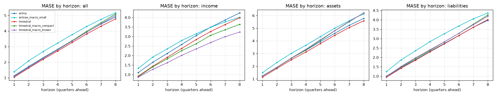

## Skill vs horizon
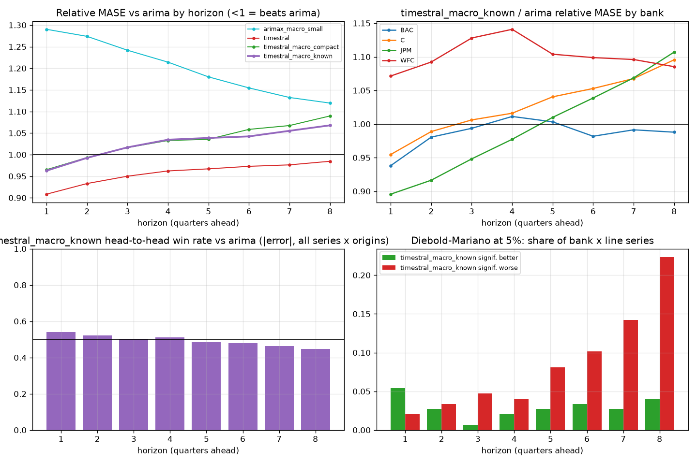

| h | arima | arimax_macro_small | timestral | timestral_macro_compact | timestral_macro_known |
|---|---|---|---|---|---|
| 1 | 1.000 | 1.290 | 0.908 | 0.965 | 0.963 |
| 2 | 1.000 | 1.274 | 0.933 | 0.993 | 0.992 |
| 3 | 1.000 | 1.242 | 0.950 | 1.016 | 1.017 |
| 4 | 1.000 | 1.214 | 0.962 | 1.033 | 1.035 |
| 5 | 1.000 | 1.180 | 0.967 | 1.035 | 1.039 |
| 6 | 1.000 | 1.155 | 0.973 | 1.059 | 1.042 |
| 7 | 1.000 | 1.132 | 0.976 | 1.067 | 1.055 |
| 8 | 1.000 | 1.119 | 0.985 | 1.090 | 1.068 |

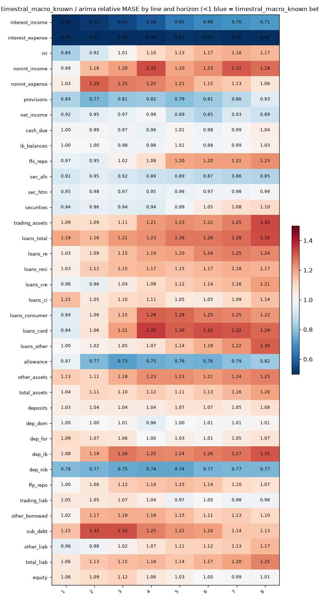

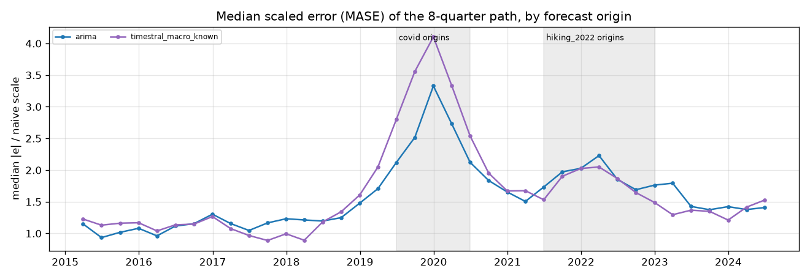

## Relative MASE vs baseline (geometric mean; <1 = better than baseline)
| model | rel_mase |
|---|---|
| timestral | 0.965 |
| arima | 1.000 |
| timestral_macro_known | 1.039 |
| timestral_macro_compact | 1.047 |
| arimax_macro_small | 1.176 |

### By bank
| id | arima | arimax_macro_small | timestral | timestral_macro_compact | timestral_macro_known |
|---|---|---|---|---|---|
| BAC | 1.000 | 1.119 | 0.963 | 1.006 | 0.993 |
| C | 1.000 | 1.231 | 0.962 | 1.027 | 1.043 |
| JPM | 1.000 | 1.041 | 1.029 | 1.043 | 1.019 |
| WFC | 1.000 | 1.335 | 0.909 | 1.113 | 1.103 |

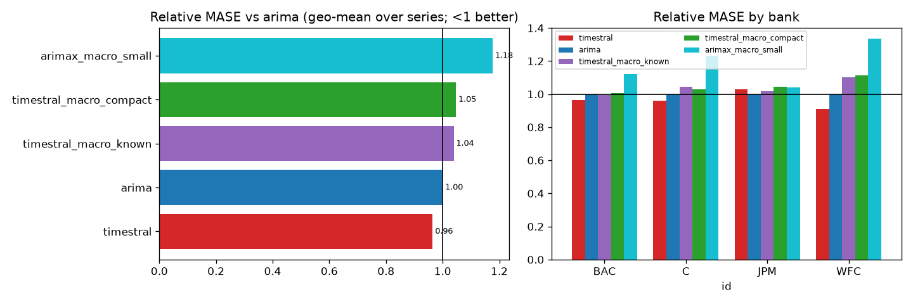

## Win rates (share of series where challenger beats baseline)
| id | MAE | MASE | RMSE | dir_acc | sMAPE |
|---|---|---|---|---|---|
| BAC | 46% | 43% | 43% | 57% | 46% |
| C | 41% | 38% | 41% | 32% | 35% |
| JPM | 46% | 46% | 35% | 38% | 35% |
| WFC | 35% | 35% | 27% | 54% | 24% |

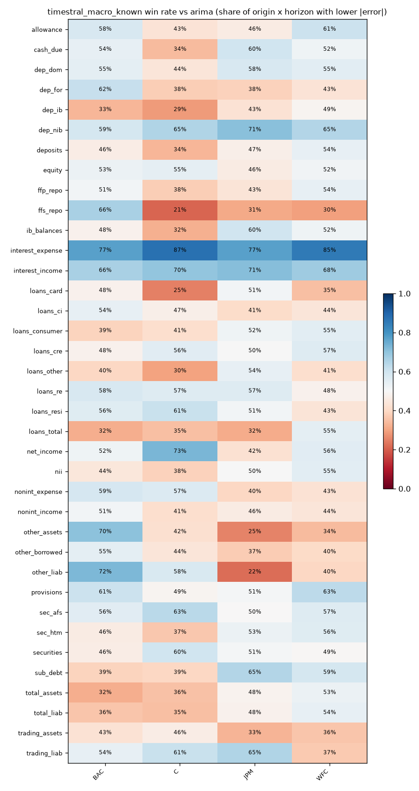

## Diebold-Mariano (squared error, HLN-corrected, per series and horizon)
Share of bank x target series where the challenger is significantly better / worse at 5%:

| h | better | worse |
|---|---|---|
| 1 | 5% | 2% |
| 2 | 3% | 3% |
| 3 | 1% | 5% |
| 4 | 2% | 4% |
| 5 | 3% | 8% |
| 6 | 3% | 10% |
| 7 | 3% | 14% |
| 8 | 4% | 22% |

## Stress slices (MASE)
| model | covid | hiking_2022 | normal |
|---|---|---|---|
| arima | 5.577 | 3.782 | 2.408 |
| arimax_macro_small | 6.748 | 3.664 | 2.710 |
| timestral | 5.719 | 3.328 | 2.335 |
| timestral_macro_compact | 5.919 | 3.293 | 2.503 |
| timestral_macro_known | 6.154 | 3.164 | 2.441 |

## Interval coverage (80%)
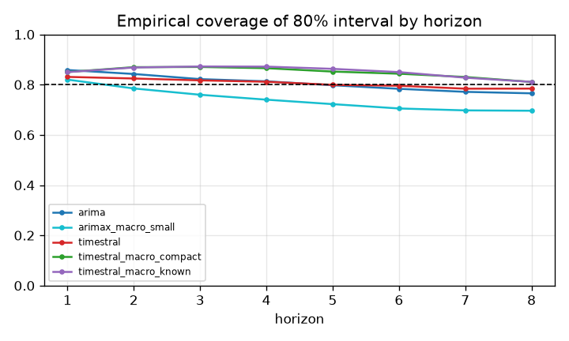

## Balance-sheet identity consistency
| identity | model | median_abs_gap_pct | median_abs_actual_gap_pct | median_excess_vs_actual_pp |
|---|---|---|---|---|
| assets_bridge | arima | 1.206 | 0.000 | 1.206 |
| assets_bridge | arimax_macro_small | 1.200 | 0.000 | 1.200 |
| assets_bridge | timestral | 1.048 | 0.000 | 1.048 |
| assets_bridge | timestral_macro_compact | 2.116 | 0.000 | 2.116 |
| assets_bridge | timestral_macro_known | 2.082 | 0.000 | 2.082 |
| liabilities_bridge | arima | 0.535 | 0.000 | 0.535 |
| liabilities_bridge | arimax_macro_small | 0.718 | 0.000 | 0.718 |
| liabilities_bridge | timestral | 0.966 | 0.000 | 0.966 |
| liabilities_bridge | timestral_macro_compact | 1.301 | 0.000 | 1.301 |
| liabilities_bridge | timestral_macro_known | 1.229 | 0.000 | 1.229 |
| nii_bridge | arima | 4.028 | 0.000 | 4.028 |
| nii_bridge | arimax_macro_small | 3.287 | 0.000 | 3.287 |
| nii_bridge | timestral | 2.172 | 0.000 | 2.172 |
| nii_bridge | timestral_macro_compact | 3.308 | 0.000 | 3.308 |
| nii_bridge | timestral_macro_known | 2.781 | 0.000 | 2.781 |

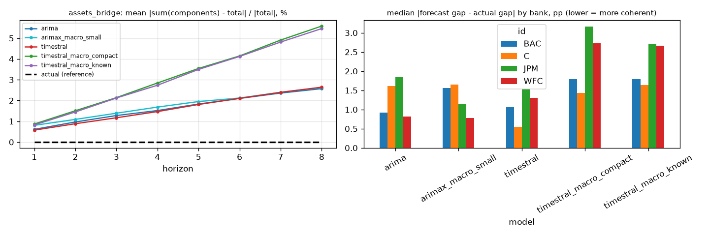
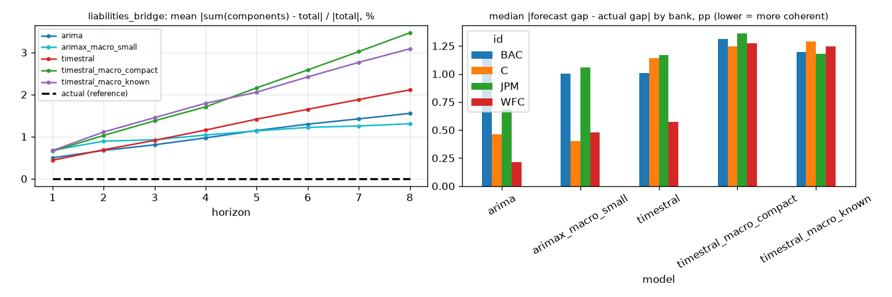
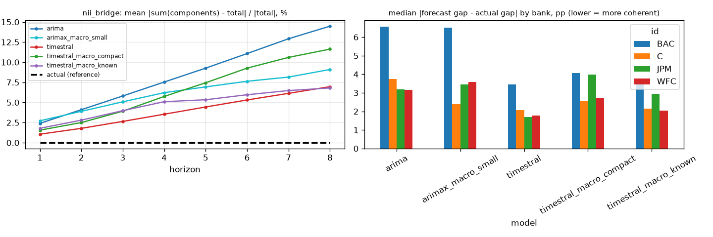

## Forecast fans

## Diebold-Mariano vs baseline, all models
Share of series significantly **better** than `arima` at 5% (squared error):

| h | arimax_macro_small | timestral | timestral_macro_compact | timestral_macro_known |
|---|---|---|---|---|
| 1 | 1% | 16% | 7% | 5% |
| 2 | 1% | 5% | 1% | 3% |
| 3 | 1% | 4% | 1% | 1% |
| 4 | 1% | 4% | 2% | 2% |
| 5 | 2% | 3% | 3% | 3% |
| 6 | 3% | 5% | 4% | 3% |
| 7 | 3% | 5% | 4% | 3% |
| 8 | 4% | 10% | 3% | 4% |

Share significantly **worse**:

| h | arimax_macro_small | timestral | timestral_macro_compact | timestral_macro_known |
|---|---|---|---|---|
| 1 | 5% | 1% | 1% | 2% |
| 2 | 7% | 2% | 1% | 3% |
| 3 | 8% | 3% | 3% | 5% |
| 4 | 9% | 3% | 3% | 4% |
| 5 | 11% | 3% | 6% | 8% |
| 6 | 12% | 4% | 10% | 10% |
| 7 | 11% | 5% | 20% | 14% |
| 8 | 10% | 7% | 20% | 22% |

## 80% interval coverage by line
| model | allowance | cash_due | dep_dom | dep_for | dep_ib | dep_nib | deposits | equity | ffp_repo | ffs_repo | ib_balances | interest_expense | interest_income | loans_card | loans_ci | loans_consumer | loans_cre | loans_other | loans_re | loans_resi | loans_total | net_income | nii | nonint_expense | nonint_income | other_assets | other_borrowed | other_liab | provisions | sec_afs | sec_htm | securities | sub_debt | total_assets | total_liab | trading_assets | trading_liab |
|---|---|---|---|---|---|---|---|---|---|---|---|---|---|---|---|---|---|---|---|---|---|---|---|---|---|---|---|---|---|---|---|---|---|---|---|---|---|
| arima | 0.854 | 0.561 | 0.725 | 0.854 | 0.802 | 0.490 | 0.756 | 0.966 | 0.928 | 0.841 | 0.557 | 0.618 | 0.669 | 0.882 | 0.858 | 0.949 | 0.898 | 0.750 | 0.965 | 0.956 | 0.924 | 0.729 | 0.793 | 0.903 | 0.943 | 0.918 | 0.916 | 0.800 | 0.868 | 0.625 | 0.484 | 0.716 | 0.997 | 0.837 | 0.833 | 0.814 | 0.869 |
| arimax_macro_small | 0.845 | 0.526 | 0.685 | 0.794 | 0.738 | 0.489 | 0.716 | 0.885 | 0.749 | 0.683 | 0.526 | 0.651 | 0.637 | 0.812 | 0.796 | 0.914 | 0.829 | 0.686 | 0.866 | 0.869 | 0.870 | 0.699 | 0.678 | 0.785 | 0.827 | 0.819 | 0.840 | 0.706 | 0.783 | 0.628 | 0.429 | 0.648 | 0.919 | 0.771 | 0.765 | 0.726 | 0.817 |
| timestral | 0.793 | 0.766 | 0.825 | 0.852 | 0.816 | 0.678 | 0.832 | 0.852 | 0.785 | 0.809 | 0.780 | 0.652 | 0.664 | 0.890 | 0.847 | 0.877 | 0.891 | 0.766 | 0.898 | 0.846 | 0.845 | 0.738 | 0.738 | 0.888 | 0.858 | 0.889 | 0.766 | 0.809 | 0.790 | 0.699 | 0.673 | 0.775 | 0.882 | 0.854 | 0.859 | 0.785 | 0.851 |
| timestral_macro_compact | 0.875 | 0.813 | 0.879 | 0.887 | 0.846 | 0.835 | 0.867 | 0.905 | 0.856 | 0.794 | 0.819 | 0.748 | 0.778 | 0.914 | 0.882 | 0.938 | 0.899 | 0.822 | 0.918 | 0.899 | 0.877 | 0.788 | 0.812 | 0.893 | 0.899 | 0.892 | 0.850 | 0.848 | 0.804 | 0.767 | 0.722 | 0.785 | 0.891 | 0.866 | 0.868 | 0.820 | 0.860 |
| timestral_macro_known | 0.877 | 0.808 | 0.891 | 0.887 | 0.850 | 0.815 | 0.873 | 0.907 | 0.833 | 0.779 | 0.815 | 0.821 | 0.853 | 0.900 | 0.872 | 0.933 | 0.887 | 0.821 | 0.924 | 0.910 | 0.877 | 0.779 | 0.831 | 0.896 | 0.891 | 0.878 | 0.854 | 0.846 | 0.827 | 0.777 | 0.698 | 0.789 | 0.900 | 0.876 | 0.871 | 0.814 | 0.858 |

## Relative MASE vs `arima` by line
| target | arima | arimax_macro_small | timestral | timestral_macro_compact | timestral_macro_known |
|---|---|---|---|---|---|
| allowance | 1.000 | 0.895 | 1.059 | 0.797 | 0.782 |
| cash_due | 1.000 | 0.966 | 0.928 | 1.015 | 0.995 |
| dep_dom | 1.000 | 1.046 | 1.050 | 1.026 | 1.005 |
| dep_for | 1.000 | 1.319 | 0.990 | 1.066 | 1.048 |
| dep_ib | 1.000 | 1.124 | 1.077 | 1.210 | 1.257 |
| dep_nib | 1.000 | 0.898 | 0.936 | 0.781 | 0.762 |
| deposits | 1.000 | 1.033 | 1.037 | 1.079 | 1.061 |
| equity | 1.000 | 1.406 | 0.885 | 1.062 | 1.032 |
| ffp_repo | 1.000 | 1.552 | 0.972 | 1.019 | 1.104 |
| ffs_repo | 1.000 | 1.232 | 1.027 | 1.113 | 1.129 |
| ib_balances | 1.000 | 0.970 | 0.924 | 1.026 | 0.999 |
| interest_expense | 1.000 | 0.817 | 0.857 | 0.617 | 0.494 |
| interest_income | 1.000 | 0.827 | 0.898 | 0.819 | 0.648 |
| loans_card | 1.000 | 1.323 | 1.068 | 1.162 | 1.262 |
| loans_ci | 1.000 | 1.084 | 0.952 | 1.071 | 1.092 |
| loans_consumer | 1.000 | 1.109 | 0.992 | 1.086 | 1.203 |
| loans_cre | 1.000 | 1.202 | 0.856 | 1.094 | 1.127 |
| loans_other | 1.000 | 1.087 | 1.082 | 1.129 | 1.161 |
| loans_re | 1.000 | 1.647 | 0.911 | 1.212 | 1.208 |
| loans_resi | 1.000 | 1.614 | 0.911 | 1.158 | 1.158 |
| loans_total | 1.000 | 1.195 | 0.980 | 1.233 | 1.258 |
| net_income | 1.000 | 0.947 | 0.895 | 0.882 | 0.922 |
| nii | 1.000 | 1.292 | 0.966 | 1.105 | 1.102 |
| nonint_expense | 1.000 | 1.389 | 0.872 | 1.214 | 1.176 |
| nonint_income | 1.000 | 1.511 | 0.977 | 1.269 | 1.219 |
| other_assets | 1.000 | 1.316 | 1.019 | 1.184 | 1.207 |
| other_borrowed | 1.000 | 1.125 | 1.013 | 1.091 | 1.135 |
| other_liab | 1.000 | 1.230 | 0.965 | 1.132 | 1.084 |
| provisions | 1.000 | 1.172 | 1.060 | 0.846 | 0.829 |
| sec_afs | 1.000 | 0.945 | 0.862 | 0.909 | 0.882 |
| sec_htm | 1.000 | 1.074 | 0.963 | 0.933 | 0.976 |
| securities | 1.000 | 1.030 | 0.949 | 1.039 | 1.025 |
| sub_debt | 1.000 | 2.522 | 0.865 | 1.142 | 1.201 |
| total_assets | 1.000 | 1.134 | 0.990 | 1.144 | 1.138 |
| total_liab | 1.000 | 1.150 | 1.003 | 1.166 | 1.179 |
| trading_assets | 1.000 | 1.335 | 1.096 | 1.283 | 1.212 |
| trading_liab | 1.000 | 1.124 | 0.893 | 1.041 | 1.014 |

## How much does `timestral_macro_known` help vs `timestral`? (relative MASE, <1 = helps)
| target | rel_mase |
|---|---|
| allowance | 0.738 |
| cash_due | 1.072 |
| dep_dom | 0.957 |
| dep_for | 1.059 |
| dep_ib | 1.167 |
| dep_nib | 0.813 |
| deposits | 1.023 |
| equity | 1.166 |
| ffp_repo | 1.136 |
| ffs_repo | 1.099 |
| ib_balances | 1.081 |
| interest_expense | 0.576 |
| interest_income | 0.722 |
| loans_card | 1.181 |
| loans_ci | 1.147 |
| loans_consumer | 1.213 |
| loans_cre | 1.316 |
| loans_other | 1.073 |
| loans_re | 1.326 |
| loans_resi | 1.271 |
| loans_total | 1.283 |
| net_income | 1.030 |
| nii | 1.141 |
| nonint_expense | 1.348 |
| nonint_income | 1.248 |
| other_assets | 1.185 |
| other_borrowed | 1.120 |
| other_liab | 1.123 |
| provisions | 0.782 |
| sec_afs | 1.023 |
| sec_htm | 1.013 |
| securities | 1.080 |
| sub_debt | 1.388 |
| total_assets | 1.150 |
| total_liab | 1.175 |
| trading_assets | 1.106 |
| trading_liab | 1.136 |

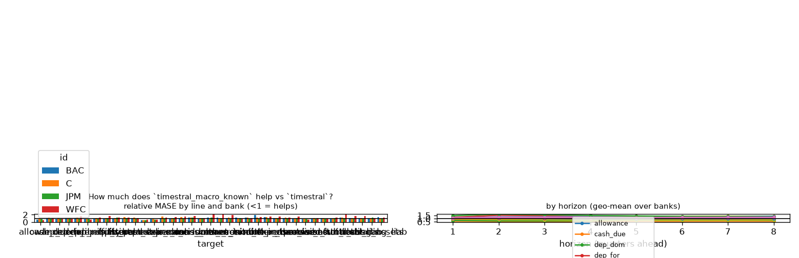

## How much does `timestral_macro_compact` help vs `timestral`? (relative MASE, <1 = helps)
| target | rel_mase |
|---|---|
| allowance | 0.752 |
| cash_due | 1.094 |
| dep_dom | 0.977 |
| dep_for | 1.076 |
| dep_ib | 1.124 |
| dep_nib | 0.833 |
| deposits | 1.041 |
| equity | 1.200 |
| ffp_repo | 1.049 |
| ffs_repo | 1.083 |
| ib_balances | 1.111 |
| interest_expense | 0.720 |
| interest_income | 0.913 |
| loans_card | 1.088 |
| loans_ci | 1.124 |
| loans_consumer | 1.095 |
| loans_cre | 1.278 |
| loans_other | 1.043 |
| loans_re | 1.331 |
| loans_resi | 1.271 |
| loans_total | 1.258 |
| net_income | 0.986 |
| nii | 1.144 |
| nonint_expense | 1.392 |
| nonint_income | 1.299 |
| other_assets | 1.162 |
| other_borrowed | 1.076 |
| other_liab | 1.173 |
| provisions | 0.798 |
| sec_afs | 1.055 |
| sec_htm | 0.969 |
| securities | 1.094 |
| sub_debt | 1.319 |
| total_assets | 1.155 |
| total_liab | 1.162 |
| trading_assets | 1.171 |
| trading_liab | 1.166 |

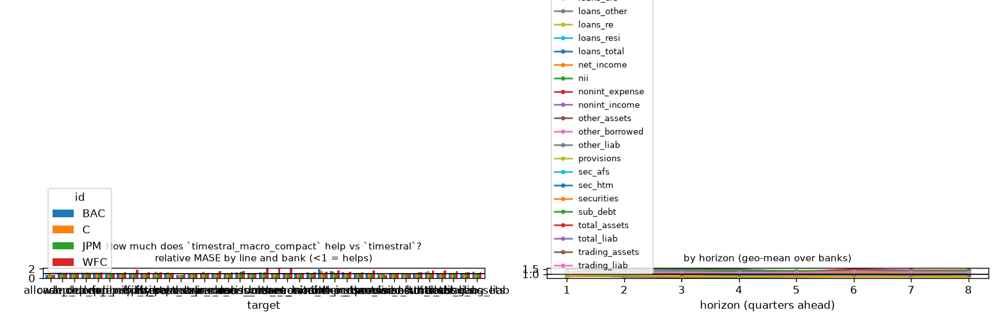

## How much does `arimax_macro_small` help vs `arima`? (relative MASE, <1 = helps)
| target | rel_mase |
|---|---|
| allowance | 0.895 |
| cash_due | 0.966 |
| dep_dom | 1.046 |
| dep_for | 1.319 |
| dep_ib | 1.124 |
| dep_nib | 0.898 |
| deposits | 1.033 |
| equity | 1.406 |
| ffp_repo | 1.552 |
| ffs_repo | 1.232 |
| ib_balances | 0.970 |
| interest_expense | 0.817 |
| interest_income | 0.827 |
| loans_card | 1.323 |
| loans_ci | 1.084 |
| loans_consumer | 1.109 |
| loans_cre | 1.202 |
| loans_other | 1.087 |
| loans_re | 1.647 |
| loans_resi | 1.614 |
| loans_total | 1.195 |
| net_income | 0.947 |
| nii | 1.292 |
| nonint_expense | 1.389 |
| nonint_income | 1.511 |
| other_assets | 1.316 |
| other_borrowed | 1.125 |
| other_liab | 1.230 |
| provisions | 1.172 |
| sec_afs | 0.945 |
| sec_htm | 1.074 |
| securities | 1.030 |
| sub_debt | 2.522 |
| total_assets | 1.134 |
| total_liab | 1.150 |
| trading_assets | 1.335 |
| trading_liab | 1.124 |

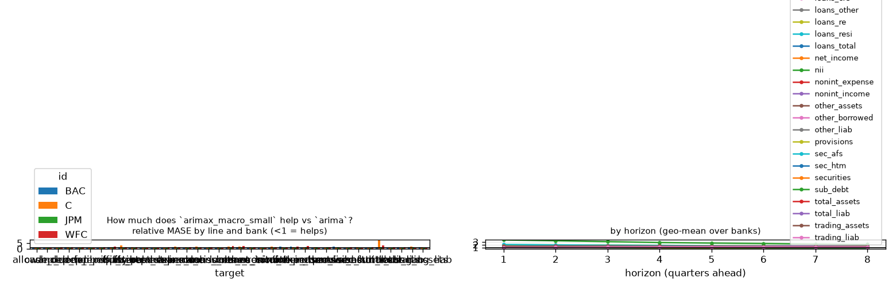

## Line x variant: relative MASE vs baseline
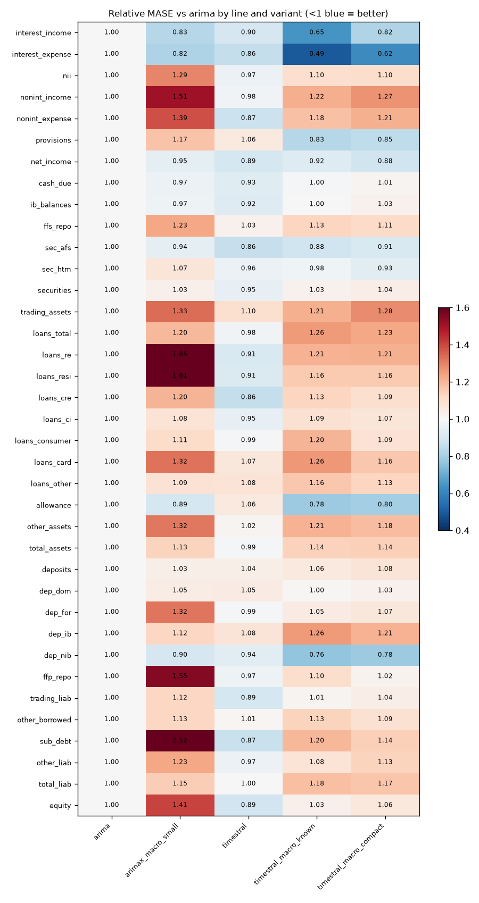

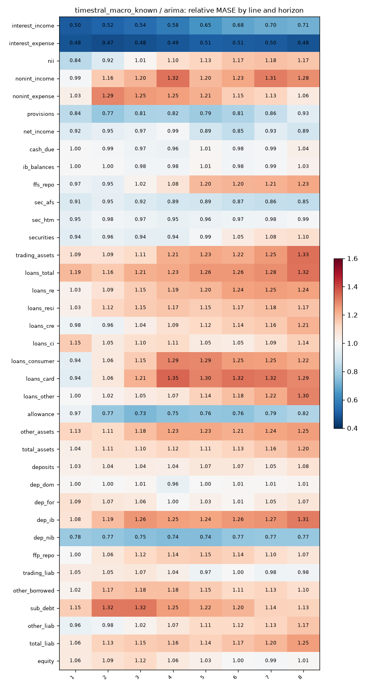
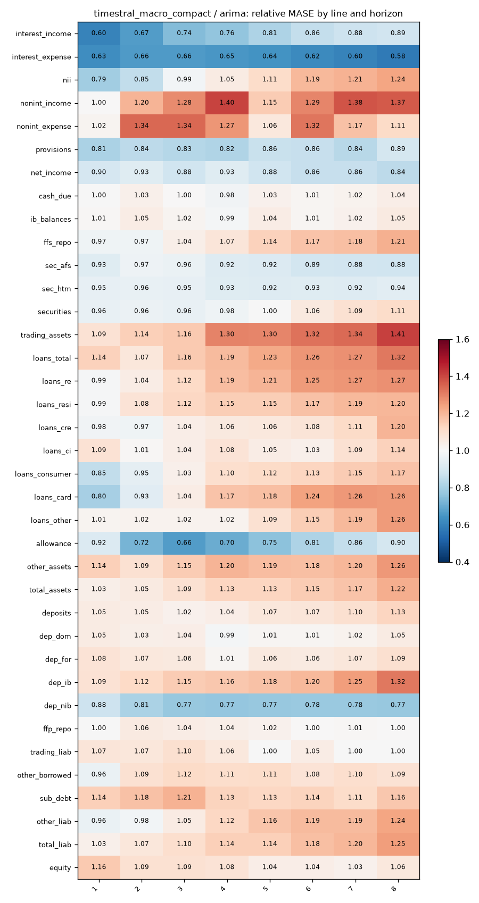

## Does macro help? (relative MASE of covariate variant vs its no-covariate twin; <1 = helps)
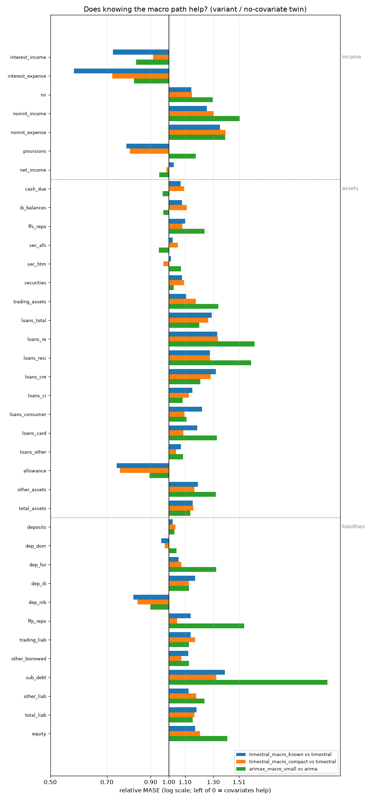

| target | timestral_macro_known vs timestral | timestral_macro_compact vs timestral | arimax_macro_small vs arima |
|---|---|---|---|
| interest_income | 0.722 | 0.913 | 0.827 |
| interest_expense | 0.576 | 0.720 | 0.817 |
| nii | 1.141 | 1.144 | 1.292 |
| nonint_income | 1.248 | 1.299 | 1.511 |
| nonint_expense | 1.348 | 1.392 | 1.389 |
| provisions | 0.782 | 0.798 | 1.172 |
| net_income | 1.030 | 0.986 | 0.947 |
| cash_due | 1.072 | 1.094 | 0.966 |
| ib_balances | 1.081 | 1.111 | 0.970 |
| ffs_repo | 1.099 | 1.083 | 1.232 |
| sec_afs | 1.023 | 1.055 | 0.945 |
| sec_htm | 1.013 | 0.969 | 1.074 |
| securities | 1.080 | 1.094 | 1.030 |
| trading_assets | 1.106 | 1.171 | 1.335 |
| loans_total | 1.283 | 1.258 | 1.195 |
| loans_re | 1.326 | 1.331 | 1.647 |
| loans_resi | 1.271 | 1.271 | 1.614 |
| loans_cre | 1.316 | 1.278 | 1.202 |
| loans_ci | 1.147 | 1.124 | 1.084 |
| loans_consumer | 1.213 | 1.095 | 1.109 |
| loans_card | 1.181 | 1.088 | 1.323 |
| loans_other | 1.073 | 1.043 | 1.087 |
| allowance | 0.738 | 0.752 | 0.895 |
| other_assets | 1.185 | 1.162 | 1.316 |
| total_assets | 1.150 | 1.155 | 1.134 |
| deposits | 1.023 | 1.041 | 1.033 |
| dep_dom | 0.957 | 0.977 | 1.046 |
| dep_for | 1.059 | 1.076 | 1.319 |
| dep_ib | 1.167 | 1.124 | 1.124 |
| dep_nib | 0.813 | 0.833 | 0.898 |
| ffp_repo | 1.136 | 1.049 | 1.552 |
| trading_liab | 1.136 | 1.166 | 1.124 |
| other_borrowed | 1.120 | 1.076 | 1.125 |
| sub_debt | 1.388 | 1.319 | 2.522 |
| other_liab | 1.123 | 1.173 | 1.230 |
| total_liab | 1.175 | 1.162 | 1.150 |
| equity | 1.166 | 1.200 | 1.406 |

## Spaghetti pages by group

- [income](figures/income/index.md) (7 lines)
- [assets](figures/assets/index.md) (18 lines)
- [liabilities](figures/liabilities/index.md) (12 lines)
