# assets: all origins' 8-quarter median paths vs actual

Columns: arima | timestral | timestral_macro_known | timestral_macro_compact. Rows: banks. Colour = origin date; black = actual.

| target | arima | arimax_macro_small | timestral | timestral_macro_known | timestral_macro_compact |
|---|---|---|---|---|---|
| cash_due | 1.000 | 0.966 | 0.928 | 0.995 | 1.015 |
| ib_balances | 1.000 | 0.970 | 0.924 | 0.999 | 1.026 |
| ffs_repo | 1.000 | 1.232 | 1.027 | 1.129 | 1.113 |
| sec_afs | 1.000 | 0.945 | 0.862 | 0.882 | 0.909 |
| sec_htm | 1.000 | 1.074 | 0.963 | 0.976 | 0.933 |
| securities | 1.000 | 1.030 | 0.949 | 1.025 | 1.039 |
| trading_assets | 1.000 | 1.335 | 1.096 | 1.212 | 1.283 |
| loans_total | 1.000 | 1.195 | 0.980 | 1.258 | 1.233 |
| loans_re | 1.000 | 1.647 | 0.911 | 1.208 | 1.212 |
| loans_resi | 1.000 | 1.614 | 0.911 | 1.158 | 1.158 |
| loans_cre | 1.000 | 1.202 | 0.856 | 1.127 | 1.094 |
| loans_ci | 1.000 | 1.084 | 0.952 | 1.092 | 1.071 |
| loans_consumer | 1.000 | 1.109 | 0.992 | 1.203 | 1.086 |
| loans_card | 1.000 | 1.323 | 1.068 | 1.262 | 1.162 |
| loans_other | 1.000 | 1.087 | 1.082 | 1.161 | 1.129 |
| allowance | 1.000 | 0.895 | 1.059 | 0.782 | 0.797 |
| other_assets | 1.000 | 1.316 | 1.019 | 1.207 | 1.184 |
| total_assets | 1.000 | 1.134 | 0.990 | 1.138 | 1.144 |

## cash_due
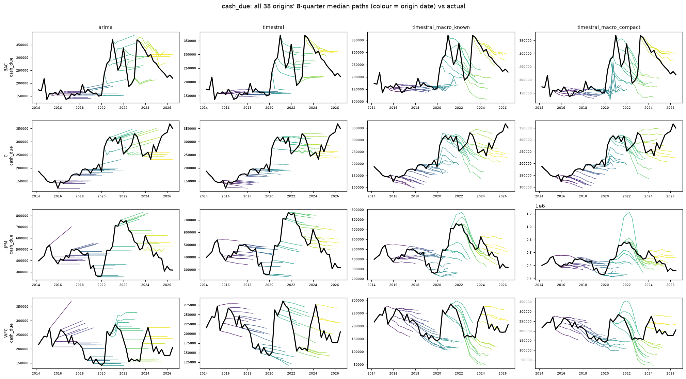

## ib_balances
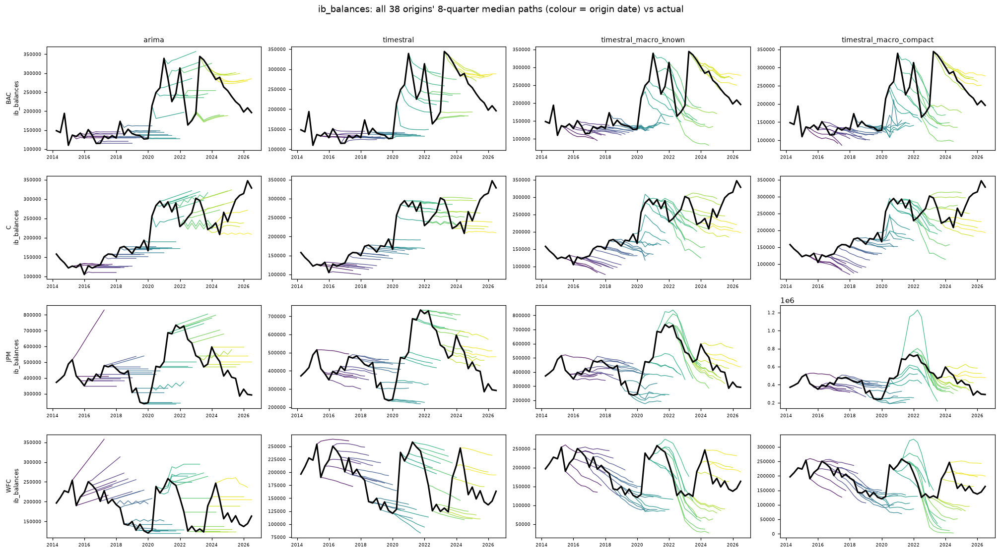

## ffs_repo
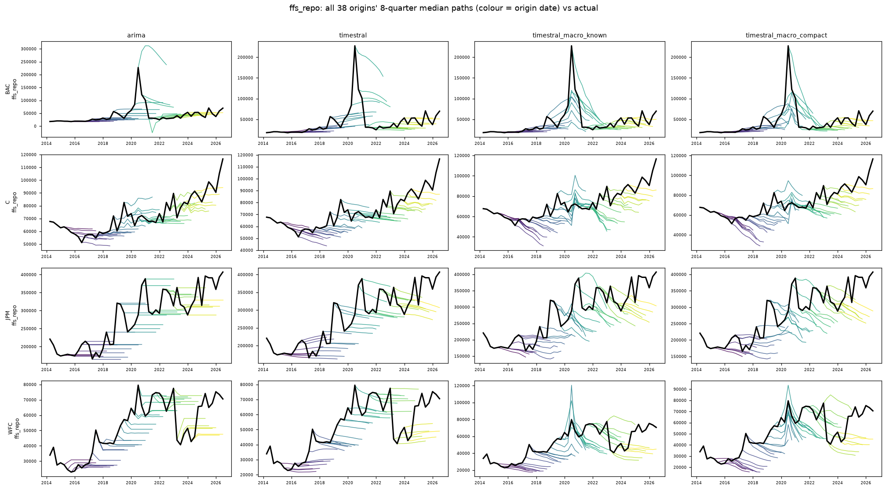

## sec_afs
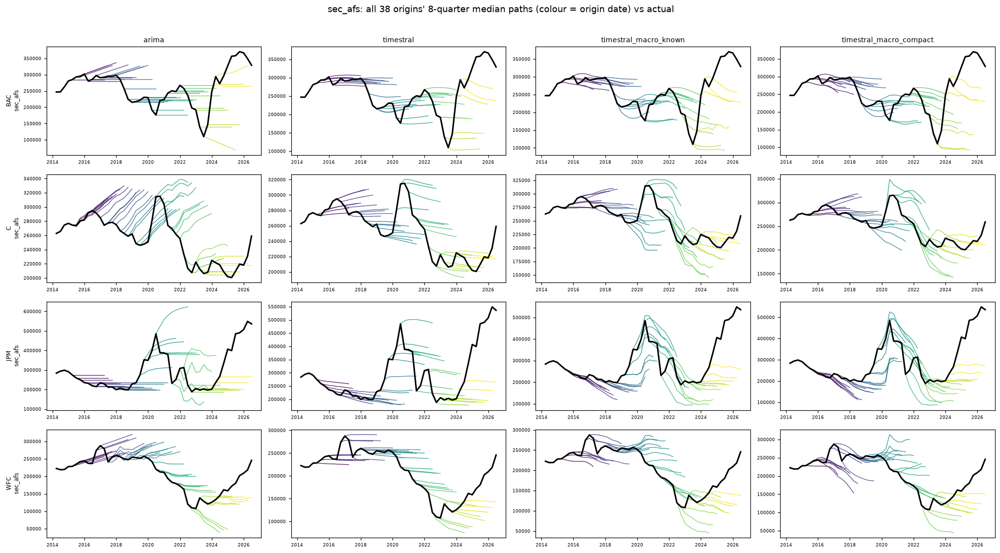

## sec_htm
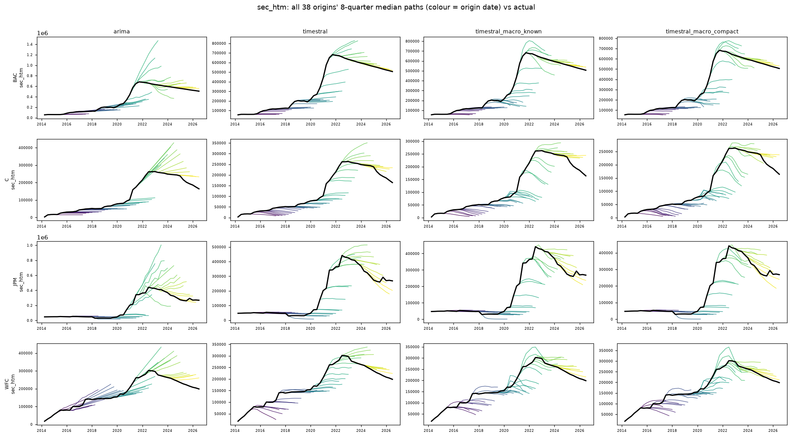

## securities
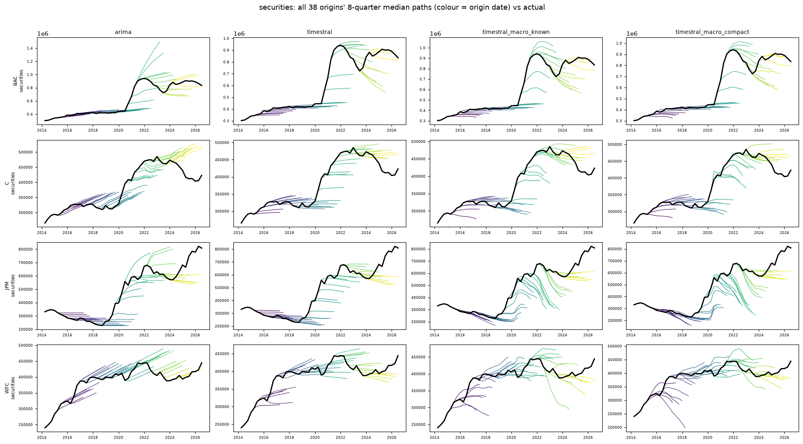

## trading_assets
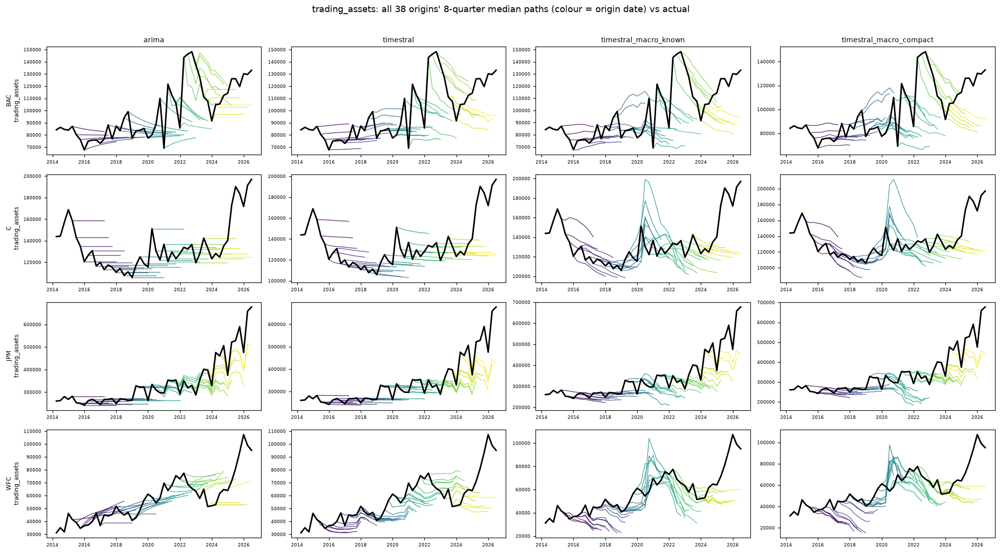

## loans_total
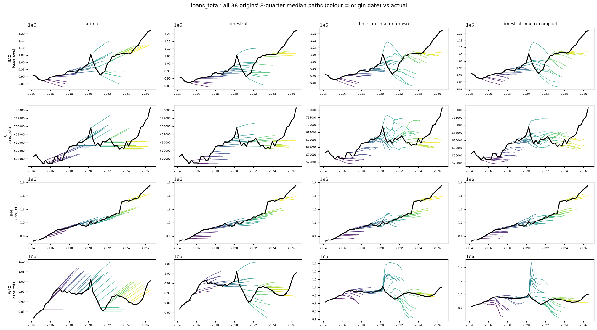

## loans_re
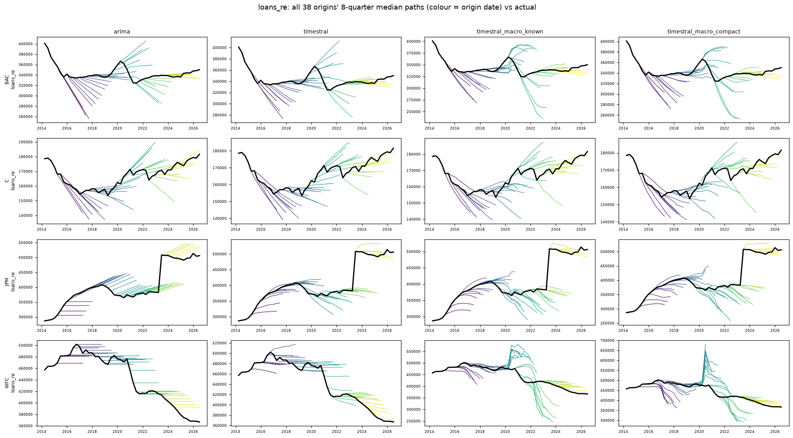

## loans_resi
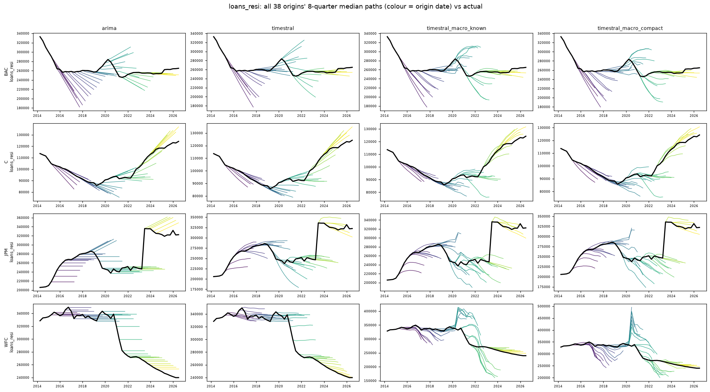

## loans_cre
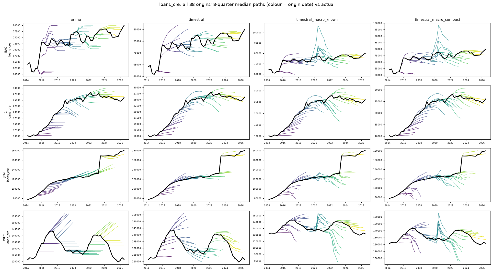

## loans_ci
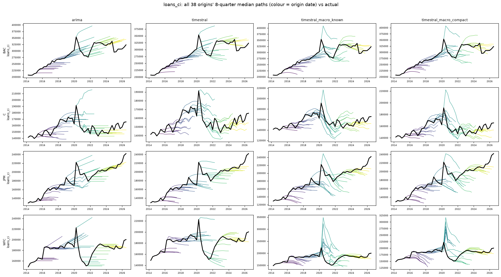

## loans_consumer
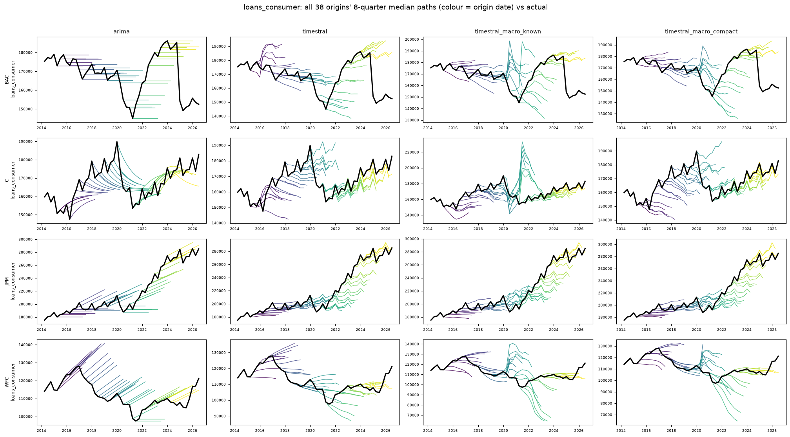

## loans_card
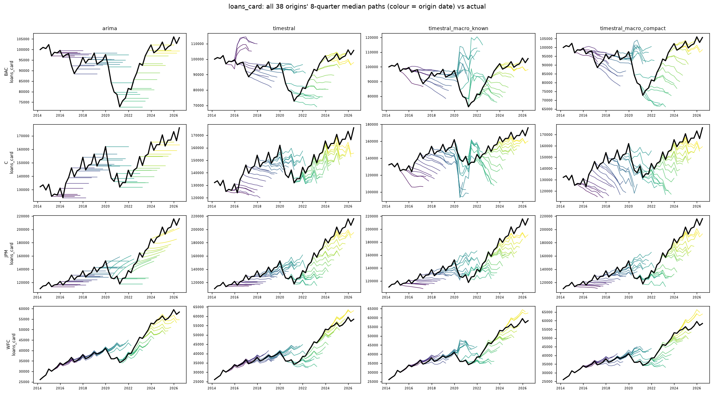

## loans_other
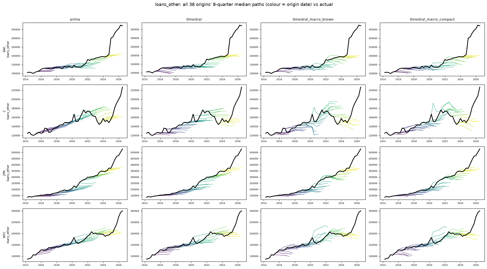

## allowance
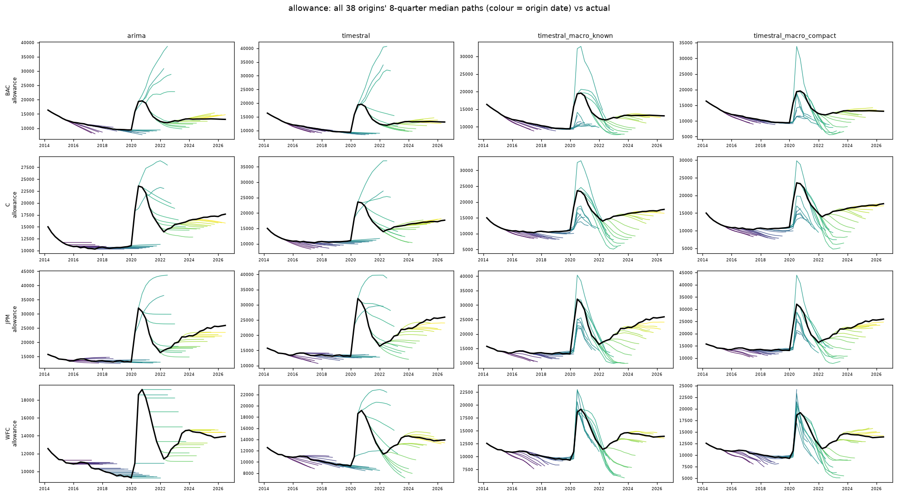

## other_assets
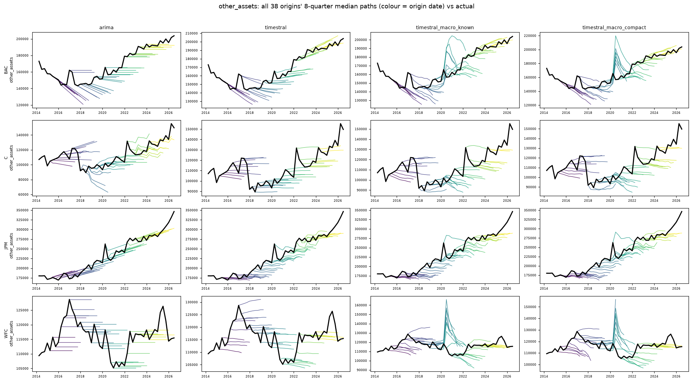

## total_assets
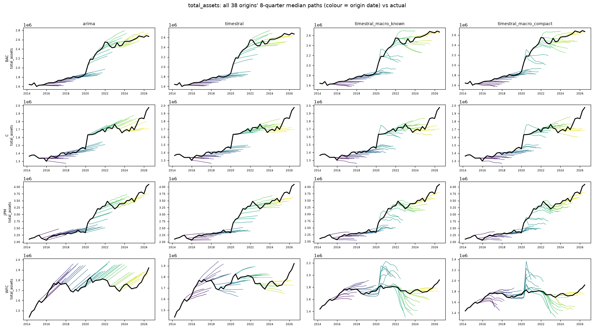
