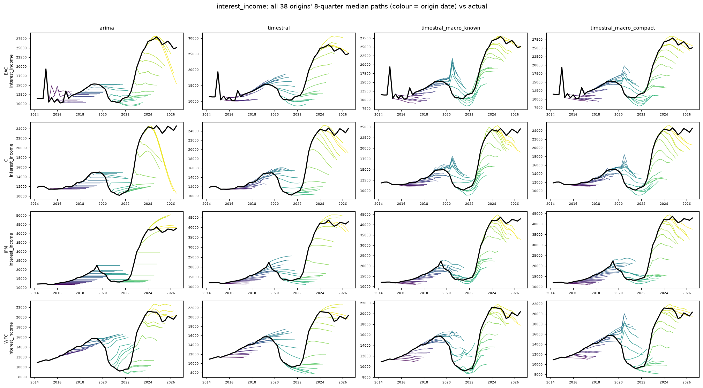
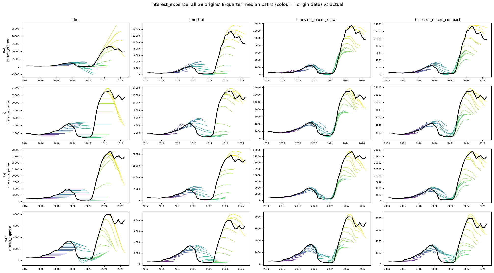
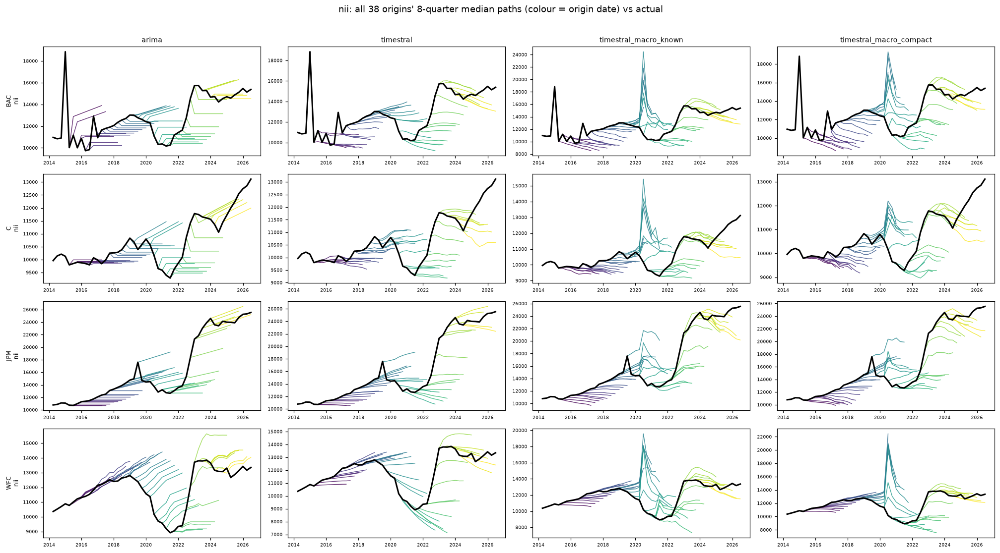
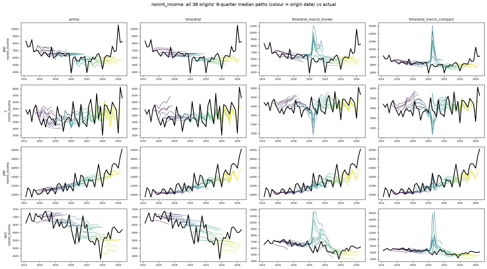
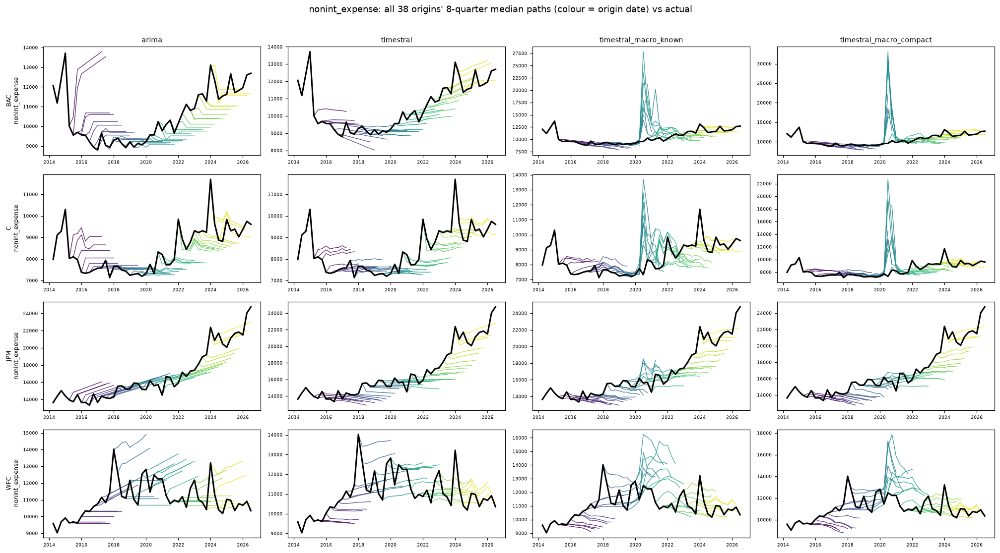
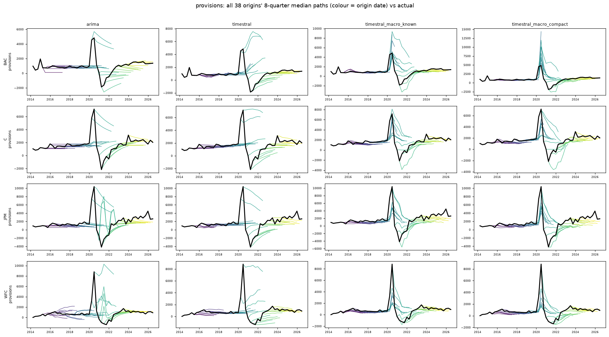
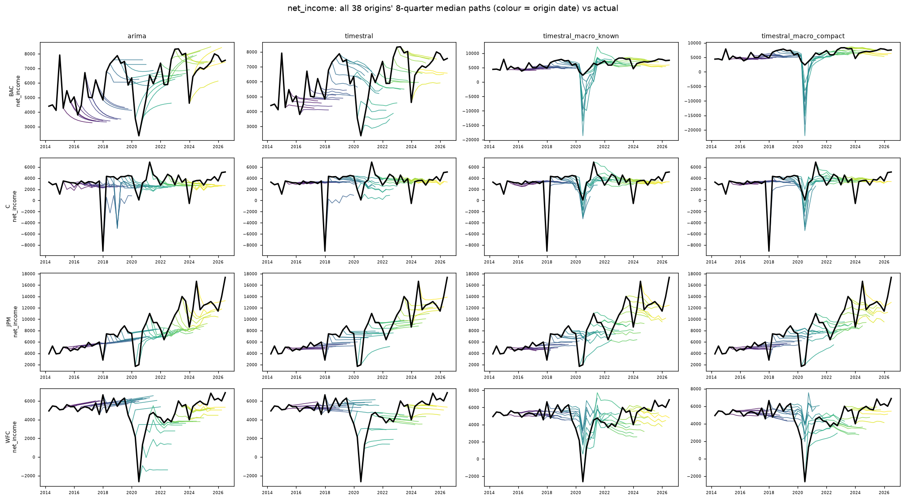

# income: all origins' 8-quarter median paths vs actual

Columns: arima | timestral | timestral_macro_known | timestral_macro_compact. Rows: banks. Colour = origin date; black = actual.

| target | arima | arimax_macro_small | timestral | timestral_macro_known | timestral_macro_compact |
|---|---|---|---|---|---|
| interest_income | 1.000 | 0.827 | 0.898 | 0.648 | 0.819 |
| interest_expense | 1.000 | 0.817 | 0.857 | 0.494 | 0.617 |
| nii | 1.000 | 1.292 | 0.966 | 1.102 | 1.105 |
| nonint_income | 1.000 | 1.511 | 0.977 | 1.219 | 1.269 |
| nonint_expense | 1.000 | 1.389 | 0.872 | 1.176 | 1.214 |
| provisions | 1.000 | 1.172 | 1.060 | 0.829 | 0.846 |
| net_income | 1.000 | 0.947 | 0.895 | 0.922 | 0.882 |

## interest_income

## interest_expense

## nii

## nonint_income

## nonint_expense

## provisions

## net_income

