# liabilities: all origins' 8-quarter median paths vs actual

Columns: arima | timestral | timestral_macro_known | timestral_macro_compact. Rows: banks. Colour = origin date; black = actual.

| target | arima | arimax_macro_small | timestral | timestral_macro_known | timestral_macro_compact |
|---|---|---|---|---|---|
| deposits | 1.000 | 1.033 | 1.037 | 1.061 | 1.079 |
| dep_dom | 1.000 | 1.046 | 1.050 | 1.005 | 1.026 |
| dep_for | 1.000 | 1.319 | 0.990 | 1.048 | 1.066 |
| dep_ib | 1.000 | 1.124 | 1.077 | 1.257 | 1.210 |
| dep_nib | 1.000 | 0.898 | 0.936 | 0.762 | 0.781 |
| ffp_repo | 1.000 | 1.552 | 0.972 | 1.104 | 1.019 |
| trading_liab | 1.000 | 1.124 | 0.893 | 1.014 | 1.041 |
| other_borrowed | 1.000 | 1.125 | 1.013 | 1.135 | 1.091 |
| sub_debt | 1.000 | 2.522 | 0.865 | 1.201 | 1.142 |
| other_liab | 1.000 | 1.230 | 0.965 | 1.084 | 1.132 |
| total_liab | 1.000 | 1.150 | 1.003 | 1.179 | 1.166 |
| equity | 1.000 | 1.406 | 0.885 | 1.032 | 1.062 |

## deposits
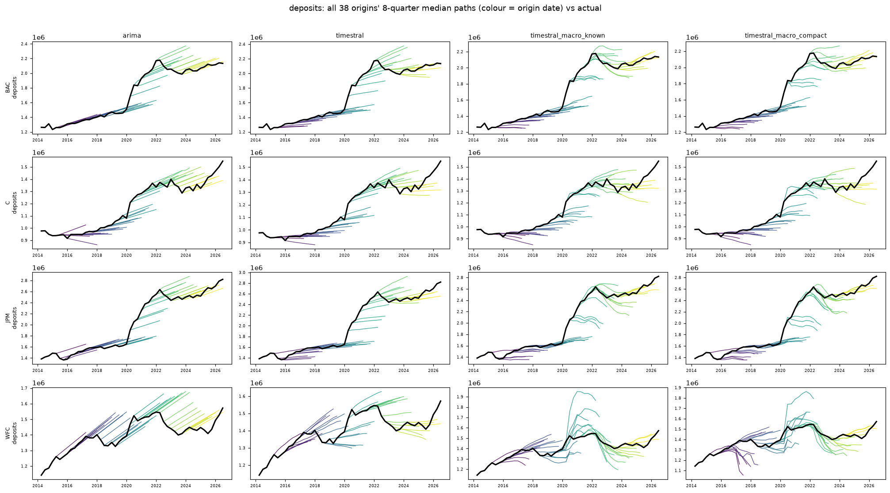

## dep_dom
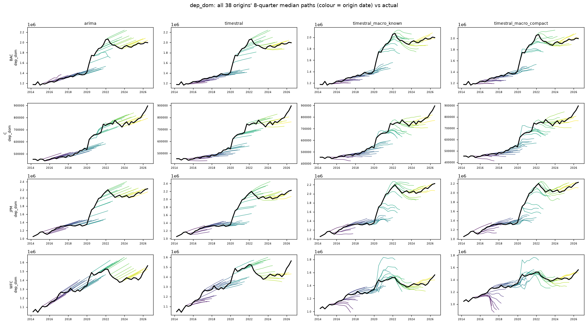

## dep_for
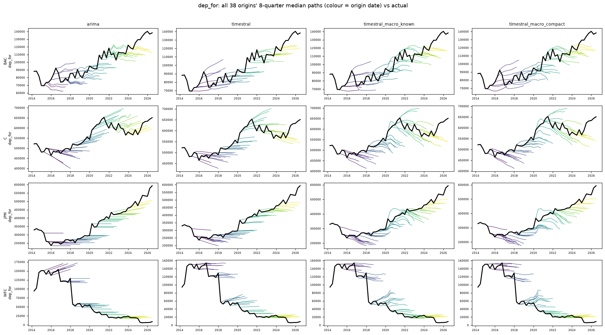

## dep_ib
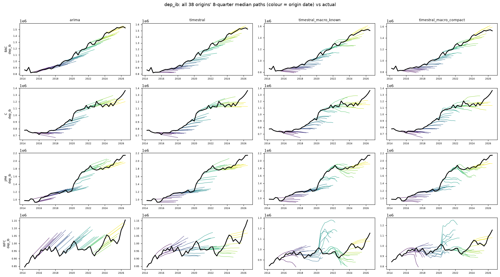

## dep_nib
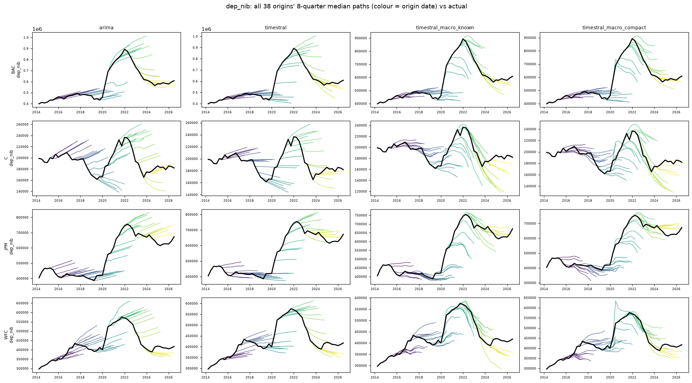

## ffp_repo
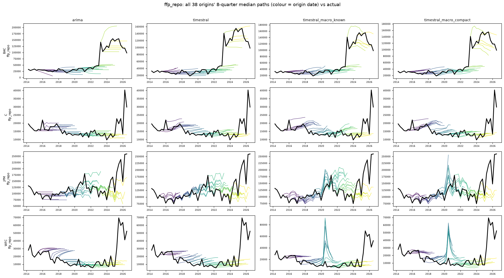

## trading_liab
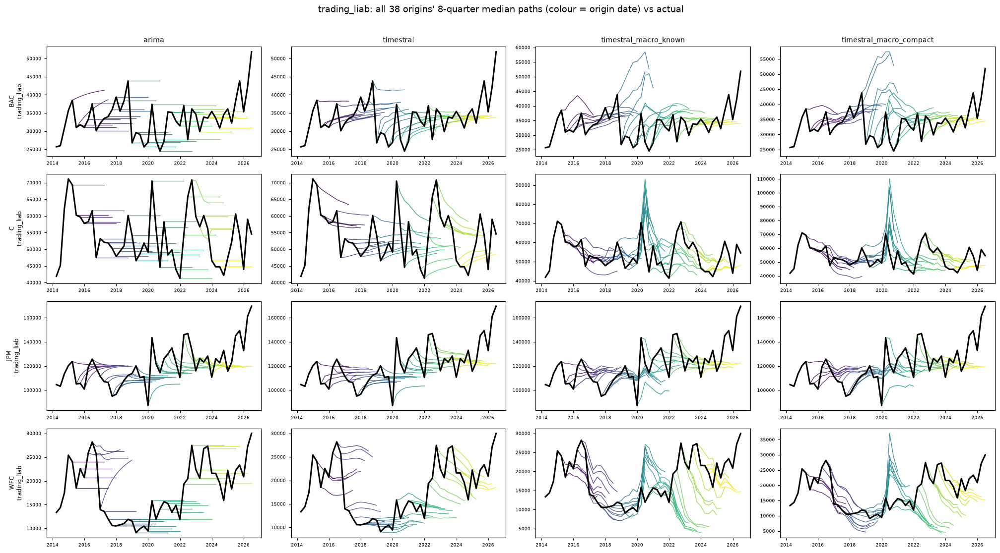

## other_borrowed
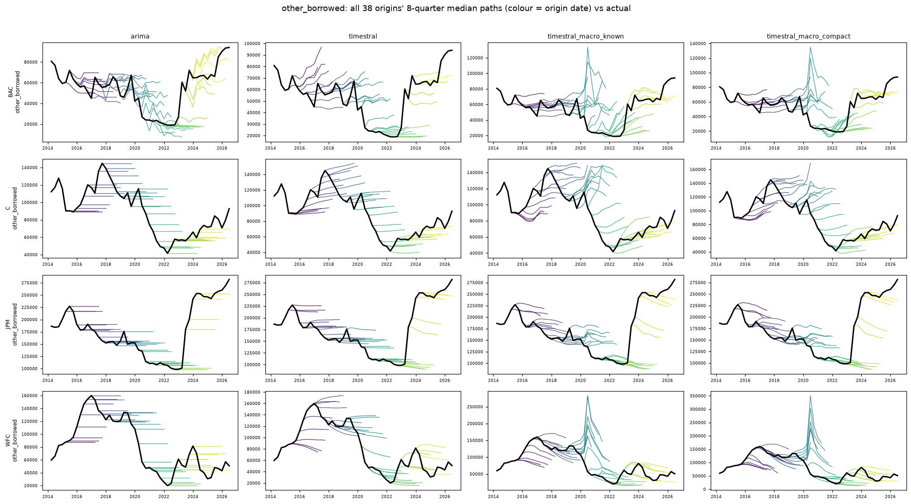

## sub_debt
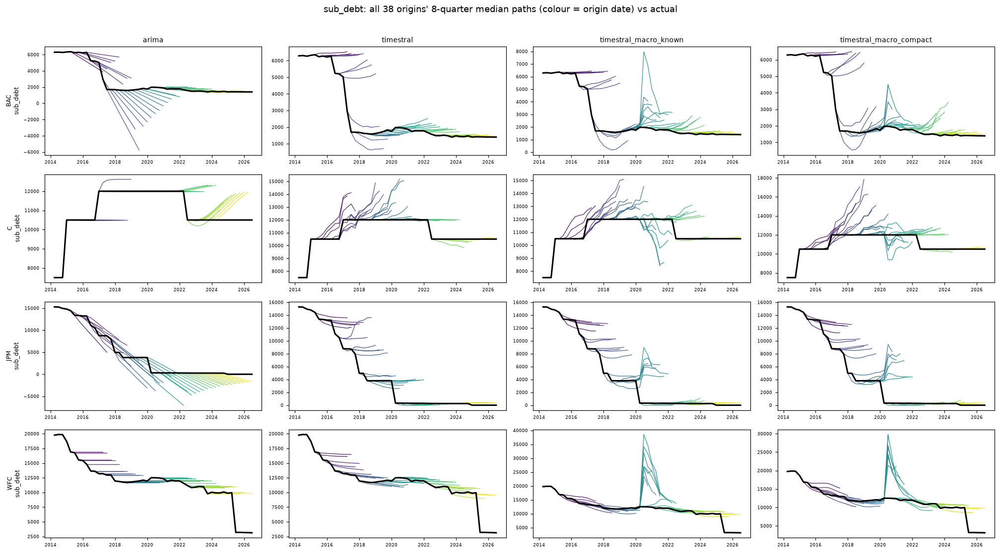

## other_liab
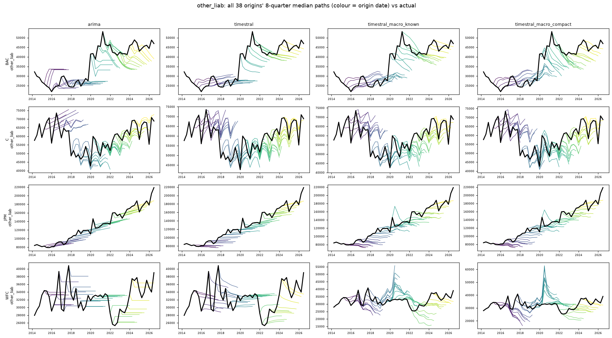

## total_liab
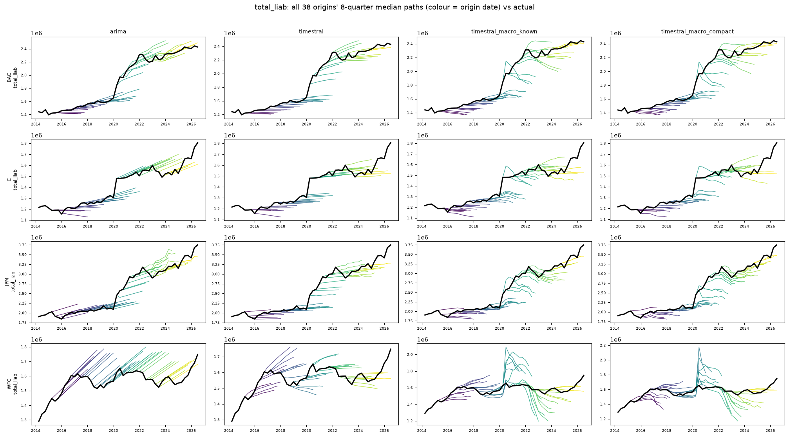

## equity
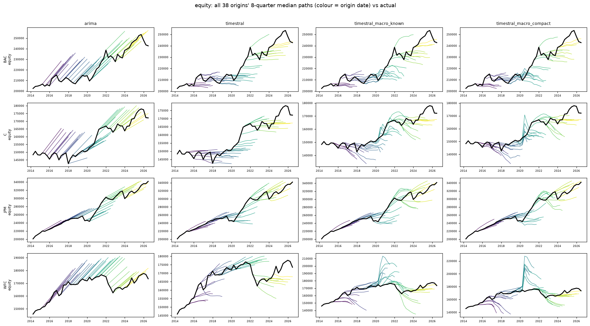
