# Backtest report: retail_census

# Retail, Census retail sales by kind of business (FRED, NSA, 14 categories): headline findings

Setup: monthly, 1992-2026-09 (context capped at 240 months), 36 origins every 3 months (2015-12..2024-09),
one-shot 24-month forecasts. **AutoARIMA was dropped** (seasonal m=12, h=24 too slow on the shared box); the reference
baseline is AutoETS, with seasonal naive also shown. Relative MASE vs AutoETS (<1 = better); MASE scaled by lag-12 naive.
Run on Gus, report built on the box.

| Model | h=1 | h=6 | h=12 | h=24 | Overall | 80% coverage |
|---|---|---|---|---|---|---|
| **Timestral + known-future macro + calendar** | **0.72** | **0.81** | **0.80** | **0.81** | **0.803** | 0.76 |
| Timestral, no covariates | 0.86 | 0.91 | 0.93 | 0.94 | 0.915 | 0.74 |
| Timestral + past macro | 0.79 | 0.91 | 0.94 | 0.95 | 0.921 | 0.75 |
| Timestral + calendar only (truly known) | 0.80 | 0.91 | 0.95 | 0.97 | 0.938 | 0.76 |
| AutoETS (baseline) | 1 | 1 | 1 | 1 | 1 | 0.64 |
| Seasonal naive | 2.01 | 1.32 | 1.06 | 1.12 | 1.323 | 0.54 |

- Plain Timestral beats ETS by ~9%; Diebold-Mariano significantly better on 14-21% of categories at h=1-12, never worse at h=24.
- Known-future macro (CPI inflation, unemployment, real income, **retail gasoline price**) gives the biggest gain (0.80),
  but it is concentrated where the covariate is nearly the target: **gasoline stations 0.23** (knowing the future pump price),
  food services 0.63. Without those it is ~0.9. This is a scenario test (realised macro path), not a real-time forecast.
- Calendar-only covariates (month, weekend-day and day counts) help at h=1 (0.80 vs 0.86) but not at long horizons:
  Timestral already learns the seasonal pattern from 20 years of context.
- 2022 inflation origins: known-macro MASE 1.18 vs ETS 1.62 (nominal sales track the price level).
- Strongest categories for plain Timestral: nonstore/e-commerce 0.74, clothing 0.79; weakest: building materials 1.07,
  general merchandise 1.05, total ex food services 1.02.

Best plots: `figures/retail_sales/spaghetti_sales.png`, `figures/error_by_horizon_mase.png`, `figures/help_timestral_macro_known_vs_timestral.png`.

---

# Full tables

- Series: 14 ids x 1 targets = 14
- Data: 1992-01-31 to 2026-09-30 (417 periods)
- Rolling origins: 36 (2015-12-31 .. 2024-09-30), one-shot direct horizon h=1..24
- Challenger `timestral` vs baseline `ets`. MASE scale = in-sample naive (lag 12).

## Overall
| model | MAE | RMSE | MAPE | sMAPE | MASE | coverage80 | dir_acc | n |
|---|---|---|---|---|---|---|---|---|
| timestral_macro_known | 3.632 | 9.659 | 3.161 | 5.783 | 1.604 | 0.757 | 0.846 | 12096 |
| timestral | 4.122 | 10.326 | 3.607 | 6.457 | 1.745 | 0.741 | 0.833 | 12096 |
| timestral_macro_past | 4.138 | 10.658 | 3.549 | 6.611 | 1.747 | 0.750 | 0.823 | 12096 |
| timestral_calendar_known | 4.218 | 10.784 | 3.627 | 6.716 | 1.784 | 0.763 | 0.824 | 12096 |
| ets | 4.403 | 10.688 | 4.030 | 7.250 | 1.928 | 0.639 | 0.807 | 12096 |
| seasonal_naive | 6.569 | 15.423 | 6.025 | 9.672 | 2.593 | 0.536 | 0.733 | 12096 |

## MASE by horizon (all series)
| h | seasonal_naive | ets | timestral | timestral_calendar_known | timestral_macro_past | timestral_macro_known |
|---|---|---|---|---|---|---|
| 1 | 1.957 | 0.993 | 0.843 | 0.789 | 0.773 | 0.712 |
| 2 | 1.870 | 0.934 | 0.791 | 0.775 | 0.760 | 0.751 |
| 3 | 1.925 | 1.221 | 1.053 | 1.046 | 1.024 | 0.966 |
| 4 | 2.016 | 1.320 | 1.179 | 1.167 | 1.141 | 1.083 |
| 5 | 1.881 | 1.192 | 1.076 | 1.089 | 1.060 | 1.043 |
| 6 | 1.955 | 1.465 | 1.324 | 1.318 | 1.309 | 1.235 |
| 7 | 2.061 | 1.553 | 1.423 | 1.420 | 1.415 | 1.301 |
| 8 | 1.925 | 1.442 | 1.315 | 1.317 | 1.294 | 1.205 |
| 9 | 1.987 | 1.742 | 1.553 | 1.574 | 1.541 | 1.411 |
| 10 | 2.111 | 1.773 | 1.631 | 1.640 | 1.602 | 1.456 |
| 11 | 1.956 | 1.628 | 1.507 | 1.536 | 1.487 | 1.340 |
| 12 | 2.029 | 1.899 | 1.746 | 1.785 | 1.759 | 1.588 |
| 13 | 3.168 | 2.048 | 1.860 | 1.891 | 1.876 | 1.706 |
| 14 | 3.026 | 1.953 | 1.712 | 1.771 | 1.754 | 1.596 |
| 15 | 3.190 | 2.266 | 2.027 | 2.070 | 2.033 | 1.860 |
| 16 | 3.229 | 2.284 | 2.105 | 2.153 | 2.103 | 1.947 |
| 17 | 3.053 | 2.140 | 1.920 | 2.018 | 1.959 | 1.819 |
| 18 | 3.245 | 2.485 | 2.257 | 2.312 | 2.297 | 2.085 |
| 19 | 3.297 | 2.499 | 2.296 | 2.385 | 2.347 | 2.124 |
| 20 | 3.111 | 2.394 | 2.153 | 2.253 | 2.197 | 2.012 |
| 21 | 3.319 | 2.752 | 2.496 | 2.577 | 2.515 | 2.279 |
| 22 | 3.373 | 2.740 | 2.522 | 2.619 | 2.531 | 2.285 |
| 23 | 3.162 | 2.573 | 2.352 | 2.483 | 2.394 | 2.166 |
| 24 | 3.394 | 2.974 | 2.737 | 2.829 | 2.768 | 2.525 |

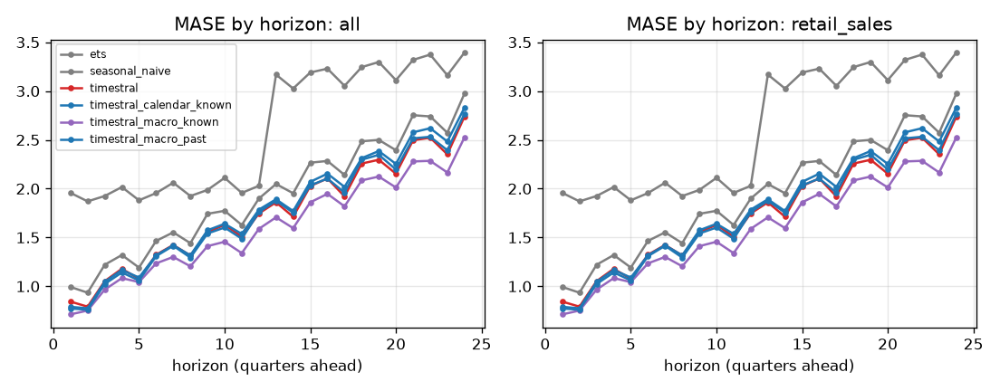

## Skill vs horizon
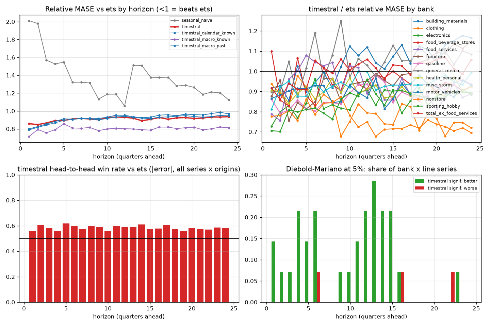

| h | ets | seasonal_naive | timestral | timestral_calendar_known | timestral_macro_known | timestral_macro_past |
|---|---|---|---|---|---|---|
| 1 | 1.000 | 2.011 | 0.858 | 0.800 | 0.716 | 0.789 |
| 2 | 1.000 | 1.978 | 0.849 | 0.826 | 0.793 | 0.818 |
| 3 | 1.000 | 1.569 | 0.865 | 0.855 | 0.756 | 0.844 |
| 4 | 1.000 | 1.526 | 0.893 | 0.883 | 0.791 | 0.868 |
| 5 | 1.000 | 1.547 | 0.894 | 0.912 | 0.855 | 0.896 |
| 6 | 1.000 | 1.321 | 0.911 | 0.908 | 0.810 | 0.905 |
| 7 | 1.000 | 1.322 | 0.918 | 0.918 | 0.807 | 0.918 |
| 8 | 1.000 | 1.314 | 0.910 | 0.920 | 0.816 | 0.911 |
| 9 | 1.000 | 1.133 | 0.901 | 0.915 | 0.780 | 0.901 |
| 10 | 1.000 | 1.188 | 0.926 | 0.931 | 0.799 | 0.916 |
| 11 | 1.000 | 1.188 | 0.932 | 0.952 | 0.807 | 0.933 |
| 12 | 1.000 | 1.057 | 0.930 | 0.952 | 0.802 | 0.941 |
| 13 | 1.000 | 1.511 | 0.919 | 0.935 | 0.799 | 0.927 |
| 14 | 1.000 | 1.508 | 0.891 | 0.925 | 0.791 | 0.920 |
| 15 | 1.000 | 1.377 | 0.907 | 0.930 | 0.785 | 0.914 |
| 16 | 1.000 | 1.376 | 0.928 | 0.954 | 0.820 | 0.931 |
| 17 | 1.000 | 1.377 | 0.908 | 0.958 | 0.820 | 0.933 |
| 18 | 1.000 | 1.279 | 0.923 | 0.947 | 0.804 | 0.942 |
| 19 | 1.000 | 1.289 | 0.926 | 0.965 | 0.813 | 0.948 |
| 20 | 1.000 | 1.264 | 0.917 | 0.959 | 0.818 | 0.938 |
| 21 | 1.000 | 1.185 | 0.921 | 0.956 | 0.790 | 0.931 |
| 22 | 1.000 | 1.212 | 0.932 | 0.972 | 0.801 | 0.937 |
| 23 | 1.000 | 1.203 | 0.933 | 0.986 | 0.820 | 0.951 |
| 24 | 1.000 | 1.124 | 0.936 | 0.967 | 0.812 | 0.946 |

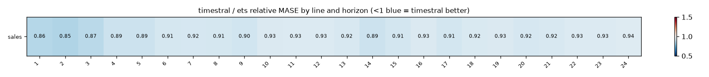

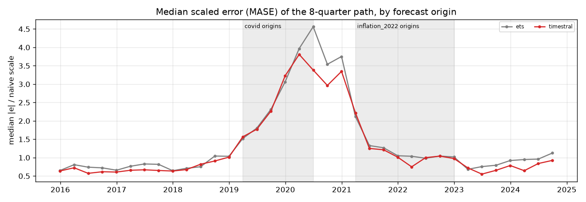

## Relative MASE vs baseline (geometric mean; <1 = better than baseline)
| model | rel_mase |
|---|---|
| timestral_macro_known | 0.803 |
| timestral | 0.915 |
| timestral_macro_past | 0.921 |
| timestral_calendar_known | 0.938 |
| ets | 1.000 |
| seasonal_naive | 1.323 |

### By bank
| id | ets | seasonal_naive | timestral | timestral_calendar_known | timestral_macro_known | timestral_macro_past |
|---|---|---|---|---|---|---|
| building_materials | 1.000 | 1.403 | 1.067 | 1.100 | 1.123 | 1.140 |
| clothing | 1.000 | 1.103 | 0.787 | 0.835 | 0.768 | 0.782 |
| electronics | 1.000 | 1.053 | 0.858 | 0.919 | 0.897 | 0.866 |
| food_beverage_stores | 1.000 | 1.744 | 0.941 | 0.917 | 0.874 | 0.843 |
| food_services | 1.000 | 1.459 | 0.919 | 0.876 | 0.633 | 0.787 |
| furniture | 1.000 | 1.153 | 0.985 | 1.051 | 0.985 | 1.012 |
| gasoline | 1.000 | 1.185 | 0.894 | 1.017 | 0.227 | 1.033 |
| general_merch | 1.000 | 1.318 | 1.053 | 1.019 | 0.889 | 0.964 |
| health_personal | 1.000 | 1.756 | 0.905 | 0.856 | 0.830 | 0.900 |
| misc_stores | 1.000 | 1.139 | 0.941 | 0.988 | 0.933 | 1.015 |
| motor_vehicles | 1.000 | 1.242 | 0.904 | 0.948 | 1.109 | 1.021 |
| nonstore | 1.000 | 1.628 | 0.741 | 0.733 | 0.729 | 0.707 |
| sporting_hobby | 1.000 | 0.997 | 0.863 | 0.902 | 0.944 | 0.911 |
| total_ex_food_services | 1.000 | 1.675 | 1.015 | 1.038 | 0.921 | 1.012 |

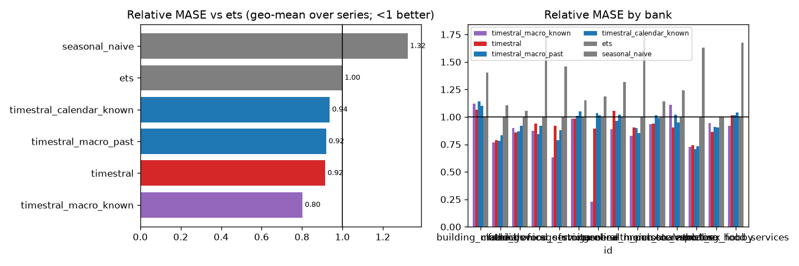

## Win rates (share of series where challenger beats baseline)
| id | MAE | MASE | RMSE | dir_acc | sMAPE |
|---|---|---|---|---|---|
| building_materials | 0% | 0% | 0% | 0% | 0% |
| clothing | 100% | 100% | 100% | 100% | 100% |
| electronics | 100% | 100% | 100% | 100% | 100% |
| food_beverage_stores | 100% | 100% | 100% | 100% | 100% |
| food_services | 100% | 100% | 0% | 100% | 100% |
| furniture | 100% | 100% | 100% | 100% | 100% |
| gasoline | 100% | 100% | 100% | 100% | 100% |
| general_merch | 0% | 0% | 0% | 0% | 0% |
| health_personal | 100% | 100% | 100% | 100% | 100% |
| misc_stores | 100% | 100% | 100% | 100% | 100% |
| motor_vehicles | 100% | 100% | 100% | 100% | 100% |
| nonstore | 100% | 100% | 100% | 100% | 100% |
| sporting_hobby | 100% | 100% | 100% | 0% | 100% |
| total_ex_food_services | 0% | 0% | 100% | 100% | 0% |

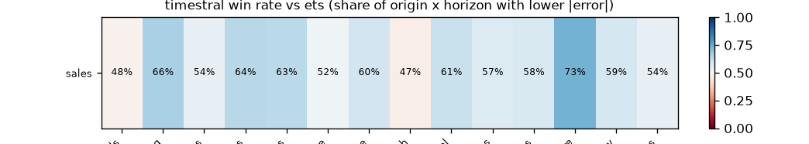

## Diebold-Mariano (squared error, HLN-corrected, per series and horizon)
Share of bank x target series where the challenger is significantly better / worse at 5%:

| h | better | worse |
|---|---|---|
| 1 | 14% | 0% |
| 2 | 7% | 0% |
| 3 | 7% | 0% |
| 4 | 21% | 0% |
| 5 | 14% | 0% |
| 6 | 21% | 7% |
| 7 | 0% | 0% |
| 8 | 0% | 0% |
| 9 | 7% | 0% |
| 10 | 7% | 0% |
| 11 | 14% | 0% |
| 12 | 21% | 0% |
| 13 | 29% | 0% |
| 14 | 21% | 0% |
| 15 | 21% | 0% |
| 16 | 7% | 7% |
| 17 | 0% | 0% |
| 18 | 0% | 0% |
| 19 | 0% | 0% |
| 20 | 0% | 0% |
| 21 | 0% | 0% |
| 22 | 0% | 7% |
| 23 | 7% | 0% |
| 24 | 0% | 0% |

## Stress slices (MASE)
| model | covid | inflation_2022 | normal |
|---|---|---|---|
| ets | 3.911 | 1.620 | 1.499 |
| seasonal_naive | 4.399 | 2.610 | 2.095 |
| timestral | 3.549 | 1.496 | 1.344 |
| timestral_calendar_known | 3.721 | 1.491 | 1.363 |
| timestral_macro_known | 3.675 | 1.184 | 1.192 |
| timestral_macro_past | 3.674 | 1.394 | 1.351 |

## Interval coverage (80%)
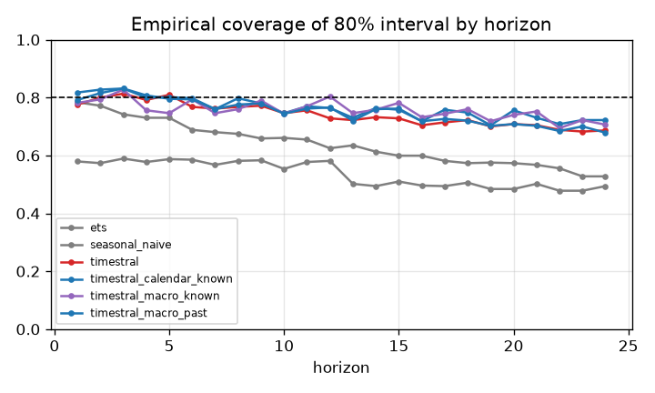

## Balance-sheet identity consistency
(none configured)

## Forecast fans

## Diebold-Mariano vs baseline, all models
Share of series significantly **better** than `ets` at 5% (squared error):

| h | seasonal_naive | timestral | timestral_calendar_known | timestral_macro_known | timestral_macro_past |
|---|---|---|---|---|---|
| 1 | 0% | 14% | 29% | 21% | 36% |
| 2 | 0% | 7% | 21% | 7% | 0% |
| 3 | 0% | 7% | 0% | 29% | 14% |
| 4 | 0% | 21% | 14% | 29% | 21% |
| 5 | 0% | 14% | 0% | 7% | 21% |
| 6 | 0% | 21% | 14% | 0% | 14% |
| 7 | 0% | 0% | 7% | 7% | 7% |
| 8 | 0% | 0% | 0% | 0% | 14% |
| 9 | 7% | 7% | 0% | 7% | 7% |
| 10 | 0% | 7% | 7% | 7% | 0% |
| 11 | 0% | 14% | 14% | 21% | 14% |
| 12 | 0% | 21% | 36% | 0% | 21% |
| 13 | 0% | 29% | 21% | 36% | 21% |
| 14 | 0% | 21% | 0% | 14% | 21% |
| 15 | 0% | 21% | 0% | 7% | 14% |
| 16 | 0% | 7% | 7% | 21% | 7% |
| 17 | 0% | 0% | 7% | 0% | 14% |
| 18 | 0% | 0% | 0% | 0% | 0% |
| 19 | 0% | 0% | 0% | 14% | 0% |
| 20 | 7% | 0% | 14% | 7% | 0% |
| 21 | 0% | 0% | 7% | 0% | 0% |
| 22 | 0% | 0% | 0% | 0% | 0% |
| 23 | 0% | 7% | 0% | 0% | 0% |
| 24 | 0% | 0% | 0% | 0% | 0% |

Share significantly **worse**:

| h | seasonal_naive | timestral | timestral_calendar_known | timestral_macro_known | timestral_macro_past |
|---|---|---|---|---|---|
| 1 | 50% | 0% | 0% | 0% | 0% |
| 2 | 43% | 0% | 0% | 0% | 0% |
| 3 | 14% | 0% | 0% | 0% | 0% |
| 4 | 29% | 0% | 0% | 0% | 0% |
| 5 | 21% | 0% | 0% | 0% | 0% |
| 6 | 0% | 7% | 0% | 0% | 0% |
| 7 | 29% | 0% | 0% | 0% | 0% |
| 8 | 14% | 0% | 0% | 0% | 0% |
| 9 | 0% | 0% | 0% | 0% | 0% |
| 10 | 29% | 0% | 0% | 7% | 0% |
| 11 | 29% | 0% | 0% | 7% | 0% |
| 12 | 7% | 0% | 0% | 0% | 0% |
| 13 | 36% | 0% | 0% | 0% | 7% |
| 14 | 36% | 0% | 0% | 0% | 0% |
| 15 | 21% | 0% | 0% | 0% | 0% |
| 16 | 14% | 7% | 0% | 0% | 0% |
| 17 | 21% | 0% | 0% | 0% | 0% |
| 18 | 14% | 0% | 0% | 0% | 0% |
| 19 | 7% | 0% | 0% | 0% | 0% |
| 20 | 21% | 0% | 0% | 0% | 0% |
| 21 | 0% | 0% | 0% | 0% | 0% |
| 22 | 14% | 7% | 0% | 0% | 0% |
| 23 | 7% | 0% | 0% | 0% | 0% |
| 24 | 0% | 0% | 0% | 0% | 0% |

## 80% interval coverage by line
| model | sales |
|---|---|
| ets | 0.639 |
| seasonal_naive | 0.536 |
| timestral | 0.741 |
| timestral_calendar_known | 0.763 |
| timestral_macro_known | 0.757 |
| timestral_macro_past | 0.750 |

## Relative MASE vs `ets` by line
| target | ets | seasonal_naive | timestral | timestral_calendar_known | timestral_macro_known | timestral_macro_past |
|---|---|---|---|---|---|---|
| sales | 1.000 | 1.323 | 0.915 | 0.938 | 0.803 | 0.921 |

### sales: relative MASE by horizon
| h | ets | seasonal_naive | timestral | timestral_calendar_known | timestral_macro_known | timestral_macro_past |
|---|---|---|---|---|---|---|
| 1 | 1.000 | 2.011 | 0.858 | 0.800 | 0.716 | 0.789 |
| 2 | 1.000 | 1.978 | 0.849 | 0.826 | 0.793 | 0.818 |
| 3 | 1.000 | 1.569 | 0.865 | 0.855 | 0.756 | 0.844 |
| 4 | 1.000 | 1.526 | 0.893 | 0.883 | 0.791 | 0.868 |
| 5 | 1.000 | 1.547 | 0.894 | 0.912 | 0.855 | 0.896 |
| 6 | 1.000 | 1.321 | 0.911 | 0.908 | 0.810 | 0.905 |
| 7 | 1.000 | 1.322 | 0.918 | 0.918 | 0.807 | 0.918 |
| 8 | 1.000 | 1.314 | 0.910 | 0.920 | 0.816 | 0.911 |
| 9 | 1.000 | 1.133 | 0.901 | 0.915 | 0.780 | 0.901 |
| 10 | 1.000 | 1.188 | 0.926 | 0.931 | 0.799 | 0.916 |
| 11 | 1.000 | 1.188 | 0.932 | 0.952 | 0.807 | 0.933 |
| 12 | 1.000 | 1.057 | 0.930 | 0.952 | 0.802 | 0.941 |
| 13 | 1.000 | 1.511 | 0.919 | 0.935 | 0.799 | 0.927 |
| 14 | 1.000 | 1.508 | 0.891 | 0.925 | 0.791 | 0.920 |
| 15 | 1.000 | 1.377 | 0.907 | 0.930 | 0.785 | 0.914 |
| 16 | 1.000 | 1.376 | 0.928 | 0.954 | 0.820 | 0.931 |
| 17 | 1.000 | 1.377 | 0.908 | 0.958 | 0.820 | 0.933 |
| 18 | 1.000 | 1.279 | 0.923 | 0.947 | 0.804 | 0.942 |
| 19 | 1.000 | 1.289 | 0.926 | 0.965 | 0.813 | 0.948 |
| 20 | 1.000 | 1.264 | 0.917 | 0.959 | 0.818 | 0.938 |
| 21 | 1.000 | 1.185 | 0.921 | 0.956 | 0.790 | 0.931 |
| 22 | 1.000 | 1.212 | 0.932 | 0.972 | 0.801 | 0.937 |
| 23 | 1.000 | 1.203 | 0.933 | 0.986 | 0.820 | 0.951 |
| 24 | 1.000 | 1.124 | 0.936 | 0.967 | 0.812 | 0.946 |

## How much does `timestral_calendar_known` help vs `timestral`? (relative MASE, <1 = helps)
| target | rel_mase |
|---|---|
| sales | 1.025 |

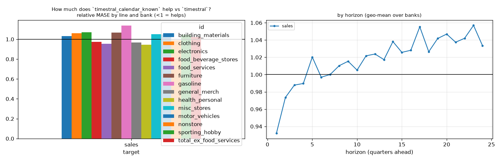

## How much does `timestral_macro_known` help vs `timestral`? (relative MASE, <1 = helps)
| target | rel_mase |
|---|---|
| sales | 0.877 |

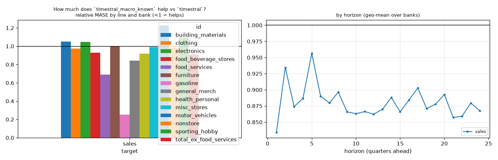

## How much does `timestral_macro_past` help vs `timestral`? (relative MASE, <1 = helps)
| target | rel_mase |
|---|---|
| sales | 1.006 |

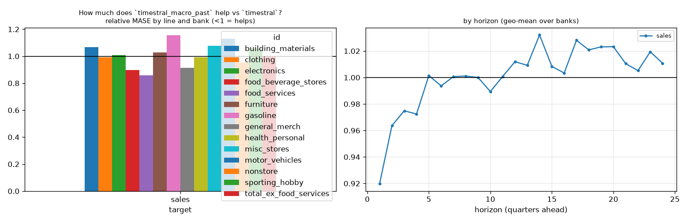

## How much does `timestral` help vs `ets`? (relative MASE, <1 = helps)
| target | rel_mase |
|---|---|
| sales | 0.915 |

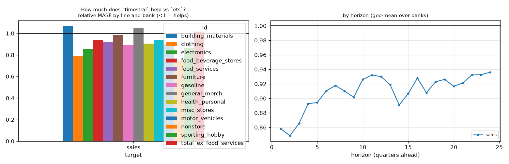

## Line x variant: relative MASE vs baseline
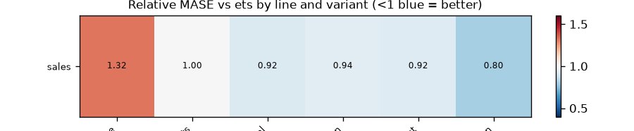

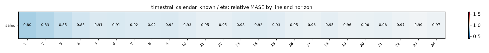
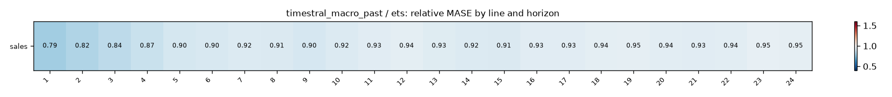
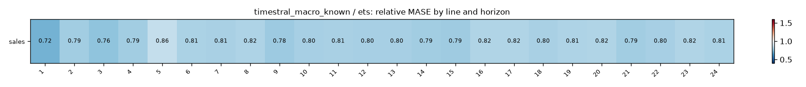

## Does macro help? (relative MASE of covariate variant vs its no-covariate twin; <1 = helps)
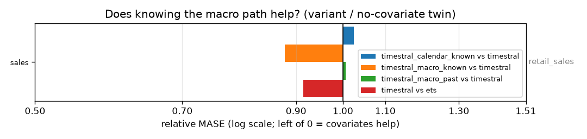

| target | timestral_calendar_known vs timestral | timestral_macro_known vs timestral | timestral_macro_past vs timestral | timestral vs ets |
|---|---|---|---|---|
| sales | 1.025 | 0.877 | 1.006 | 0.915 |

## Spaghetti pages by group

- [retail_sales](figures/retail_sales/index.md) (1 lines)
