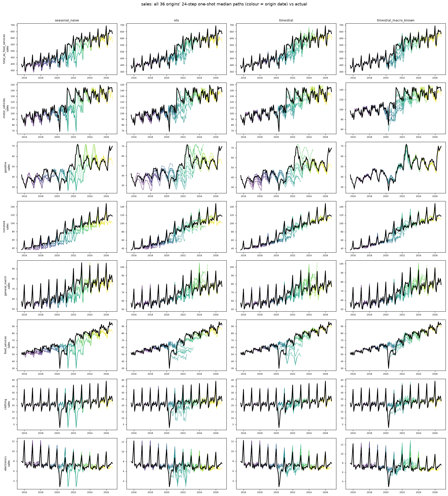

# retail_sales: all origins' 8-quarter median paths vs actual

Columns: seasonal_naive | ets | timestral | timestral_macro_known. Rows: banks. Colour = origin date; black = actual.

| target | seasonal_naive | ets | timestral | timestral_calendar_known | timestral_macro_past | timestral_macro_known |
|---|---|---|---|---|---|---|
| sales | 1.323 | 1.000 | 0.915 | 0.938 | 0.921 | 0.803 |

## sales

