# Backtest report: retail_m5

# Retail, M5 Walmart unit sales (10 stores x 7 departments = 70 daily series): headline findings

Setup: daily 2013-01-01..2016-05-22, 24 origins every 14 days, one-shot 28-day forecasts. **AutoARIMA was dropped**
(did not finish one origin in 10 min); baseline = seasonal naive (last week), AutoETS also shown. MASE scaled by lag-7 naive.
Data: original Kaggle M5 files via the Hugging Face mirror `kashif/M5`. Run on the box in 3 parallel shards.

| Model | day 1 | day 7 | day 14 | day 28 | Overall | 80% coverage |
|---|---|---|---|---|---|---|
| **Timestral + known calendar (SNAP, events, Christmas, day-of-week)** | 0.62 | **0.70** | 0.68 | 0.78 | **0.675** | 0.80 |
| Timestral + calendar + relative price index | **0.61** | 0.71 | 0.68 | 0.78 | 0.677 | 0.79 |
| Timestral, no covariates | 0.64 | 0.72 | **0.67** | **0.75** | 0.696 | 0.80 |
| AutoETS | 0.69 | 0.83 | 0.82 | 0.82 | 0.824 | 0.83 |
| Seasonal naive (baseline) | 1 | 1 | 1 | 1 | 1 | 0.90 |

- Plain Timestral is ~30% better than seasonal naive and ~16% better than AutoETS; Diebold-Mariano significantly better
  than seasonal naive on 49% of series at day 1, never worse. Its 80% bands are well calibrated (80%).
- Calendar covariates are genuinely known in advance (not a scenario test) and help modestly (0.675 vs 0.696), mostly
  in the first two weeks; at day 28 plain Timestral is slightly better. Adding the store x department price index adds nothing.
- Wins are broad across stores and departments (most series 0.55-0.85); FOODS_2 at CA_3/CA_1 are the best (~0.52-0.57).

Best plots: `figures/store_dept_units/spaghetti_units.png`, `figures/error_by_horizon_mase.png`, `figures/help_timestral_calendar_known_vs_timestral.png`.

---

# Full tables

- Series: 70 ids x 1 targets = 70
- Data: 2013-01-01 to 2016-05-22 (1238 periods)
- Rolling origins: 24 (2015-06-07 .. 2016-04-24), one-shot direct horizon h=1..28
- Challenger `timestral` vs baseline `seasonal_naive`. MASE scale = in-sample naive (lag 7).

## Overall
| model | MAE | RMSE | MAPE | sMAPE | MASE | coverage80 | dir_acc | n |
|---|---|---|---|---|---|---|---|---|
| timestral_calendar_known | 58.987 | 105.129 | 9.884 | 14.201 | 0.780 | 0.797 | 0.844 | 47040 |
| timestral_all_known | 59.207 | 105.551 | 9.902 | 14.227 | 0.783 | 0.794 | 0.843 | 47040 |
| timestral | 61.804 | 112.997 | 10.066 | 14.407 | 0.799 | 0.798 | 0.839 | 47040 |
| ets | 77.623 | 144.062 | 11.831 | 17.040 | 0.942 | 0.830 | 0.807 | 47040 |
| seasonal_naive | 92.481 | 169.905 | 14.567 | 20.589 | 1.137 | 0.904 | 0.796 | 47040 |

## MASE by horizon (all series)
| h | seasonal_naive | ets | timestral | timestral_calendar_known | timestral_all_known |
|---|---|---|---|---|---|
| 1 | 1.035 | 0.715 | 0.665 | 0.651 | 0.648 |
| 2 | 0.942 | 0.717 | 0.653 | 0.636 | 0.639 |
| 3 | 0.982 | 0.772 | 0.691 | 0.682 | 0.683 |
| 4 | 1.056 | 0.858 | 0.727 | 0.682 | 0.692 |
| 5 | 1.251 | 1.066 | 0.929 | 0.846 | 0.870 |
| 6 | 1.226 | 1.023 | 0.887 | 0.849 | 0.858 |
| 7 | 1.224 | 1.032 | 0.907 | 0.886 | 0.890 |
| 8 | 1.164 | 0.894 | 0.746 | 0.737 | 0.736 |
| 9 | 1.096 | 0.884 | 0.686 | 0.666 | 0.671 |
| 10 | 1.051 | 0.872 | 0.680 | 0.674 | 0.671 |
| 11 | 1.140 | 0.962 | 0.764 | 0.755 | 0.759 |
| 12 | 1.135 | 0.958 | 0.802 | 0.782 | 0.784 |
| 13 | 1.237 | 1.055 | 0.876 | 0.860 | 0.864 |
| 14 | 1.263 | 1.042 | 0.865 | 0.875 | 0.874 |
| 15 | 1.165 | 0.945 | 0.727 | 0.732 | 0.726 |
| 16 | 1.035 | 0.876 | 0.696 | 0.679 | 0.684 |
| 17 | 1.060 | 0.898 | 0.728 | 0.730 | 0.731 |
| 18 | 1.138 | 0.963 | 0.769 | 0.729 | 0.738 |
| 19 | 1.374 | 1.144 | 0.988 | 0.876 | 0.899 |
| 20 | 1.276 | 1.099 | 0.940 | 0.896 | 0.906 |
| 21 | 1.331 | 1.142 | 0.989 | 0.969 | 0.972 |
| 22 | 1.032 | 0.865 | 0.743 | 0.739 | 0.738 |
| 23 | 0.971 | 0.845 | 0.716 | 0.697 | 0.699 |
| 24 | 0.981 | 0.845 | 0.698 | 0.699 | 0.694 |
| 25 | 1.081 | 0.905 | 0.791 | 0.792 | 0.788 |
| 26 | 1.142 | 0.942 | 0.846 | 0.830 | 0.824 |
| 27 | 1.235 | 1.036 | 0.922 | 0.924 | 0.926 |
| 28 | 1.225 | 1.015 | 0.936 | 0.969 | 0.967 |

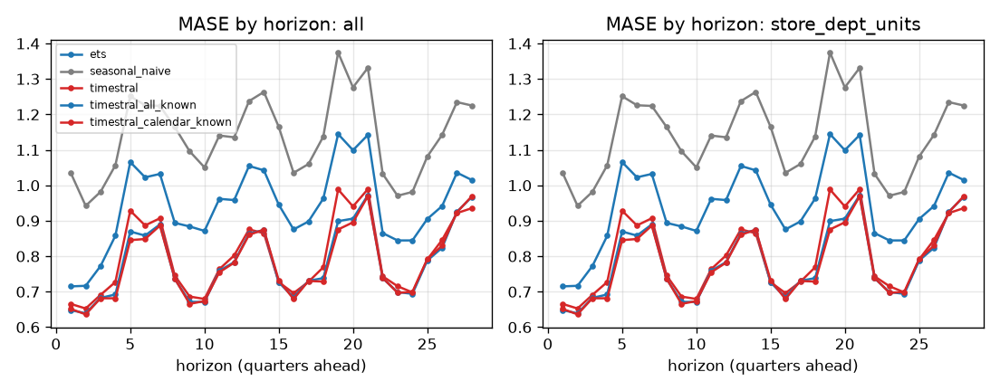

## Skill vs horizon
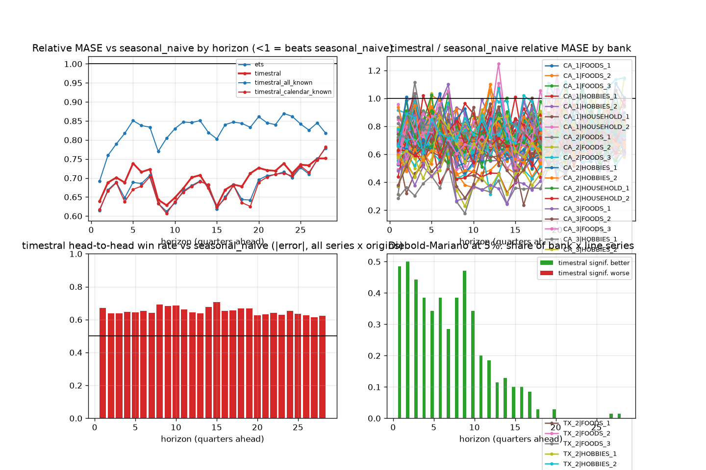

| h | ets | seasonal_naive | timestral | timestral_all_known | timestral_calendar_known |
|---|---|---|---|---|---|
| 1 | 0.692 | 1.000 | 0.639 | 0.614 | 0.617 |
| 2 | 0.760 | 1.000 | 0.688 | 0.669 | 0.666 |
| 3 | 0.789 | 1.000 | 0.701 | 0.689 | 0.687 |
| 4 | 0.817 | 1.000 | 0.688 | 0.648 | 0.638 |
| 5 | 0.851 | 1.000 | 0.739 | 0.689 | 0.670 |
| 6 | 0.838 | 1.000 | 0.716 | 0.685 | 0.679 |
| 7 | 0.834 | 1.000 | 0.723 | 0.707 | 0.703 |
| 8 | 0.770 | 1.000 | 0.643 | 0.633 | 0.633 |
| 9 | 0.805 | 1.000 | 0.628 | 0.612 | 0.607 |
| 10 | 0.830 | 1.000 | 0.648 | 0.635 | 0.638 |
| 11 | 0.847 | 1.000 | 0.673 | 0.665 | 0.663 |
| 12 | 0.846 | 1.000 | 0.701 | 0.680 | 0.678 |
| 13 | 0.851 | 1.000 | 0.707 | 0.692 | 0.691 |
| 14 | 0.820 | 1.000 | 0.673 | 0.681 | 0.682 |
| 15 | 0.803 | 1.000 | 0.625 | 0.619 | 0.623 |
| 16 | 0.840 | 1.000 | 0.669 | 0.650 | 0.646 |
| 17 | 0.847 | 1.000 | 0.683 | 0.681 | 0.681 |
| 18 | 0.844 | 1.000 | 0.678 | 0.644 | 0.635 |
| 19 | 0.833 | 1.000 | 0.712 | 0.642 | 0.625 |
| 20 | 0.861 | 1.000 | 0.727 | 0.696 | 0.688 |
| 21 | 0.845 | 1.000 | 0.720 | 0.706 | 0.703 |
| 22 | 0.840 | 1.000 | 0.719 | 0.709 | 0.710 |
| 23 | 0.870 | 1.000 | 0.738 | 0.716 | 0.712 |
| 24 | 0.862 | 1.000 | 0.712 | 0.701 | 0.705 |
| 25 | 0.842 | 1.000 | 0.735 | 0.727 | 0.732 |
| 26 | 0.826 | 1.000 | 0.733 | 0.710 | 0.714 |
| 27 | 0.845 | 1.000 | 0.751 | 0.749 | 0.747 |
| 28 | 0.818 | 1.000 | 0.752 | 0.778 | 0.781 |

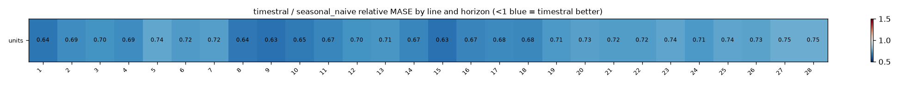

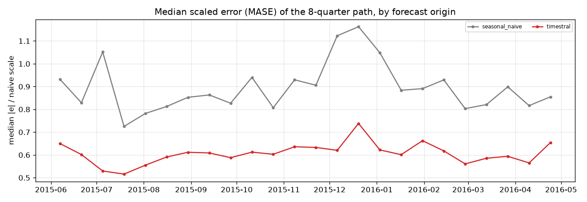

## Relative MASE vs baseline (geometric mean; <1 = better than baseline)
| model | rel_mase |
|---|---|
| timestral_calendar_known | 0.675 |
| timestral_all_known | 0.677 |
| timestral | 0.696 |
| ets | 0.824 |
| seasonal_naive | 1.000 |

### By bank
| id | ets | seasonal_naive | timestral | timestral_all_known | timestral_calendar_known |
|---|---|---|---|---|---|
| CA_1|FOODS_1 | 0.939 | 1.000 | 0.674 | 0.658 | 0.663 |
| CA_1|FOODS_2 | 0.979 | 1.000 | 0.591 | 0.567 | 0.565 |
| CA_1|FOODS_3 | 0.908 | 1.000 | 0.737 | 0.701 | 0.702 |
| CA_1|HOBBIES_1 | 0.757 | 1.000 | 0.752 | 0.742 | 0.730 |
| CA_1|HOBBIES_2 | 0.813 | 1.000 | 0.689 | 0.694 | 0.685 |
| CA_1|HOUSEHOLD_1 | 0.771 | 1.000 | 0.713 | 0.692 | 0.685 |
| CA_1|HOUSEHOLD_2 | 0.797 | 1.000 | 0.728 | 0.705 | 0.700 |
| CA_2|FOODS_1 | 0.881 | 1.000 | 0.785 | 0.808 | 0.815 |
| CA_2|FOODS_2 | 0.883 | 1.000 | 0.835 | 0.845 | 0.849 |
| CA_2|FOODS_3 | 0.834 | 1.000 | 0.903 | 0.913 | 0.922 |
| CA_2|HOBBIES_1 | 0.794 | 1.000 | 0.770 | 0.777 | 0.773 |
| CA_2|HOBBIES_2 | 0.831 | 1.000 | 0.686 | 0.689 | 0.690 |
| CA_2|HOUSEHOLD_1 | 0.825 | 1.000 | 0.808 | 0.827 | 0.821 |
| CA_2|HOUSEHOLD_2 | 0.830 | 1.000 | 0.811 | 0.819 | 0.818 |
| CA_3|FOODS_1 | 0.870 | 1.000 | 0.648 | 0.646 | 0.658 |
| CA_3|FOODS_2 | 0.891 | 1.000 | 0.570 | 0.525 | 0.524 |
| CA_3|FOODS_3 | 0.858 | 1.000 | 0.736 | 0.735 | 0.735 |
| CA_3|HOBBIES_1 | 0.728 | 1.000 | 0.717 | 0.722 | 0.709 |
| CA_3|HOBBIES_2 | 0.810 | 1.000 | 0.751 | 0.737 | 0.739 |
| CA_3|HOUSEHOLD_1 | 0.819 | 1.000 | 0.694 | 0.685 | 0.668 |
| CA_3|HOUSEHOLD_2 | 0.798 | 1.000 | 0.747 | 0.740 | 0.735 |
| CA_4|FOODS_1 | 0.882 | 1.000 | 0.746 | 0.756 | 0.760 |
| CA_4|FOODS_2 | 0.814 | 1.000 | 0.746 | 0.731 | 0.725 |
| CA_4|FOODS_3 | 0.846 | 1.000 | 0.743 | 0.719 | 0.722 |
| CA_4|HOBBIES_1 | 0.754 | 1.000 | 0.745 | 0.736 | 0.735 |
| CA_4|HOBBIES_2 | 0.812 | 1.000 | 0.658 | 0.656 | 0.658 |
| CA_4|HOUSEHOLD_1 | 0.770 | 1.000 | 0.738 | 0.711 | 0.706 |
| CA_4|HOUSEHOLD_2 | 0.780 | 1.000 | 0.763 | 0.743 | 0.754 |
| TX_1|FOODS_1 | 0.877 | 1.000 | 0.782 | 0.779 | 0.771 |
| TX_1|FOODS_2 | 0.885 | 1.000 | 0.579 | 0.497 | 0.498 |
| TX_1|FOODS_3 | 0.819 | 1.000 | 0.730 | 0.694 | 0.696 |
| TX_1|HOBBIES_1 | 0.798 | 1.000 | 0.792 | 0.782 | 0.785 |
| TX_1|HOBBIES_2 | 0.806 | 1.000 | 0.656 | 0.668 | 0.664 |
| TX_1|HOUSEHOLD_1 | 0.734 | 1.000 | 0.736 | 0.719 | 0.720 |
| TX_1|HOUSEHOLD_2 | 0.865 | 1.000 | 0.798 | 0.804 | 0.800 |
| TX_2|FOODS_1 | 0.910 | 1.000 | 0.670 | 0.664 | 0.655 |
| TX_2|FOODS_2 | 0.850 | 1.000 | 0.639 | 0.595 | 0.600 |
| TX_2|FOODS_3 | 0.782 | 1.000 | 0.693 | 0.656 | 0.653 |
| TX_2|HOBBIES_1 | 0.722 | 1.000 | 0.724 | 0.722 | 0.715 |
| TX_2|HOBBIES_2 | 0.807 | 1.000 | 0.629 | 0.616 | 0.615 |
| TX_2|HOUSEHOLD_1 | 0.785 | 1.000 | 0.792 | 0.791 | 0.781 |
| TX_2|HOUSEHOLD_2 | 0.774 | 1.000 | 0.719 | 0.714 | 0.710 |
| TX_3|FOODS_1 | 0.887 | 1.000 | 0.708 | 0.696 | 0.691 |
| TX_3|FOODS_2 | 0.866 | 1.000 | 0.520 | 0.442 | 0.443 |
| TX_3|FOODS_3 | 0.809 | 1.000 | 0.659 | 0.589 | 0.588 |
| TX_3|HOBBIES_1 | 0.744 | 1.000 | 0.742 | 0.750 | 0.747 |
| TX_3|HOBBIES_2 | 0.834 | 1.000 | 0.697 | 0.689 | 0.684 |
| TX_3|HOUSEHOLD_1 | 0.826 | 1.000 | 0.726 | 0.697 | 0.684 |
| TX_3|HOUSEHOLD_2 | 0.757 | 1.000 | 0.701 | 0.680 | 0.673 |
| WI_1|FOODS_1 | 0.925 | 1.000 | 0.640 | 0.639 | 0.646 |
| WI_1|FOODS_2 | 0.842 | 1.000 | 0.663 | 0.665 | 0.650 |
| WI_1|FOODS_3 | 0.759 | 1.000 | 0.701 | 0.676 | 0.672 |
| WI_1|HOBBIES_1 | 0.706 | 1.000 | 0.691 | 0.675 | 0.670 |
| WI_1|HOBBIES_2 | 0.838 | 1.000 | 0.697 | 0.703 | 0.700 |
| WI_1|HOUSEHOLD_1 | 0.791 | 1.000 | 0.716 | 0.714 | 0.703 |
| WI_1|HOUSEHOLD_2 | 0.761 | 1.000 | 0.699 | 0.693 | 0.685 |
| WI_2|FOODS_1 | 0.874 | 1.000 | 0.793 | 0.761 | 0.743 |
| WI_2|FOODS_2 | 0.921 | 1.000 | 0.412 | 0.345 | 0.338 |
| WI_2|FOODS_3 | 0.877 | 1.000 | 0.484 | 0.390 | 0.390 |
| WI_2|HOBBIES_1 | 0.738 | 1.000 | 0.716 | 0.706 | 0.694 |
| WI_2|HOBBIES_2 | 0.810 | 1.000 | 0.655 | 0.655 | 0.652 |
| WI_2|HOUSEHOLD_1 | 0.825 | 1.000 | 0.614 | 0.584 | 0.589 |
| WI_2|HOUSEHOLD_2 | 0.840 | 1.000 | 0.706 | 0.691 | 0.694 |
| WI_3|FOODS_1 | 0.906 | 1.000 | 0.703 | 0.725 | 0.721 |
| WI_3|FOODS_2 | 0.933 | 1.000 | 0.462 | 0.398 | 0.396 |
| WI_3|FOODS_3 | 0.877 | 1.000 | 0.576 | 0.533 | 0.534 |
| WI_3|HOBBIES_1 | 0.731 | 1.000 | 0.744 | 0.752 | 0.744 |
| WI_3|HOBBIES_2 | 0.794 | 1.000 | 0.765 | 0.764 | 0.757 |
| WI_3|HOUSEHOLD_1 | 0.844 | 1.000 | 0.690 | 0.684 | 0.681 |
| WI_3|HOUSEHOLD_2 | 0.830 | 1.000 | 0.795 | 0.784 | 0.779 |

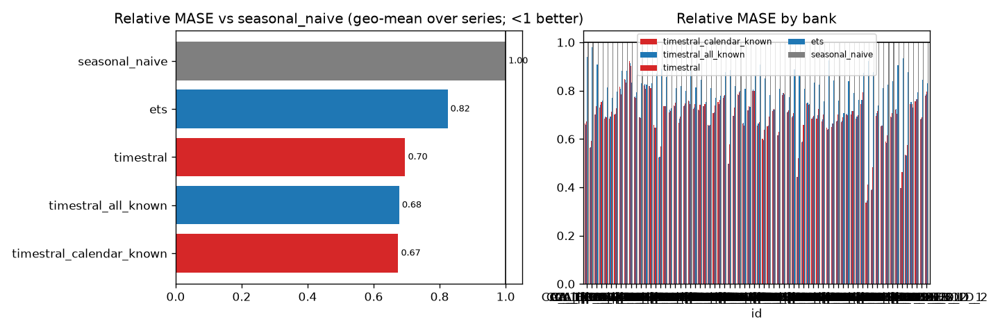

## Win rates (share of series where challenger beats baseline)
| id | MAE | MASE | RMSE | dir_acc | sMAPE |
|---|---|---|---|---|---|
| CA_1|FOODS_1 | 100% | 100% | 100% | 100% | 100% |
| CA_1|FOODS_2 | 100% | 100% | 100% | 0% | 100% |
| CA_1|FOODS_3 | 100% | 100% | 100% | 0% | 100% |
| CA_1|HOBBIES_1 | 100% | 100% | 100% | 100% | 100% |
| CA_1|HOBBIES_2 | 100% | 100% | 100% | 100% | 100% |
| CA_1|HOUSEHOLD_1 | 100% | 100% | 100% | 0% | 100% |
| CA_1|HOUSEHOLD_2 | 100% | 100% | 100% | 0% | 100% |
| CA_2|FOODS_1 | 100% | 100% | 100% | 100% | 100% |
| CA_2|FOODS_2 | 100% | 100% | 100% | 0% | 100% |
| CA_2|FOODS_3 | 100% | 100% | 100% | 0% | 100% |
| CA_2|HOBBIES_1 | 100% | 100% | 100% | 100% | 100% |
| CA_2|HOBBIES_2 | 100% | 100% | 100% | 100% | 100% |
| CA_2|HOUSEHOLD_1 | 100% | 100% | 100% | 0% | 100% |
| CA_2|HOUSEHOLD_2 | 100% | 100% | 100% | 0% | 100% |
| CA_3|FOODS_1 | 100% | 100% | 100% | 100% | 100% |
| CA_3|FOODS_2 | 100% | 100% | 100% | 0% | 100% |
| CA_3|FOODS_3 | 100% | 100% | 100% | 100% | 100% |
| CA_3|HOBBIES_1 | 100% | 100% | 100% | 100% | 100% |
| CA_3|HOBBIES_2 | 100% | 100% | 100% | 100% | 100% |
| CA_3|HOUSEHOLD_1 | 100% | 100% | 100% | 0% | 100% |
| CA_3|HOUSEHOLD_2 | 100% | 100% | 100% | 100% | 100% |
| CA_4|FOODS_1 | 100% | 100% | 100% | 100% | 100% |
| CA_4|FOODS_2 | 100% | 100% | 100% | 100% | 100% |
| CA_4|FOODS_3 | 100% | 100% | 100% | 100% | 100% |
| CA_4|HOBBIES_1 | 100% | 100% | 100% | 100% | 100% |
| CA_4|HOBBIES_2 | 100% | 100% | 100% | 100% | 100% |
| CA_4|HOUSEHOLD_1 | 100% | 100% | 100% | 100% | 100% |
| CA_4|HOUSEHOLD_2 | 100% | 100% | 100% | 100% | 100% |
| TX_1|FOODS_1 | 100% | 100% | 100% | 100% | 100% |
| TX_1|FOODS_2 | 100% | 100% | 100% | 100% | 100% |
| TX_1|FOODS_3 | 100% | 100% | 100% | 0% | 100% |
| TX_1|HOBBIES_1 | 100% | 100% | 100% | 100% | 100% |
| TX_1|HOBBIES_2 | 100% | 100% | 100% | 100% | 100% |
| TX_1|HOUSEHOLD_1 | 100% | 100% | 100% | 0% | 100% |
| TX_1|HOUSEHOLD_2 | 100% | 100% | 100% | 100% | 100% |
| TX_2|FOODS_1 | 100% | 100% | 100% | 100% | 100% |
| TX_2|FOODS_2 | 100% | 100% | 100% | 100% | 100% |
| TX_2|FOODS_3 | 100% | 100% | 100% | 0% | 100% |
| TX_2|HOBBIES_1 | 100% | 100% | 100% | 100% | 100% |
| TX_2|HOBBIES_2 | 100% | 100% | 100% | 100% | 100% |
| TX_2|HOUSEHOLD_1 | 100% | 100% | 100% | 0% | 100% |
| TX_2|HOUSEHOLD_2 | 100% | 100% | 100% | 100% | 100% |
| TX_3|FOODS_1 | 100% | 100% | 100% | 100% | 100% |
| TX_3|FOODS_2 | 100% | 100% | 100% | 100% | 100% |
| TX_3|FOODS_3 | 100% | 100% | 100% | 100% | 100% |
| TX_3|HOBBIES_1 | 100% | 100% | 100% | 100% | 100% |
| TX_3|HOBBIES_2 | 100% | 100% | 100% | 100% | 100% |
| TX_3|HOUSEHOLD_1 | 100% | 100% | 100% | 100% | 100% |
| TX_3|HOUSEHOLD_2 | 100% | 100% | 100% | 100% | 100% |
| WI_1|FOODS_1 | 100% | 100% | 100% | 100% | 100% |
| WI_1|FOODS_2 | 100% | 100% | 100% | 100% | 100% |
| WI_1|FOODS_3 | 100% | 100% | 100% | 100% | 100% |
| WI_1|HOBBIES_1 | 100% | 100% | 100% | 100% | 100% |
| WI_1|HOBBIES_2 | 100% | 100% | 100% | 100% | 100% |
| WI_1|HOUSEHOLD_1 | 100% | 100% | 100% | 100% | 100% |
| WI_1|HOUSEHOLD_2 | 100% | 100% | 100% | 100% | 100% |
| WI_2|FOODS_1 | 100% | 100% | 100% | 100% | 100% |
| WI_2|FOODS_2 | 100% | 100% | 100% | 100% | 100% |
| WI_2|FOODS_3 | 100% | 100% | 100% | 100% | 100% |
| WI_2|HOBBIES_1 | 100% | 100% | 100% | 100% | 100% |
| WI_2|HOBBIES_2 | 100% | 100% | 100% | 100% | 100% |
| WI_2|HOUSEHOLD_1 | 100% | 100% | 100% | 100% | 100% |
| WI_2|HOUSEHOLD_2 | 100% | 100% | 100% | 100% | 100% |
| WI_3|FOODS_1 | 100% | 100% | 100% | 100% | 100% |
| WI_3|FOODS_2 | 100% | 100% | 100% | 100% | 100% |
| WI_3|FOODS_3 | 100% | 100% | 100% | 100% | 100% |
| WI_3|HOBBIES_1 | 100% | 100% | 100% | 100% | 100% |
| WI_3|HOBBIES_2 | 100% | 100% | 100% | 100% | 100% |
| WI_3|HOUSEHOLD_1 | 100% | 100% | 100% | 100% | 100% |
| WI_3|HOUSEHOLD_2 | 100% | 100% | 100% | 100% | 100% |

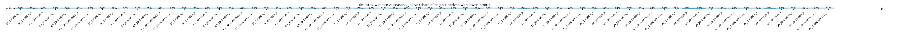

## Diebold-Mariano (squared error, HLN-corrected, per series and horizon)
Share of bank x target series where the challenger is significantly better / worse at 5%:

| h | better | worse |
|---|---|---|
| 1 | 49% | 0% |
| 2 | 50% | 0% |
| 3 | 44% | 0% |
| 4 | 39% | 0% |
| 5 | 34% | 0% |
| 6 | 39% | 0% |
| 7 | 29% | 0% |
| 8 | 39% | 0% |
| 9 | 47% | 0% |
| 10 | 34% | 0% |
| 11 | 20% | 0% |
| 12 | 19% | 0% |
| 13 | 11% | 0% |
| 14 | 13% | 0% |
| 15 | 10% | 0% |
| 16 | 10% | 0% |
| 17 | 9% | 0% |
| 18 | 3% | 0% |
| 19 | 0% | 0% |
| 20 | 3% | 0% |
| 21 | 0% | 0% |
| 22 | 0% | 0% |
| 23 | 0% | 0% |
| 24 | 0% | 0% |
| 25 | 0% | 0% |
| 26 | 0% | 0% |
| 27 | 1% | 0% |
| 28 | 1% | 0% |

## Stress slices (MASE)
| model | normal |
|---|---|
| ets | 0.942 |
| seasonal_naive | 1.137 |
| timestral | 0.799 |
| timestral_all_known | 0.783 |
| timestral_calendar_known | 0.780 |

## Interval coverage (80%)
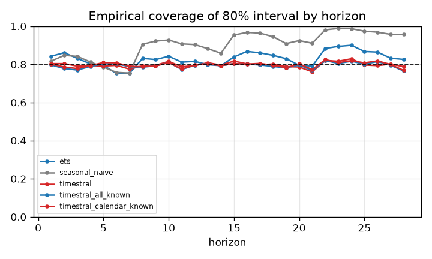

## Balance-sheet identity consistency
(none configured)

## Forecast fans

## Diebold-Mariano vs baseline, all models
Share of series significantly **better** than `seasonal_naive` at 5% (squared error):

| h | ets | timestral | timestral_all_known | timestral_calendar_known |
|---|---|---|---|---|
| 1 | 41% | 49% | 43% | 43% |
| 2 | 39% | 50% | 51% | 54% |
| 3 | 33% | 44% | 46% | 44% |
| 4 | 23% | 39% | 37% | 41% |
| 5 | 13% | 34% | 41% | 44% |
| 6 | 19% | 39% | 46% | 46% |
| 7 | 23% | 29% | 26% | 29% |
| 8 | 23% | 39% | 43% | 39% |
| 9 | 20% | 47% | 53% | 47% |
| 10 | 4% | 34% | 27% | 26% |
| 11 | 9% | 20% | 21% | 16% |
| 12 | 11% | 19% | 20% | 17% |
| 13 | 6% | 11% | 14% | 14% |
| 14 | 10% | 13% | 14% | 17% |
| 15 | 6% | 10% | 11% | 11% |
| 16 | 3% | 10% | 10% | 10% |
| 17 | 3% | 9% | 7% | 9% |
| 18 | 1% | 3% | 1% | 1% |
| 19 | 0% | 0% | 0% | 0% |
| 20 | 3% | 3% | 0% | 0% |
| 21 | 0% | 0% | 1% | 3% |
| 22 | 0% | 0% | 1% | 1% |
| 23 | 0% | 0% | 0% | 0% |
| 24 | 0% | 0% | 0% | 0% |
| 25 | 0% | 0% | 0% | 0% |
| 26 | 0% | 0% | 0% | 0% |
| 27 | 0% | 1% | 0% | 0% |
| 28 | 1% | 1% | 3% | 0% |

Share significantly **worse**:

| h | ets | timestral | timestral_all_known | timestral_calendar_known |
|---|---|---|---|---|
| 1 | 0% | 0% | 0% | 0% |
| 2 | 0% | 0% | 0% | 0% |
| 3 | 0% | 0% | 0% | 0% |
| 4 | 1% | 0% | 0% | 0% |
| 5 | 1% | 0% | 0% | 0% |
| 6 | 1% | 0% | 0% | 0% |
| 7 | 0% | 0% | 0% | 0% |
| 8 | 0% | 0% | 0% | 0% |
| 9 | 0% | 0% | 0% | 0% |
| 10 | 0% | 0% | 0% | 0% |
| 11 | 0% | 0% | 0% | 0% |
| 12 | 0% | 0% | 0% | 0% |
| 13 | 0% | 0% | 0% | 0% |
| 14 | 0% | 0% | 0% | 0% |
| 15 | 0% | 0% | 0% | 0% |
| 16 | 0% | 0% | 0% | 0% |
| 17 | 0% | 0% | 0% | 0% |
| 18 | 0% | 0% | 0% | 0% |
| 19 | 0% | 0% | 0% | 0% |
| 20 | 0% | 0% | 0% | 0% |
| 21 | 0% | 0% | 0% | 0% |
| 22 | 0% | 0% | 0% | 0% |
| 23 | 0% | 0% | 0% | 0% |
| 24 | 0% | 0% | 0% | 0% |
| 25 | 0% | 0% | 0% | 0% |
| 26 | 0% | 0% | 0% | 0% |
| 27 | 0% | 0% | 0% | 0% |
| 28 | 0% | 0% | 0% | 0% |

## 80% interval coverage by line
| model | units |
|---|---|
| ets | 0.830 |
| seasonal_naive | 0.904 |
| timestral | 0.798 |
| timestral_all_known | 0.794 |
| timestral_calendar_known | 0.797 |

## Relative MASE vs `seasonal_naive` by line
| target | ets | seasonal_naive | timestral | timestral_all_known | timestral_calendar_known |
|---|---|---|---|---|---|
| units | 0.824 | 1.000 | 0.696 | 0.677 | 0.675 |

### units: relative MASE by horizon
| h | ets | seasonal_naive | timestral | timestral_all_known | timestral_calendar_known |
|---|---|---|---|---|---|
| 1 | 0.692 | 1.000 | 0.639 | 0.614 | 0.617 |
| 2 | 0.760 | 1.000 | 0.688 | 0.669 | 0.666 |
| 3 | 0.789 | 1.000 | 0.701 | 0.689 | 0.687 |
| 4 | 0.817 | 1.000 | 0.688 | 0.648 | 0.638 |
| 5 | 0.851 | 1.000 | 0.739 | 0.689 | 0.670 |
| 6 | 0.838 | 1.000 | 0.716 | 0.685 | 0.679 |
| 7 | 0.834 | 1.000 | 0.723 | 0.707 | 0.703 |
| 8 | 0.770 | 1.000 | 0.643 | 0.633 | 0.633 |
| 9 | 0.805 | 1.000 | 0.628 | 0.612 | 0.607 |
| 10 | 0.830 | 1.000 | 0.648 | 0.635 | 0.638 |
| 11 | 0.847 | 1.000 | 0.673 | 0.665 | 0.663 |
| 12 | 0.846 | 1.000 | 0.701 | 0.680 | 0.678 |
| 13 | 0.851 | 1.000 | 0.707 | 0.692 | 0.691 |
| 14 | 0.820 | 1.000 | 0.673 | 0.681 | 0.682 |
| 15 | 0.803 | 1.000 | 0.625 | 0.619 | 0.623 |
| 16 | 0.840 | 1.000 | 0.669 | 0.650 | 0.646 |
| 17 | 0.847 | 1.000 | 0.683 | 0.681 | 0.681 |
| 18 | 0.844 | 1.000 | 0.678 | 0.644 | 0.635 |
| 19 | 0.833 | 1.000 | 0.712 | 0.642 | 0.625 |
| 20 | 0.861 | 1.000 | 0.727 | 0.696 | 0.688 |
| 21 | 0.845 | 1.000 | 0.720 | 0.706 | 0.703 |
| 22 | 0.840 | 1.000 | 0.719 | 0.709 | 0.710 |
| 23 | 0.870 | 1.000 | 0.738 | 0.716 | 0.712 |
| 24 | 0.862 | 1.000 | 0.712 | 0.701 | 0.705 |
| 25 | 0.842 | 1.000 | 0.735 | 0.727 | 0.732 |
| 26 | 0.826 | 1.000 | 0.733 | 0.710 | 0.714 |
| 27 | 0.845 | 1.000 | 0.751 | 0.749 | 0.747 |
| 28 | 0.818 | 1.000 | 0.752 | 0.778 | 0.781 |

## How much does `timestral_calendar_known` help vs `timestral`? (relative MASE, <1 = helps)
| target | rel_mase |
|---|---|
| units | 0.970 |

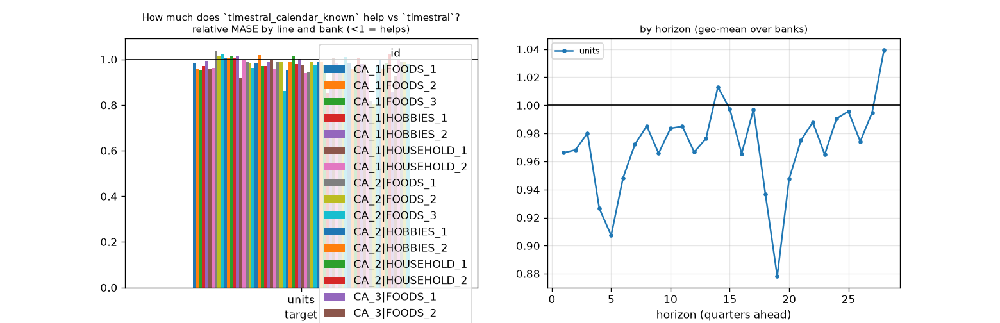

## How much does `timestral_all_known` help vs `timestral`? (relative MASE, <1 = helps)
| target | rel_mase |
|---|---|
| units | 0.974 |

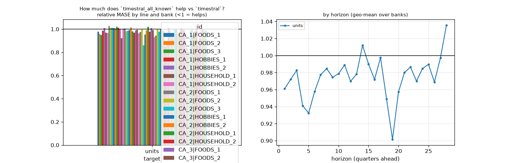

## How much does `timestral` help vs `seasonal_naive`? (relative MASE, <1 = helps)
| target | rel_mase |
|---|---|
| units | 0.696 |

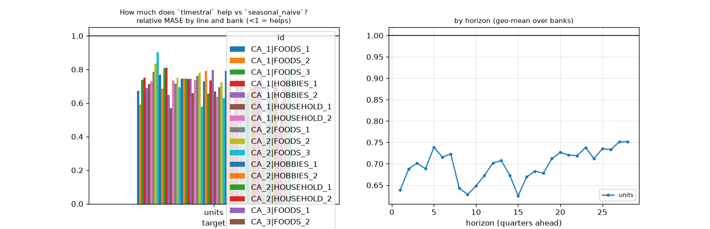

## How much does `ets` help vs `seasonal_naive`? (relative MASE, <1 = helps)
| target | rel_mase |
|---|---|
| units | 0.824 |

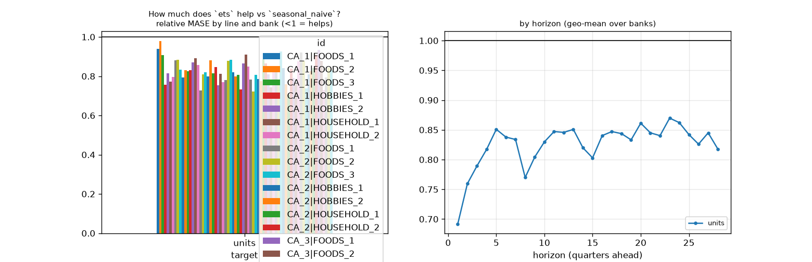

## Line x variant: relative MASE vs baseline
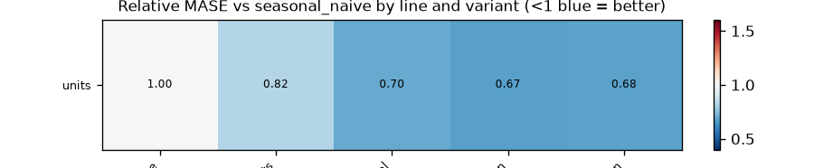

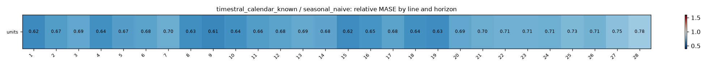
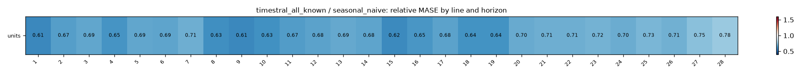

## Does macro help? (relative MASE of covariate variant vs its no-covariate twin; <1 = helps)
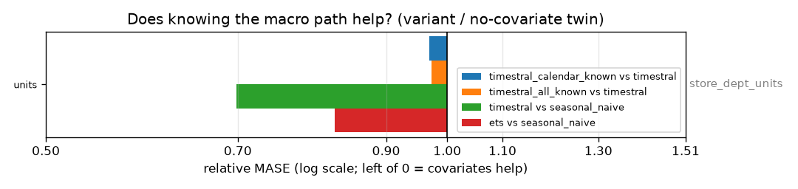

| target | timestral_calendar_known vs timestral | timestral_all_known vs timestral | timestral vs seasonal_naive | ets vs seasonal_naive |
|---|---|---|---|---|
| units | 0.970 | 0.974 | 0.696 | 0.824 |

## Spaghetti pages by group

- [store_dept_units](figures/store_dept_units/index.md) (1 lines)
