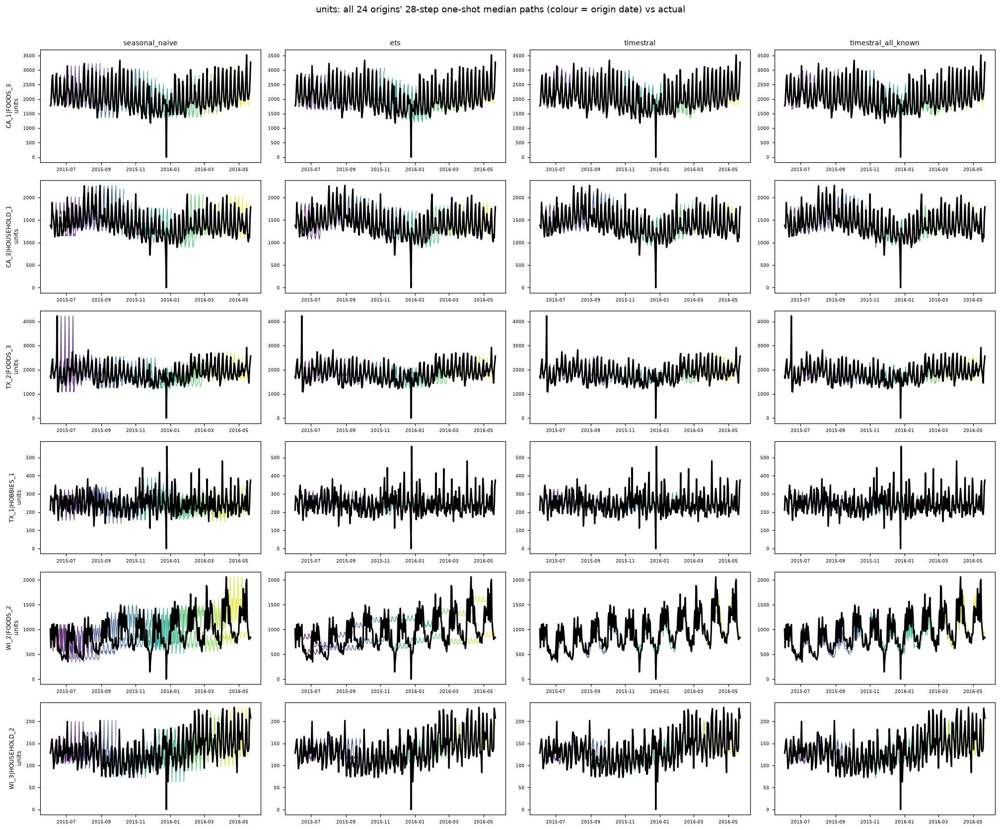

# store_dept_units: all origins' 8-quarter median paths vs actual

Columns: seasonal_naive | ets | timestral | timestral_all_known. Rows: banks. Colour = origin date; black = actual.

| target | seasonal_naive | ets | timestral | timestral_calendar_known | timestral_all_known |
|---|---|---|---|---|---|
| units | 1.000 | 0.824 | 0.696 | 0.675 | 0.677 |

## units

