# Backtest report: term_structure

## Headline findings: does knowing the Treasury curve help forecast interest income and expense?

Setup: 4 BHCs (FDIC call-report aggregation), targets are total interest income (`INTINC`), total interest expense
(`EINTEXP`) and NII. At build time the panel checks that INTINC − EINTEXP = NII (max relative gap 1.6e-6). There are 38
quarterly origins from 2015Q1 to 2024Q2, each with a one-shot 8-quarter forecast. The 10-point CMT curve (3m–30y,
quarterly averages, with 20y/30y gaps filled through spreads) is the covariate. *Known-future* means the **realised**
curve over the forecast window, a scenario/oracle setup like stress testing, not a real-time forecast.

Relative MASE vs AutoARIMA (geometric mean over 4 banks; <1 = better):

| variant | interest expense | interest income | NII | all, h=1 | all, h=8 |
|---|---|---|---|---|---|
| Timestral, no covariates | 0.86 | 0.90 | 0.97 | 0.74 | 0.95 |
| Timestral, past-only curve | 0.75 | 0.80 | 0.95 | 0.64 | 0.89 |
| **Timestral, known-future curve** | **0.51** | **0.58** | 0.88 | 0.60 | **0.66** |
| Timestral, known-future level/slope/curvature | 0.52 | 0.61 | 0.89 | 0.58 | 0.70 |
| ARIMAX, known-future level + slope | 0.69 | 0.86 | 1.27 | 1.01 | 0.88 |

* **Yes, the known curve helps interest expense, and the help grows with horizon, as deposit-beta lags imply.**
  Against the same model without covariates, the known curve cuts interest-expense MASE by 40% overall: 26% at h=1,
  rising to 44% at h=8. For interest income the cut is 35%; for NII it is only 9%. In NII the rate effects on income
  and expense largely offset.
* Three factors (level/slope/curvature) recover almost all of the full-curve gain. The full curve is marginally better.
* The past-only curve already helps (−12% on expense), so Timestral uses the *recent* rate path as a leading
  indicator even without a scenario.
* **2021Q4, just before the hikes, is the defining case.** Unconditional models (ARIMA and plain Timestral) project flat
  expense, while the known-curve model gets the direction and roughly half the size of the surge. Interest-expense MASE
  there is 6.9 vs 15.1 for ARIMA and 15.5 for plain Timestral. It still under-predicts how fast expense rose.
* **2023Q2, the rate peak, is the exception.** Knowing the curve *hurts* (expense MASE 4.5 vs 2.2 for plain Timestral).
  Rates plateaued and then fell, but deposit costs kept repricing upward with a lag. The model maps the flat-to-lower
  curve into falling expense too early. That is the deposit-beta lag working against a level-only mapping.
* 2019Q2 (cuts) and 2020Q1 (zero lower bound): the known curve gets the direction of the expense collapse right, while
  ARIMA and plain Timestral extrapolate the rise. All models under-predict how fast deposit costs fell.
* ARIMAX with the same oracle information helps expense (0.69) but hurts NII (1.27). Linear regressors on levels are a
  much weaker way to use the scenario than Timestral's known-covariate conditioning.
* **Calibration:** with the known curve, 80% bands cover 79% (expense) / 89% (income) / 86% (NII). Without it, interest
  income and expense coverage is only 62–69%: ARIMA and plain Timestral bands are too narrow through the regime changes.
* **Diebold-Mariano:** at h=1 most variants beat ARIMA significantly on 58–83% of series. Beyond h=2 there are few
  significant results (only 4 series per line and 38 overlapping origins, so power is low). Read the point estimates
  above as indicative.

---

# Full tables

- Series: 4 ids x 3 targets = 12
- Data: 2001-03-31 to 2026-06-30 (102 periods)
- Rolling origins: 38 (2015-03-31 .. 2024-06-30), one-shot direct horizon h=1..8
- Challenger `timestral_curve_known` vs baseline `arima`. MASE scale = in-sample naive (lag 1).

## Overall
| model | MAE | RMSE | MAPE | sMAPE | MASE | coverage80 | dir_acc | n |
|---|---|---|---|---|---|---|---|---|
| timestral_curve_known | 1514.398 | 2562.057 | 9.443 | 18.835 | 2.817 | 0.847 | 0.765 | 3648 |
| timestral_factors_known | 1549.183 | 2583.424 | 9.677 | 19.100 | 2.897 | 0.796 | 0.750 | 3648 |
| timestral_curve_past | 1976.538 | 3647.178 | 10.111 | 27.322 | 3.709 | 0.697 | 0.699 | 3648 |
| arimax_curve_factors | 2129.782 | 3551.112 | 13.928 | 25.307 | 3.995 | 0.696 | 0.616 | 3648 |
| timestral | 2161.676 | 3872.105 | 11.087 | 28.289 | 4.048 | 0.685 | 0.663 | 3648 |
| arima | 2399.440 | 4061.540 | 14.675 | 32.748 | 4.463 | 0.693 | 0.563 | 3648 |

## MASE by horizon (all series)
| h | arima | arimax_curve_factors | timestral | timestral_curve_past | timestral_curve_known | timestral_factors_known |
|---|---|---|---|---|---|---|
| 1 | 1.130 | 1.143 | 0.863 | 0.758 | 0.697 | 0.676 |
| 2 | 2.069 | 2.014 | 1.745 | 1.544 | 1.281 | 1.237 |
| 3 | 3.039 | 2.874 | 2.685 | 2.392 | 1.875 | 1.854 |
| 4 | 4.070 | 3.739 | 3.645 | 3.267 | 2.498 | 2.490 |
| 5 | 5.024 | 4.510 | 4.593 | 4.165 | 3.178 | 3.255 |
| 6 | 5.944 | 5.243 | 5.503 | 5.063 | 3.796 | 3.946 |
| 7 | 6.812 | 5.912 | 6.298 | 5.853 | 4.353 | 4.568 |
| 8 | 7.620 | 6.526 | 7.054 | 6.631 | 4.859 | 5.152 |

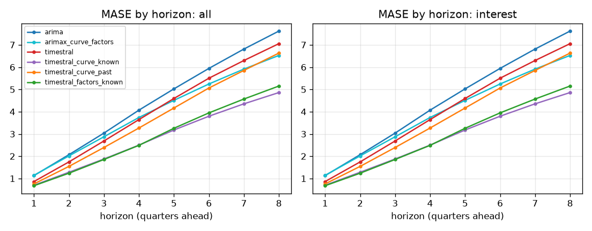

## Skill vs horizon
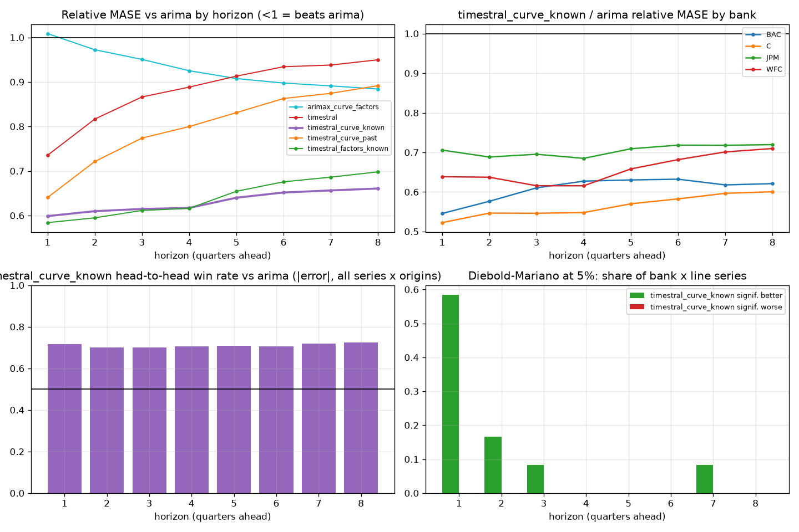

| h | arima | arimax_curve_factors | timestral | timestral_curve_known | timestral_curve_past | timestral_factors_known |
|---|---|---|---|---|---|---|
| 1 | 1.000 | 1.009 | 0.735 | 0.599 | 0.640 | 0.584 |
| 2 | 1.000 | 0.972 | 0.817 | 0.610 | 0.721 | 0.595 |
| 3 | 1.000 | 0.951 | 0.866 | 0.615 | 0.774 | 0.611 |
| 4 | 1.000 | 0.925 | 0.888 | 0.617 | 0.800 | 0.616 |
| 5 | 1.000 | 0.908 | 0.913 | 0.640 | 0.831 | 0.654 |
| 6 | 1.000 | 0.898 | 0.934 | 0.652 | 0.863 | 0.676 |
| 7 | 1.000 | 0.891 | 0.938 | 0.656 | 0.874 | 0.686 |
| 8 | 1.000 | 0.884 | 0.950 | 0.661 | 0.892 | 0.698 |

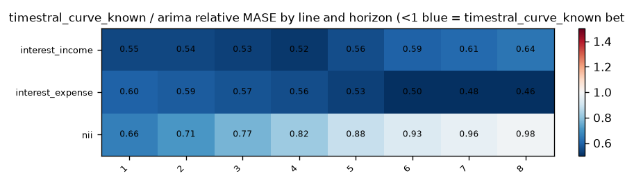

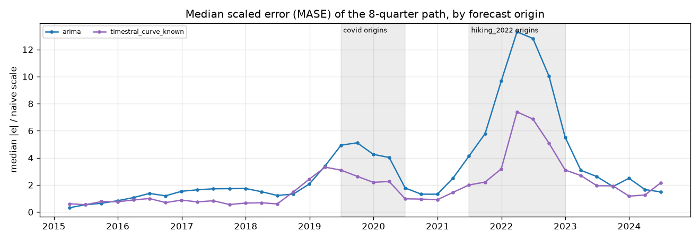

## Relative MASE vs baseline (geometric mean; <1 = better than baseline)
| model | rel_mase |
|---|---|
| timestral_curve_known | 0.638 |
| timestral_factors_known | 0.656 |
| timestral_curve_past | 0.831 |
| timestral | 0.906 |
| arimax_curve_factors | 0.909 |
| arima | 1.000 |

### By bank
| id | arima | arimax_curve_factors | timestral | timestral_curve_known | timestral_curve_past | timestral_factors_known |
|---|---|---|---|---|---|---|
| BAC | 1.000 | 0.812 | 0.847 | 0.612 | 0.811 | 0.626 |
| C | 1.000 | 0.874 | 0.891 | 0.573 | 0.750 | 0.589 |
| JPM | 1.000 | 1.005 | 0.978 | 0.708 | 0.924 | 0.708 |
| WFC | 1.000 | 0.957 | 0.912 | 0.669 | 0.850 | 0.708 |

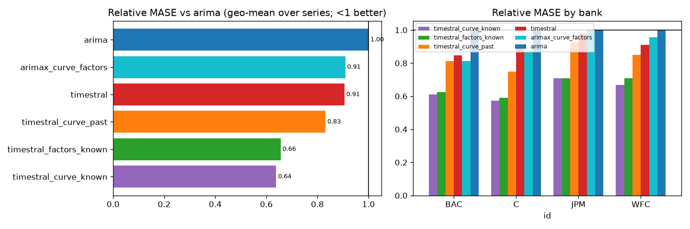

## Win rates (share of series where challenger beats baseline)
| id | MAE | MASE | RMSE | dir_acc | sMAPE |
|---|---|---|---|---|---|
| BAC | 100% | 100% | 100% | 100% | 100% |
| C | 100% | 100% | 100% | 67% | 100% |
| JPM | 100% | 100% | 100% | 67% | 100% |
| WFC | 100% | 100% | 100% | 100% | 100% |

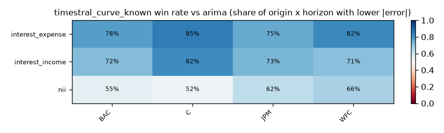

## Diebold-Mariano (squared error, HLN-corrected, per series and horizon)
Share of bank x target series where the challenger is significantly better / worse at 5%:

| h | better | worse |
|---|---|---|
| 1 | 58% | 0% |
| 2 | 17% | 0% |
| 3 | 8% | 0% |
| 4 | 0% | 0% |
| 5 | 0% | 0% |
| 6 | 0% | 0% |
| 7 | 8% | 0% |
| 8 | 0% | 0% |

## Stress slices (MASE)
| model | covid | hiking_2022 | normal |
|---|---|---|---|
| arima | 5.199 | 10.522 | 2.691 |
| arimax_curve_factors | 4.793 | 9.198 | 2.441 |
| timestral | 4.011 | 10.771 | 2.246 |
| timestral_curve_known | 2.873 | 6.279 | 1.874 |
| timestral_curve_past | 3.377 | 9.990 | 2.082 |
| timestral_factors_known | 3.230 | 6.193 | 1.946 |

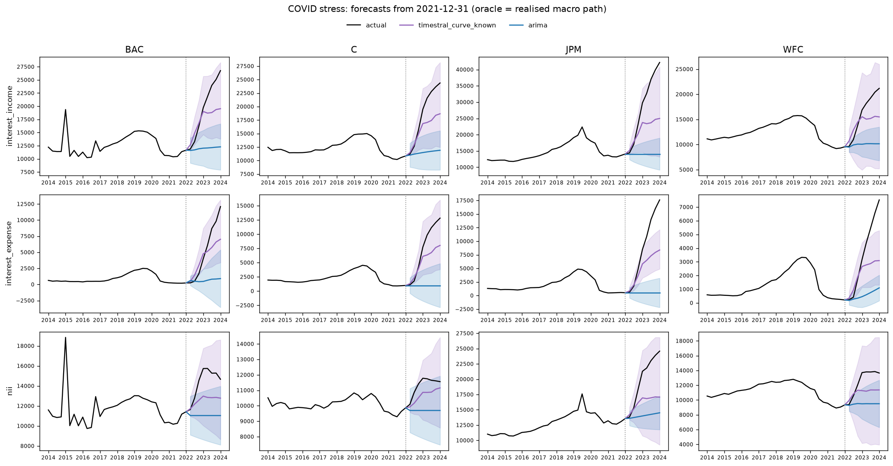

## Interval coverage (80%)
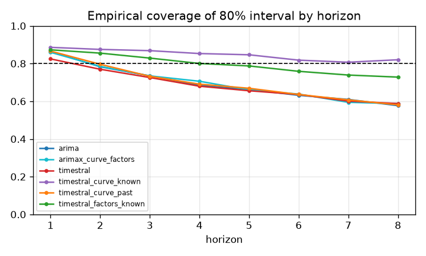

## Balance-sheet identity consistency
| identity | model | median_abs_gap_pct | median_abs_actual_gap_pct | median_excess_vs_actual_pp |
|---|---|---|---|---|
| nii_bridge | arima | 4.028 | 0.000 | 4.028 |
| nii_bridge | arimax_curve_factors | 2.652 | 0.000 | 2.652 |
| nii_bridge | timestral | 2.172 | 0.000 | 2.172 |
| nii_bridge | timestral_curve_known | 2.247 | 0.000 | 2.247 |
| nii_bridge | timestral_curve_past | 1.837 | 0.000 | 1.837 |
| nii_bridge | timestral_factors_known | 2.089 | 0.000 | 2.089 |

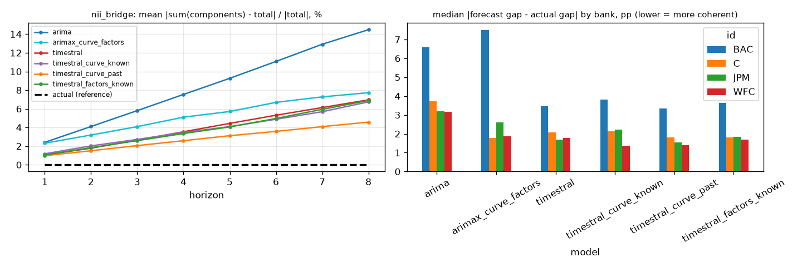

## Forecast fans

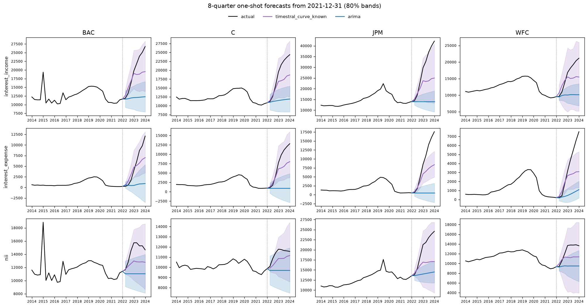
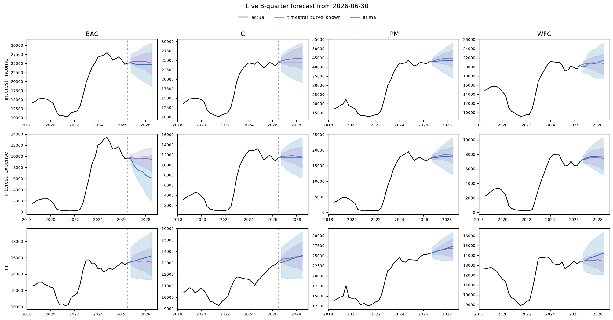

## Diebold-Mariano vs baseline, all models
Share of series significantly **better** than `arima` at 5% (squared error):

| h | arimax_curve_factors | timestral | timestral_curve_known | timestral_curve_past | timestral_factors_known |
|---|---|---|---|---|---|
| 1 | 0% | 75% | 58% | 83% | 67% |
| 2 | 0% | 8% | 17% | 0% | 17% |
| 3 | 0% | 0% | 8% | 17% | 8% |
| 4 | 0% | 0% | 0% | 0% | 0% |
| 5 | 0% | 0% | 0% | 8% | 0% |
| 6 | 8% | 0% | 0% | 0% | 0% |
| 7 | 8% | 0% | 8% | 0% | 0% |
| 8 | 8% | 0% | 0% | 0% | 0% |

Share significantly **worse**:

| h | arimax_curve_factors | timestral | timestral_curve_known | timestral_curve_past | timestral_factors_known |
|---|---|---|---|---|---|
| 1 | 17% | 0% | 0% | 0% | 0% |
| 2 | 0% | 0% | 0% | 0% | 0% |
| 3 | 0% | 0% | 0% | 0% | 0% |
| 4 | 0% | 0% | 0% | 0% | 0% |
| 5 | 0% | 0% | 0% | 0% | 0% |
| 6 | 0% | 0% | 0% | 0% | 0% |
| 7 | 0% | 0% | 0% | 0% | 0% |
| 8 | 0% | 8% | 0% | 0% | 0% |

## 80% interval coverage by line
| model | interest_expense | interest_income | nii |
|---|---|---|---|
| arima | 0.618 | 0.669 | 0.793 |
| arimax_curve_factors | 0.679 | 0.653 | 0.755 |
| timestral | 0.652 | 0.664 | 0.738 |
| timestral_curve_known | 0.785 | 0.892 | 0.863 |
| timestral_curve_past | 0.671 | 0.687 | 0.734 |
| timestral_factors_known | 0.738 | 0.818 | 0.833 |

## Relative MASE vs `arima` by line
| target | arima | arimax_curve_factors | timestral | timestral_curve_known | timestral_curve_past | timestral_factors_known |
|---|---|---|---|---|---|---|
| interest_expense | 1.000 | 0.688 | 0.857 | 0.510 | 0.754 | 0.518 |
| interest_income | 1.000 | 0.858 | 0.898 | 0.582 | 0.804 | 0.613 |
| nii | 1.000 | 1.272 | 0.966 | 0.876 | 0.949 | 0.888 |

### interest_expense: relative MASE by horizon
| h | arima | arimax_curve_factors | timestral | timestral_curve_known | timestral_curve_past | timestral_factors_known |
|---|---|---|---|---|---|---|
| 1 | 1.000 | 0.889 | 0.807 | 0.596 | 0.649 | 0.591 |
| 2 | 1.000 | 0.811 | 0.856 | 0.585 | 0.723 | 0.564 |
| 3 | 1.000 | 0.765 | 0.901 | 0.569 | 0.757 | 0.560 |
| 4 | 1.000 | 0.730 | 0.906 | 0.557 | 0.767 | 0.547 |
| 5 | 1.000 | 0.692 | 0.883 | 0.532 | 0.764 | 0.536 |
| 6 | 1.000 | 0.667 | 0.862 | 0.499 | 0.767 | 0.514 |
| 7 | 1.000 | 0.648 | 0.841 | 0.482 | 0.757 | 0.499 |
| 8 | 1.000 | 0.637 | 0.820 | 0.462 | 0.745 | 0.481 |

### interest_income: relative MASE by horizon
| h | arima | arimax_curve_factors | timestral | timestral_curve_known | timestral_curve_past | timestral_factors_known |
|---|---|---|---|---|---|---|
| 1 | 1.000 | 0.997 | 0.696 | 0.547 | 0.601 | 0.527 |
| 2 | 1.000 | 0.945 | 0.799 | 0.545 | 0.686 | 0.534 |
| 3 | 1.000 | 0.907 | 0.840 | 0.531 | 0.734 | 0.542 |
| 4 | 1.000 | 0.870 | 0.863 | 0.516 | 0.753 | 0.537 |
| 5 | 1.000 | 0.848 | 0.890 | 0.557 | 0.794 | 0.593 |
| 6 | 1.000 | 0.842 | 0.919 | 0.595 | 0.831 | 0.633 |
| 7 | 1.000 | 0.833 | 0.937 | 0.612 | 0.847 | 0.654 |
| 8 | 1.000 | 0.826 | 0.958 | 0.635 | 0.877 | 0.682 |

### nii: relative MASE by horizon
| h | arima | arimax_curve_factors | timestral | timestral_curve_known | timestral_curve_past | timestral_factors_known |
|---|---|---|---|---|---|---|
| 1 | 1.000 | 1.158 | 0.708 | 0.658 | 0.672 | 0.639 |
| 2 | 1.000 | 1.199 | 0.796 | 0.711 | 0.757 | 0.698 |
| 3 | 1.000 | 1.239 | 0.860 | 0.768 | 0.834 | 0.753 |
| 4 | 1.000 | 1.247 | 0.897 | 0.816 | 0.885 | 0.796 |
| 5 | 1.000 | 1.274 | 0.970 | 0.884 | 0.947 | 0.882 |
| 6 | 1.000 | 1.288 | 1.029 | 0.931 | 1.008 | 0.948 |
| 7 | 1.000 | 1.310 | 1.048 | 0.958 | 1.042 | 0.989 |
| 8 | 1.000 | 1.316 | 1.091 | 0.982 | 1.085 | 1.036 |

## Highlighted origins only: relative MASE
2015-12-31, 2019-06-30, 2020-03-31, 2021-12-31, 2023-06-30

| target | arima | arimax_curve_factors | timestral | timestral_curve_known | timestral_curve_past | timestral_factors_known |
|---|---|---|---|---|---|---|
| interest_expense | 1.000 | 0.667 | 0.808 | 0.492 | 0.741 | 0.507 |
| interest_income | 1.000 | 0.914 | 0.883 | 0.591 | 0.799 | 0.625 |
| nii | 1.000 | 1.286 | 0.818 | 0.727 | 0.816 | 0.757 |

### MASE per highlighted origin
| origin | target | arima | arimax_curve_factors | timestral | timestral_curve_known | timestral_curve_past | timestral_factors_known |
|---|---|---|---|---|---|---|---|
| 2015-12-31 | interest_expense | 1.595 | 0.903 | 1.139 | 0.922 | 0.746 | 0.856 |
| 2015-12-31 | interest_income | 1.235 | 1.297 | 1.523 | 1.422 | 1.141 | 1.492 |
| 2015-12-31 | nii | 0.887 | 1.315 | 1.186 | 1.199 | 1.278 | 1.500 |
| 2019-06-30 | interest_expense | 6.236 | 3.745 | 6.978 | 3.466 | 5.163 | 4.640 |
| 2019-06-30 | interest_income | 6.610 | 6.212 | 7.743 | 5.195 | 6.060 | 6.313 |
| 2019-06-30 | nii | 6.055 | 7.329 | 5.168 | 5.374 | 4.762 | 4.918 |
| 2020-03-31 | interest_expense | 4.527 | 3.407 | 3.734 | 2.627 | 2.970 | 3.043 |
| 2020-03-31 | interest_income | 5.957 | 5.846 | 3.086 | 3.070 | 3.130 | 3.142 |
| 2020-03-31 | nii | 4.752 | 5.044 | 2.597 | 2.905 | 3.012 | 2.945 |
| 2021-12-31 | interest_expense | 15.093 | 8.716 | 15.545 | 6.853 | 15.541 | 6.694 |
| 2021-12-31 | interest_income | 12.466 | 10.809 | 12.230 | 5.846 | 12.563 | 6.682 |
| 2021-12-31 | nii | 7.516 | 11.599 | 7.199 | 4.350 | 7.249 | 4.352 |
| 2023-06-30 | interest_expense | 8.609 | 8.630 | 2.234 | 4.485 | 2.652 | 4.278 |
| 2023-06-30 | interest_income | 3.290 | 3.714 | 1.758 | 2.665 | 1.255 | 2.026 |
| 2023-06-30 | nii | 1.379 | 1.478 | 0.695 | 1.279 | 0.647 | 1.562 |

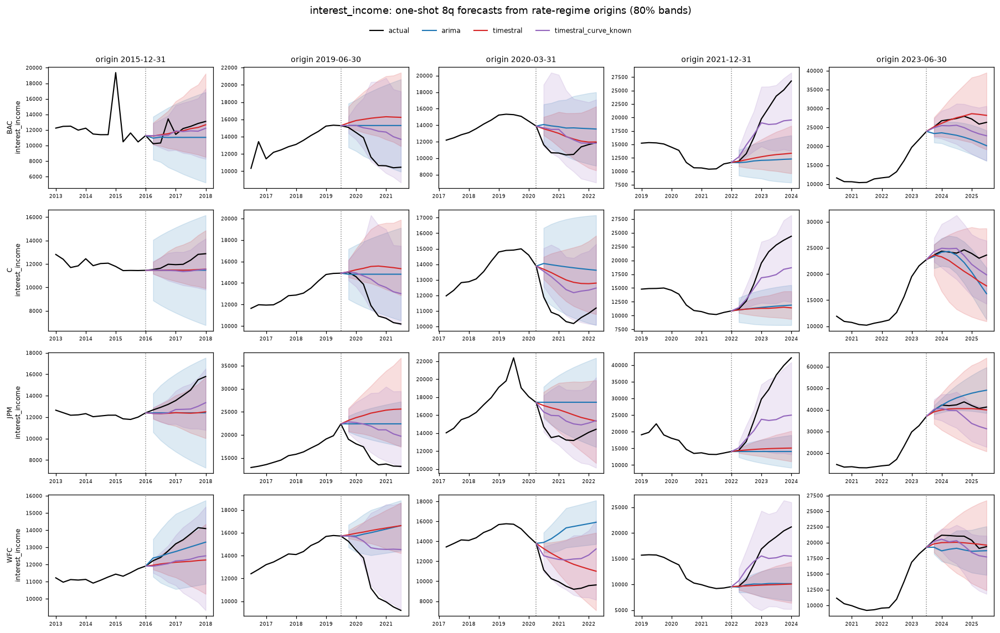
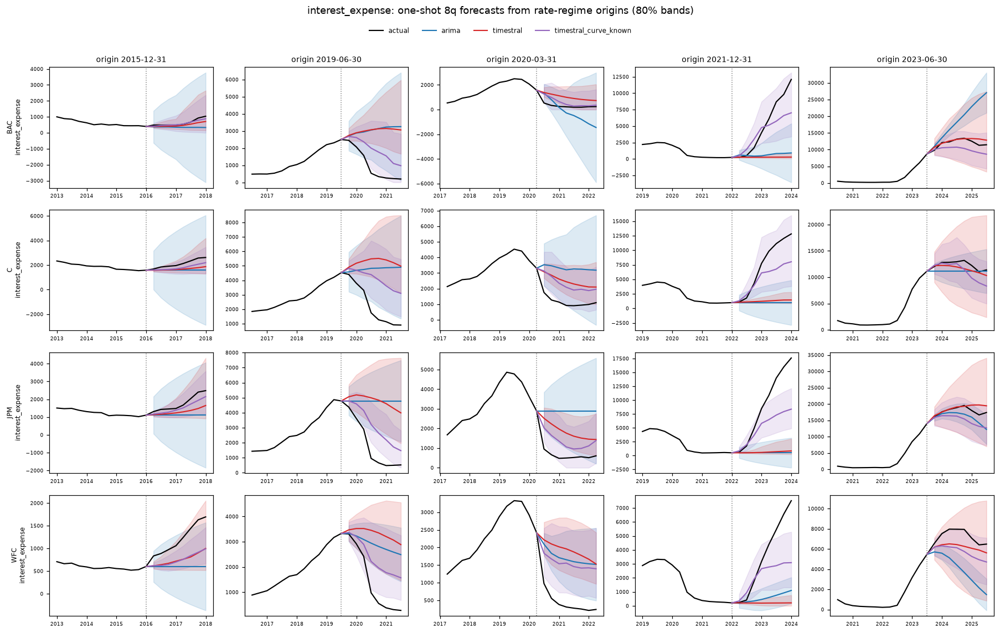

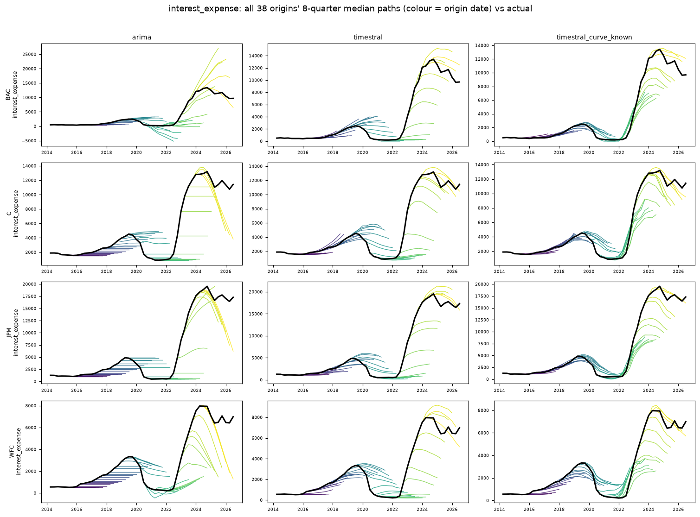
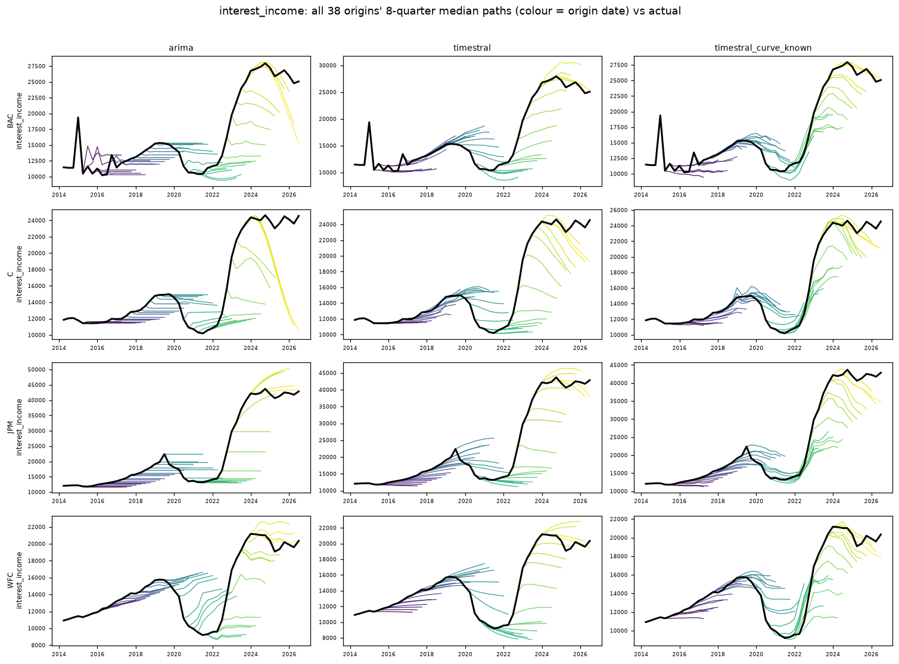
## How much does `timestral_curve_known` help vs `timestral`? (relative MASE, <1 = helps)
| target | rel_mase |
|---|---|
| interest_expense | 0.595 |
| interest_income | 0.648 |
| nii | 0.908 |

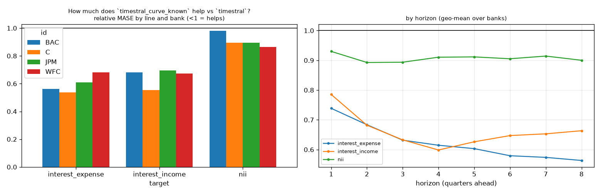

## How much does `timestral_factors_known` help vs `timestral`? (relative MASE, <1 = helps)
| target | rel_mase |
|---|---|
| interest_expense | 0.604 |
| interest_income | 0.683 |
| nii | 0.920 |

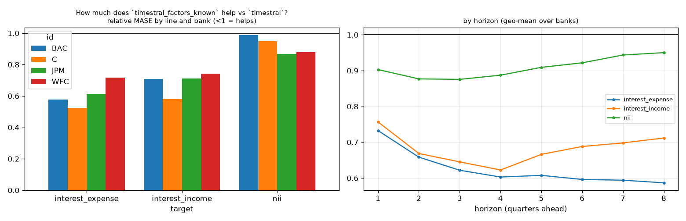

## How much does `timestral_curve_past` help vs `timestral`? (relative MASE, <1 = helps)
| target | rel_mase |
|---|---|
| interest_expense | 0.879 |
| interest_income | 0.896 |
| nii | 0.982 |

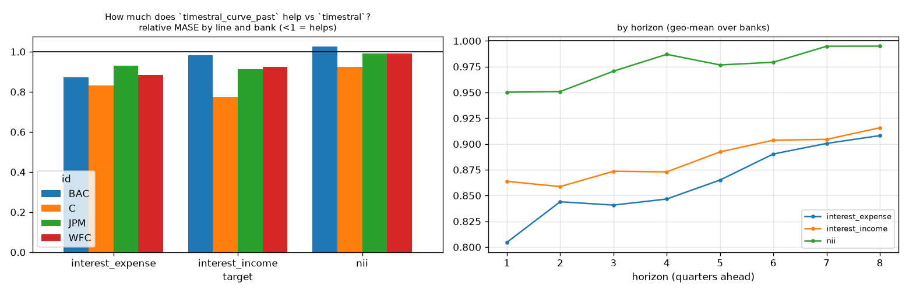

## How much does `arimax_curve_factors` help vs `arima`? (relative MASE, <1 = helps)
| target | rel_mase |
|---|---|
| interest_expense | 0.688 |
| interest_income | 0.858 |
| nii | 1.272 |

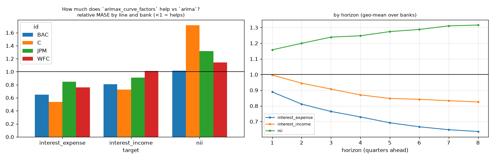

## Yield curve at highlighted origins
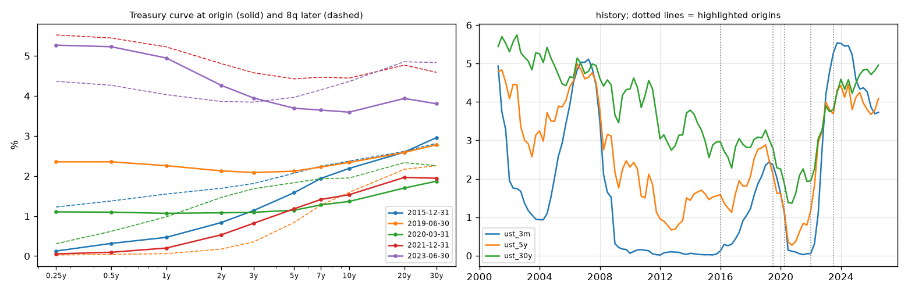
