# Backtest report: treasury_curve

## Findings: Treasury curve (3m..30y), 8-quarter one-shot, 40 quarterly origins 2014Q4..2024Q3 (+ a live forecast)

Relative MASE vs random walk (<1 = better; geometric mean over the 10 maturities):

| Model | h=1 | h=2 | h=4 | h=8 | Overall | 80% coverage |
|---|---|---|---|---|---|---|
| **Timestral joint + known fed funds path** | 0.67 | 0.59 | 0.42 | **0.30** | **0.39** | 0.86 |
| Timestral joint + known unemployment & core CPI | 0.80 | 0.79 | 0.78 | 0.77 | 0.78 | 0.84 |
| Timestral joint + past macro | 0.86 | 0.88 | 0.91 | 0.95 | 0.93 | 0.73 |
| Timestral joint (no covariates) | 0.87 | 0.89 | 0.92 | 0.97 | 0.94 | 0.71 |
| Timestral univariate | 0.85 | 0.87 | 0.93 | 0.98 | 0.95 | 0.71 |
| AutoARIMA | 0.90 | 0.93 | 1.00 | 1.09 | 1.03 | 0.81 |

- **Without covariates Timestral beats the random walk** (0.94 overall), which is a notoriously hard benchmark for
  yields; AutoARIMA does not (1.03). The gain is all at the short end (3m 0.69, 1y 0.76, 2y 0.86); at 10y-30y
  every model loses to the random walk (1.11-1.19).
- **Joint (multivariate) vs univariate:** only marginal (0.936 vs 0.947); it helps the front end slightly and the long end not at all.
- **Known fed funds path is by far the strongest input:** error falls 61% overall and 70% at 8 quarters
  (3m 0.12, 2y 0.28, 5y 0.46, 10y 0.75), and the gain grows with horizon. It transmits correctly along the curve:
  large at the front, fading to ~1 at 20-30y. In the 2022 hiking window MASE drops from 5.7 to 1.9.
- **Known macro path (unemployment, core CPI)** helps too (0.78) - the model has learned a Taylor-rule-like link -
  but not in the 2022 hikes (5.8 vs 5.7): inflation took time to show up in policy rates.
- **Past-only macro** adds almost nothing (0.93 vs 0.94).
- **Intervals:** without covariates the 80% bands cover only ~71% (too narrow); with the policy path they are about right (86%).
- **Significance:** only 10 series (one curve), so DM tests have little power; Timestral joint is significantly better than
  random walk on 30-40% of maturities at h=1 and h=8, never significantly worse.

Caveat: "known" variants are given the realised path over the forecast window (perfect-foresight scenario). The fed funds
result shows how well the model maps a policy scenario onto the curve, not real-time skill. Fed funds futures history is not
freely available, so a market-implied comparison was skipped.

---

# Full tables

- Series: 1 ids x 10 targets = 10
- Data: 1985-03-31 to 2026-09-30 (167 periods)
- Rolling origins: 40 (2014-12-31 .. 2024-09-30), one-shot direct horizon h=1..8
- Challenger `timestral_joint` vs baseline `random_walk`. MASE scale = in-sample naive (lag 1).

## Overall
| model | MAE | RMSE | MAPE | sMAPE | MASE | coverage80 | dir_acc | n |
|---|---|---|---|---|---|---|---|---|
| timestral_joint_ff_known | 0.386 | 0.545 | 14.618 | 26.963 | 1.216 | 0.860 | 0.797 | 3200 |
| timestral_joint_macro_known | 0.696 | 1.070 | 20.724 | 37.206 | 2.195 | 0.838 | 0.718 | 3200 |
| timestral_joint_macro_past | 0.830 | 1.225 | 24.999 | 48.064 | 2.617 | 0.727 | 0.690 | 3200 |
| timestral_joint | 0.839 | 1.237 | 25.173 | 49.704 | 2.646 | 0.714 | 0.661 | 3200 |
| timestral | 0.852 | 1.238 | 25.876 | 49.263 | 2.682 | 0.710 | 0.648 | 3200 |
| random_walk | 0.921 | 1.337 | 29.928 | 54.151 | 2.918 | 0.722 |  | 3200 |
| arima | 0.936 | 1.341 | 31.447 | 57.434 | 2.950 | 0.814 | 0.547 | 3200 |

## MASE by horizon (all series)
| h | random_walk | arima | timestral | timestral_joint | timestral_joint_macro_past | timestral_joint_ff_known | timestral_joint_macro_known |
|---|---|---|---|---|---|---|---|
| 1 | 0.910 | 0.825 | 0.780 | 0.796 | 0.793 | 0.647 | 0.746 |
| 2 | 1.567 | 1.449 | 1.348 | 1.373 | 1.366 | 0.954 | 1.222 |
| 3 | 2.177 | 2.035 | 1.919 | 1.893 | 1.877 | 1.142 | 1.657 |
| 4 | 2.756 | 2.693 | 2.486 | 2.457 | 2.434 | 1.218 | 2.082 |
| 5 | 3.276 | 3.292 | 3.000 | 2.959 | 2.937 | 1.285 | 2.463 |
| 6 | 3.779 | 3.874 | 3.508 | 3.433 | 3.391 | 1.375 | 2.823 |
| 7 | 4.260 | 4.484 | 4.023 | 3.930 | 3.889 | 1.502 | 3.140 |
| 8 | 4.619 | 4.952 | 4.393 | 4.325 | 4.250 | 1.602 | 3.425 |

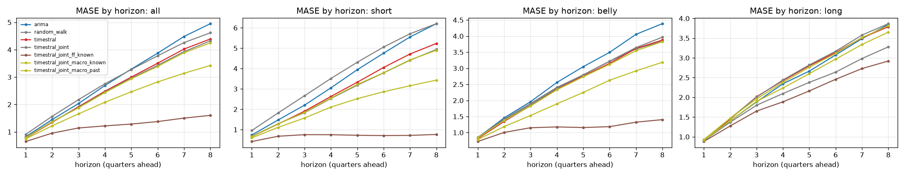

## Skill vs horizon
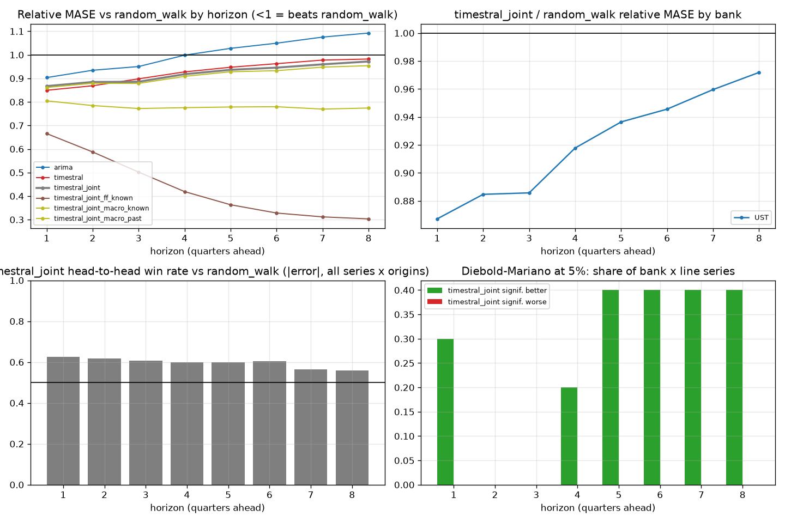

| h | arima | random_walk | timestral | timestral_joint | timestral_joint_ff_known | timestral_joint_macro_known | timestral_joint_macro_past |
|---|---|---|---|---|---|---|---|
| 1 | 0.903 | 1.000 | 0.849 | 0.867 | 0.666 | 0.804 | 0.861 |
| 2 | 0.934 | 1.000 | 0.869 | 0.885 | 0.587 | 0.785 | 0.879 |
| 3 | 0.950 | 1.000 | 0.898 | 0.886 | 0.502 | 0.772 | 0.879 |
| 4 | 0.999 | 1.000 | 0.928 | 0.918 | 0.419 | 0.776 | 0.909 |
| 5 | 1.028 | 1.000 | 0.947 | 0.936 | 0.363 | 0.778 | 0.928 |
| 6 | 1.049 | 1.000 | 0.962 | 0.946 | 0.328 | 0.780 | 0.933 |
| 7 | 1.075 | 1.000 | 0.978 | 0.960 | 0.312 | 0.770 | 0.948 |
| 8 | 1.093 | 1.000 | 0.982 | 0.972 | 0.303 | 0.774 | 0.954 |

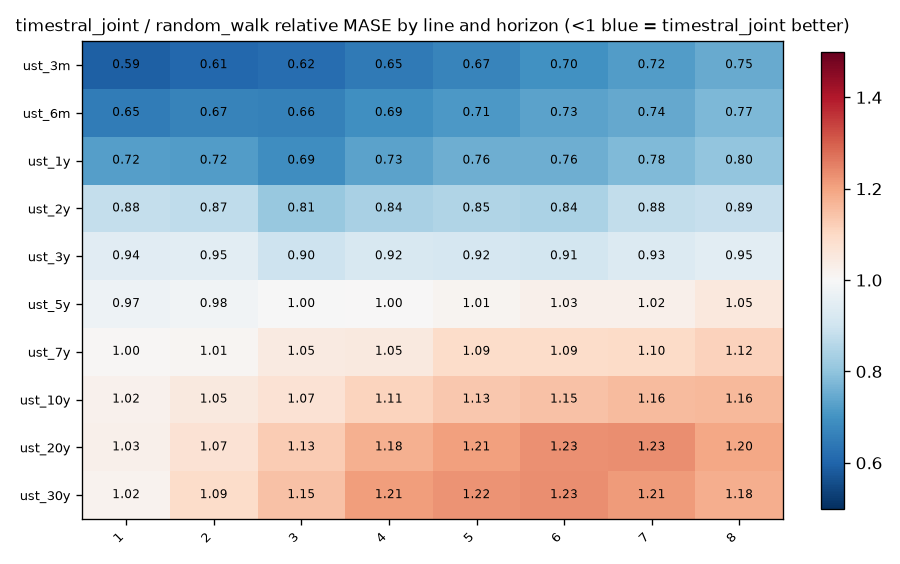

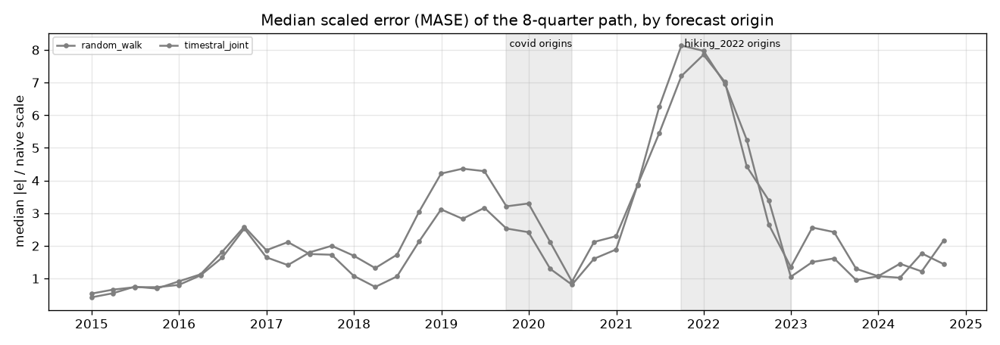

## Relative MASE vs baseline (geometric mean; <1 = better than baseline)
| model | rel_mase |
|---|---|
| timestral_joint_ff_known | 0.386 |
| timestral_joint_macro_known | 0.776 |
| timestral_joint_macro_past | 0.925 |
| timestral_joint | 0.936 |
| timestral | 0.947 |
| random_walk | 1.000 |
| arima | 1.031 |

### By bank
| id | arima | random_walk | timestral | timestral_joint | timestral_joint_ff_known | timestral_joint_macro_known | timestral_joint_macro_past |
|---|---|---|---|---|---|---|---|
| UST | 1.031 | 1.000 | 0.947 | 0.936 | 0.386 | 0.776 | 0.925 |

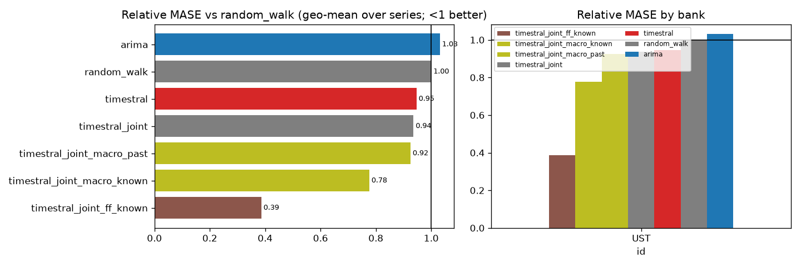

## Win rates (share of series where challenger beats baseline)
| id | MAE | MASE | RMSE | sMAPE |
|---|---|---|---|---|
| UST | 50% | 50% | 50% | 50% |

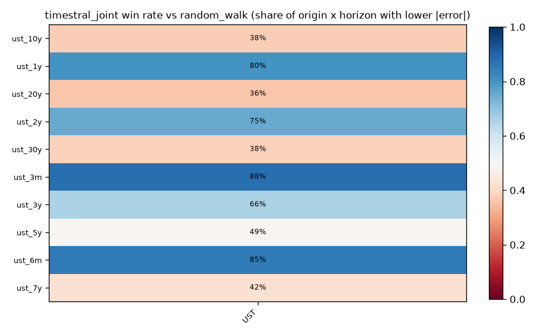

## Diebold-Mariano (squared error, HLN-corrected, per series and horizon)
Share of bank x target series where the challenger is significantly better / worse at 5%:

| h | better | worse |
|---|---|---|
| 1 | 30% | 0% |
| 2 | 0% | 0% |
| 3 | 0% | 0% |
| 4 | 20% | 0% |
| 5 | 40% | 0% |
| 6 | 40% | 0% |
| 7 | 40% | 0% |
| 8 | 40% | 0% |

## Stress slices (MASE)
| model | covid | hiking_2022 | normal |
|---|---|---|---|
| arima | 2.661 | 5.476 | 2.484 |
| random_walk | 2.552 | 5.967 | 2.357 |
| timestral | 1.915 | 5.374 | 2.246 |
| timestral_joint | 1.839 | 5.678 | 2.147 |
| timestral_joint_ff_known | 0.863 | 1.899 | 1.126 |
| timestral_joint_macro_known | 1.322 | 5.830 | 1.584 |
| timestral_joint_macro_past | 1.904 | 5.658 | 2.104 |

## Interval coverage (80%)
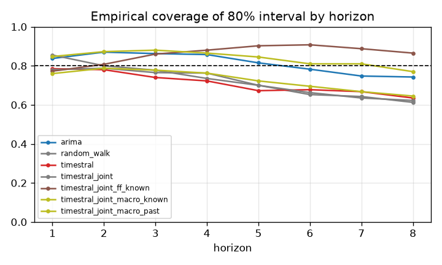

## Balance-sheet identity consistency
(none configured)

## Forecast fans

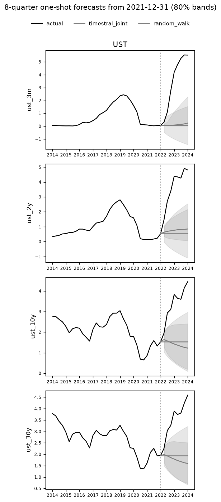
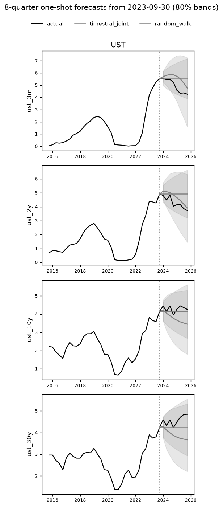
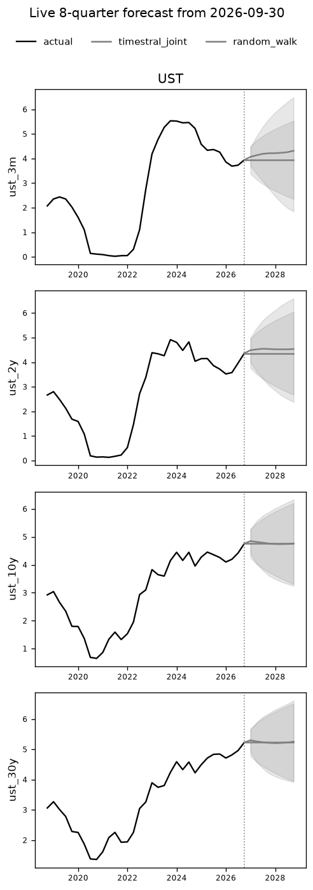

## Diebold-Mariano vs baseline, all models
Share of series significantly **better** than `random_walk` at 5% (squared error):

| h | arima | timestral | timestral_joint | timestral_joint_ff_known | timestral_joint_macro_known | timestral_joint_macro_past |
|---|---|---|---|---|---|---|
| 1 | 20% | 20% | 30% | 40% | 30% | 30% |
| 2 | 0% | 0% | 0% | 0% | 0% | 0% |
| 3 | 0% | 0% | 0% | 0% | 0% | 0% |
| 4 | 0% | 0% | 20% | 0% | 10% | 20% |
| 5 | 0% | 0% | 40% | 0% | 20% | 50% |
| 6 | 0% | 30% | 40% | 0% | 40% | 50% |
| 7 | 20% | 20% | 40% | 0% | 40% | 40% |
| 8 | 0% | 10% | 40% | 0% | 40% | 40% |

Share significantly **worse**:

| h | arima | timestral | timestral_joint | timestral_joint_ff_known | timestral_joint_macro_known | timestral_joint_macro_past |
|---|---|---|---|---|---|---|
| 1 | 0% | 0% | 0% | 0% | 0% | 0% |
| 2 | 0% | 0% | 0% | 0% | 0% | 0% |
| 3 | 0% | 0% | 0% | 0% | 0% | 0% |
| 4 | 0% | 0% | 0% | 0% | 0% | 0% |
| 5 | 0% | 0% | 0% | 0% | 0% | 0% |
| 6 | 0% | 0% | 0% | 0% | 0% | 0% |
| 7 | 0% | 0% | 0% | 0% | 0% | 0% |
| 8 | 0% | 0% | 0% | 0% | 0% | 0% |

## 80% interval coverage by line
| model | ust_10y | ust_1y | ust_20y | ust_2y | ust_30y | ust_3m | ust_3y | ust_5y | ust_6m | ust_7y |
|---|---|---|---|---|---|---|---|---|---|---|
| arima | 0.812 | 0.812 | 0.825 | 0.794 | 0.841 | 0.825 | 0.806 | 0.791 | 0.828 | 0.809 |
| random_walk | 0.759 | 0.672 | 0.759 | 0.697 | 0.769 | 0.641 | 0.738 | 0.756 | 0.672 | 0.756 |
| timestral | 0.713 | 0.747 | 0.719 | 0.703 | 0.709 | 0.697 | 0.678 | 0.694 | 0.719 | 0.722 |
| timestral_joint | 0.700 | 0.747 | 0.713 | 0.703 | 0.716 | 0.766 | 0.681 | 0.684 | 0.750 | 0.684 |
| timestral_joint_ff_known | 0.884 | 0.863 | 0.803 | 0.881 | 0.766 | 0.894 | 0.878 | 0.894 | 0.844 | 0.897 |
| timestral_joint_macro_known | 0.781 | 0.900 | 0.772 | 0.866 | 0.759 | 0.906 | 0.856 | 0.809 | 0.903 | 0.822 |
| timestral_joint_macro_past | 0.725 | 0.759 | 0.741 | 0.716 | 0.719 | 0.775 | 0.694 | 0.672 | 0.753 | 0.719 |

## Relative MASE vs `random_walk` by line
| target | arima | random_walk | timestral | timestral_joint | timestral_joint_ff_known | timestral_joint_macro_known | timestral_joint_macro_past |
|---|---|---|---|---|---|---|---|
| ust_10y | 1.118 | 1.000 | 1.111 | 1.124 | 0.748 | 1.006 | 1.097 |
| ust_1y | 0.908 | 1.000 | 0.807 | 0.758 | 0.200 | 0.580 | 0.762 |
| ust_20y | 1.123 | 1.000 | 1.146 | 1.180 | 0.978 | 1.125 | 1.165 |
| ust_2y | 0.982 | 1.000 | 0.900 | 0.858 | 0.282 | 0.664 | 0.846 |
| ust_30y | 1.133 | 1.000 | 1.190 | 1.183 | 1.029 | 1.143 | 1.169 |
| ust_3m | 0.909 | 1.000 | 0.719 | 0.688 | 0.120 | 0.532 | 0.694 |
| ust_3y | 1.016 | 1.000 | 0.916 | 0.926 | 0.349 | 0.727 | 0.907 |
| ust_5y | 1.129 | 1.000 | 0.998 | 1.018 | 0.460 | 0.824 | 0.987 |
| ust_6m | 0.908 | 1.000 | 0.756 | 0.723 | 0.155 | 0.545 | 0.727 |
| ust_7y | 1.132 | 1.000 | 1.056 | 1.077 | 0.576 | 0.918 | 1.053 |

## Highlighted origins only: relative MASE
2015-12-31, 2019-06-30, 2020-03-31, 2021-12-31, 2023-09-30

| target | arima | random_walk | timestral | timestral_joint | timestral_joint_ff_known | timestral_joint_macro_known | timestral_joint_macro_past |
|---|---|---|---|---|---|---|---|
| ust_10y | 1.059 | 1.000 | 1.089 | 1.092 | 0.628 | 0.997 | 1.066 |
| ust_1y | 0.935 | 1.000 | 0.896 | 0.778 | 0.180 | 0.636 | 0.797 |
| ust_20y | 1.084 | 1.000 | 1.109 | 1.129 | 0.917 | 1.083 | 1.110 |
| ust_2y | 0.978 | 1.000 | 0.948 | 0.811 | 0.229 | 0.671 | 0.835 |
| ust_30y | 1.055 | 1.000 | 1.099 | 1.101 | 0.950 | 1.076 | 1.082 |
| ust_3m | 0.931 | 1.000 | 0.893 | 0.784 | 0.105 | 0.604 | 0.789 |
| ust_3y | 0.971 | 1.000 | 0.947 | 0.827 | 0.257 | 0.720 | 0.846 |
| ust_5y | 1.059 | 1.000 | 0.945 | 0.923 | 0.317 | 0.786 | 0.912 |
| ust_6m | 0.931 | 1.000 | 0.916 | 0.814 | 0.152 | 0.649 | 0.825 |
| ust_7y | 1.060 | 1.000 | 1.004 | 1.015 | 0.403 | 0.883 | 0.999 |

### MASE per highlighted origin
| origin | target | arima | random_walk | timestral | timestral_joint | timestral_joint_ff_known | timestral_joint_macro_known | timestral_joint_macro_past |
|---|---|---|---|---|---|---|---|---|
| 2015-12-31 | ust_10y | 1.405 | 0.739 | 1.220 | 1.102 | 0.892 | 1.020 | 0.919 |
| 2015-12-31 | ust_1y | 1.048 | 1.361 | 0.758 | 0.920 | 0.439 | 1.215 | 0.748 |
| 2015-12-31 | ust_20y | 1.370 | 0.715 | 1.054 | 1.089 | 1.024 | 1.055 | 0.954 |
| 2015-12-31 | ust_2y | 0.876 | 0.908 | 0.474 | 0.892 | 0.621 | 1.336 | 0.842 |
| 2015-12-31 | ust_30y | 1.089 | 0.801 | 0.867 | 0.904 | 0.871 | 0.983 | 0.805 |
| 2015-12-31 | ust_3m | 1.396 | 1.782 | 1.215 | 0.673 | 0.163 | 1.685 | 0.716 |
| 2015-12-31 | ust_3y | 0.826 | 0.852 | 0.568 | 0.768 | 0.741 | 1.286 | 0.881 |
| 2015-12-31 | ust_5y | 1.455 | 0.807 | 0.839 | 0.829 | 0.634 | 0.781 | 0.737 |
| 2015-12-31 | ust_6m | 0.998 | 1.470 | 1.295 | 1.385 | 0.426 | 1.839 | 1.320 |
| 2015-12-31 | ust_7y | 1.420 | 0.750 | 1.185 | 0.991 | 0.689 | 0.917 | 0.812 |
| 2019-06-30 | ust_10y | 2.264 | 3.371 | 2.779 | 2.722 | 1.343 | 2.326 | 2.897 |
| 2019-06-30 | ust_1y | 4.520 | 5.231 | 3.287 | 3.100 | 0.483 | 0.859 | 3.349 |
| 2019-06-30 | ust_20y | 1.956 | 2.959 | 2.145 | 2.238 | 1.367 | 2.008 | 2.385 |
| 2019-06-30 | ust_2y | 4.085 | 4.345 | 3.715 | 2.827 | 0.672 | 1.111 | 3.104 |
| 2019-06-30 | ust_30y | 2.053 | 3.144 | 2.359 | 2.504 | 1.674 | 2.324 | 2.610 |
| 2019-06-30 | ust_3m | 5.817 | 6.228 | 4.041 | 4.277 | 0.451 | 0.407 | 4.432 |
| 2019-06-30 | ust_3y | 3.760 | 3.989 | 3.770 | 2.842 | 0.690 | 1.485 | 3.109 |
| 2019-06-30 | ust_5y | 2.791 | 3.610 | 3.315 | 2.770 | 0.807 | 2.063 | 2.987 |
| 2019-06-30 | ust_6m | 5.220 | 5.818 | 3.734 | 3.872 | 0.500 | 0.610 | 4.074 |
| 2019-06-30 | ust_7y | 2.362 | 3.426 | 2.968 | 2.678 | 0.967 | 2.197 | 2.880 |
| 2020-03-31 | ust_10y | 1.929 | 1.149 | 1.230 | 1.126 | 1.109 | 0.762 | 1.064 |
| 2020-03-31 | ust_1y | 1.549 | 2.685 | 1.568 | 1.415 | 0.423 | 1.584 | 1.361 |
| 2020-03-31 | ust_20y | 2.247 | 1.328 | 1.444 | 1.408 | 1.385 | 1.051 | 1.296 |
| 2020-03-31 | ust_2y | 1.805 | 2.342 | 1.922 | 1.677 | 0.655 | 1.515 | 1.606 |
| 2020-03-31 | ust_30y | 2.050 | 1.045 | 0.912 | 0.990 | 0.969 | 0.787 | 0.871 |
| 2020-03-31 | ust_3m | 1.150 | 3.601 | 1.278 | 0.992 | 0.324 | 2.081 | 0.973 |
| 2020-03-31 | ust_3y | 1.587 | 2.067 | 1.842 | 1.590 | 0.743 | 1.335 | 1.568 |
| 2020-03-31 | ust_5y | 1.518 | 1.549 | 1.368 | 1.321 | 0.934 | 0.797 | 1.312 |
| 2020-03-31 | ust_6m | 1.301 | 3.170 | 1.392 | 1.163 | 0.417 | 1.962 | 1.164 |
| 2020-03-31 | ust_7y | 1.750 | 1.293 | 1.242 | 1.213 | 1.040 | 0.669 | 1.194 |
| 2021-12-31 | ust_10y | 6.576 | 6.023 | 6.474 | 6.404 | 2.530 | 6.085 | 6.206 |
| 2021-12-31 | ust_1y | 11.951 | 12.228 | 10.877 | 11.584 | 1.564 | 10.668 | 11.222 |
| 2021-12-31 | ust_20y | 6.810 | 6.114 | 6.961 | 6.901 | 5.264 | 6.817 | 6.784 |
| 2021-12-31 | ust_2y | 9.318 | 9.719 | 7.999 | 9.039 | 1.370 | 8.419 | 8.801 |
| 2021-12-31 | ust_30y | 6.662 | 5.883 | 6.447 | 6.488 | 5.466 | 6.453 | 6.387 |
| 2021-12-31 | ust_3m | 13.328 | 13.350 | 13.291 | 13.126 | 1.389 | 11.421 | 12.584 |
| 2021-12-31 | ust_3y | 7.842 | 8.301 | 6.881 | 7.928 | 1.243 | 7.276 | 7.643 |
| 2021-12-31 | ust_5y | 7.330 | 6.789 | 6.502 | 6.762 | 1.169 | 6.259 | 6.514 |
| 2021-12-31 | ust_6m | 12.971 | 13.139 | 12.827 | 12.791 | 1.590 | 11.478 | 12.278 |
| 2021-12-31 | ust_7y | 6.733 | 6.297 | 6.470 | 6.562 | 1.233 | 6.090 | 6.351 |
| 2023-09-30 | ust_10y | 0.409 | 0.597 | 1.235 | 1.615 | 1.586 | 1.654 | 1.579 |
| 2023-09-30 | ust_1y | 3.571 | 2.719 | 5.209 | 1.823 | 1.447 | 1.073 | 2.631 |
| 2023-09-30 | ust_20y | 0.594 | 0.859 | 1.678 | 1.883 | 1.939 | 2.040 | 1.868 |
| 2023-09-30 | ust_2y | 2.702 | 1.895 | 4.101 | 1.146 | 1.090 | 0.501 | 1.678 |
| 2023-09-30 | ust_30y | 0.870 | 1.190 | 2.673 | 2.390 | 2.476 | 2.436 | 2.381 |
| 2023-09-30 | ust_3m | 3.538 | 2.147 | 4.386 | 2.183 | 0.523 | 0.790 | 2.687 |
| 2023-09-30 | ust_3y | 2.017 | 1.294 | 2.569 | 0.523 | 0.819 | 0.494 | 0.767 |
| 2023-09-30 | ust_5y | 1.182 | 0.732 | 0.725 | 0.769 | 0.728 | 0.696 | 0.744 |
| 2023-09-30 | ust_6m | 3.776 | 2.461 | 4.631 | 2.000 | 1.020 | 1.016 | 2.672 |
| 2023-09-30 | ust_7y | 0.750 | 0.518 | 0.473 | 1.019 | 1.018 | 0.975 | 1.030 |

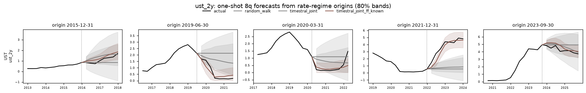
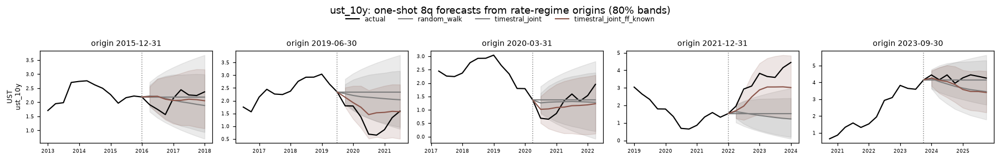

## How much does `timestral_joint` help vs `timestral`? (relative MASE, <1 = helps)
| target | rel_mase |
|---|---|
| ust_10y | 1.012 |
| ust_1y | 0.939 |
| ust_20y | 1.030 |
| ust_2y | 0.954 |
| ust_30y | 0.994 |
| ust_3m | 0.957 |
| ust_3y | 1.010 |
| ust_5y | 1.021 |
| ust_6m | 0.956 |
| ust_7y | 1.021 |

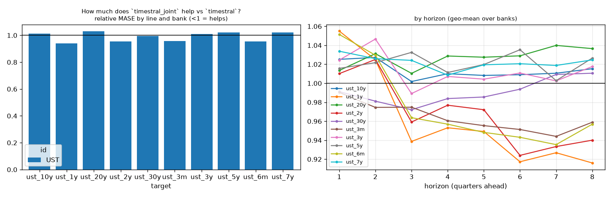

## How much does `timestral_joint_ff_known` help vs `timestral_joint`? (relative MASE, <1 = helps)
| target | rel_mase |
|---|---|
| ust_10y | 0.665 |
| ust_1y | 0.263 |
| ust_20y | 0.829 |
| ust_2y | 0.329 |
| ust_30y | 0.870 |
| ust_3m | 0.175 |
| ust_3y | 0.377 |
| ust_5y | 0.452 |
| ust_6m | 0.215 |
| ust_7y | 0.535 |

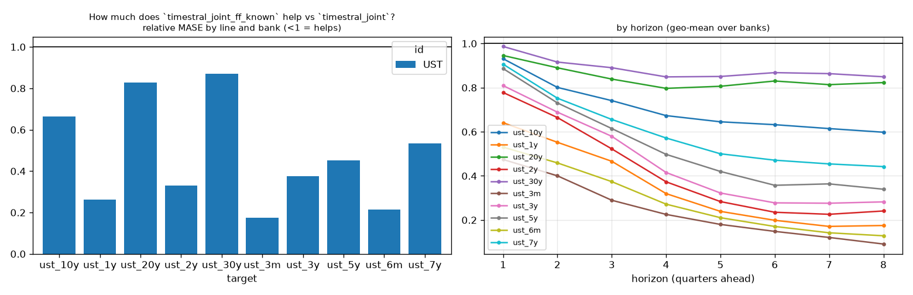

## How much does `timestral_joint_macro_known` help vs `timestral_joint`? (relative MASE, <1 = helps)
| target | rel_mase |
|---|---|
| ust_10y | 0.895 |
| ust_1y | 0.765 |
| ust_20y | 0.953 |
| ust_2y | 0.773 |
| ust_30y | 0.967 |
| ust_3m | 0.773 |
| ust_3y | 0.785 |
| ust_5y | 0.809 |
| ust_6m | 0.754 |
| ust_7y | 0.852 |

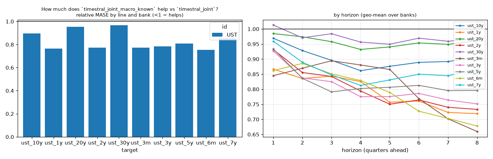

## How much does `timestral_joint_macro_past` help vs `timestral_joint`? (relative MASE, <1 = helps)
| target | rel_mase |
|---|---|
| ust_10y | 0.976 |
| ust_1y | 1.005 |
| ust_20y | 0.987 |
| ust_2y | 0.986 |
| ust_30y | 0.988 |
| ust_3m | 1.008 |
| ust_3y | 0.980 |
| ust_5y | 0.969 |
| ust_6m | 1.006 |
| ust_7y | 0.977 |

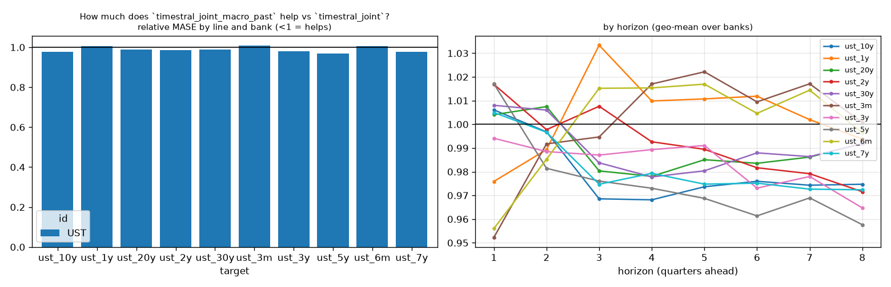

## How much does `timestral` help vs `random_walk`? (relative MASE, <1 = helps)
| target | rel_mase |
|---|---|
| ust_10y | 1.111 |
| ust_1y | 0.807 |
| ust_20y | 1.146 |
| ust_2y | 0.900 |
| ust_30y | 1.190 |
| ust_3m | 0.719 |
| ust_3y | 0.916 |
| ust_5y | 0.998 |
| ust_6m | 0.756 |
| ust_7y | 1.056 |

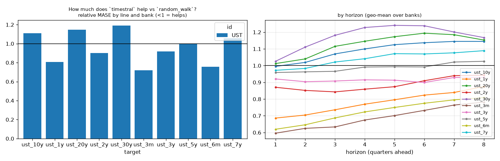

## How much does `arima` help vs `random_walk`? (relative MASE, <1 = helps)
| target | rel_mase |
|---|---|
| ust_10y | 1.118 |
| ust_1y | 0.908 |
| ust_20y | 1.123 |
| ust_2y | 0.982 |
| ust_30y | 1.133 |
| ust_3m | 0.909 |
| ust_3y | 1.016 |
| ust_5y | 1.129 |
| ust_6m | 0.908 |
| ust_7y | 1.132 |

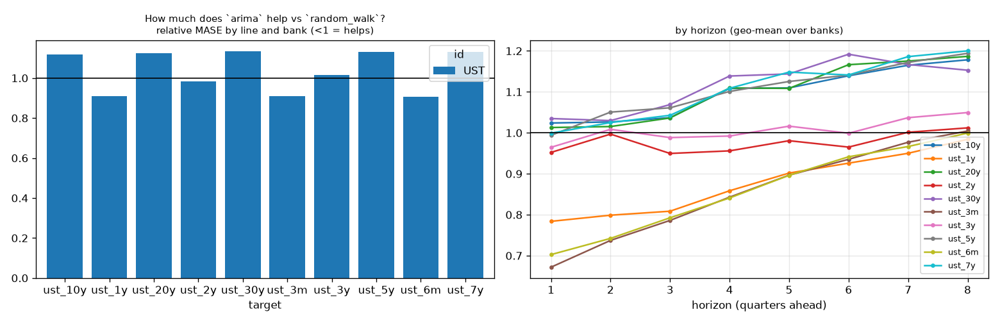

## Spaghetti grid: UST (rows = targets)
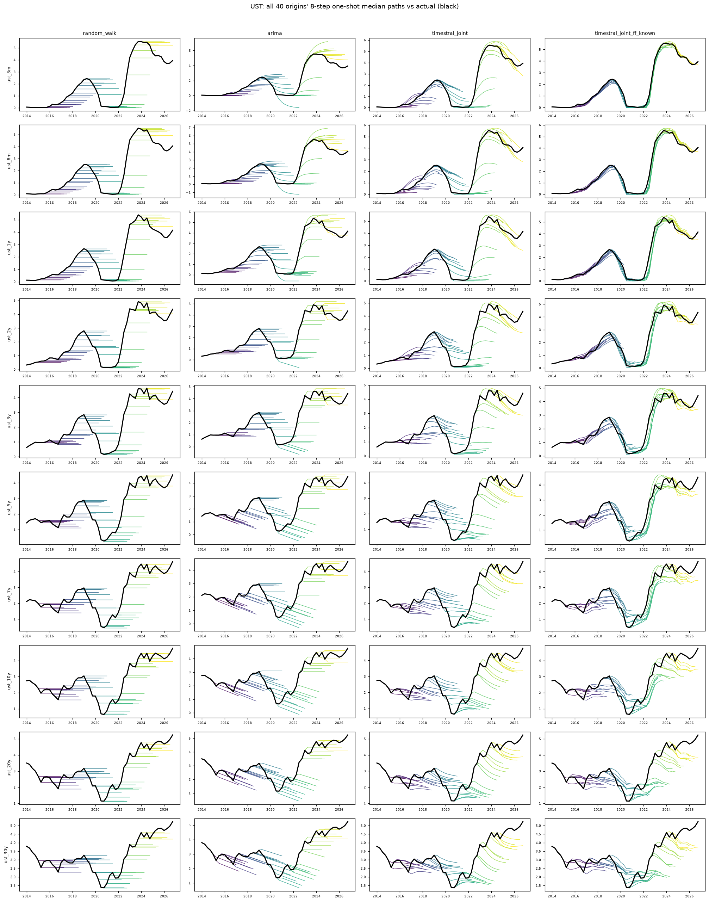
