# Backtest report: y9c_top4

- Series: 4 ids x 15 targets = 60
- Data: 2001-03-31 to 2026-06-30 (102 periods)
- Rolling origins: 24 (2018-09-30 .. 2024-06-30), one-shot direct horizon h=1..8
- Challenger `timestral` vs baseline `arima`. MASE scale = in-sample naive (lag 1).

## Overall
| model | MAE | RMSE | MAPE | sMAPE | MASE | coverage80 | dir_acc | n |
|---|---|---|---|---|---|---|---|---|
| timestral_mv | 31819.163 | 86184.104 | 7.415 | 18.753 | 2.627 | 0.762 | 0.611 | 11520 |
| timestral_cov | 31099.429 | 84008.261 | 7.648 | 19.237 | 2.630 | 0.762 | 0.613 | 11520 |
| timestral | 31049.101 | 84365.246 | 7.727 | 19.289 | 2.645 | 0.748 | 0.598 | 11520 |
| arima | 30938.527 | 79935.013 | 8.288 | 19.072 | 2.683 | 0.764 | 0.625 | 11520 |
| naive | 32140.506 | 88790.160 | 7.937 | 20.939 | 2.718 | 0.820 |  | 11520 |
| timestral_cov_oracle | 34840.595 | 89765.986 | 8.668 | 19.956 | 2.927 | 0.830 | 0.620 | 11520 |
| arimax_oracle | 32804.508 | 85766.924 | 9.473 | 21.386 | 3.097 | 0.691 | 0.610 | 11520 |
| snaive | 39351.136 | 105372.471 | 9.797 | 23.464 | 3.195 | 0.775 | 0.500 | 11520 |

## MASE by horizon (all series)
| h | naive | snaive | arima | arimax_oracle | timestral | timestral_cov | timestral_cov_oracle | timestral_mv |
|---|---|---|---|---|---|---|---|---|
| 1 | 1.183 | 2.503 | 1.234 | 1.477 | 1.129 | 1.114 | 1.155 | 1.115 |
| 2 | 1.762 | 2.533 | 1.772 | 2.139 | 1.667 | 1.645 | 1.797 | 1.679 |
| 3 | 2.235 | 2.574 | 2.226 | 2.637 | 2.143 | 2.120 | 2.321 | 2.158 |
| 4 | 2.637 | 2.637 | 2.634 | 3.089 | 2.568 | 2.538 | 2.845 | 2.581 |
| 5 | 3.042 | 3.785 | 2.999 | 3.493 | 2.967 | 2.943 | 3.289 | 2.961 |
| 6 | 3.431 | 3.865 | 3.340 | 3.861 | 3.347 | 3.332 | 3.731 | 3.319 |
| 7 | 3.657 | 3.866 | 3.565 | 4.072 | 3.597 | 3.591 | 4.052 | 3.535 |
| 8 | 3.797 | 3.797 | 3.690 | 4.005 | 3.745 | 3.756 | 4.225 | 3.666 |

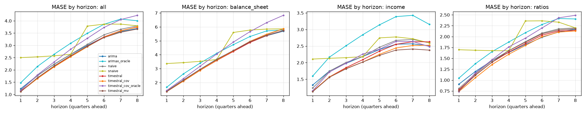

## Skill vs horizon
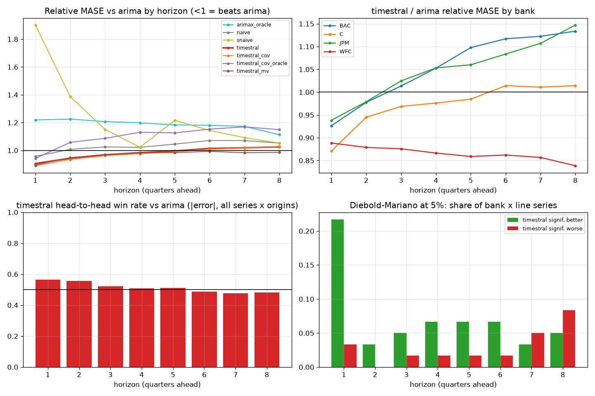

| h | arima | arimax_oracle | naive | snaive | timestral | timestral_cov | timestral_cov_oracle | timestral_mv |
|---|---|---|---|---|---|---|---|---|
| 1 | 1.000 | 1.219 | 0.958 | 1.901 | 0.905 | 0.890 | 0.943 | 0.895 |
| 2 | 1.000 | 1.225 | 1.008 | 1.387 | 0.944 | 0.935 | 1.058 | 0.948 |
| 3 | 1.000 | 1.207 | 1.025 | 1.151 | 0.969 | 0.962 | 1.087 | 0.970 |
| 4 | 1.000 | 1.198 | 1.022 | 1.022 | 0.984 | 0.977 | 1.131 | 0.983 |
| 5 | 1.000 | 1.183 | 1.046 | 1.216 | 0.996 | 0.989 | 1.126 | 0.984 |
| 6 | 1.000 | 1.181 | 1.071 | 1.144 | 1.014 | 1.009 | 1.153 | 0.993 |
| 7 | 1.000 | 1.173 | 1.071 | 1.092 | 1.019 | 1.018 | 1.169 | 0.983 |
| 8 | 1.000 | 1.113 | 1.053 | 1.053 | 1.026 | 1.027 | 1.150 | 0.986 |

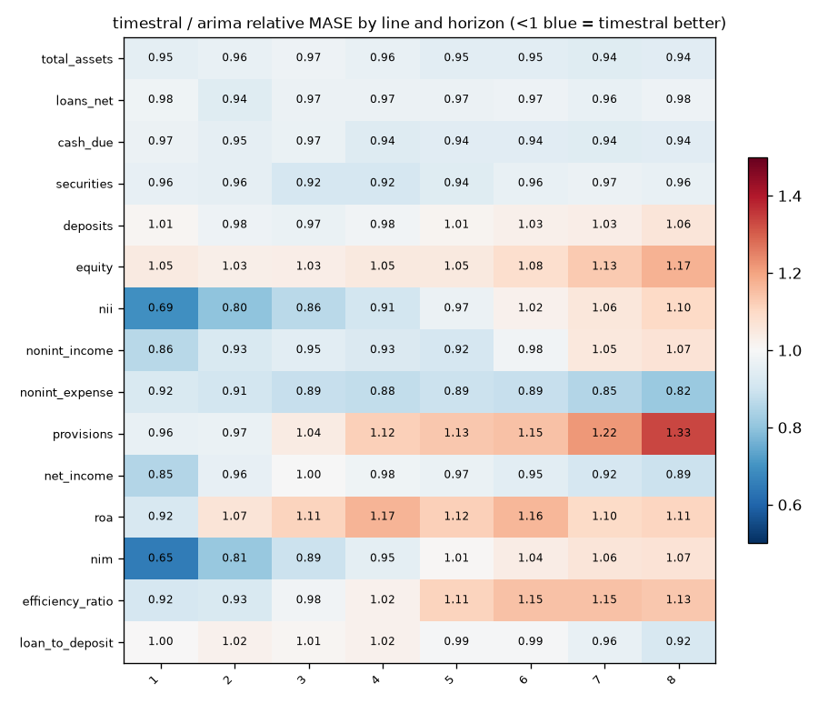

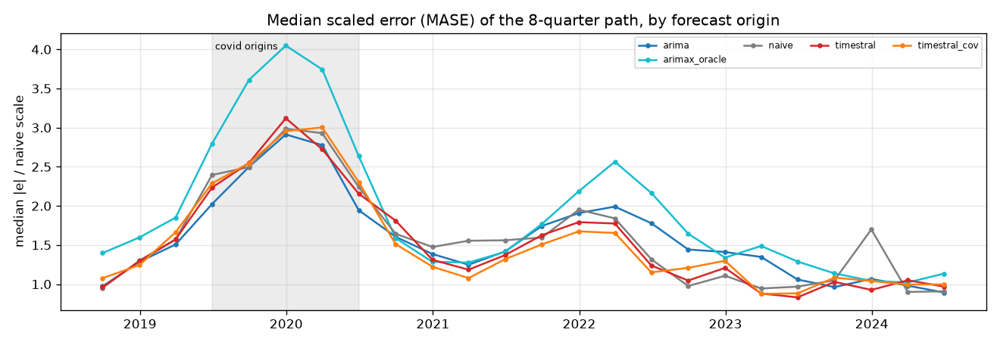

## Relative MASE vs baseline (geometric mean; <1 = better than baseline)
| model | rel_mase |
|---|---|
| timestral_mv | 0.975 |
| timestral_cov | 0.987 |
| timestral | 0.990 |
| arima | 1.000 |
| naive | 1.037 |
| timestral_cov_oracle | 1.122 |
| snaive | 1.176 |
| arimax_oracle | 1.178 |

### By bank
| id | arima | arimax_oracle | naive | snaive | timestral | timestral_cov | timestral_cov_oracle | timestral_mv |
|---|---|---|---|---|---|---|---|---|
| BAC | 1.000 | 1.242 | 1.100 | 1.279 | 1.070 | 1.047 | 1.213 | 1.034 |
| C | 1.000 | 1.194 | 1.067 | 1.154 | 0.977 | 0.995 | 1.146 | 0.969 |
| JPM | 1.000 | 1.030 | 1.166 | 1.333 | 1.067 | 1.059 | 1.068 | 1.058 |
| WFC | 1.000 | 1.262 | 0.847 | 0.971 | 0.862 | 0.861 | 1.065 | 0.852 |

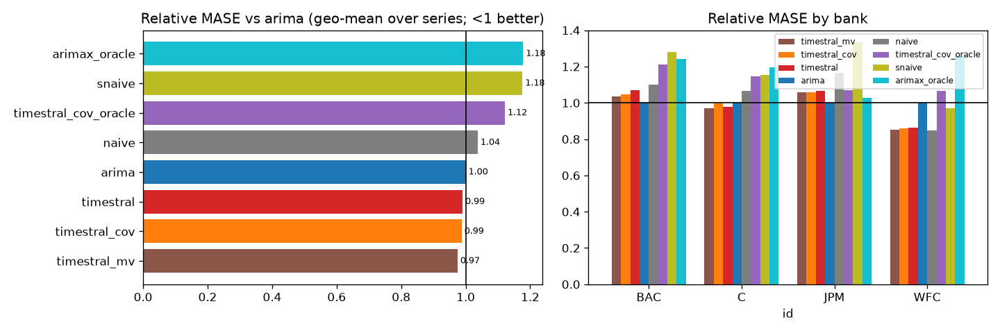

## Win rates (share of series where challenger beats baseline)
| id | MAE | MASE | RMSE | dir_acc | sMAPE |
|---|---|---|---|---|---|
| BAC | 47% | 47% | 47% | 40% | 47% |
| C | 67% | 67% | 40% | 40% | 60% |
| JPM | 27% | 27% | 27% | 40% | 27% |
| WFC | 80% | 80% | 87% | 53% | 80% |

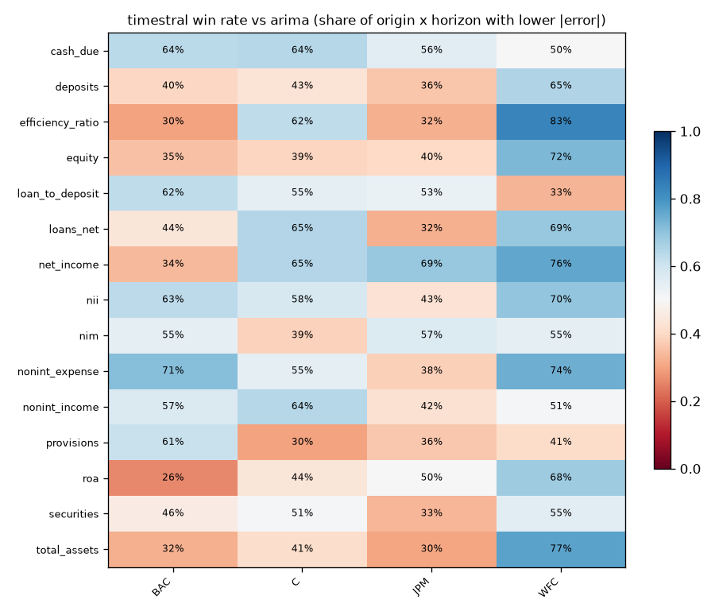

## Diebold-Mariano (squared error, HLN-corrected, per series and horizon)
Share of bank x target series where the challenger is significantly better / worse at 5%:

| h | better | worse |
|---|---|---|
| 1 | 22% | 3% |
| 2 | 3% | 0% |
| 3 | 5% | 2% |
| 4 | 7% | 2% |
| 5 | 7% | 2% |
| 6 | 7% | 2% |
| 7 | 3% | 5% |
| 8 | 5% | 8% |

## Stress slices (MASE)
| model | covid | normal |
|---|---|---|
| arima | 4.112 | 2.306 |
| arimax_oracle | 5.186 | 2.547 |
| naive | 4.505 | 2.248 |
| snaive | 4.953 | 2.732 |
| timestral | 4.327 | 2.203 |
| timestral_cov | 4.335 | 2.181 |
| timestral_cov_oracle | 4.749 | 2.447 |
| timestral_mv | 4.385 | 2.164 |

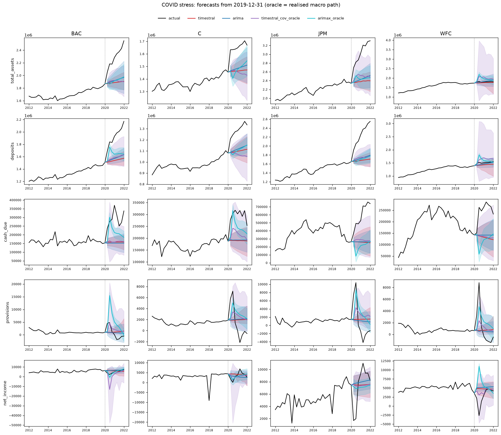

## Interval coverage (80%)
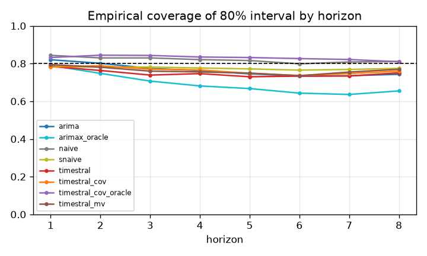

## Balance-sheet identity consistency
| identity | model | median_abs_gap_pct | median_abs_actual_gap_pct | median_excess_vs_actual_pp |
|---|---|---|---|---|
| earnings_bridge | arima | 38.088 | 25.658 | 26.074 |
| earnings_bridge | arimax_oracle | 38.852 | 25.658 | 28.555 |
| earnings_bridge | naive | 24.763 | 25.658 | 7.279 |
| earnings_bridge | snaive | 25.658 | 25.658 | 8.012 |
| earnings_bridge | timestral | 27.469 | 25.658 | 18.924 |
| earnings_bridge | timestral_cov | 28.520 | 25.658 | 15.904 |
| earnings_bridge | timestral_cov_oracle | 31.442 | 25.658 | 20.262 |
| earnings_bridge | timestral_mv | 24.096 | 25.658 | 10.458 |

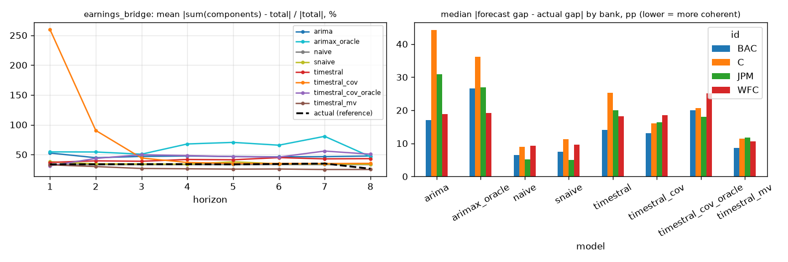

## Forecast fans

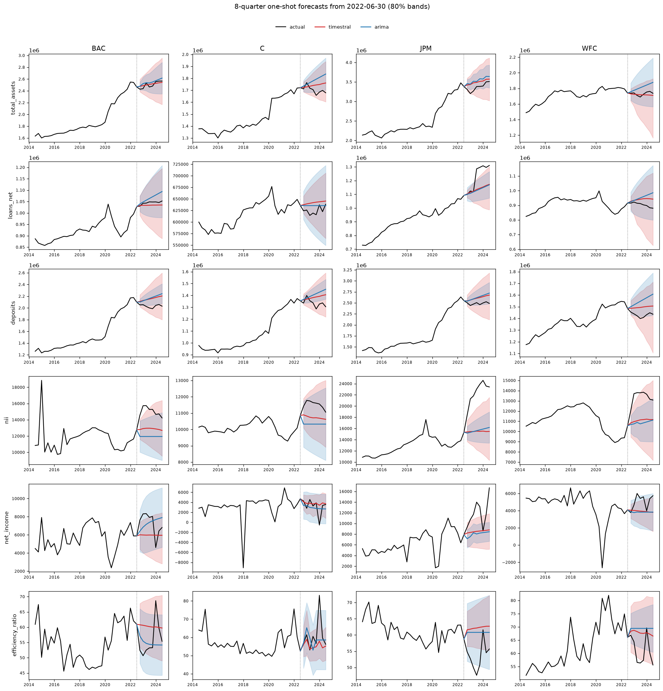
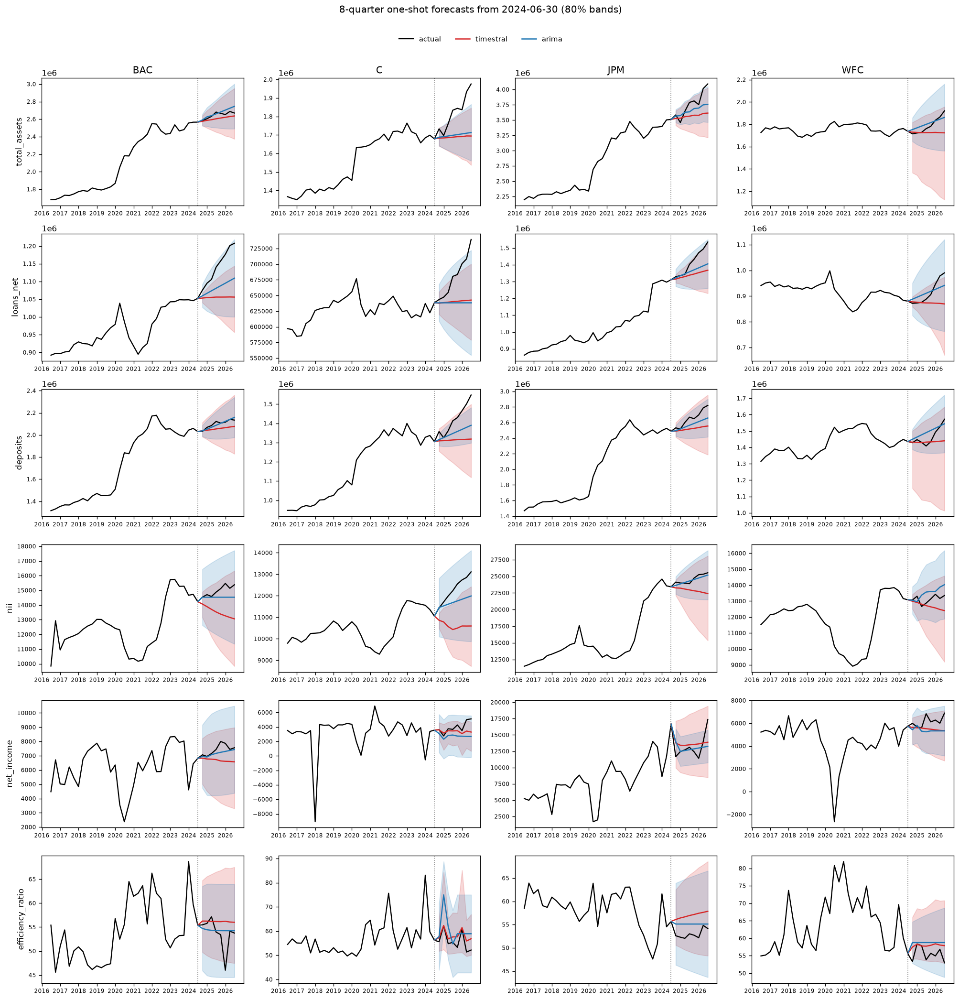
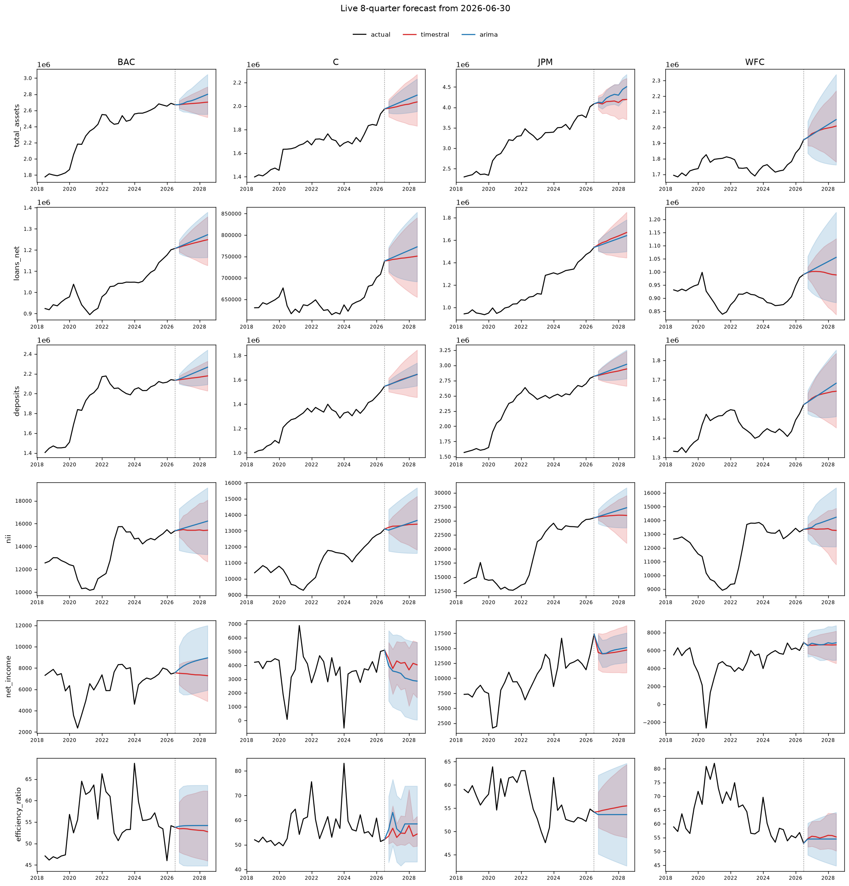
