# Backtest report: electricity

## Headline numbers (auto-generated; narrative pending)

```
baseline=mstl  H=7
h                         1      3      7  overall  coverage80   MASE
model                                                                
timestral_temp_known  0.541  0.391  0.355    0.407       0.752  0.397
timestral_temp_past   0.740  0.779  0.727    0.765       0.775  0.735
timestral             0.754  0.785  0.739    0.772       0.793  0.742
mstl                  1.000  1.000  1.000    1.000       0.666  0.963
seasonal_naive        1.864  1.166  0.979    1.157       0.803  1.110

DM share better/worse at 5% (h in [1, 3, 7] )
                     better             worse           
h                         1     3     7     1     3    7
model                                                   
seasonal_naive          0.0  0.00  0.00   1.0  0.14  0.0
timestral               1.0  0.71  0.57   0.0  0.00  0.0
timestral_temp_known    1.0  1.00  1.00   0.0  0.00  0.0
timestral_temp_past     1.0  0.57  0.57   0.0  0.00  0.0

rel MASE by id:
model  mstl  seasonal_naive  timestral  timestral_temp_known  timestral_temp_past
id                                                                               
CISO    1.0            1.32       0.81                  0.45                 0.78
ERCO    1.0            1.13       0.77                  0.37                 0.75
FPL     1.0            1.22       0.80                  0.43                 0.81
ISNE    1.0            1.03       0.73                  0.47                 0.73
MISO    1.0            1.24       0.79                  0.40                 0.80
NYIS    1.0            1.06       0.75                  0.43                 0.74
PJM     1.0            1.13       0.75                  0.32                 0.75

by slice MASE:
slice                 normal  summer_2025  winter_2025_26
model                                                    
mstl                   0.881        1.243           0.955
seasonal_naive         1.032        1.432           1.037
timestral              0.674        0.949           0.762
timestral_temp_known   0.376        0.492           0.369
timestral_temp_past    0.650        0.954           0.806
```

Known-future variants use the realised covariate path (perfect-foresight scenario test), not real-time forecasts.

---

# Full tables

- Series: 7 ids x 1 targets = 7
- Data: 2022-01-01 to 2026-10-14 (1748 periods)
- Rolling origins: 78 (2025-04-16 .. 2026-10-07), one-shot direct horizon h=1..7
- Challenger `timestral_temp_known` vs baseline `mstl`. MASE scale = in-sample naive (lag 7).

## Overall
| model | MAE | RMSE | MAPE | sMAPE | MASE | coverage80 | dir_acc | n |
|---|---|---|---|---|---|---|---|---|
| timestral_temp_known | 26.657 | 43.794 | 2.029 | 2.888 | 0.397 | 0.752 | 0.866 | 3821 |
| timestral_temp_past | 53.646 | 93.390 | 3.839 | 5.297 | 0.735 | 0.775 | 0.721 | 3821 |
| timestral | 53.867 | 91.979 | 3.819 | 5.346 | 0.742 | 0.793 | 0.719 | 3821 |
| mstl | 70.298 | 119.120 | 5.086 | 6.981 | 0.963 | 0.666 | 0.622 | 3821 |
| seasonal_naive | 81.496 | 132.485 | 6.107 | 7.949 | 1.110 | 0.803 | 0.603 | 3821 |

## MASE by horizon (all series)
| h | seasonal_naive | mstl | timestral | timestral_temp_past | timestral_temp_known |
|---|---|---|---|---|---|
| 1 | 1.109 | 0.604 | 0.469 | 0.458 | 0.333 |
| 2 | 1.130 | 0.837 | 0.684 | 0.674 | 0.388 |
| 3 | 1.060 | 0.910 | 0.711 | 0.705 | 0.362 |
| 4 | 1.053 | 0.988 | 0.757 | 0.762 | 0.422 |
| 5 | 1.109 | 1.073 | 0.835 | 0.832 | 0.451 |
| 6 | 1.162 | 1.161 | 0.875 | 0.864 | 0.396 |
| 7 | 1.145 | 1.169 | 0.861 | 0.846 | 0.427 |

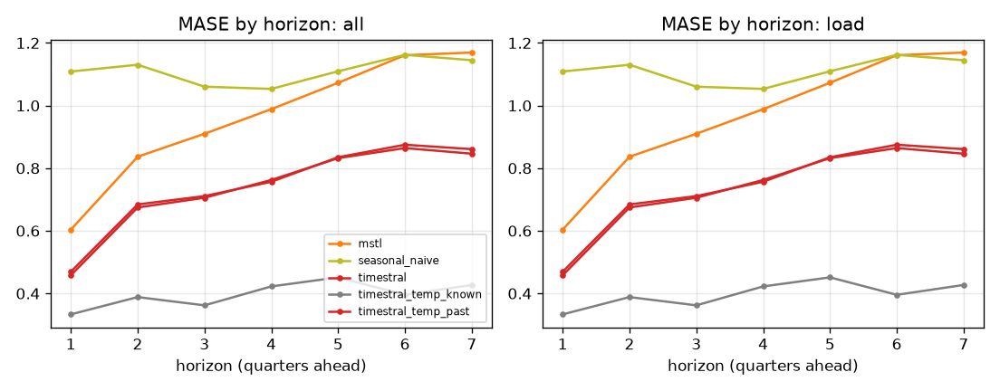

## Skill vs horizon
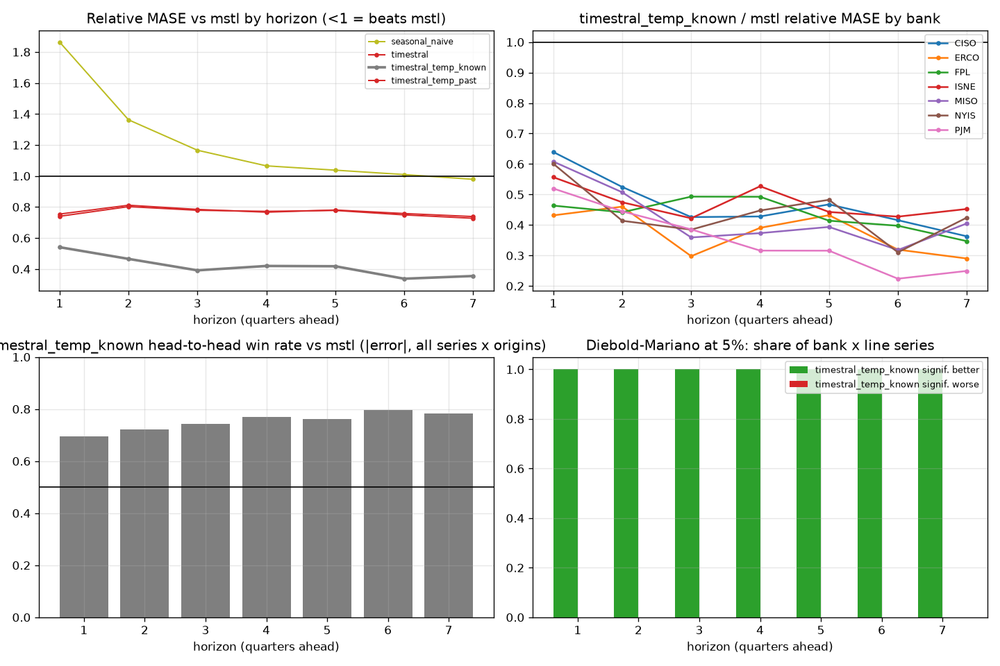

| h | mstl | seasonal_naive | timestral | timestral_temp_known | timestral_temp_past |
|---|---|---|---|---|---|
| 1 | 1.000 | 1.864 | 0.754 | 0.541 | 0.740 |
| 2 | 1.000 | 1.363 | 0.812 | 0.465 | 0.802 |
| 3 | 1.000 | 1.166 | 0.785 | 0.391 | 0.779 |
| 4 | 1.000 | 1.066 | 0.767 | 0.420 | 0.772 |
| 5 | 1.000 | 1.038 | 0.781 | 0.418 | 0.778 |
| 6 | 1.000 | 1.009 | 0.758 | 0.337 | 0.749 |
| 7 | 1.000 | 0.979 | 0.739 | 0.355 | 0.727 |

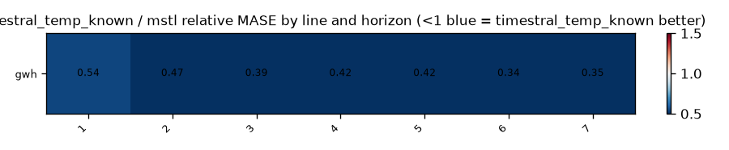

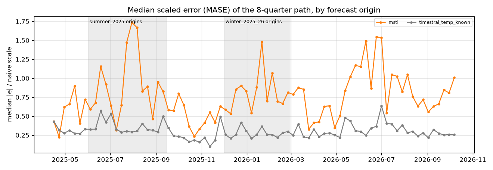

## Relative MASE vs baseline (geometric mean; <1 = better than baseline)
| model | rel_mase |
|---|---|
| timestral_temp_known | 0.407 |
| timestral_temp_past | 0.765 |
| timestral | 0.772 |
| mstl | 1.000 |
| seasonal_naive | 1.157 |

### By bank
| id | mstl | seasonal_naive | timestral | timestral_temp_known | timestral_temp_past |
|---|---|---|---|---|---|
| CISO | 1.000 | 1.316 | 0.812 | 0.450 | 0.784 |
| ERCO | 1.000 | 1.133 | 0.770 | 0.365 | 0.751 |
| FPL | 1.000 | 1.215 | 0.803 | 0.433 | 0.807 |
| ISNE | 1.000 | 1.033 | 0.733 | 0.467 | 0.729 |
| MISO | 1.000 | 1.242 | 0.788 | 0.404 | 0.803 |
| NYIS | 1.000 | 1.058 | 0.754 | 0.426 | 0.738 |
| PJM | 1.000 | 1.127 | 0.748 | 0.323 | 0.748 |

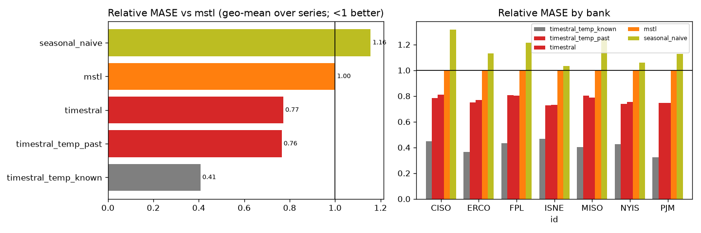

## Win rates (share of series where challenger beats baseline)
| id | MAE | MASE | RMSE | dir_acc | sMAPE |
|---|---|---|---|---|---|
| CISO | 100% | 100% | 100% | 100% | 100% |
| ERCO | 100% | 100% | 100% | 100% | 100% |
| FPL | 100% | 100% | 100% | 100% | 100% |
| ISNE | 100% | 100% | 100% | 100% | 100% |
| MISO | 100% | 100% | 100% | 100% | 100% |
| NYIS | 100% | 100% | 100% | 100% | 100% |
| PJM | 100% | 100% | 100% | 100% | 100% |

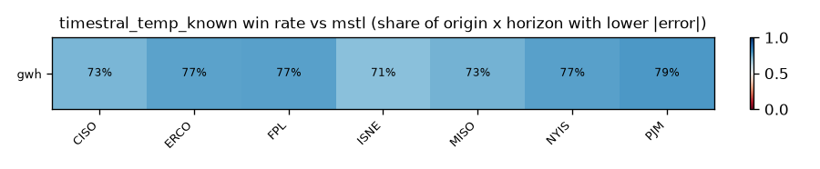

## Diebold-Mariano (squared error, HLN-corrected, per series and horizon)
Share of bank x target series where the challenger is significantly better / worse at 5%:

| h | better | worse |
|---|---|---|
| 1 | 100% | 0% |
| 2 | 100% | 0% |
| 3 | 100% | 0% |
| 4 | 100% | 0% |
| 5 | 100% | 0% |
| 6 | 100% | 0% |
| 7 | 100% | 0% |

## Stress slices (MASE)
| model | normal | summer_2025 | winter_2025_26 |
|---|---|---|---|
| mstl | 0.881 | 1.243 | 0.955 |
| seasonal_naive | 1.032 | 1.432 | 1.037 |
| timestral | 0.674 | 0.949 | 0.762 |
| timestral_temp_known | 0.376 | 0.492 | 0.369 |
| timestral_temp_past | 0.650 | 0.954 | 0.806 |


## Interval coverage (80%)
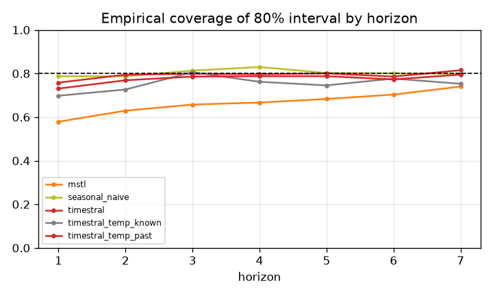

## Balance-sheet identity consistency
(none configured)


## Forecast fans

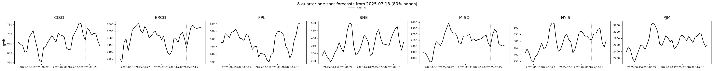
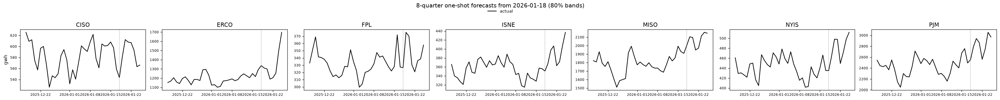
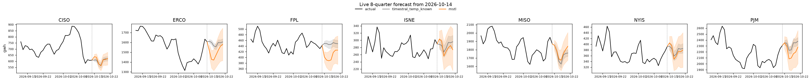

## Diebold-Mariano vs baseline, all models
Share of series significantly **better** than `mstl` at 5% (squared error):

| h | seasonal_naive | timestral | timestral_temp_known | timestral_temp_past |
|---|---|---|---|---|
| 1 | 0% | 100% | 100% | 100% |
| 2 | 0% | 86% | 100% | 71% |
| 3 | 0% | 71% | 100% | 57% |
| 4 | 0% | 71% | 100% | 43% |
| 5 | 0% | 57% | 100% | 43% |
| 6 | 0% | 43% | 100% | 43% |
| 7 | 0% | 57% | 100% | 57% |

Share significantly **worse**:

| h | seasonal_naive | timestral | timestral_temp_known | timestral_temp_past |
|---|---|---|---|---|
| 1 | 100% | 0% | 0% | 0% |
| 2 | 71% | 0% | 0% | 0% |
| 3 | 14% | 0% | 0% | 0% |
| 4 | 0% | 0% | 0% | 0% |
| 5 | 0% | 0% | 0% | 0% |
| 6 | 0% | 0% | 0% | 0% |
| 7 | 0% | 0% | 0% | 0% |

## 80% interval coverage by line
| model | gwh |
|---|---|
| mstl | 0.666 |
| seasonal_naive | 0.803 |
| timestral | 0.793 |
| timestral_temp_known | 0.752 |
| timestral_temp_past | 0.775 |

## Relative MASE vs `mstl` by line
| target | mstl | seasonal_naive | timestral | timestral_temp_known | timestral_temp_past |
|---|---|---|---|---|---|
| gwh | 1.000 | 1.157 | 0.772 | 0.407 | 0.765 |

### gwh: relative MASE by horizon
| h | mstl | seasonal_naive | timestral | timestral_temp_known | timestral_temp_past |
|---|---|---|---|---|---|
| 1 | 1.000 | 1.864 | 0.754 | 0.541 | 0.740 |
| 2 | 1.000 | 1.363 | 0.812 | 0.465 | 0.802 |
| 3 | 1.000 | 1.166 | 0.785 | 0.391 | 0.779 |
| 4 | 1.000 | 1.066 | 0.767 | 0.420 | 0.772 |
| 5 | 1.000 | 1.038 | 0.781 | 0.418 | 0.778 |
| 6 | 1.000 | 1.009 | 0.758 | 0.337 | 0.749 |
| 7 | 1.000 | 0.979 | 0.739 | 0.355 | 0.727 |

## How much does `timestral_temp_known` help vs `timestral`? (relative MASE, <1 = helps)
| target | rel_mase |
|---|---|
| gwh | 0.527 |

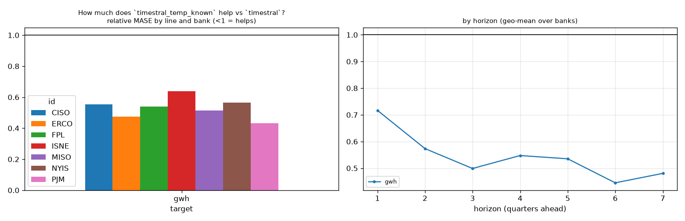

## How much does `timestral_temp_past` help vs `timestral`? (relative MASE, <1 = helps)
| target | rel_mase |
|---|---|
| gwh | 0.991 |

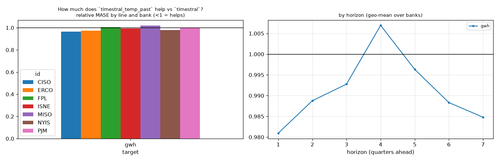

## How much does `timestral` help vs `mstl`? (relative MASE, <1 = helps)
| target | rel_mase |
|---|---|
| gwh | 0.772 |

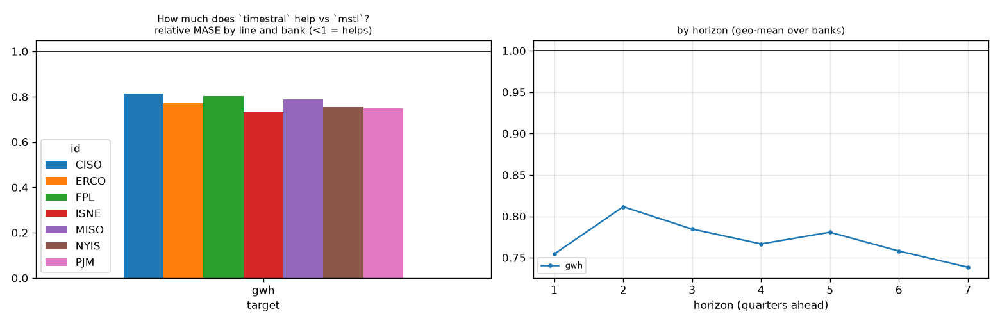

## Line x variant: relative MASE vs baseline
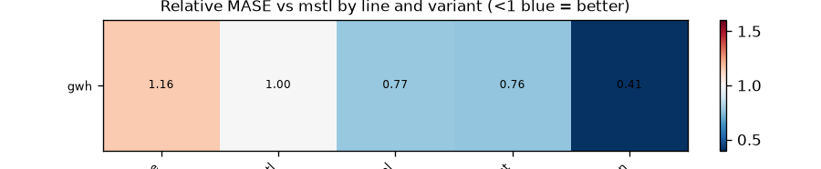

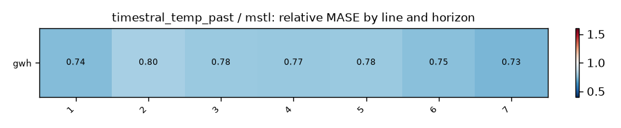
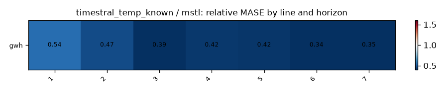

## Does macro help? (relative MASE of covariate variant vs its no-covariate twin; <1 = helps)
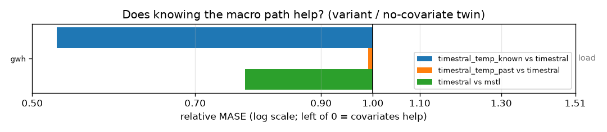

| target | timestral_temp_known vs timestral | timestral_temp_past vs timestral | timestral vs mstl |
|---|---|---|---|
| gwh | 0.527 | 0.991 | 0.772 |

## Spaghetti pages by group

- [load](figures/load/index.md) (1 lines)

## Relative MASE vs `mstl` by series
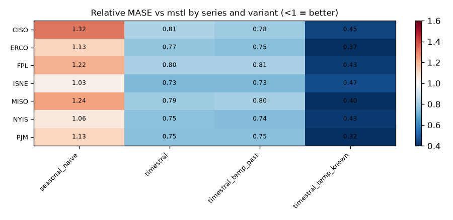

| id | seasonal_naive | timestral | timestral_temp_past | timestral_temp_known |
|---|---|---|---|---|
| CISO | 1.316 | 0.812 | 0.784 | 0.450 |
| ERCO | 1.133 | 0.770 | 0.751 | 0.365 |
| FPL | 1.215 | 0.803 | 0.807 | 0.433 |
| ISNE | 1.033 | 0.733 | 0.729 | 0.467 |
| MISO | 1.242 | 0.788 | 0.803 | 0.404 |
| NYIS | 1.058 | 0.754 | 0.738 | 0.426 |
| PJM | 1.127 | 0.748 | 0.748 | 0.323 |

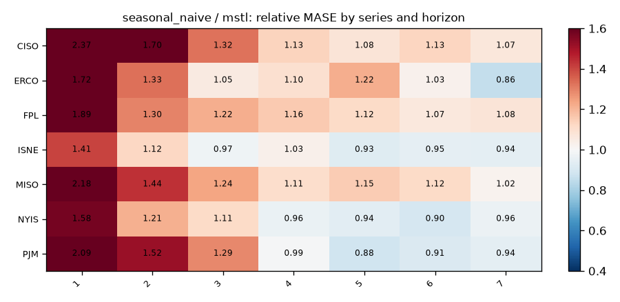
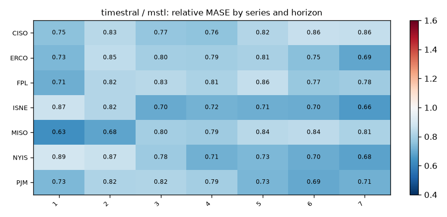
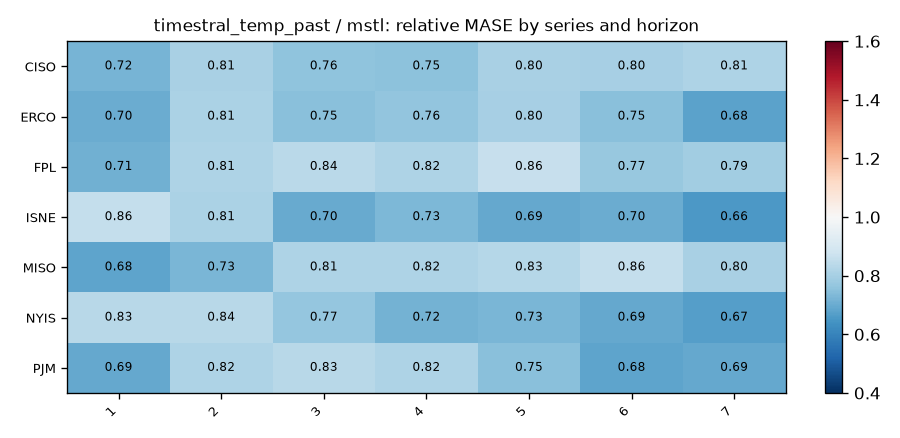
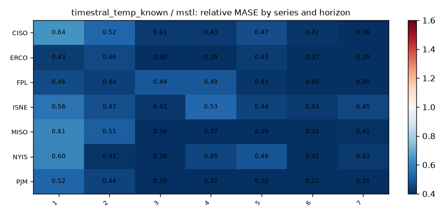
