# Backtest report: inflation

## Findings: CPI components (y/y %), 24-month one-shot, 37 origins every 3 months 2015-09..2024-09

Relative MASE vs AutoARIMA (<1 = better; geometric mean over 9 components):

| Model | h=1 | h=6 | h=12 | h=24 | Overall | 80% coverage |
|---|---|---|---|---|---|---|
| **Timestral + known macro (WTI, 3m/2y/10y, term spread, unemployment)** | 0.87 | 0.71 | 0.68 | **0.62** | **0.66** | 0.76 |
| Timestral + known oil only | 0.87 | 0.71 | 0.68 | 0.64 | 0.68 | 0.74 |
| ARIMAX + known WTI & unemployment | 0.94 | 0.89 | 0.86 | 0.82 | 0.85 | 0.66 |
| Timestral + past macro | 0.95 | 0.91 | 0.91 | 0.83 | 0.88 | 0.72 |
| Timestral (no covariates) | 0.99 | 0.91 | 0.92 | 0.85 | 0.89 | 0.73 |
| Random walk | 1.09 | 1.04 | 1.05 | 1.11 | 1.07 | 0.59 |

- **Plain Timestral beats AutoARIMA by ~11%**, mostly on core components (core services 0.76, medical 0.76, core 0.79);
  it is no better on energy/transportation/headline (~1.0-1.1), which are driven by oil.
- **Known oil path does almost all the work:** oil alone gets 0.68 vs 0.66 for the full panel. Energy falls to 0.38-0.40,
  transportation 0.45-0.47, headline 0.65-0.67. The full panel adds a little on shelter (0.62) and core services (0.66).
- **Timestral uses the scenario far better than ARIMAX** (0.66 vs 0.85 with the same kind of information).
- **2021-22 surge origins:** every model's error is ~2.5x normal; known macro cuts Timestral's MASE from 13.1 to 11.5,
  ARIMAX gets no help there (14.3).
- **Intervals are too narrow** for all models (74-76% for Timestral with covariates, 66-68% for ARIMA/ARIMAX).
- **Significance is weak:** 9 series and 37 overlapping origins; known-macro Timestral is significantly better on 22% of
  components at h=1, and no model is significantly better at h=24.

Caveats: known paths are realised values (perfect-foresight scenario). Context capped at the last 240 months. Fed SEP
was not added as a reference (it projects annual PCE, not monthly CPI).

---

# Full tables

- Series: 9 ids x 1 targets = 9
- Data: 1990-01-31 to 2026-09-30 (441 periods)
- Rolling origins: 36 (2015-12-31 .. 2024-09-30), one-shot direct horizon h=1..24
- Challenger `timestral_macro_known` vs baseline `arima`. MASE scale = in-sample naive (lag 1).

## Overall
| model | MAE | RMSE | MAPE | sMAPE | MASE | coverage80 | dir_acc | n |
|---|---|---|---|---|---|---|---|---|
| timestral_macro_known | 1.528 | 2.573 | 27.837 | 50.540 | 5.628 | 0.759 | 0.760 | 7740 |
| timestral_oil_known | 1.529 | 2.518 | 28.463 | 50.951 | 5.876 | 0.737 | 0.739 | 7740 |
| timestral_macro_past | 2.684 | 5.486 | 38.122 | 68.359 | 6.538 | 0.722 | 0.692 | 7740 |
| timestral | 2.635 | 5.194 | 39.320 | 68.366 | 6.692 | 0.729 | 0.685 | 7740 |
| arimax_macro_known | 2.025 | 3.507 | 36.424 | 59.705 | 7.013 | 0.660 | 0.692 | 7740 |
| arima | 2.699 | 5.233 | 45.500 | 72.934 | 7.859 | 0.677 | 0.600 | 7740 |
| naive | 3.307 | 6.692 | 46.300 | 73.853 | 7.981 | 0.587 |  | 7740 |

## MASE by horizon (all series)
| h | naive | arima | timestral | timestral_macro_past | timestral_macro_known | timestral_oil_known | arimax_macro_known |
|---|---|---|---|---|---|---|---|
| 1 | 1.477 | 1.365 | 1.362 | 1.314 | 1.256 | 1.238 | 1.290 |
| 2 | 2.470 | 2.229 | 2.176 | 2.111 | 1.984 | 1.953 | 2.138 |
| 3 | 3.292 | 3.026 | 2.898 | 2.832 | 2.571 | 2.523 | 2.824 |
| 4 | 3.927 | 3.736 | 3.433 | 3.446 | 3.043 | 3.011 | 3.430 |
| 5 | 4.609 | 4.464 | 4.008 | 4.031 | 3.480 | 3.475 | 4.118 |
| 6 | 5.375 | 5.235 | 4.665 | 4.676 | 4.046 | 4.068 | 4.827 |
| 7 | 5.935 | 5.862 | 5.183 | 5.167 | 4.428 | 4.433 | 5.242 |
| 8 | 6.490 | 6.397 | 5.676 | 5.633 | 4.847 | 4.876 | 5.786 |
| 9 | 7.226 | 7.080 | 6.297 | 6.256 | 5.421 | 5.436 | 6.461 |
| 10 | 7.682 | 7.631 | 6.717 | 6.699 | 5.767 | 5.818 | 6.843 |
| 11 | 8.141 | 8.140 | 7.138 | 7.087 | 6.079 | 6.196 | 7.307 |
| 12 | 8.711 | 8.707 | 7.612 | 7.489 | 6.454 | 6.617 | 7.898 |
| 13 | 9.120 | 9.130 | 7.910 | 7.803 | 6.645 | 6.847 | 8.155 |
| 14 | 9.373 | 9.327 | 7.988 | 7.821 | 6.684 | 6.980 | 8.357 |
| 15 | 9.695 | 9.620 | 8.178 | 7.993 | 6.886 | 7.263 | 8.668 |
| 16 | 10.060 | 10.038 | 8.456 | 8.225 | 7.013 | 7.447 | 8.912 |
| 17 | 10.222 | 10.094 | 8.434 | 8.142 | 7.019 | 7.476 | 9.039 |
| 18 | 10.561 | 10.366 | 8.632 | 8.294 | 7.159 | 7.665 | 9.268 |
| 19 | 10.838 | 10.674 | 8.865 | 8.577 | 7.280 | 7.809 | 9.402 |
| 20 | 10.992 | 10.788 | 8.851 | 8.523 | 7.267 | 7.843 | 9.458 |
| 21 | 11.155 | 10.946 | 8.932 | 8.572 | 7.401 | 7.964 | 9.570 |
| 22 | 11.433 | 11.283 | 9.228 | 8.875 | 7.529 | 8.139 | 9.769 |
| 23 | 11.484 | 11.321 | 9.074 | 8.717 | 7.416 | 8.023 | 9.845 |
| 24 | 11.552 | 11.439 | 9.105 | 8.835 | 7.569 | 8.119 | 9.942 |

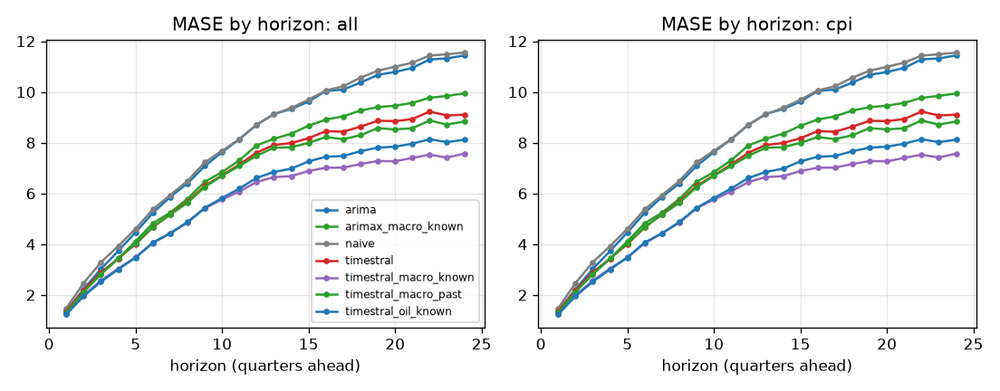

## Skill vs horizon
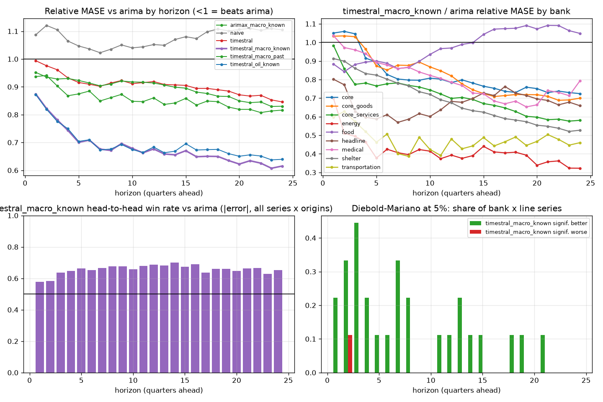

| h | arima | arimax_macro_known | naive | timestral | timestral_macro_known | timestral_macro_past | timestral_oil_known |
|---|---|---|---|---|---|---|---|
| 1 | 1.000 | 0.937 | 1.087 | 0.994 | 0.874 | 0.952 | 0.872 |
| 2 | 1.000 | 0.941 | 1.121 | 0.976 | 0.822 | 0.935 | 0.820 |
| 3 | 1.000 | 0.903 | 1.105 | 0.961 | 0.781 | 0.928 | 0.776 |
| 4 | 1.000 | 0.868 | 1.065 | 0.932 | 0.743 | 0.930 | 0.749 |
| 5 | 1.000 | 0.875 | 1.047 | 0.916 | 0.701 | 0.923 | 0.704 |
| 6 | 1.000 | 0.885 | 1.036 | 0.909 | 0.709 | 0.914 | 0.710 |
| 7 | 1.000 | 0.849 | 1.023 | 0.902 | 0.676 | 0.904 | 0.673 |
| 8 | 1.000 | 0.861 | 1.035 | 0.914 | 0.671 | 0.910 | 0.676 |
| 9 | 1.000 | 0.873 | 1.051 | 0.923 | 0.696 | 0.921 | 0.693 |
| 10 | 1.000 | 0.848 | 1.040 | 0.911 | 0.679 | 0.918 | 0.674 |
| 11 | 1.000 | 0.847 | 1.044 | 0.915 | 0.663 | 0.917 | 0.664 |
| 12 | 1.000 | 0.860 | 1.052 | 0.919 | 0.677 | 0.914 | 0.684 |
| 13 | 1.000 | 0.837 | 1.050 | 0.909 | 0.659 | 0.907 | 0.663 |
| 14 | 1.000 | 0.842 | 1.070 | 0.907 | 0.656 | 0.899 | 0.669 |
| 15 | 1.000 | 0.859 | 1.080 | 0.905 | 0.670 | 0.895 | 0.696 |
| 16 | 1.000 | 0.834 | 1.074 | 0.894 | 0.649 | 0.881 | 0.673 |
| 17 | 1.000 | 0.849 | 1.098 | 0.894 | 0.650 | 0.876 | 0.674 |
| 18 | 1.000 | 0.847 | 1.108 | 0.890 | 0.650 | 0.866 | 0.675 |
| 19 | 1.000 | 0.827 | 1.101 | 0.885 | 0.635 | 0.865 | 0.660 |
| 20 | 1.000 | 0.819 | 1.106 | 0.871 | 0.622 | 0.849 | 0.650 |
| 21 | 1.000 | 0.819 | 1.110 | 0.867 | 0.634 | 0.843 | 0.656 |
| 22 | 1.000 | 0.808 | 1.103 | 0.870 | 0.626 | 0.846 | 0.651 |
| 23 | 1.000 | 0.813 | 1.109 | 0.853 | 0.607 | 0.830 | 0.638 |
| 24 | 1.000 | 0.816 | 1.105 | 0.846 | 0.615 | 0.830 | 0.639 |

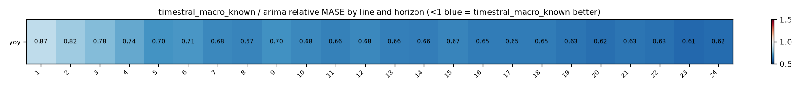

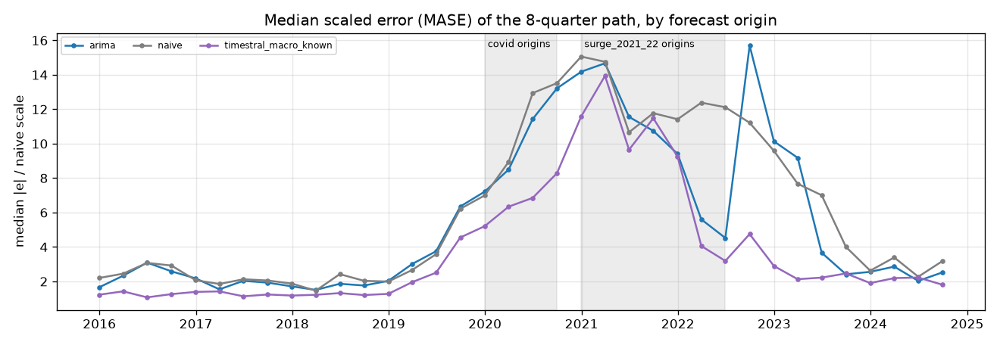

## Relative MASE vs baseline (geometric mean; <1 = better than baseline)
| model | rel_mase |
|---|---|
| timestral_macro_known | 0.659 |
| timestral_oil_known | 0.676 |
| arimax_macro_known | 0.845 |
| timestral_macro_past | 0.881 |
| timestral | 0.892 |
| arima | 1.000 |
| naive | 1.071 |

### By bank
| id | arima | arimax_macro_known | naive | timestral | timestral_macro_known | timestral_macro_past | timestral_oil_known |
|---|---|---|---|---|---|---|---|
| core | 1.000 | 0.936 | 0.918 | 0.789 | 0.777 | 0.807 | 0.781 |
| core_goods | 1.000 | 1.028 | 1.033 | 0.838 | 0.770 | 0.774 | 0.800 |
| core_services | 1.000 | 0.786 | 0.815 | 0.756 | 0.663 | 0.712 | 0.723 |
| energy | 1.000 | 0.530 | 1.375 | 1.073 | 0.396 | 1.134 | 0.377 |
| food | 1.000 | 0.917 | 1.186 | 0.978 | 1.005 | 0.986 | 0.954 |
| headline | 1.000 | 0.984 | 1.158 | 1.006 | 0.671 | 1.025 | 0.648 |
| medical | 1.000 | 0.989 | 0.984 | 0.759 | 0.773 | 0.750 | 0.772 |
| shelter | 1.000 | 0.824 | 0.923 | 0.823 | 0.617 | 0.745 | 0.805 |
| transportation | 1.000 | 0.743 | 1.396 | 1.086 | 0.465 | 1.121 | 0.448 |

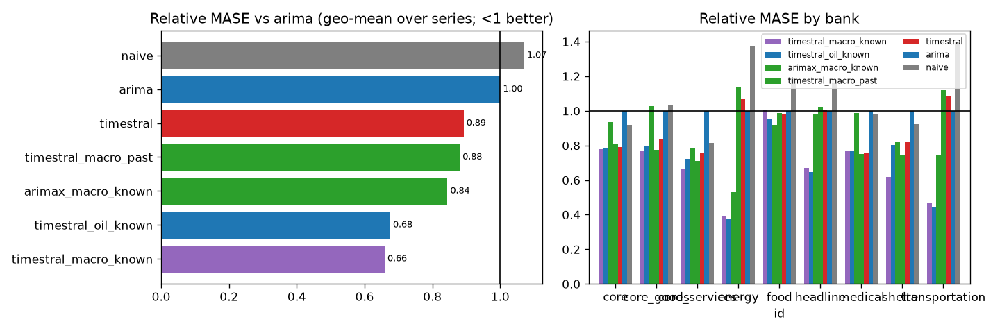

## Win rates (share of series where challenger beats baseline)
| id | MAE | MASE | RMSE | dir_acc | sMAPE |
|---|---|---|---|---|---|
| core | 100% | 100% | 100% | 100% | 100% |
| core_goods | 100% | 100% | 100% | 100% | 100% |
| core_services | 100% | 100% | 100% | 100% | 100% |
| energy | 100% | 100% | 100% | 100% | 100% |
| food | 0% | 0% | 0% | 0% | 0% |
| headline | 100% | 100% | 100% | 100% | 100% |
| medical | 100% | 100% | 100% | 100% | 100% |
| shelter | 100% | 100% | 100% | 100% | 100% |
| transportation | 100% | 100% | 100% | 100% | 100% |

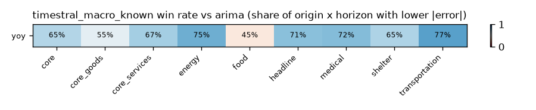

## Diebold-Mariano (squared error, HLN-corrected, per series and horizon)
Share of bank x target series where the challenger is significantly better / worse at 5%:

| h | better | worse |
|---|---|---|
| 1 | 22% | 0% |
| 2 | 33% | 11% |
| 3 | 44% | 0% |
| 4 | 22% | 0% |
| 5 | 11% | 0% |
| 6 | 11% | 0% |
| 7 | 33% | 0% |
| 8 | 22% | 0% |
| 9 | 0% | 0% |
| 10 | 0% | 0% |
| 11 | 11% | 0% |
| 12 | 11% | 0% |
| 13 | 22% | 0% |
| 14 | 11% | 0% |
| 15 | 11% | 0% |
| 16 | 0% | 0% |
| 17 | 0% | 0% |
| 18 | 11% | 0% |
| 19 | 11% | 0% |
| 20 | 0% | 0% |
| 21 | 11% | 0% |
| 22 | 0% | 0% |
| 23 | 0% | 0% |
| 24 | 0% | 0% |

## Stress slices (MASE)
| model | covid | normal | surge_2021_22 |
|---|---|---|---|
| arima | 13.007 | 5.359 | 13.791 |
| arimax_macro_known | 11.368 | 4.250 | 14.328 |
| naive | 13.194 | 5.177 | 14.950 |
| timestral | 12.650 | 3.915 | 13.139 |
| timestral_macro_known | 10.723 | 3.163 | 11.462 |
| timestral_macro_past | 12.893 | 3.643 | 13.179 |
| timestral_oil_known | 11.172 | 3.379 | 11.710 |

## Interval coverage (80%)
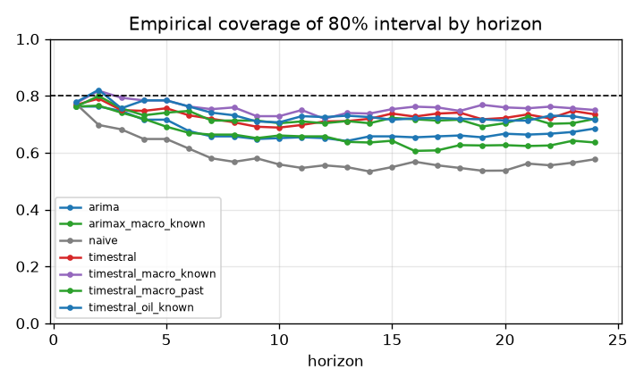

## Balance-sheet identity consistency
(none configured)

## Forecast fans

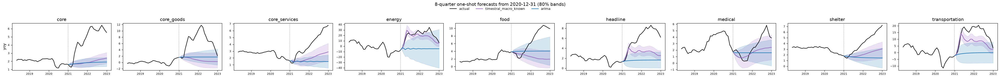
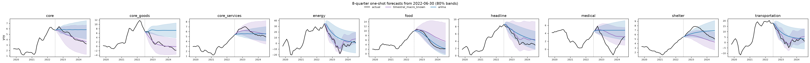
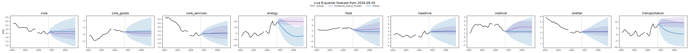

## Diebold-Mariano vs baseline, all models
Share of series significantly **better** than `arima` at 5% (squared error):

| h | arimax_macro_known | naive | timestral | timestral_macro_known | timestral_macro_past | timestral_oil_known |
|---|---|---|---|---|---|---|
| 1 | 11% | 0% | 0% | 22% | 0% | 22% |
| 2 | 0% | 0% | 11% | 33% | 11% | 33% |
| 3 | 11% | 0% | 22% | 44% | 22% | 44% |
| 4 | 22% | 0% | 11% | 22% | 11% | 22% |
| 5 | 0% | 0% | 0% | 11% | 0% | 0% |
| 6 | 11% | 0% | 0% | 11% | 0% | 0% |
| 7 | 11% | 0% | 0% | 33% | 11% | 22% |
| 8 | 22% | 0% | 0% | 22% | 0% | 22% |
| 9 | 22% | 0% | 11% | 0% | 0% | 0% |
| 10 | 22% | 0% | 0% | 0% | 0% | 11% |
| 11 | 22% | 11% | 0% | 11% | 0% | 11% |
| 12 | 22% | 0% | 0% | 11% | 0% | 11% |
| 13 | 0% | 11% | 0% | 22% | 0% | 22% |
| 14 | 0% | 0% | 0% | 11% | 0% | 11% |
| 15 | 0% | 0% | 0% | 11% | 0% | 0% |
| 16 | 0% | 11% | 0% | 0% | 0% | 0% |
| 17 | 11% | 0% | 0% | 0% | 0% | 0% |
| 18 | 0% | 0% | 11% | 11% | 11% | 11% |
| 19 | 0% | 0% | 11% | 11% | 0% | 11% |
| 20 | 11% | 33% | 0% | 0% | 11% | 0% |
| 21 | 11% | 0% | 11% | 11% | 22% | 11% |
| 22 | 0% | 11% | 0% | 0% | 0% | 0% |
| 23 | 0% | 0% | 0% | 0% | 0% | 0% |
| 24 | 0% | 0% | 0% | 0% | 0% | 0% |

Share significantly **worse**:

| h | arimax_macro_known | naive | timestral | timestral_macro_known | timestral_macro_past | timestral_oil_known |
|---|---|---|---|---|---|---|
| 1 | 0% | 0% | 0% | 0% | 0% | 0% |
| 2 | 0% | 0% | 0% | 11% | 0% | 0% |
| 3 | 11% | 11% | 0% | 0% | 0% | 0% |
| 4 | 11% | 11% | 0% | 0% | 0% | 0% |
| 5 | 0% | 0% | 0% | 0% | 11% | 0% |
| 6 | 0% | 22% | 0% | 0% | 0% | 0% |
| 7 | 0% | 11% | 0% | 0% | 0% | 0% |
| 8 | 22% | 0% | 0% | 0% | 0% | 0% |
| 9 | 0% | 11% | 0% | 0% | 11% | 0% |
| 10 | 0% | 11% | 0% | 0% | 0% | 0% |
| 11 | 0% | 0% | 11% | 0% | 0% | 0% |
| 12 | 0% | 0% | 11% | 0% | 0% | 0% |
| 13 | 0% | 0% | 11% | 0% | 0% | 0% |
| 14 | 0% | 33% | 0% | 0% | 0% | 0% |
| 15 | 0% | 33% | 11% | 0% | 11% | 0% |
| 16 | 11% | 11% | 0% | 0% | 11% | 0% |
| 17 | 0% | 0% | 0% | 0% | 11% | 0% |
| 18 | 0% | 0% | 0% | 0% | 11% | 0% |
| 19 | 0% | 0% | 0% | 0% | 11% | 0% |
| 20 | 0% | 0% | 0% | 0% | 0% | 0% |
| 21 | 0% | 0% | 0% | 0% | 0% | 0% |
| 22 | 0% | 0% | 0% | 0% | 0% | 0% |
| 23 | 0% | 0% | 0% | 0% | 0% | 0% |
| 24 | 0% | 0% | 0% | 0% | 0% | 0% |

## 80% interval coverage by line
| model | yoy |
|---|---|
| arima | 0.677 |
| arimax_macro_known | 0.660 |
| naive | 0.587 |
| timestral | 0.729 |
| timestral_macro_known | 0.759 |
| timestral_macro_past | 0.722 |
| timestral_oil_known | 0.737 |

## Relative MASE vs `arima` by line
| target | arima | arimax_macro_known | naive | timestral | timestral_macro_known | timestral_macro_past | timestral_oil_known |
|---|---|---|---|---|---|---|---|
| yoy | 1.000 | 0.845 | 1.071 | 0.892 | 0.659 | 0.881 | 0.676 |

### yoy: relative MASE by horizon
| h | arima | arimax_macro_known | naive | timestral | timestral_macro_known | timestral_macro_past | timestral_oil_known |
|---|---|---|---|---|---|---|---|
| 1 | 1.000 | 0.937 | 1.087 | 0.994 | 0.874 | 0.952 | 0.872 |
| 2 | 1.000 | 0.941 | 1.121 | 0.976 | 0.822 | 0.935 | 0.820 |
| 3 | 1.000 | 0.903 | 1.105 | 0.961 | 0.781 | 0.928 | 0.776 |
| 4 | 1.000 | 0.868 | 1.065 | 0.932 | 0.743 | 0.930 | 0.749 |
| 5 | 1.000 | 0.875 | 1.047 | 0.916 | 0.701 | 0.923 | 0.704 |
| 6 | 1.000 | 0.885 | 1.036 | 0.909 | 0.709 | 0.914 | 0.710 |
| 7 | 1.000 | 0.849 | 1.023 | 0.902 | 0.676 | 0.904 | 0.673 |
| 8 | 1.000 | 0.861 | 1.035 | 0.914 | 0.671 | 0.910 | 0.676 |
| 9 | 1.000 | 0.873 | 1.051 | 0.923 | 0.696 | 0.921 | 0.693 |
| 10 | 1.000 | 0.848 | 1.040 | 0.911 | 0.679 | 0.918 | 0.674 |
| 11 | 1.000 | 0.847 | 1.044 | 0.915 | 0.663 | 0.917 | 0.664 |
| 12 | 1.000 | 0.860 | 1.052 | 0.919 | 0.677 | 0.914 | 0.684 |
| 13 | 1.000 | 0.837 | 1.050 | 0.909 | 0.659 | 0.907 | 0.663 |
| 14 | 1.000 | 0.842 | 1.070 | 0.907 | 0.656 | 0.899 | 0.669 |
| 15 | 1.000 | 0.859 | 1.080 | 0.905 | 0.670 | 0.895 | 0.696 |
| 16 | 1.000 | 0.834 | 1.074 | 0.894 | 0.649 | 0.881 | 0.673 |
| 17 | 1.000 | 0.849 | 1.098 | 0.894 | 0.650 | 0.876 | 0.674 |
| 18 | 1.000 | 0.847 | 1.108 | 0.890 | 0.650 | 0.866 | 0.675 |
| 19 | 1.000 | 0.827 | 1.101 | 0.885 | 0.635 | 0.865 | 0.660 |
| 20 | 1.000 | 0.819 | 1.106 | 0.871 | 0.622 | 0.849 | 0.650 |
| 21 | 1.000 | 0.819 | 1.110 | 0.867 | 0.634 | 0.843 | 0.656 |
| 22 | 1.000 | 0.808 | 1.103 | 0.870 | 0.626 | 0.846 | 0.651 |
| 23 | 1.000 | 0.813 | 1.109 | 0.853 | 0.607 | 0.830 | 0.638 |
| 24 | 1.000 | 0.816 | 1.105 | 0.846 | 0.615 | 0.830 | 0.639 |

## How much does `timestral_macro_known` help vs `timestral`? (relative MASE, <1 = helps)
| target | rel_mase |
|---|---|
| yoy | 0.739 |

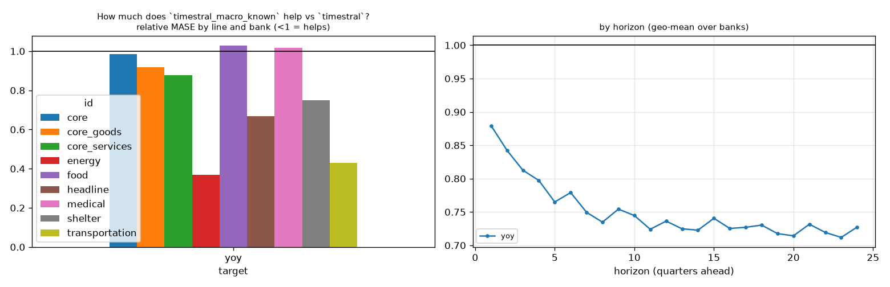

## How much does `timestral_oil_known` help vs `timestral`? (relative MASE, <1 = helps)
| target | rel_mase |
|---|---|
| yoy | 0.757 |

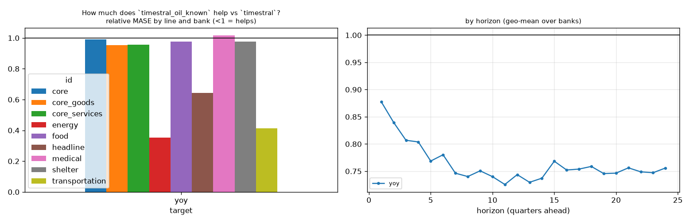

## How much does `timestral_macro_past` help vs `timestral`? (relative MASE, <1 = helps)
| target | rel_mase |
|---|---|
| yoy | 0.987 |

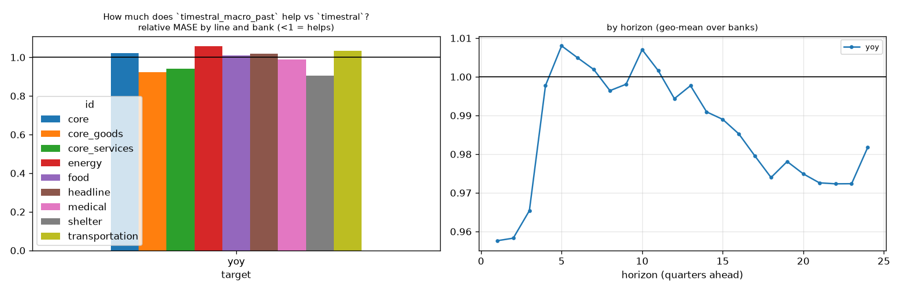

## How much does `timestral` help vs `arima`? (relative MASE, <1 = helps)
| target | rel_mase |
|---|---|
| yoy | 0.892 |

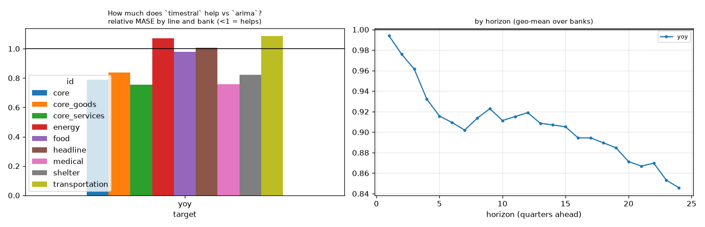

## How much does `arimax_macro_known` help vs `arima`? (relative MASE, <1 = helps)
| target | rel_mase |
|---|---|
| yoy | 0.845 |

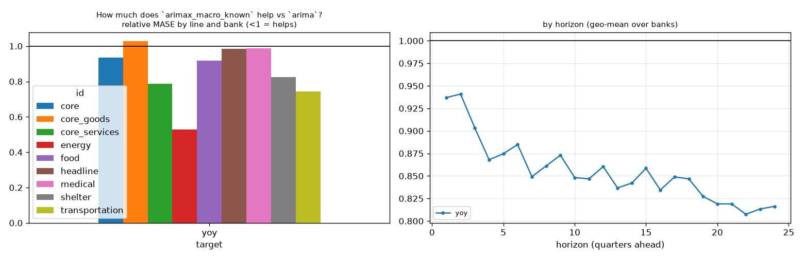

## Line x variant: relative MASE vs baseline
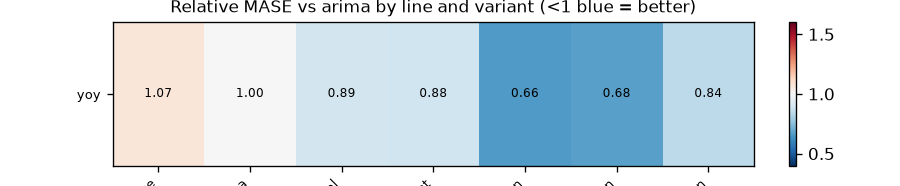

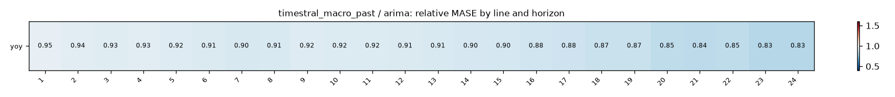
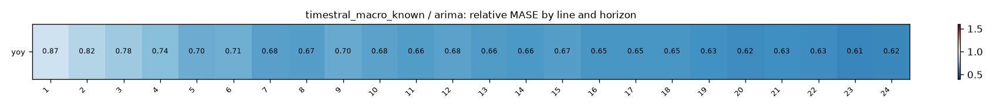
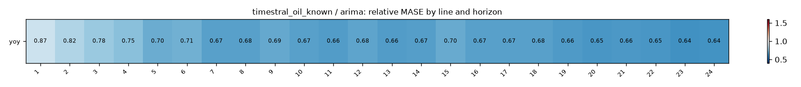

## Does macro help? (relative MASE of covariate variant vs its no-covariate twin; <1 = helps)
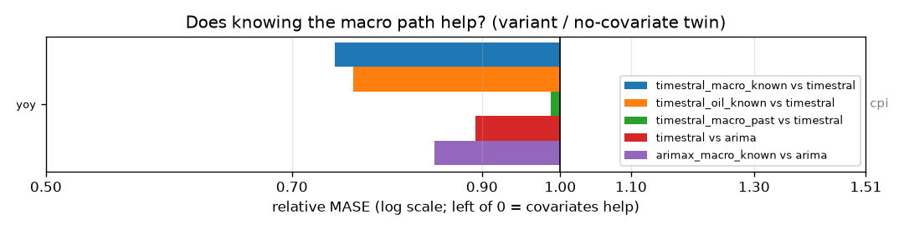

| target | timestral_macro_known vs timestral | timestral_oil_known vs timestral | timestral_macro_past vs timestral | timestral vs arima | arimax_macro_known vs arima |
|---|---|---|---|---|---|
| yoy | 0.739 | 0.757 | 0.987 | 0.892 | 0.845 |

## Spaghetti pages by group

- [cpi](figures/cpi/index.md) (1 lines)

## Relative MASE vs `arima` by series
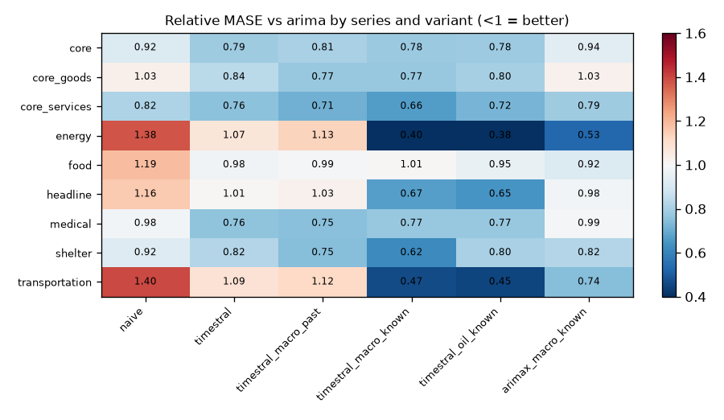

| id | naive | timestral | timestral_macro_past | timestral_macro_known | timestral_oil_known | arimax_macro_known |
|---|---|---|---|---|---|---|
| core | 0.918 | 0.789 | 0.807 | 0.777 | 0.781 | 0.936 |
| core_goods | 1.033 | 0.838 | 0.774 | 0.770 | 0.800 | 1.028 |
| core_services | 0.815 | 0.756 | 0.712 | 0.663 | 0.723 | 0.786 |
| energy | 1.375 | 1.073 | 1.134 | 0.396 | 0.377 | 0.530 |
| food | 1.186 | 0.978 | 0.986 | 1.005 | 0.954 | 0.917 |
| headline | 1.158 | 1.006 | 1.025 | 0.671 | 0.648 | 0.984 |
| medical | 0.984 | 0.759 | 0.750 | 0.773 | 0.772 | 0.989 |
| shelter | 0.923 | 0.823 | 0.745 | 0.617 | 0.805 | 0.824 |
| transportation | 1.396 | 1.086 | 1.121 | 0.465 | 0.448 | 0.743 |

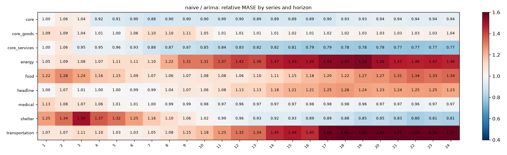
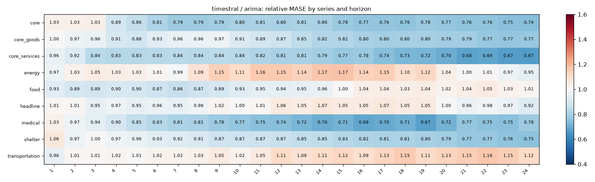
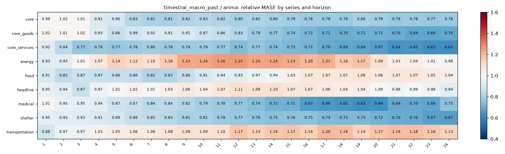
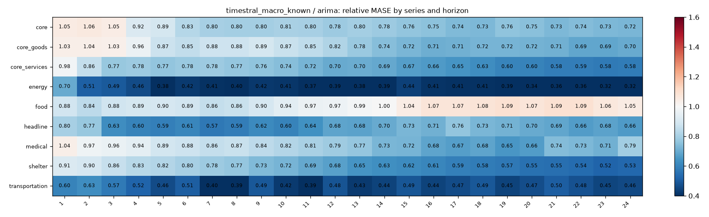
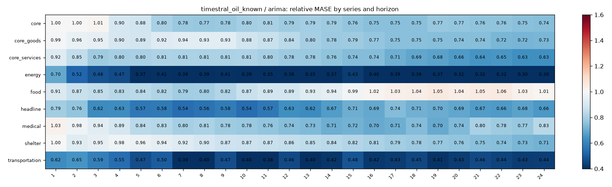
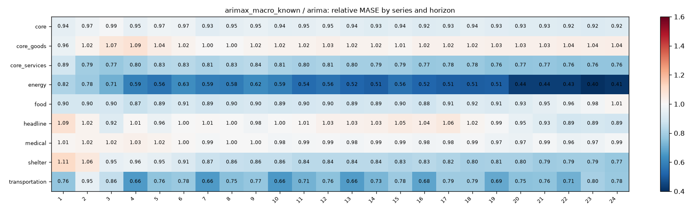
